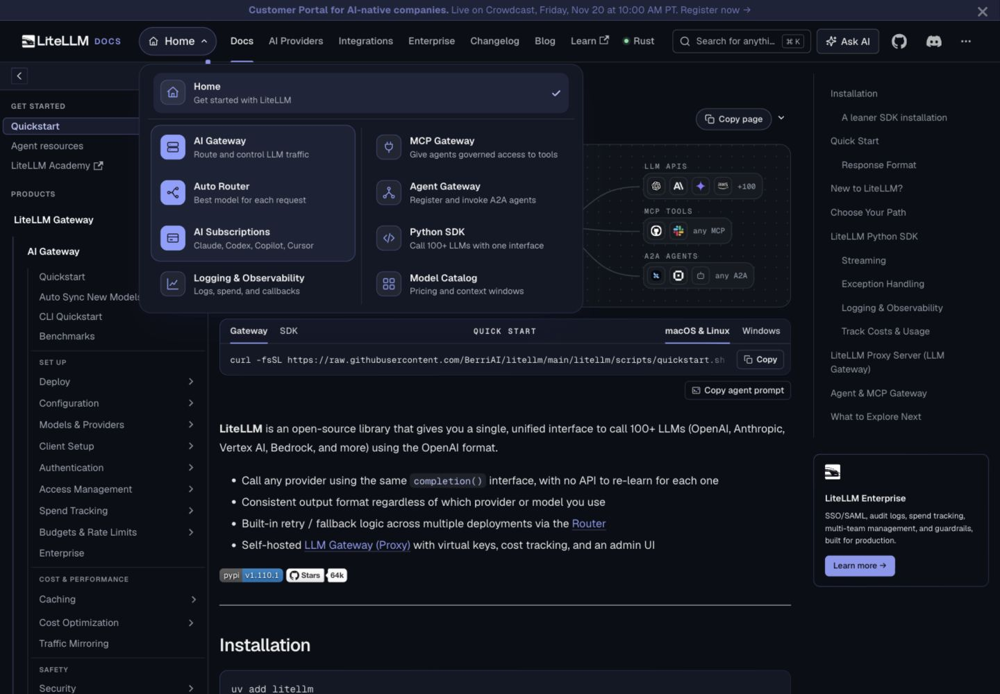
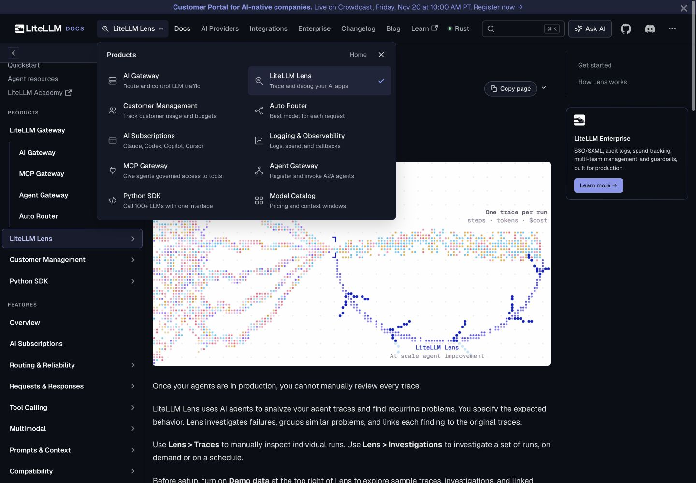
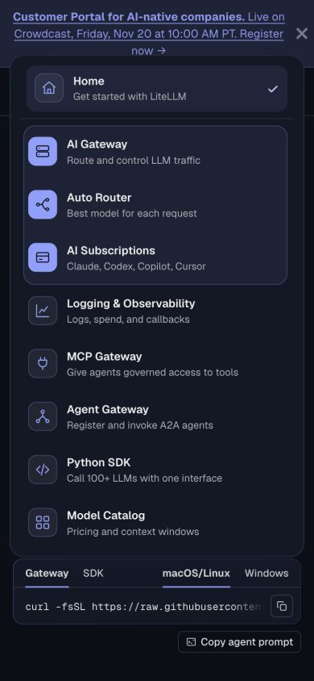
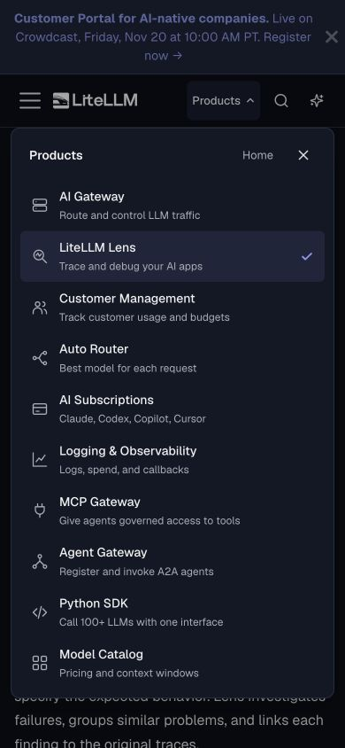

# Docs product navigation

The product picker now uses one link style. LiteLLM Lens is the second product and Customer Management is third. The docs sidebar also places Lens before Python SDK and makes Customer Management a top-level category. Duplicate customer links were removed so its breadcrumbs use the top-level category.

On phones, Products has a readable label and opens below its trigger. The popup has a close button, outside-click dismissal, Escape handling, and a scrollable list with a stationary header. The drawer closes when selecting the current product and supports Escape. The theme control lives in the drawer, leaving more room in the toolbar.

## Reproduce

1. Run `npm run build` and `npm run serve -- --port 3025`.
2. Open `http://localhost:3025/docs/` at 390 × 844 and select Products. Check the product order and close button. Close with the button, Escape, and a click outside, reopening between checks.
3. Open Customer Management. Open the navigation drawer, select Back to main menu, then select Customer Management again. The drawer should close even though the route stays the same.
4. Open the drawer and press Escape. Open its search dialog and press Escape. Only the search dialog should close; a second Escape closes the drawer.
5. Check 320 × 568 and 844 × 390. All products remain reachable by scrolling and the close button stays visible. The header and page do not overflow horizontally.
6. Check 1024 × 768 and 1440 × 1000 in light and dark themes. Tab through the product links and out of the popup. Resize across the desktop breakpoint while it is open. Both actions should dismiss it.
7. Visit `/docs/proxy/lens`, `/docs/proxy/customers`, and a customer subpage. Check the current product indicator and customer breadcrumbs.

## Validation

Verified against local production builds with Chromium viewport resizing. Production build, typecheck, and docs structure checks passed. The advisory Supported Endpoints test reports the same pre-existing `search/webiq` omission on base `f4e574dd` and this branch. No physical phone or mobile Safari run was performed.

## Screenshots

| Before | After |
| --- | --- |
|  |  |
|  |  |
