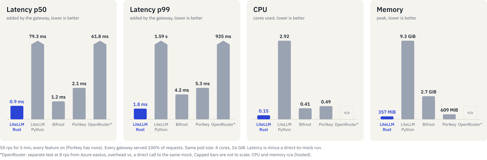
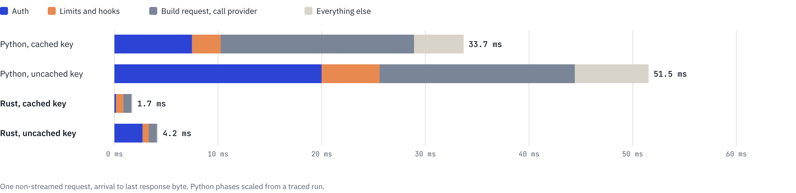
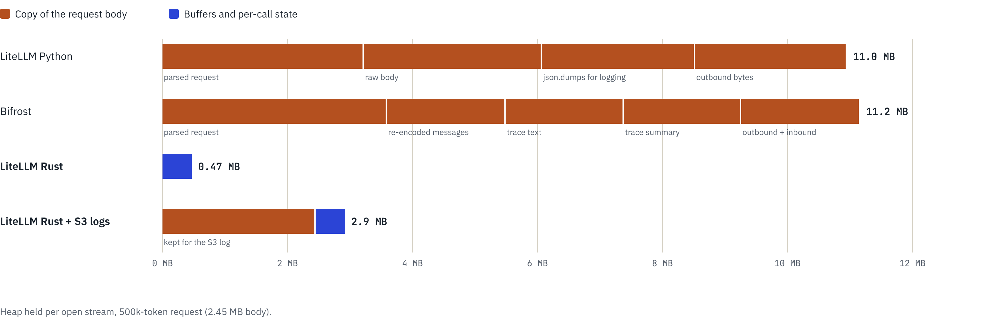

# Better Benchmarks

We mentioned last week that we would be posting updated, more representative benchmarks with common features enabled. The headline numbers are in, and they're great!

{/* truncate */}

Our previous benchmarks were with a much smaller subset of our functionality enabled, and they were not particularly representative of production workflows. We were very clear about this, as we just wanted to validate how much better Rust could do than Python as a language. In order to keep high performance as we build towards an end-to-end request handled in Rust in production, we have to be very mindful about choices made and the hot path of our requests.

With these benchmarks, we wanted to be sure that it represented realistic modern
LLM scale and gateway features. These benchmarks are useful for us internally to ensure that our gateway is performing well at the scale that it actually operates. The benchmark covers:

- Context can go up to 1M tokens, which means requests are ~4 MB
- Requests can sometimes take 6+ minutes to fully complete
- Gateways have many virtual keys with team, user, and deployment budget limits
- Budget tracking, spend logging, prometheus metrics, dumping logs
- Custom hooks for header logic, RPM/TPM limits on each deployment
- Many deployments across multiple model groups
- Retries and fallbacks enabled by the router

The rust implementation is a [branch](https://github.com/BerriAI/litellm/tree/litellm_customer_proxy) which we used in order to flesh out how we would handle some of our richer featureset, if we are able to rethink it with performance in mind. We expect comparable performance on the fast path which will be available on December 1st. Everything in this branch is compatible with a subset of LiteLLM's extensive featureset. It writes compatibly to the S3 log dumping and prometheus metrics, and writes to our spend logs in the same way as the Python implementation.

## Detailed Benchmarks

## What we did to achieve these benchmarks

Everyone will say that the first three things to do if you want to improve performance is to measure, measure, and measure again. Following that logic, we have the following waterfalls of a Python Hot vs Cold path timing. These are generated by profiling a request, then scaling it to the average duration of such a request.

We spend time doing virtual key lookup, auth checks, running pre-call hooks in parallel, and then a lot of time building the request for OpenAI. On the cold path, the same main areas are a pain point for performance.

- Router deployment cooldowns are kept as an in-memory cache and updated in the background
- Auth lookups are kept in an in-process cache, which can be shared in-memory more effectively in Rust than Python because the python workers are forked processes.
- Admission hooks run in parallel against Redis instead of serially due to a different callback model that is more explicit about what data gets read and written when
- on passthrough requests, we send the body upstream without reserializing when possible

Talk about how we don't even keep a single copy of request in memory unless we need it. Compare to python (maybe mention bifrost in a footnote).

## Benchmark Borders

We ran a few different benchmarks, but most of them run on the exact setup, except for the one that includes OpenRouter.
### General Benchmarks

- Where: Kubernetes on AWS, every pod on m7i.4xlarge nodes (one instance type, so all gateways get the same CPU). Buildkite pipeline `litellm-rust-perf`.
- Gateway pods: one replica per gateway, 4 dedicated cores and 16 GiB each (requests equal to limits). The mock upstream, an S3 stub, Postgres and the load generator run in their own pods in the same cluster.
- Versions:
  - LiteLLM Rust: built with fat LTO from commit `5990e10f` (the `litellm_customer_proxy` gateway plus the load-test kit).
  - LiteLLM Python: the proxy image from the same commit, 4 workers.
  - Bifrost: the published v2.3.0 image (`maximhq/bifrost@sha256:d9caa7c5…`).
  - Portkey: the published open-source gateway 1.15.2 (`portkeyai/gateway@sha256:552b5399…`), run as 4 Node.js processes with Node's cluster module, since one process uses about one core.
- Mock upstream: OpenAI chat completions, Anthropic messages and Bedrock invoke, each with a scripted time to first token and total time.
- Request mix, the same requests in the same order for every gateway:
  - half `/v1/chat/completions` and half `/v1/messages`, half of each streamed;
  - context 10k to 50k tokens (log-uniform);
  - time to first token 200 to 800 ms, total time 1 to 5 s.
- Routing: 20 model groups (10 chat, 10 messages) of 4 deployments each, 80 in total. Half of each messages group goes through Bedrock invoke (SigV4 signed). Router: simple-shuffle, 2 retries, 3 allowed fails, 30 s cooldown.
- Full features (LiteLLM Rust, LiteLLM Python, Bifrost):
  - each gateway has its own 1,000 virtual keys, 100 users and 10 teams;
  - every key, user, team and team member has rpm, tpm and a budget, set far above the test's load so nothing is refused;
  - every key has `max_parallel_requests`, and every deployment has rpm and tpm;
  - callbacks: `dynamic_rate_limiter_v3`, `prometheus` and `s3_v2` (into the S3 stub);
  - four request hooks that forward, add and strip headers and attach spend metadata (Python runs equivalent custom callbacks).
- Bifrost: each feature mapped onto Bifrost's own equivalent. It has no shared state across replicas. Its Bedrock calls reach the mock over TLS; the other gateways' do not.
- Portkey: no features, because its open-source gateway has no auth, keys, limits, budgets, logs or metrics. Routing comes from an `x-portkey-config` header per model group (load balance over the same 4 deployments, 2 retries), which Portkey validates on every request. Its Bedrock calls go to the mock over plain HTTP.
- Overhead: what the load generator observed minus the time the mock was told to take. First-byte overhead uses time to the first SSE event or first body byte.
- Validity: a run counts only if the load generator shed no requests and sent them within 10 ms of schedule (p99). Every run in builds 28 and 29 passed this.
- After each run, a checker compares each LiteLLM gateway's spend logs, key, team and user spend, daily tables, Prometheus counters, S3 logs and forwarded headers against what was sent.
- Single run of each configuration.

### What "full features" turns on

| Feature | LiteLLM Rust | LiteLLM Python | Bifrost | Portkey |
|---|---|---|---|---|
| Virtual keys (1,000 per gateway) | yes | yes | yes | no |
| Key, user, team and team member budgets | yes | yes | key, team, customer (users and members are enterprise-only) | no |
| rpm and tpm limits on keys, users, teams, members | yes | yes | key, team, customer | no |
| `max_parallel_requests` per key | yes | yes | no | no |
| rpm and tpm per deployment | yes | yes | yes (model configs) | no |
| Dynamic rate limiter (`dynamic_rate_limiter_v3`) | yes | yes | no | no |
| Spend logs, key, team and user spend, daily tables in Postgres | yes | yes | its own logs store and budgets | no |
| Prometheus metrics | yes | yes | yes (telemetry plugin) | no |
| S3 request logs | yes (`s3_v2`) | yes (`s3_v2`) | yes (logs store payloads) | no |
| Forward and strip request headers | yes (hooks) | yes (custom callbacks) | yes (`header_filter_config`) | no |
| Spend metadata from request headers | yes (hook) | yes (custom callback) | yes (`logging_headers`) | no |
| Add the key's team as an upstream header | yes (hook) | yes (custom callback) | no | no |
| Router: shuffle over 4 deployments, 2 retries | yes | yes | yes (no cooldown) | yes (load balance, 2 retries) |
| Router cooldown (3 allowed fails, 30 s) | yes | yes | no | no |

- TODO: add code to replicate to our benchmarks repo

### Benchmarking OpenRouter

Getting OpenRouter involved in the benchmarks involved a bit of a clunky process, because unless you have an enterprise account with the addon, you [cannot use custom endpoints](https://openrouter.ai/docs/guides/routing/private-endpoints), which is what we use to take the randomness of normal model serving out of the benchmarks. The amount of noise in large requests to a model like Opus will drown out performance differences unless you run a massive sample size. For that reason, we wanted to find a way around the custom endpoints.

It is not guaranteed that this method will last now that we have made it public, but there is a way to run a performance test against a mock upstream with OpenRouter by leveraging their lax validation of Azure deployments (`*.azure.com`). You can configure a BYOK key for azure in the legacy fomat and give it a host that is `<myprobe>.eastus.cloudapp.azure.com` and points to a mock provider that you run in azure cloud. Then, you need to load a little bit of OpenRouter usage credits so that the [low balance doesn't force it to higher coherency](https://openrouter.ai/docs/guides/best-practices/latency-and-performance#credit-balance-checks).

Once we have that, we can put all of our other providers in the `eastus` region on Azure, and run a benchmark from our runner, separately placed on eastus. Each of the providers reaches the mock upstream via the public internet. It compares four different test lanes:
- Direct to the mock provider over public internet
- LiteLLM Rust
- LiteLLM Python
- OpenRouter

Because this test is both more challenging to conduct and introduces potential interference from network topology, we used it to get a sense of OpenRouter's latency, but prefer the measurements from other tests.

For this test, we had the following setup:

- Each self-hosted gateway ran on the same D8s_v4 VM with 2 cores each
- 8 RPS with poisson arrivals over 20 minutes
- 50% of requests were streaming, and 500 token prompts
- LiteLLM and Bifrost were run with their full-featured configs
