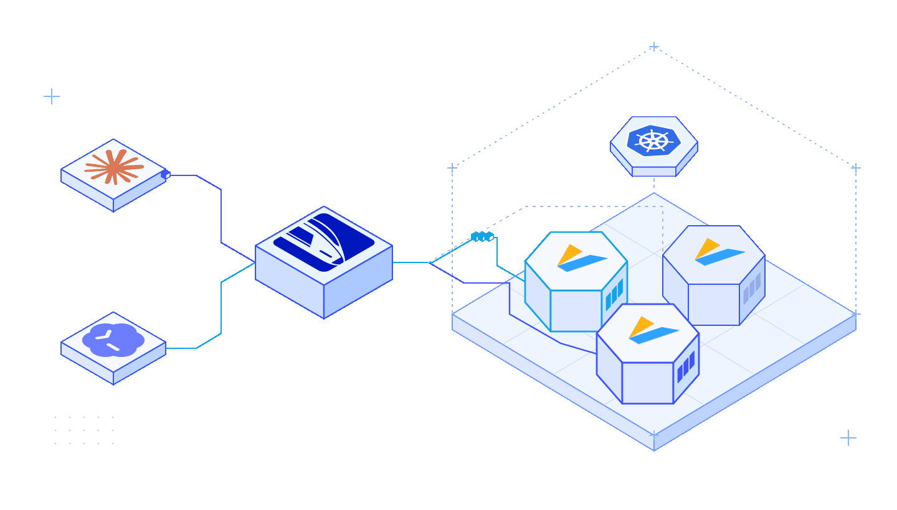

LiteLLM now supports **cache-aware routing for self-hosted inference on Kubernetes**. Within a deployment, requests from the same session go to the same GPU pod. This lets vLLM reuse cached prompt prefixes across turns.

Agent requests often share system instructions, tool definitions, and conversation history. When requests reach different pods, each pod may process the same prefix again. Session affinity helps reuse that work.

{/* truncate */}

## Keep a session on one GPU pod

LiteLLM discovers pod IPs through a Kubernetes headless Service. It uses the session ID to choose a pod using rendezvous hashing, then sends the request directly to that pod.

## Get started

[Read the cache-aware routing setup guide](https://docs.litellm.ai/docs/proxy/cache_aware_routing).
