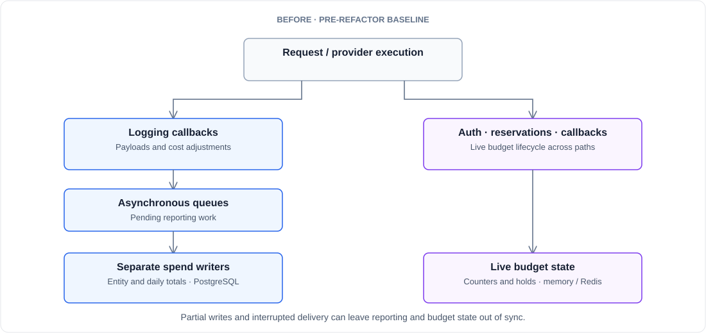
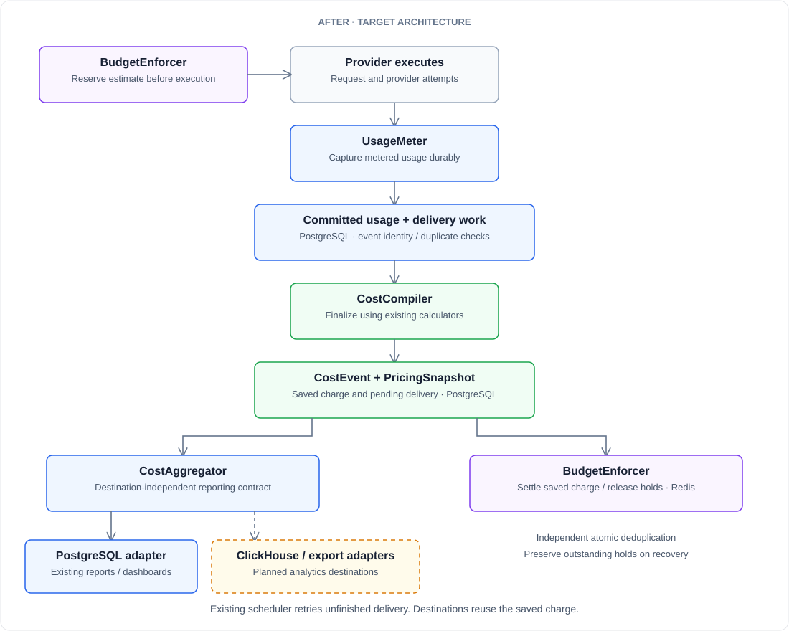

:::note Rough draft for review
This is a preview of work in progress. Architecture, rollout status and adapter availability remain subject to review.
:::

*Durable usage tracking, explainable charges, and analytics that fit your stack.*

You’ve told us where spend tracking falls short. Reports that disagree with exports. Usage that goes missing after an interrupted stream or a failed database write. Budget limits that block requests while the dashboard still shows room to spend. Charges that take too much work to reconcile.

We’ve heard these complaints repeatedly from customers using LiteLLM to manage their AI spend. We’ve fixed individual bugs along the way. Those experiences have also shaped a broader change to the accounting underneath LiteLLM.

We’re rebuilding that foundation around a simple idea: **record usage durably, finalize one charge, and use that same charge everywhere it belongs.**

The goal is accounting you can recover after a failure, explain when someone asks about a charge, and analyze in the infrastructure your team already uses.

{/* truncate */}

## Why the foundation needs to change

In the pre-refactor architecture, logging callbacks and asynchronous queues feed separate spend writers. Authentication checks, budget reservations and callbacks manage live budget state. Those paths can make progress independently. One write can succeed while another fails, leaving different views of the same activity out of sync.

For a finance team, that means reconciling conflicting totals. For an operator, it means investigating whether a budget block reflects actual spend or an outstanding reservation. For a developer, it means tracing a charge through several paths.

A shared, durable accounting record gives those paths a common basis for recovery and reconciliation.

*Before: the pre-refactor baseline. Reporting and live budget state have separate update paths.*

## One usage record. One finalized charge.

The new design separates four responsibilities inside the existing proxy.

**UsageMeter captures the activity.** It durably records usage, with identifiers that distinguish a caller’s request from each outbound provider attempt. Retrying delivery of an event must not create another copy of that event. A real provider retry remains a separate attempt, with its own usage to account for.

**CostCompiler finalizes the charge.** It wraps the existing cost calculator and saves a `CostEvent` with a typed `PricingSnapshot`. The snapshot records the pricing basis, rates, priced usage, multipliers and adjustments behind the total. Per-call overrides stay local to that call. Unknown pricing is explicitly marked unpriced.

**CostAggregator updates reporting.** It applies the saved event’s contributions through destination adapters. For the existing PostgreSQL reports, the contribution and its applied delivery state commit together. Retrying unfinished work must not add a completed contribution again.

**BudgetEnforcer owns reservations and settlement.** It reserves an estimate before execution, then settles against the saved charge and releases holds as appropriate. Redis settlement has its own atomic duplicate protection. A reporting receipt in PostgreSQL cannot, by itself, protect a Redis update.

*After: the target architecture. These are contracts and adapters within the proxy, not four new services. PostgreSQL and Redis remain in place. Dashed destinations are planned extensions.*

This builds on established accounting and distributed-systems patterns. We capture metered usage durably, save events alongside their pending delivery work, and make consumers safe to retry. The [transactional outbox pattern](https://docs.aws.amazon.com/prescriptive-guidance/latest/cloud-design-patterns/transactional-outbox.html) describes the same principle of committing data and delivery intent together. Idempotent consumers ensure that repeated delivery does not repeat the accounting effect.

The existing proxy scheduler retries unfinished delivery. Reporting and budget settlement reuse the saved charge rather than recalculating it independently.

## What this means for your team

**Accounting that can recover.** Once usage is committed, a restart does not erase it. Pending delivery remains available for recovery, and completed contributions are protected against duplicate application within the retained deduplication history.

**Numbers you can reconcile.** Reporting and live budget settlement start from the same finalized charge. After pending work and recovery finish, the same accepted activity, scope and time window should reconcile within existing numeric precision. Outstanding holds remain separate from settled charges.

**Charges you can explain.** The pricing snapshot preserves the inputs used at the time, so a later pricing change does not erase the explanation for an earlier charge. It also makes adjustments visible. Provider usage and pricing rules still need to be correct; a durable record makes them easier to inspect.

**Usage you can interpret.** Caller requests, provider attempts and charges have distinct records. A request that triggers a retry should not look like two customer requests, even when both provider attempts consume billable resources.

## Your accounting data, in your infrastructure

We’re designing `CostAggregator` to be agnostic to the enterprise’s analytics backend. The accounting contract describes what an event contributes. An adapter handles how that contribution reaches a particular destination.

That makes ClickHouse a natural planned destination for teams that already use it for analytics. The same finalized events could feed ClickHouse-backed dashboards or other export formats without requiring a second implementation of LiteLLM’s pricing logic.

Each adapter needs explicit delivery and duplicate-handling semantics. Adding a destination must preserve the accounting guarantees, including when data is replayed or rebuilt. Backend independence is an interface we can extend and verify, not a claim that every database is already supported.

The initial reporting path keeps the existing PostgreSQL tables and dashboard queries. This design does not require replacing the proxy’s PostgreSQL or Redis dependencies, or redesigning the dashboard.

## Recover the missing update, not another charge

Consider a request whose usage and charge have been saved. Budget settlement succeeds, but the reporting write fails before it commits.

Under the target design, reporting remains pending. The scheduler retries that delivery using the saved charge. When reporting commits, it also records that the contribution was applied. Budget settlement is not charged again.

That is a concrete recovery scenario we will verify before activation. The proof should show the same event, the failure point, the final reporting total, the settled budget and the time taken to recover. This draft does not yet claim measured results for that integrated flow.

## Rolling out carefully

As with the Rust migration, we’re taking this in stages. The contracts, storage foundation and early fixes described in the design are complete; capture, finalization, reporting, budget recovery and activation still need integrated verification.

Shadow comparisons come first, without changing production totals or settling charges twice. The initial activation targets fixed-rate, known-usage synchronous calls. Broader request types follow as their failure and recovery cases pass. Activation must reconcile existing spend and active holds, and rollback must drain or reconcile pending work.

There are clear boundaries. Default asynchronous capture still has a crash window before durable commit; optional synchronous capture waits under an explicit failure policy. Dashboards may temporarily lag. Streaming and deferred calls do not promise a final-cost response header. This work also does not guarantee that concurrent requests can never overshoot a budget.

The direction is clear: durable usage, one explainable charge, and reporting that fits your stack. We want your feedback on the reconciliation problems and analytics destinations that matter most to your team.
