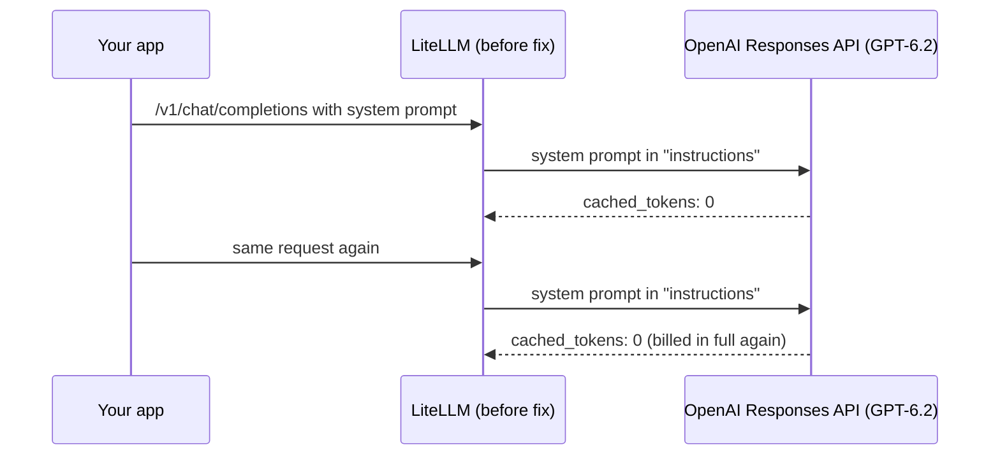

**Date:** November 18, 2026
**Duration:** ~12 hours from report to patched releases (Nov 18, 10:33 AM PT to 10:47 PM PT)
**Severity:** High (cost, no request failures)
**Status:** Resolved

## TLDR

- On November 17, OpenAI stopped caching the system prompt on GPT-6.2 when it arrives in the `instructions` field.
- LiteLLM puts the system prompt there when it sends `/v1/chat/completions` or `/v1/messages` traffic to OpenAI's Responses API. Those GPT-6.2 requests paid full price for the system prompt every time.
- Requests did not fail. The only sign was cached tokens dropping to 0 and higher input costs.

**What to do:** upgrade to the fixed version for your release line. No config changes are needed.

| Release line | Upgrade to |
|---|---|
| 1.111 RC | `v1.111.0-rc.2` or later |
| 1.110 stable | `v1.110.1` or later |
| 1.109 stable | `v1.109.2` or later |
| 1.108 LTS | `v1.108.12` or later |
| 1.106 stable | `v1.106.11` or later |

## Summary

On November 17, OpenAI changed GPT-6.2 (Sol and Astra) so that text sent in the Responses API `instructions` field is no longer prompt cached. When LiteLLM turns a Chat Completions or Anthropic Messages request into an OpenAI Responses request, it puts the system prompt in `instructions`. So after OpenAI's change, every one of those requests paid full price for the system prompt, even when the prompt was identical to the last request.

Requests kept succeeding and responses were correct. The only symptom was `cached_tokens` (or `cache_read_input_tokens` on `/v1/messages`) dropping to 0 and input costs going up.

- **`/v1/chat/completions` to GPT-6.2 through the Responses API** (the `openai/responses/` prefix, `chatgpt/`, Bedrock Mantle GPT-6.2): system prompt not cached.
- **`/v1/messages` to GPT-6.2** (Claude Code and other Anthropic-format clients): system prompt not cached.
- **`/v1/chat/completions` to GPT-6.2 on OpenAI's Chat Completions API, and `/v1/responses` calls:** no change from LiteLLM. LiteLLM passes these through as you sent them.
- **GPT-6.1 and earlier, and non-OpenAI providers:** no impact.

{/* truncate */}

---

## Background

The Responses API has two places a system prompt can go. It can go in the top-level `instructions` field, or as the first message in `input`. Up to GPT-6.1 both were prompt cached the same way, so LiteLLM used `instructions` because it has one important property for stored conversations. When you continue a conversation with `previous_response_id`, OpenAI does not carry the old `instructions` forward, but it does carry the old `input` forward. Putting the system prompt in `instructions` means it is sent once per turn instead of piling up in the stored history.

On GPT-6.2 that trade stopped being free. In a public reproduction, the same prompt sent twice to GPT-6.1 Sol read about 9.6k cached tokens on the second request. On GPT-6.2 Sol it read 0. Moving the same prompt to the first message in `input` brought caching back.



---

## Root cause

OpenAI changed what gets cached on GPT-6.2 and noted it in their changelog. The way LiteLLM sent system prompts was correct for every model before 6.2, and no request actually failed, so none of our error alerts went off.

We also have a bot that reads provider changelogs and tells us when something affects LiteLLM. It watched for new models, new parameters and deprecations, but it wasn't watching for caching changes, so it read the GPT-6.2 entry and moved on. We found out when a customer reported it on November 18.

---

## The fix

If a request says `store: false`, LiteLLM now sends the system prompt as the first message in the conversation instead of in `instructions`, and GPT-6.2 caches it again.

`store` tells OpenAI whether to save the conversation on their side. If they save it, your next turn can point back to it with `previous_response_id`, and OpenAI replays the saved messages for you. That replay includes the system prompt if it was sent as a message, but not if it was sent in `instructions`. So for saved conversations, moving the system prompt into the messages means each new turn carries the old copy plus the new one, and you pay for it twice. That's why the fix only applies to `store: false`.

So `store: false` requests get caching back. Requests that leave `store` unset or set it to `true` work exactly as before. Requests that use `previous_response_id` or `truncation: "auto"` also keep `instructions`.

Live results through the proxy, same long system prompt sent three times to `gpt-6.2-sol`:

| Route | Before (cached tokens, calls 1/2/3) | After (cached tokens, calls 1/2/3) |
|---|---|---|
| `/v1/chat/completions` | 0 / 0 / 0 | 0 / 3,333 / 3,333 |
| `/v1/messages` | 0 / 0 / 0 | 0 / ~4,240 / ~4,240 |

---

## Timeline (Pacific Time)

| Time | Event |
|---|---|
| Nov 17 | OpenAI changelog notes the GPT-6.2 `instructions` caching change |
| Nov 18, 10:33 AM | A customer reports uncached system prompts on GPT-6.2 through LiteLLM v1.110.0 |
| Nov 18, 1:12 PM | Fix merged to `main` ([PR #52599](https://github.com/BerriAI/litellm/pull/52599)) |
| Nov 18, 2:35 PM to 5:25 PM | Fix backported to 1.111 RC, 1.110, 1.109, LTS 1.108 and 1.106 |
| Nov 18, 6:38 PM | `v1.109.2` released |
| Nov 18, 7:27 PM | `/v1/messages` half of the fix merged for 1.106 and LTS 1.108, which have an older Messages adapter |
| Nov 18, 9:05 PM to 10:47 PM | `v1.110.1`, `v1.111.0-rc.2`, `v1.106.11` and `v1.108.12` released |

---

## Remediation

| # | Action | Status | Code |
|---|---|---|---|
| 1 | Send the system prompt as leading input for `store: false` requests on Chat Completions and Messages | Done | [PR #52599](https://github.com/BerriAI/litellm/pull/52599), [PR #52694](https://github.com/BerriAI/litellm/pull/52694) |
| 2 | Backport to 1.111 RC, 1.110, 1.109, LTS 1.108 and 1.106 | Done | [#52657](https://github.com/BerriAI/litellm/pull/52657), [#52658](https://github.com/BerriAI/litellm/pull/52658), [#52664](https://github.com/BerriAI/litellm/pull/52664), [#52707](https://github.com/BerriAI/litellm/pull/52707), [#52621](https://github.com/BerriAI/litellm/pull/52621), [#52739](https://github.com/BerriAI/litellm/pull/52739), [#52665](https://github.com/BerriAI/litellm/pull/52665), [#52698](https://github.com/BerriAI/litellm/pull/52698), [#52738](https://github.com/BerriAI/litellm/pull/52738) |
| 3 | Make `/v1/messages/count_tokens` place the system prompt the same way generation does, so token counts match billing | Done | Same PRs as above |
| 4 | Provider changelog monitor now flags changes to what is cache eligible, and was replayed against the GPT-6.2 entry to confirm it catches it | Done | Internal |
| 5 | Extend prompt cache alerting to warn when a deployment's cache hit rate drops to zero | Planned | |

---

## Resolution steps for users

Upgrade to the version for your release line from the [TLDR](#tldr) table, or any later version. No config changes are needed.

```bash
pip install --upgrade litellm
```

To confirm it is working, send the same request twice and check `usage.prompt_tokens_details.cached_tokens` on `/v1/chat/completions`, or `usage.cache_read_input_tokens` on `/v1/messages`. The second request should show a non-zero number.
