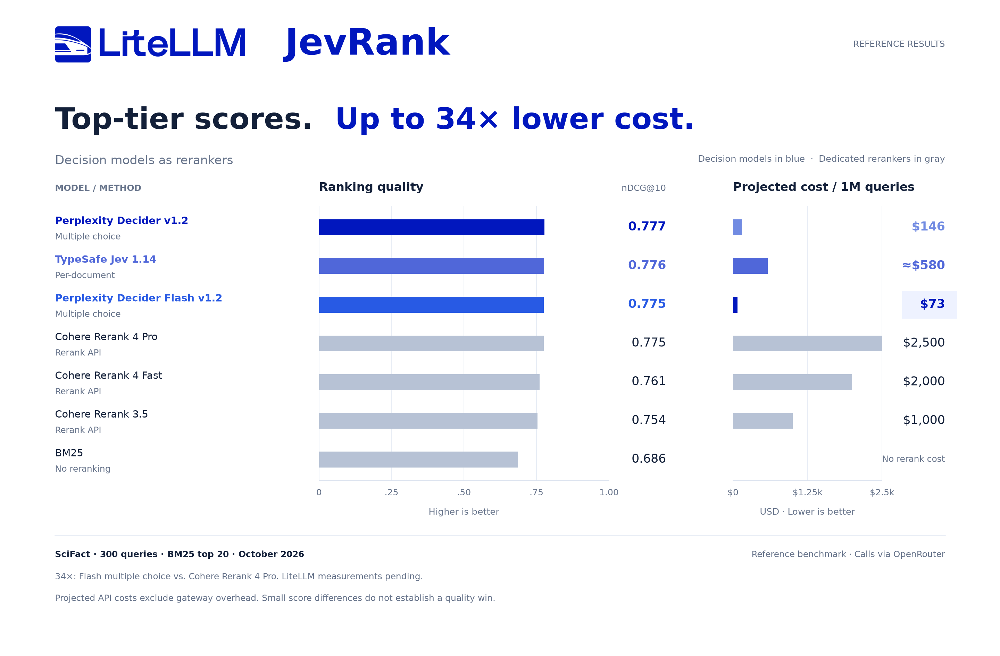
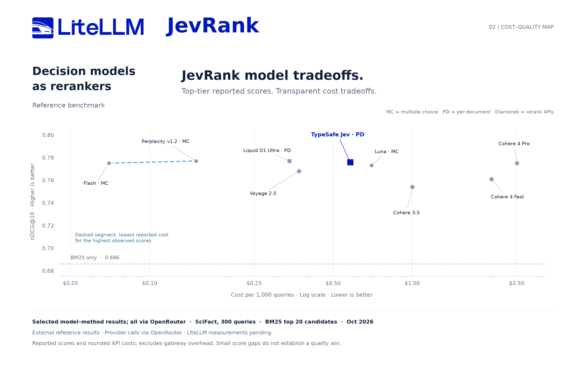

Introducing **JevRank**, a preview of decision models through LiteLLM’s `/rerank` API. In a SciFact reference benchmark, **Perplexity Decider Flash v1.2 and Cohere Rerank 4 Pro both scored 0.775 nDCG@10**. Their projected costs were **$73 versus $2,500 per million queries**, about **34× lower cost** for Flash.

We built an adapter for these scoring methods and ran **6,000 document decisions** with TypeSafe Jev through LiteLLM. You send a query and candidate documents to the existing rerank endpoint; the provider supplies the probabilities, and you get ranked document indexes and relevance scores.

{/* truncate */}



JevRank is in [a preview PR](https://github.com/BerriAI/litellm/pull/47782). The preview includes synchronous and asynchronous SDK calls and gateway configuration. We have not assigned a release version.

## Our 300-query run

We tested Jev 1.13 on the full BEIR SciFact test split. For each query, we retrieved 20 scientific abstracts with BM25, then reranked those same candidates. We improved **nDCG@10 from 0.686 to 0.768**, with an estimated cost of **$0.575 per 1,000 queries**.

All 300 queries completed. With eight document calls in flight per query, we measured **0.50 s median latency** and **1.15 s at p95**. Jev placed a relevant document first for 68% of queries, compared with [55% for BM25](/benchmarks/jevrank/independent-audit.json).

We saved the inputs and provider responses so you can [reproduce the evaluation](/benchmarks/jevrank/README.md), inspect individual queries or test a different model against the same candidates.

## Turn a relevance question into a score

After retrieval, you have a query and a short list of passages. A decision model accepts a question with a fixed set of answers and returns their probabilities. We use those probabilities to rank the passages.

JevRank supports two methods. With **per-document scoring**, we send the query and one passage, ask whether the passage contains information that answers, supports or contradicts the query, and use the probability of “yes” as its relevance score. Twenty passages require twenty provider calls. This is the method we tested with Jev.

With **multiple choice**, we send the query and all candidate passages in one request, then ask which passage is most relevant. Each passage gets the probability assigned to its option. Perplexity’s reference results use this method: one provider call for the full candidate set.

In both cases, we sort by score, preserve the original document indexes and return the usual rerank response. Your application can keep using `query`, `documents`, `top_n` and `return_documents`.

## Compare quality, cost and request shape

| Model and method | Origin | nDCG@10 | Cost per million queries |
| --- | --- | ---: | ---: |
| Perplexity Decider v1.2, multiple choice | Reference | 0.777 | $146 |
| Perplexity Decider Flash v1.2, multiple choice | Reference | 0.775 | $73 |
| TypeSafe Jev 1.14, per document | Reference | 0.776 | ≈$580 |
| Cohere Rerank 4 Pro | Reference | 0.775 | $2,500 |
| TypeSafe Jev 1.13, per document | LiteLLM run | 0.768 | ≈$575 estimated |
| BM25 without reranking | Local baseline | 0.686 | No rerank call |

Flash used one multiple-choice request for a query’s 20 candidates. Jev used a relevance judgment for each candidate. That difference affects request volume and the cost of repeating the query and instructions. Choose the method alongside the model when you evaluate a deployment.



### Methodology and cost

We ran Jev 1.13.0 through the local SDK at [commit 5aa0a8304c](https://github.com/BerriAI/litellm/commit/5aa0a8304c), using a gateway’s Decisions transport. We used BM25s 0.3.13, Lucene BM25 with k1=1.5 and b=0.75, English stop words and Snowball stemming over titles and full abstracts. Returned token usage at the configured rate of $0.042 per million input tokens and zero output charge gives an estimated **$0.172618 for the run**. The [manifest](/benchmarks/jevrank/measured-run.json) records the configuration; the [per-query data](/benchmarks/jevrank/measured-per-query.csv) and [saved responses](/benchmarks/jevrank/measured-responses.jsonl.gz) support an independent recalculation.

The other model rows come from an external October 2026 benchmark through OpenRouter. It used the same SciFact split and candidate count; we have not verified identical retrieval settings or candidates. We could not access Perplexity or Cohere for our run. The **34× comparison uses the reference’s Flash and Cohere Pro cost projections**, with both scores rounded to 0.775. The reference’s paired tests found no significant quality difference between Flash and Cohere Pro. Costs cover reranking and depend on rates and input length. Download the [chart data](./jevrank-comparison.csv) or the [reference cost projections](./projected-costs.csv).

## Configure the existing rerank endpoint

On the preview branch, add a decision model to your gateway configuration:

```yaml keep-model-ids
model_list:
  - model_name: jevrank-flash
    litellm_params:
      model: perplexity/pplx-decider-flash-v1.2
      api_key: os.environ/PERPLEXITY_API_KEY
      rerank_mode: decisions
      decision_rerank:
        strategy: multiple_choice
    model_info:
      mode: rerank
```

Start the proxy with that configuration and call `/rerank`:

```bash
curl "$LITELLM_BASE_URL/rerank" \
  -H "Authorization: Bearer $LITELLM_API_KEY" \
  -H "Content-Type: application/json" \
  -d '{
    "model": "jevrank-flash",
    "query": "How long is the warranty?",
    "documents": [
      "Shipping takes three days.",
      "Warranty coverage lasts two years."
    ],
    "top_n": 1,
    "return_documents": true
  }'
```

For TypeSafe Jev, use the guide’s `jevrank` preset with `strategy: pointwise` and a concurrency limit. Multiple choice accepts 2–255 documents in one call; its probabilities belong to that candidate set. The preview rejects oversized inputs instead of combining scores from separate batches. It returns errors for provider failures and refusals, and preserves available usage for accounting.

The [JevRank guide](/docs/decisions/rerank) covers both presets, Python examples and operational limits. Start with your application’s queries and fixed candidate sets. Compare ranking quality, cost and latency, then bring your results to the [preview PR](https://github.com/BerriAI/litellm/pull/47782).

{/* Publication gate: link the first supported release and keep measured/reference origins explicit. Keep draft: true until the launch is ready. */}
