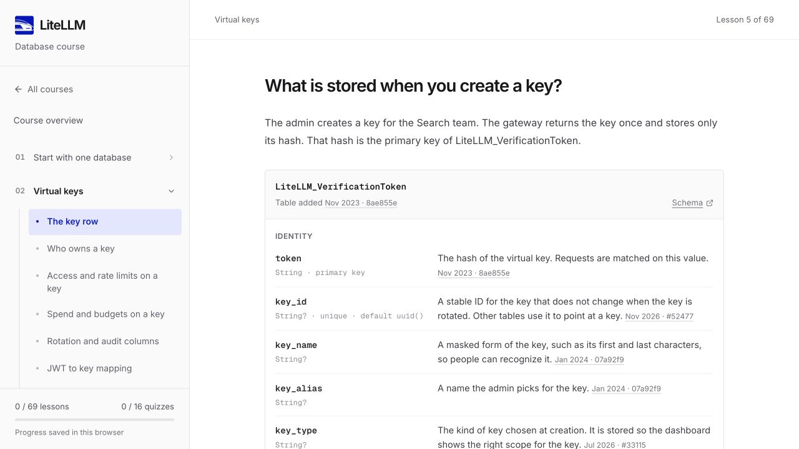

I built a [LiteLLM database course](https://www.litellm.ai/course) to understand how our schema got here. It walks through every table and column, what each one does, and the pull requests or commits that explain why it was added.

The course is free and open in your browser. Choose **Database course** in LiteLLM Academy to start. You do not need an account, API key, or running gateway.

{/* truncate */}

## Follow a team, a key, and two cents

The course starts with a platform admin who creates a team called Search and gives it a key. The Search app sends a request that costs two cents. We follow that team, key, and cost through the database.

Why do gateway pods share a database? What does a key row contain? Where does its budget live? How does a request become a spend record, and why do dashboards read daily rollups? Each lesson connects the schema to a question you might encounter while building or operating the gateway.

There are **69 lessons across 16 chapters**. They cover keys, users, teams, budgets, request logs, spend writes, rollups, models, MCP servers, guardrails, managed resources, agents, routing state, customer hierarchies, Lens, and alerts. The reviewed schema contains **119 tables and 3 enums**, based on LiteLLM 1.112.0 as of November 19, 2026.

## Read why a column exists

A schema tells you that `spend` and `total_spend` are columns. The course explains the difference: `spend` resets each budget period, while `total_spend` preserves the lifetime total. It links back to the change that added the column so you can read the original context.

Table references include field types, defaults, relationships, and indexes. Lessons connect them to the source code and the PR descriptions or commit history behind the design. The course follows the schema from its first key table to the systems built on it today.

## Use it at your own pace

I made this for myself, but it should also help engineers joining LiteLLM and developers who want to understand what their gateway stores. Read it in order, or use the chapter outline to jump to the area you are working on.

Each chapter ends with a three-question quiz, explanations, and links back to the lessons. You can retry as often as you need. Complete the lessons and pass each quiz to create a completion certificate. Your answers and progress are saved in that browser; download the certificate if you want to keep a copy.

If you want to understand the request path first, the **Gateway course** is in the same library. It has 83 lessons across 15 chapters on routing, access, costs, tools, and operations.

[Open LiteLLM Academy](https://www.litellm.ai/course) and choose a course. You can also find it through **Learn** in the docs navigation or **LiteLLM Academy** in the docs sidebar.
