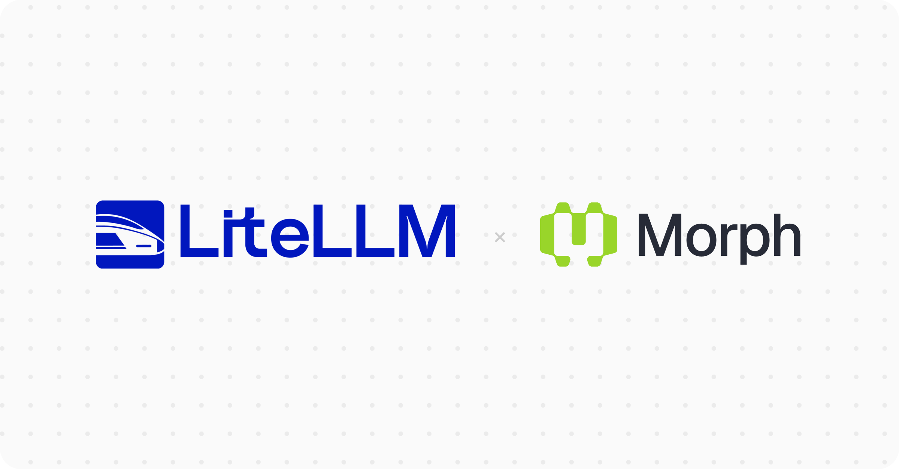

You can now use Morph's open-weight chat models through LiteLLM, alongside its existing Fast Apply models. Route requests to Kimi K3, GLM-5.3, or DeepSeek V4.1 Flash with the `morph/` prefix and a Morph API key.

{/* truncate */}

[Morph](https://www.morphllm.com/) serves these models on an inference stack optimized for code generation. The integration supports tool calling, structured output, reasoning controls, and streaming. Through the LiteLLM AI Gateway, you can manage model access, budgets, and request logs in the same place as your other providers.

## Get started

Set `MORPH_API_KEY` in the gateway's environment and add a model to `config.yaml`.

```yaml
model_list:
  - model_name: morph-deepseek
    litellm_params:
      model: morph/morph-dsv41flash
      api_key: os.environ/MORPH_API_KEY
```

Your application can then request `morph-deepseek` through the gateway's `/v1/chat/completions` endpoint. For installation and a complete request example, see the [Morph provider guide](/docs/providers/morph).

## Available models

Morph offers Kimi K3 and Kimi K3 Fast, GLM-5.3 and GLM-5.3-Flash, DeepSeek V4.1 Flash and its 1017 version, and DeepSeek V4 Flash 0731. Morph documents a 1M-token context window for these models.

DeepSeek V4.1 Flash Abliterated is also available to accounts with [Morph's approval](https://docs.morphllm.com/sdk/components/fast-models#deepseek-uncensored). The existing `morph-v3-fast` and `morph-v3-large` models remain available for applying code edits.

## Prompt caching

Morph caches repeated prompt prefixes automatically. LiteLLM reads the returned token usage and applies the model's cached-input rate. New prefixes cost the normal input rate, with no extra cache-write charge.

For conversations, reuse an `x-session-id` header across turns to improve cache hit rates. Keep stable prompts and tool definitions at the beginning of each request. The provider guide shows how to pass the header and read cached-token counts from streamed responses.

See [Morph's pricing](https://www.morphllm.com/pricing) for rates and the [provider guide](/docs/providers/morph) for cache accounting details.
