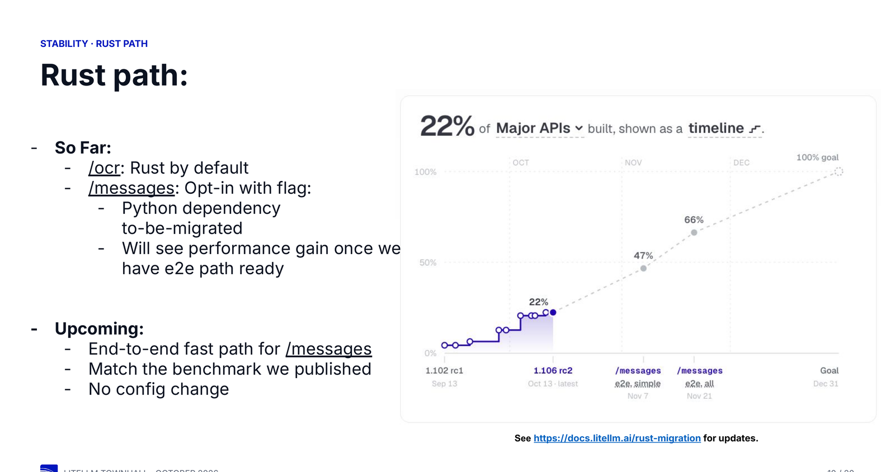
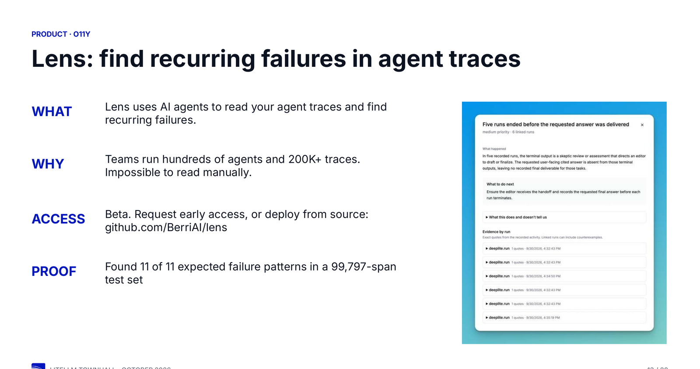
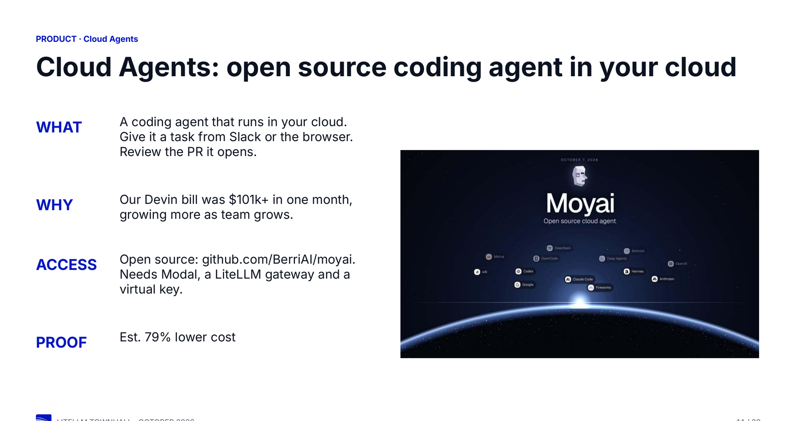
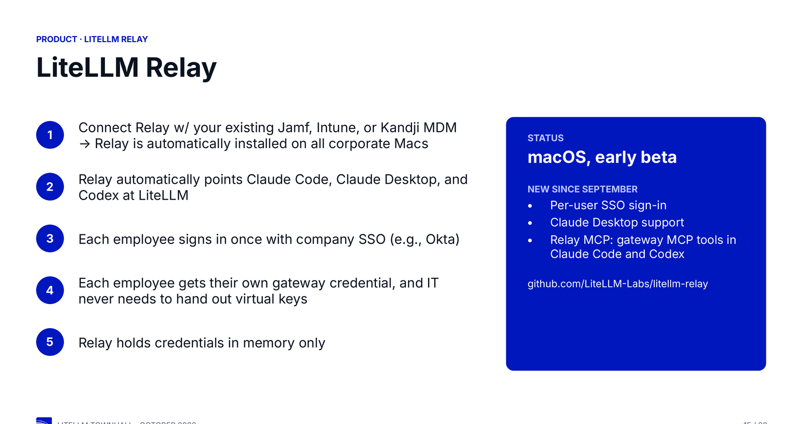

Thank you to everyone who joined our October town hall. We covered security, stability and performance work, and the product updates from the month.

{/* truncate */}

## Security

On October 21 our release pipeline published a compromised `litellm==1.107.0`. The [attack chain post](https://docs.litellm.ai/blog/security-incident-oct-21-2026-attack-chain) has the full record and what to do.

We shipped 65 security fixes in stable releases between September 24 and October 12, broken down by category:

| Category                      | Fixes |
| ----------------------------- | ----- |
| Credential / secret / PII     | 18    |
| General hardening             | 18    |
| Quota / budget / rate limits  | 15    |
| Access control / authz        | 14    |

**Three changes need action before you upgrade.**

| Change                                                                    | Version  |
| ------------------------------------------------------------------------- | -------- |
| The proxy does not start without a strong master key                      | v1.104.0 |
| STDIO MCP servers are off. `LITELLM_ENABLE_MCP_STDIO=true` turns them on  | v1.104.0 |
| `/sso/debug` is off. `ENABLE_SSO_DEBUG=true` turns it on                  | v1.105.0 |

- We are doubling the security team with a second dedicated headcount.
- The focus moves from reactive to proactive.
- We are formalising how we handle vulnerabilities, disclosures and customer security requests.

## Stability

In October we shipped **426 bug fixes**.

| Area                          | Fixes |
| ----------------------------- | ----- |
| Providers                     | 120   |
| Spend, budgets, observability | 94    |
| Proxy core                    | 82    |
| Streaming / realtime          | 40    |
| UI, auth, SSO                 | 40    |
| MCP gateway                   | 27    |
| Other / SDK                   | 23    |

Providers took the largest share, which is where a model release or an API change shows up first.

- **Coverage.** 83.5% in September, **88.4%** today.
- **User journeys.** Up from 521 to 7,048 covered, against a 600 target for October.
- **Every release** now runs 7,048 integration tests, 877 end to end tests and 3 performance benchmarks.
- **Roadmap.** Tracked in [issue #30484](https://github.com/BerriAI/litellm/issues/30484).

### Where the gateway got faster

| Metric                                   | Before  | After   |
| ---------------------------------------- | ------- | ------- |
| Time to first byte on 440K-token prompts | 553 ms  | 35 ms   |
| Redis round trips per request            | 22      | 8       |
| Usage page load with 5,000+ keys         | 6+ min  | 3.2 s   |

The `litellm-core` install is also 65.6 MB smaller.

### Rust path

OCR runs on Rust by default, and `/v1/messages` is opt-in behind a flag.

- `/v1/messages` still has a Python dependency to migrate, so the speed arrives with the end to end path.
- Progress is public at [docs.litellm.ai/rust-migration](https://docs.litellm.ai/rust-migration), currently at 22%.

## Product

### Decisions API

`/v1/decisions` asks a yes/no, multiple-choice or score question about an input and returns a probability for each answer.

- Keys, budgets, spend, fallbacks and guardrails all apply.
- Providers: OpenAI, Perplexity, TypeSafe Jev, OpenRouter, Cloudflare, vLLM, Azure AI, Strands Decider, Databricks, Fireworks AI, Laya, Bespoke and Nace.
- **JevRank** puts those models behind the rerank API, so you swap a rerank call without a change to your application. The [JevRank post](https://docs.litellm.ai/blog/jevrank) has the SciFact results.
- See the [decisions docs](https://docs.litellm.ai/docs/decisions) for setup.

### Auto Router

- Use any decision model as the classifier.
- Self-hosted OSS classifiers, Laya and Bespoke Nimble, arrive next release.
- Context compaction is on by default. Prompt-cache cost routing is opt-in.
- Tokens, cost and savings per router land next release.

### Lens

Lens uses AI agents to read your agent traces and find recurring failures. Teams run hundreds of agents and 200K or more traces, which nobody reads by hand.

- It found 11 of the 11 expected failure patterns in a 99,797-span test set.
- Beta. Request early access, or deploy from source at [github.com/BerriAI/lens](https://github.com/BerriAI/lens).

### Moyai

Moyai is an open source coding agent that runs in your cloud. Give it a task from Slack or the browser, then review the pull request it opens.

- Our own Devin bill passed $101k in one month, and it grew with the team.
- Moyai is an estimated 79% lower cost.
- It needs Modal, a LiteLLM gateway and a virtual key: [github.com/BerriAI/moyai](https://github.com/BerriAI/moyai).

### LiteLLM Relay

Relay connects to your existing Jamf, Intune or Kandji MDM and installs on every corporate Mac, then points Claude Code, Claude Desktop and Codex at LiteLLM.

- Each employee signs in once with company SSO and gets their own gateway credential, so IT never hands out virtual keys.
- Relay holds credentials in memory only.
- New since September: per-user SSO sign-in, Claude Desktop support, and Relay MCP for gateway MCP tools in Claude Code and Codex.
- macOS early beta at [github.com/LiteLLM-Labs/litellm-relay](https://github.com/LiteLLM-Labs/litellm-relay).

### Claude Code and Codex through the gateway

- In Claude Code, run `/login` and pick "Cloud gateway". In Codex, sign in with `lite codex`.
- Refresh tokens land next release and keep you signed in for 14 days. Before, users signed in every 24 hours.

### Handoff, our cloud agent workshop

Handoff runs remote from October 26 to November 9. Sign up at [handoff.litellm.ai](https://handoff.litellm.ai).

### Roadmap

- **Now.** Harden CI/CD and product security, complete the Rust migration by December 1, and reduce regressions.
- **Next one to two months.** Resolve more than a thousand open GitHub issues and improve the developer experience.
- **Next three to six months.** The core workflows for developers who build production agents on LiteLLM.

## We're hiring

We have open roles across the core gateway, and two new security roles. Reach us at [recruiting@berri.ai](mailto:recruiting@berri.ai), or [product@berri.ai](mailto:product@berri.ai) for product feedback.

Thank you for using LiteLLM. **The LiteLLM Team**
