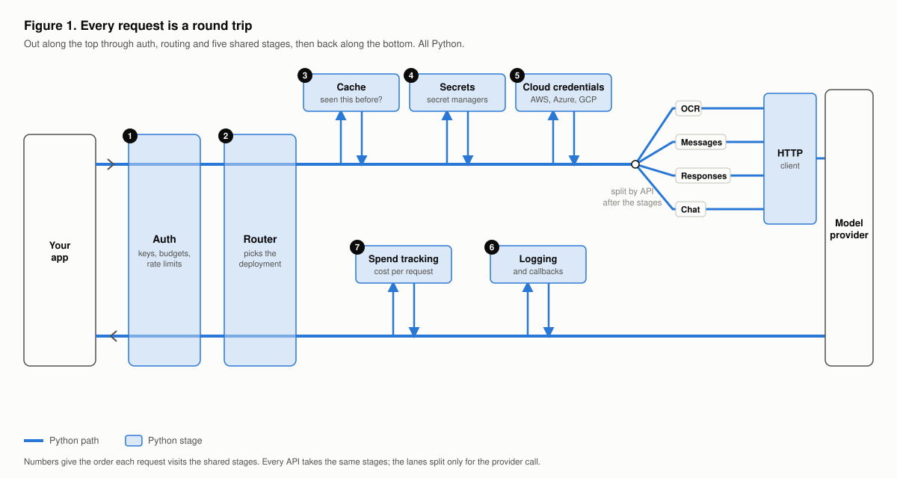
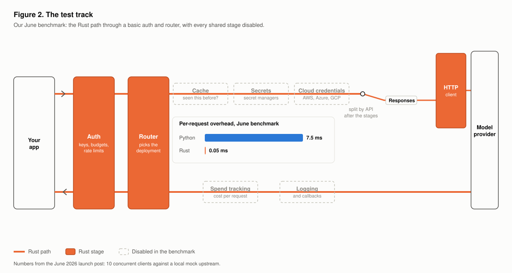
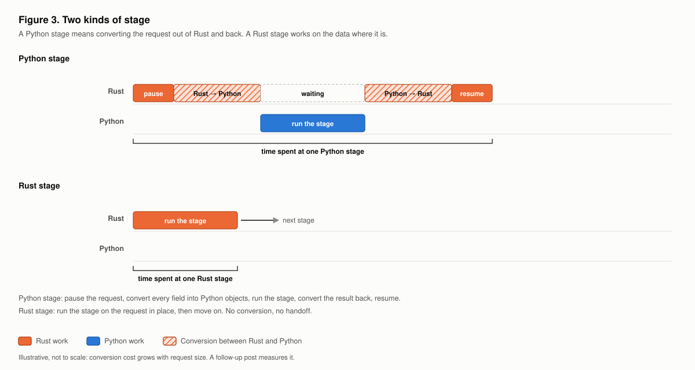
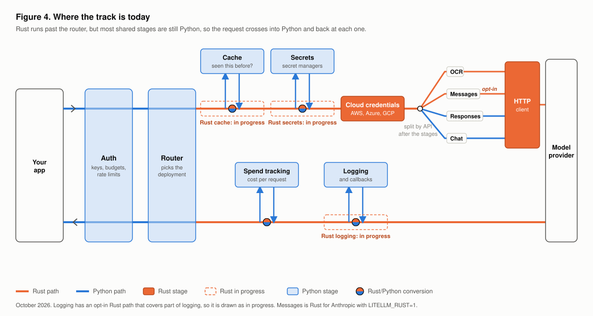
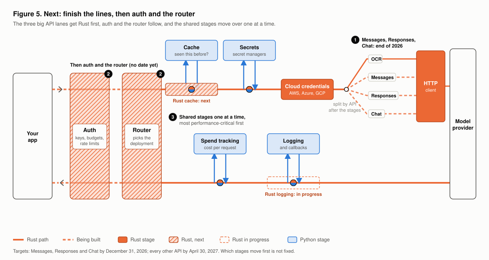
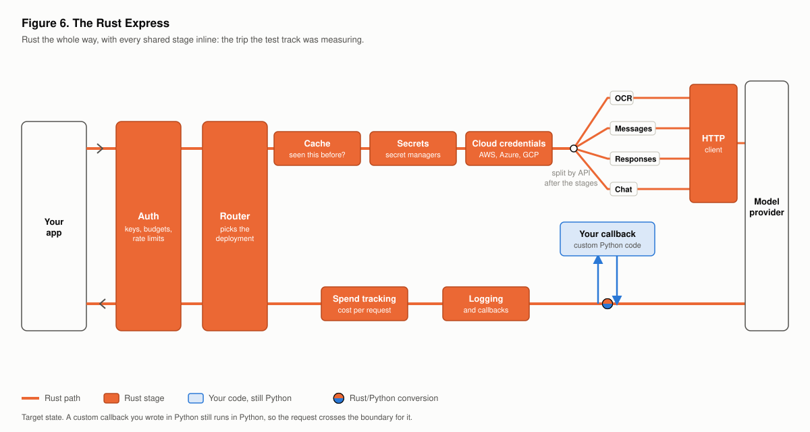

The question we hear most about the Rust migration is "when will LiteLLM get fast?" The honest answer is that it gets fast when a request can make its whole trip on Rust, stops included. Rust track on the main line alone isn't enough, and that is the part that took us longer than we said.

{/* truncate */}

## Every request is a round trip

The easiest way to see why is to follow one request. Think of LiteLLM as a little railway map.

The trip is a loop. On the way out, your request passes through the **gate**, where we check your key, budget and rate limits, and the **router**, which decides which deployment it's headed for and tags the wagon with its API (OCR, Messages, Responses or Chat). Then it stops at the **cache** ("have we answered this before?"), the **vault** (to fetch the provider's API key from your secret manager) and **customs** (to sign the request with AWS, Azure or Google Cloud credentials). Only after those stations does the line split by API and run through the **HTTP tunnel** to the model provider.

The answer comes back around the bottom of the loop. It stops at the **post office**, where logs and your callbacks (Langfuse, Datadog, and so on) go out, and the **ledger**, where we record what it cost, then passes back through the router and the gate to your app. Every request makes every stop, whatever API it's for, so a fast line to the provider doesn't help much if the stations are slow.

Today almost all of that trip is a Python wagon on a dirt road.

## The test track

In June we published a benchmark showing a Rust gateway adding about **0.05 ms** per request, against about **7.5 ms** for the Python path. That number is real, and you can reproduce it.

But that benchmark ran on a test track: a basic gate and router, then a clear run to a mock provider, with every station closed. Our July benchmark said so plainly: no logging callbacks, no spend tracking, no persistence. That is the right way to measure the cost of the train itself. It is not the trip your production requests take.

## Two kinds of station

Laying Rust track isn't enough on its own, because of what happens when a Rust train reaches a Python station.

Python stations sit off the line, at the end of a little road. At a Python station the train has to stop. Every crate comes off the train and gets repacked into a box Python can handle, and a wagon hauls it up the dirt road to the station. Then it waits, comes back, gets repacked into crates and goes back on the train. That isn't just a cartoon: it's roughly what happens to your request's data each time Rust hands it to a Python service and takes it back.

A Rust station sits right on the track. The train rolls through it and the work happens on the cargo where it is, with no unloading.

## Where the track is today

Here is the map as of October 2026.

- **OCR** runs on Rust track, and it is Rust only since `v1.104.0-rc.1`. You don't have to do anything.
- **Messages** has Rust track for Anthropic that you can switch on with `LITELLM_RUST=1`.
- **Responses** and **Chat completions** are still Python roads.
- **Customs** (cloud credentials for AWS, Azure and Google Cloud) and the **HTTP tunnel** are finished Rust.
- **Cache**, **vault** and the **post office** (logging and callbacks) have Rust versions being built. There is an opt-in Rust logger, but it only covers part of what logging does today, so we count the post office as Python. Until they open, a Rust train that needs them stops and unloads onto a wagon.
- The **gate**, **router** and **ledger** are Python.

OCR shows what this means in practice. On one CPU, the Rust path handled **1.5x to 1.7x** more OCR requests per second than Python. That is a solid gain, but it is not the 150x from the test track, because the express still stops at Python stations along the way. Fast on the track, slow at the stops.

## What we got wrong in June

In June we said Messages and Chat completions would be on Rust by September 1, and the router by September 15. We missed those dates.

The plan then was to lay Rust track only on the API lines after the split: Rust would translate requests and responses, and Python would keep running every station. Once we started, we found that even the smallest stretch of track needs the stations. One provider's translation for one route still needs the cache, the secret manager, logging and callbacks. So we went back and started rebuilding the stations first: cloud credentials and the HTTP client are done, and cache, secrets and logging are underway. That is slower to show up in a benchmark, but it is the work that makes real requests fast.

## Next: finish the lines, then the gate and router

Our target for the **end of 2026** is Rust track on the three big lines: **Messages, Responses and Chat completions**. Our target for **every other API** (embeddings, audio transcription, MCP and the rest) is **April 30, 2027**.

The gate and the router come next, so a request can stay on Rust from the moment it reaches LiteLLM. We haven't set a new date for them yet, and we would rather say that than give you another date we can't stand behind.

The stations move over gradually, and not all at once. Each callback or service gets a Rust version depending on how performance critical it is, so the busiest stops go first. Until a station has its Rust version, the train still stops and unloads there.

You can follow every line and station on the [migration tracker](/rust-migration), which updates with each release.

## The Rust Express

When every station is Rust, the whole trip runs at test-track speed, and that is the gateway the June benchmark was measuring. One thing stays Python on purpose: if you wrote your own callback in Python, the express still stops and unloads at your station, because it is your code.

## What you can do today

- **Use OCR.** It is already on Rust, with nothing to change.
- **Try Anthropic Messages on Rust** with `LITELLM_RUST=1`. Python stays as the fallback, and `LITELLM_RUST=0` turns it off.
- **Watch the [tracker](/rust-migration)** to see each line and station move from Python to Rust.

Nothing in your config changes along the way. We lay the track under you, and each route moves from Python, to opt-in, to Rust by default, to Rust only.
