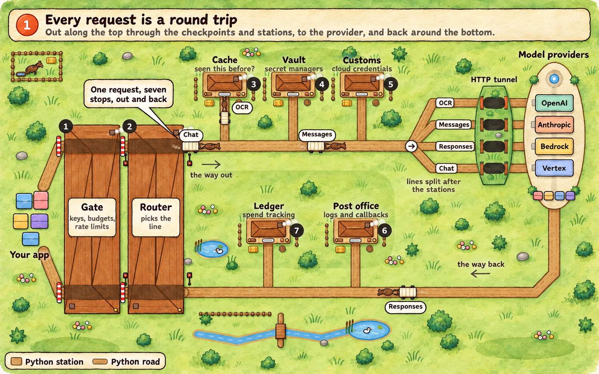
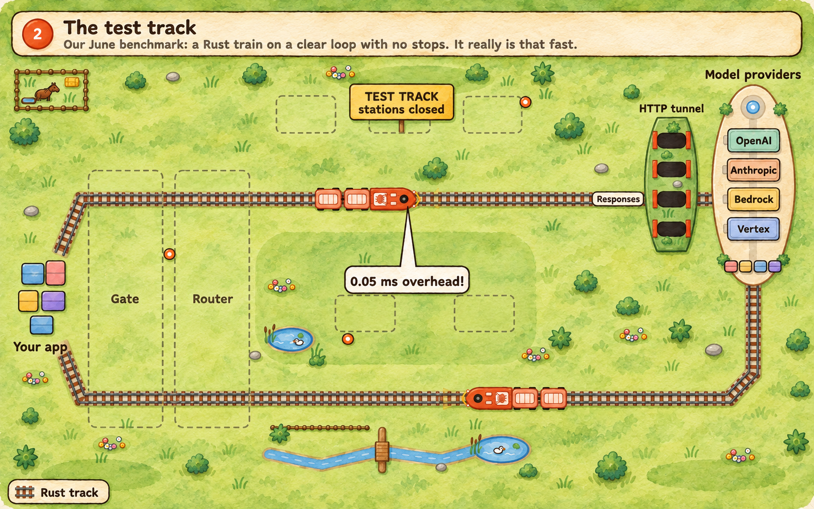
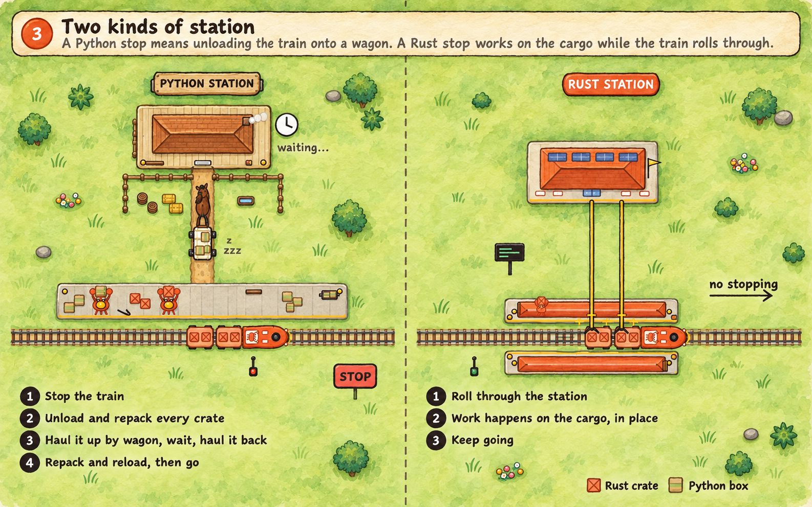
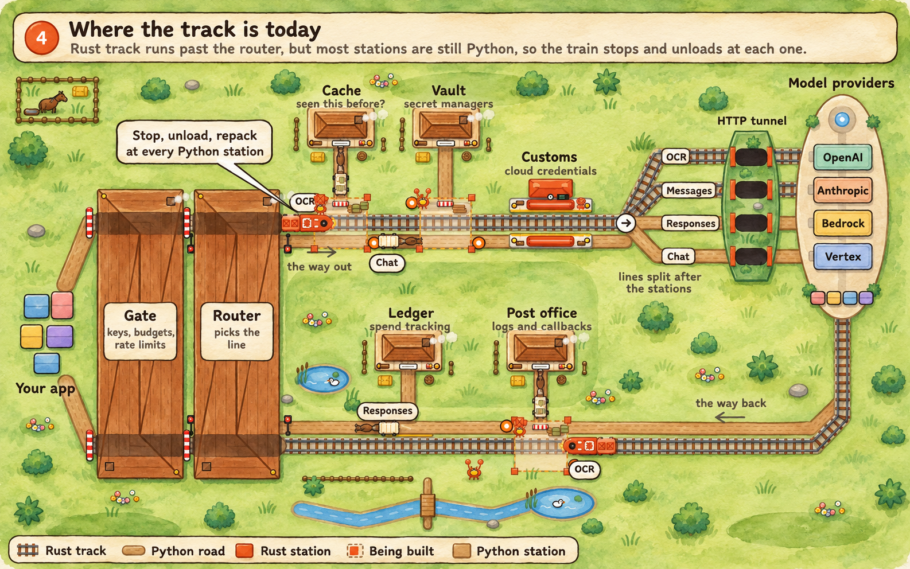
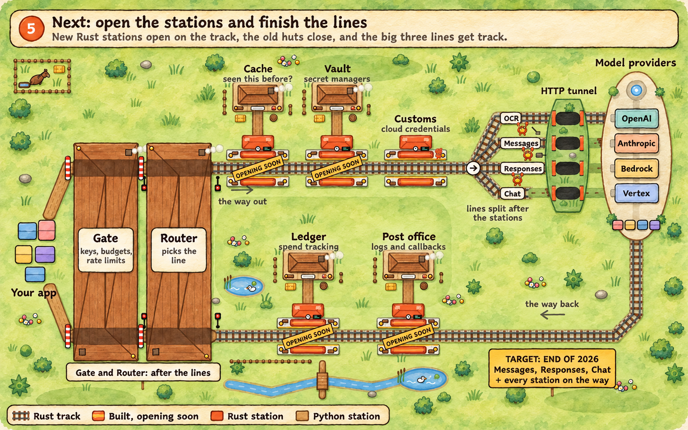
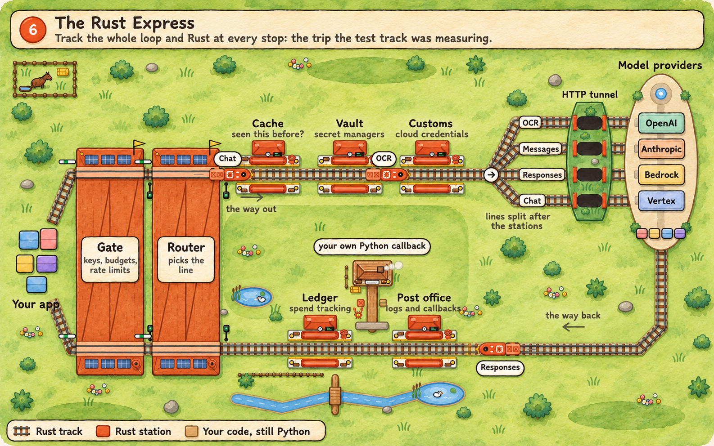

A very common question about the Rust migration is "when will it get fast?". Requests will gradually get faster as more and more of the trip stays within Rust, but there are other things that LiteLLM does than the main translation.

This article is targeted at a less-technical audience, and aims to provide some intuition on why and when it will start speeding up substantially.

{/* truncate */}

## Every request is a round trip

Think of LiteLLM as a little railway, and in order for us to handle a request for you like "How many 'R's are in strawberry?", that request needs to go all the way around the track.

The trip is a loop. On the way out, your request passes through the **gate**,
where we check your key, budget and rate limits, and the **router**, which
decides which deployment it's headed for and tags the wagon with its API
(Messages, Responses or Chat).

Then it stops at the **cache** ("have we answered this before?"), the **vault**
(to fetch the provider's API key from your secret manager) and **customs** (to
sign the request with AWS, Azure or Google Cloud credentials). Only after those
stations does the line split by API, handle the quirks for each given model
provider, and run through the **HTTP tunnel** to the model provider.

After that, the train is carrying the response, and that goes through the bottom
of the loop.  It stops at the **post office**, where logging callbacks go out,
and the **ledger**, where we record what it cost, then passes back through the
router and the gate to your app. Every request makes every stop, whatever API
it's for, so a fast line to the provider doesn't help much if the stations are
slow.

Today almost all of that trip is a Python wagon on a dirt road.

## The test track

In June we published a benchmark showing a Rust gateway adding about **0.05 ms**
per request, against about **7.5 ms** for the Python path.

But that benchmark ran on a test track, for both Rust and Python: a basic gate
and router, then a clear run to a provider, with every station closed. In particular, there are no logging callbacks, no spend tracking, and none of the flexible features that LiteLLM provides.

Even though that is the right way to measure the cost of the train itself, it is
not the trip your production requests take. In practice, you almost always want to know how much you are spending, how much you are using, and you _really_ don't want a developer accidentally sending credentials to a third party.

## Two kinds of station

Laying Rust track isn't enough on its own, because of what happens when a Rust train reaches a Python station.

Python stations sit off the line, at the end of a little road. At a Python
station the train has to stop. Every crate comes off the train and gets repacked
into a box Python can handle, and a wagon hauls it up the dirt road to the
station. Then it waits, comes back, gets repacked into crates and goes back on
the train. That is actually roughly what happens to your request's data each
time Rust hands it to a Python service and takes it back.

By comparsion, a Rust station sits right on the track. The train rolls through
it and the work happens on the cargo where it is, with no unloading. The rust
station is able to more easily do work in the background, even while the train
is accelerating towards the next stop.

## Where the track is today

Here is the map as of October 2026.

- **OCR** runs on Rust track, and it is Rust only since `v1.104.0-rc.1`. You don't have to do anything.
- **Messages** has Rust track for Anthropic that you can switch on with `LITELLM_RUST=1`.
- **Responses** has Rust track for OpenAI-compatible providers that you can switch on with `LITELLM_RUST=1`.
- **Chat completions** is still in Python.
- **Customs** (cloud credentials for AWS, Azure and Google Cloud) and the **HTTP tunnel** are finished Rust.
- **Cache**, **vault** and the **post office** (logging and callbacks) have Rust
versions being built. Until they are complete, a Rust train that needs them
stops and unloads onto a wagon.
- The **gate**, **router** and **ledger** are Python.

OCR is a live example of what this means for performance. On one CPU, the Rust
path handled around **1.6x** more OCR requests per second than Python. That is
certainly better, but it is not the massive gain from the test track, because
the express still stops at Python stations along the way. Fast on the track,
slow at the stops.

## Next: finish the lines, then the gate and router

Our target for the **end of 2026** is converting the most commonly used paths to Rust end-to-end, including all the stations that they need to stop at. This looks like support for `/v1/messages` (Anthropic), `/chat/completions` (old OpenAI), and `/v1/responses` (new OpenAI), the router, and gateway.

We will be gradually migrating stations and routes across. Until each has a Rust implementation, it will fall back to Python.

You can follow every line and station on the [migration tracker](/rust-migration), which updates with each release.

## The Rust Express

When everything is in Rust, the whole trip can run at test-track speed.  If you
wrote your own callback in Python, the express will still stop and unload at
your station. However, there will be ways to write callbacks that execute
_blazingly fast_, with details upcoming.

## What you can do today

- **Use OCR.** It is already on Rust, with nothing to change.
- **Try Anthropic Messages and Responses on Rust** with `LITELLM_RUST=1`. Python stays as the fallback, and `LITELLM_RUST=0` turns it off.
- **Watch the [tracker](/rust-migration)** to see each line and station move from Python to Rust.

Nothing in your config will need to change along the way. We will ensure
correctness before swapping anyone over, and each route moves from Python, to
opt-in, to Rust by default, to Rust only.
