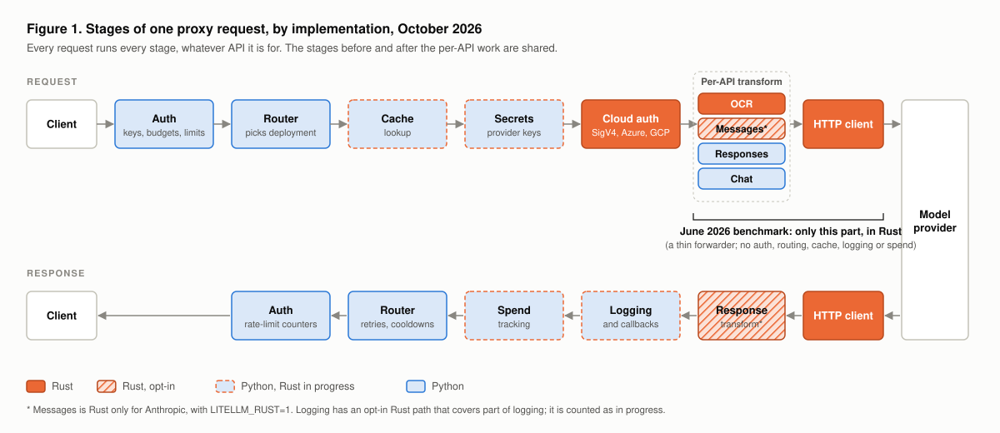
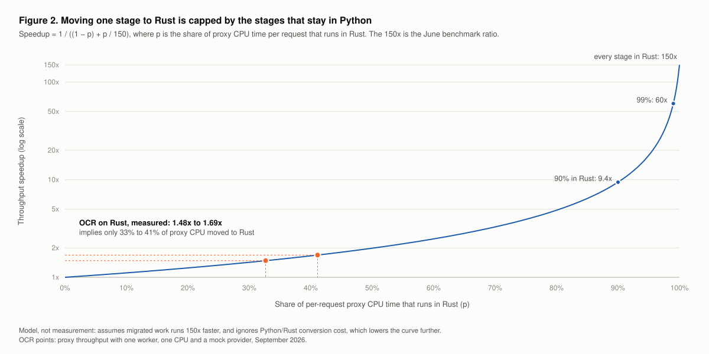
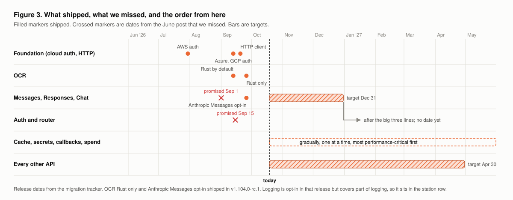

In June we published a benchmark showing that a Rust gateway adds about `0.05 ms` per request, compared with about `7.5 ms` for the Python path, which is roughly 150x less. In September, OCR became the first API to run on Rust by default, and its proxy throughput on one CPU went up by `1.48x` to `1.69x`.

Both numbers are correct. This post explains why they differ by two orders of magnitude, what runs in Rust as of October 2026, which dates from June we missed, and the order the rest of the migration will follow.

{/* truncate */}

## What the June benchmark measured

The [June harness](https://github.com/BerriAI/litellm-docs/tree/main/blog/litellm_rust_launch/benchmark) compares two things against the same mock upstream:

- **Rust side:** a thin axum server ([`main.rs`](https://github.com/BerriAI/litellm-docs/blob/main/blog/litellm_rust_launch/benchmark/main.rs)) that parses the JSON body, adds one field and forwards it with `reqwest`.
- **Python side:** a FastAPI app ([`llm_app.py`](https://github.com/BerriAI/litellm-docs/blob/main/blog/litellm_rust_launch/benchmark/llm_app.py)) that calls `litellm.acompletion` directly.

Neither side checks a virtual key, picks a deployment, reads a cache, fetches a secret, runs a callback or writes spend. The [July AIGatewayBench run](/blog/rust-ai-gateway-benchmarks) was closer to a real proxy, but it also ran with no logging callbacks, spend tracking or persistence, and said so.

These benchmarks measure the forwarding path in isolation, and they measure it well. The forwarding path is a small part of what a production proxy does per request.

## What a proxy request actually runs

A request to the LiteLLM proxy passes through the same shared stages whatever API it is for:

1. **On the way out:** auth (virtual key, budget, rate limits), the router (deployment selection), the cache lookup, the secret manager, and cloud credentials (SigV4, Azure AD, GCP).
2. **The per-API work:** transforming the request for the provider, and making the HTTP call.
3. **On the way back:** response transformation, logging and callbacks, spend tracking, and router and rate-limit bookkeeping.

The June benchmark covered step 2 and the response transform. Today, most of steps 1 and 3 run in Python.

## Why one Rust stage gives 1.6x, not 150x

Speeding up part of a request is capped by the part you didn't speed up. This is Amdahl's law. If a share `p` of per-request proxy CPU time moves to code that is 150x faster, the speedup is `1 / ((1 - p) + p / 150)`.

The measured OCR gains of `1.48x` and `1.69x` fit a proxy where about a third of the CPU time per request had moved to Rust. The rest, including auth, routing, logging and spend tracking, still ran in Python on every request. The curve stays below `2x` until about half the work is in Rust, and the large gains come only near the end: `9.4x` at 90% and the full 150x only at 100%.

The model is generous to us, because it ignores the cost of crossing between the two languages. Each time a Rust stage hands a request to a Python stage, the data has to be converted into Python objects and back. A follow-up post measures that cost.

## What we got wrong in June

In June we said Messages and Chat completions would run on Rust by September 1, and the router by September 15. We missed both dates.

The June plan was to move the per-API transforms first and leave every shared stage in Python. Once we started, we found that even one provider on one API depends on the shared stages: the cache, the secret managers, cloud credentials, logging and callbacks. A Rust transform that calls back into Python for each of those sits on the left side of Figure 2. So we started building the shared stages in Rust first. Cloud credentials and the HTTP client are done. Cache, secret managers, the router and auth exist as Rust crates in [`litellm-rust/crates`](https://github.com/BerriAI/litellm/tree/main/litellm-rust/crates), but they are not yet on the default request path.

## Where things stand, October 2026

| Stage | Status | How to use it |
|---|---|---|
| OCR (all providers) | Rust only since `v1.104.0-rc.1` (Rust by default since `v1.102.0-rc.1`) | Nothing to change |
| Anthropic Messages | Rust, opt-in since `v1.104.0-rc.1` | `LITELLM_RUST=1` |
| Other Messages providers, Responses, Chat completions | Python | |
| Cloud credentials (AWS, Azure, GCP) | Rust | Nothing to change |
| HTTP client | Rust since `v1.103.0-rc.1` | Nothing to change |
| Logging | An opt-in Rust path that covers part of logging; counted as in progress | |
| Cache, secret managers, callbacks, spend tracking | Python, Rust in progress | |
| Auth and router | Python | |

The [migration tracker](/rust-migration) breaks this down per provider and per release, and updates with each release.

## The order from here

1. **Messages, Responses and Chat completions by December 31, 2026.** These three APIs carry most LiteLLM traffic.
2. **Auth and the router next.** Every request passes through both, on the way in and on the way out. We haven't set a date for them yet, and we would rather say that than give you another date we can't stand behind.
3. **Cache, secret managers, callbacks and spend tracking, gradually.** Each callback or backend gets a Rust version based on how much it costs per request, so the most performance-critical ones go first. Until a stage has its Rust version, requests cross into Python for it.
4. **Every other API (embeddings, audio, MCP and the rest) by April 30, 2027.**

If you wrote a custom callback in Python, it stays in Python. Your code runs as it does today, and the request crosses into Python to run it.

## What you can do today

- **OCR** already runs on Rust, with nothing to change.
- **Anthropic Messages** runs on Rust with `LITELLM_RUST=1`, or `litellm.rust(True)` for one SDK process. Python stays as the fallback.
- **Check our numbers.** The [June harness](https://github.com/BerriAI/litellm-docs/tree/main/blog/litellm_rust_launch/benchmark), [AIGatewayBench](https://github.com/BerriAI/ai-gateway-bench) and the [OCR benchmark setup](/blog/litellm-rust-ocr) are all public. If your workload looks different from ours, we want to hear about it.

Your config doesn't change at any point. Each route moves from Python, to opt-in, to Rust by default, to Rust only, and the tracker shows where each one is.
