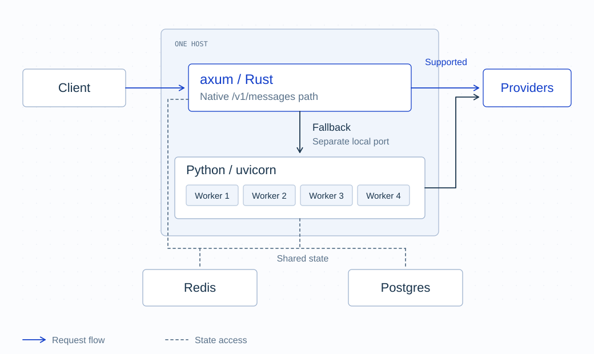

import RequestFlowHero from './RequestFlowHero';

export const Hero = RequestFlowHero;

The Rust migration is being slightly rerouted to get the largest performance improvements to the largest portion of requests as quickly as possible. We will be focusing on `/v1/messages` requests to providers which natively support Anthropic-style APIs, with the most common set of proxy features enabled. By December 1st, you can expect the proxy to handle these requests with common configurations with about 20x less latency.

{/* truncate */}

Earlier, LiteLLM's path towards having a proxy server that runs blazingly fast in Rust was to build from the bottom up. We would first port over the translation layer which handles putting a request from one provider in terms of another. Then, we would port over the core routing logic which selects a particular deployment for a given request. Finally, we would migrate the actual proxy webserver.

Doing things that way gives us the cleanest set of lines across which to move dependencies, but it also means that users wait a longer time in order to see the real payoff. If the translation layer and router are ported, a request will still have to:

- pass through the FastAPI server and auth on the way in
- check the cache on the way in, and populate it on the way out
- be provided to callbacks in order to mutate headers, strip sensitive information from the body, or write out to spend logs

These things take up a significant portion of the time taken in a request, and so even if we make other parts of the request 10-50x faster, we will still end up with only an overall performance gain of ~2x.
In some cases, the poorly defined boundary of what needs to be _provided_ to a callback can actually mean that we make things slightly worse due to crossing the Python-Rust boundary repeatedly!

We want to give our users an incredible experience as quickly as possible. That means that we will migrate the hot path of as large a portion of our requests, and then gradually expand to include more configurations and requests in this fast track. For now, the focus is the path for requests to `/v1/messages` which are routed to a provider that natively supports `/v1/messages`.

![One request stream splits into blue fast-path candidates and gray Python requests at the top. Horizontally aligned layers show endpoint, routing strategy, callbacks, and providers. Blue means eligible so far; further requests branch into the left side of the Python lane between each layer, including endpoint and routing. The remaining blue requests reach Rust. Endpoints, routing strategies, and providers each allow one choice. Callbacks allow any combination of supported options, including both S3 logs and spend logging. Bedrock and Vertex AI eligibility applies to Anthropic models. Traffic widths are illustrative and have no numeric labels.](./rust-request-mix.svg)

Once we have this written, you can expect `/v1/messages` requests with ~1.5 milliseconds of latency. We have updated, more representative benchmarks with all of these common features which will be made available soon.

We will implement this by having a Rust server written in Axum sitting in front of all requests.
There will be Rust implementations of the callbacks and router, used by both Python and Rust.
The Python modules will just be a thin shell around the business logic, which lives in Rust.
That way, we ensure that the Rust and Python implementations are entirely compatible.

A request will come in and go to the Axum server. Early on, the server will check if it knows how to handle the request. If it does, it passes through the fast path. If the Axum server _cannot_ handle the request, the request will be forwarded to a Python worker on the same host. This is almost the exact same mechanism that is currently used by our existing Python implementation to share requests across different instances of the ASGI server.

We recommend running LiteLLM with 4 workers running on a host with 4 vCPUs. With this setup, the initiating Uvicorn process starts listening on the appropriate port, then spawns 4 worker processes. The workers communicate amongst themselves via Redis and our Postgres database. They do not keep meaningful persistent state. The incoming connections are automatically split among the workers by the operating system, as they all have a handle to the port from before the split.

The Rust server will be able to run alongside the Python servers in a similar manner, and it speaks the exact same Redis and Postgres protocols, so we will ensure seamless failover.

By December 1st, you will be able to run this server for yourself on a standard configuration and see the speed improvements! Stay posted for more updates on how we are approaching this.

