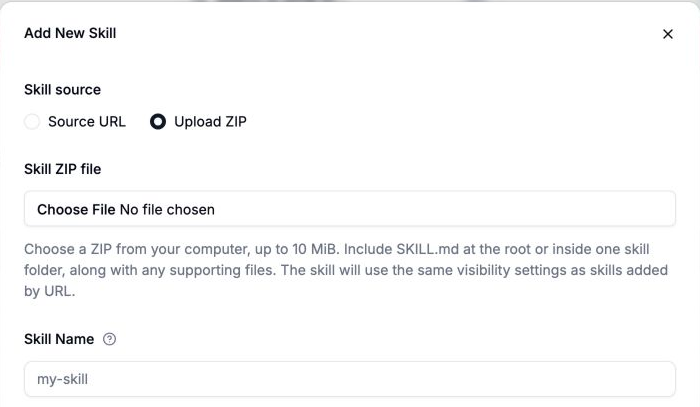
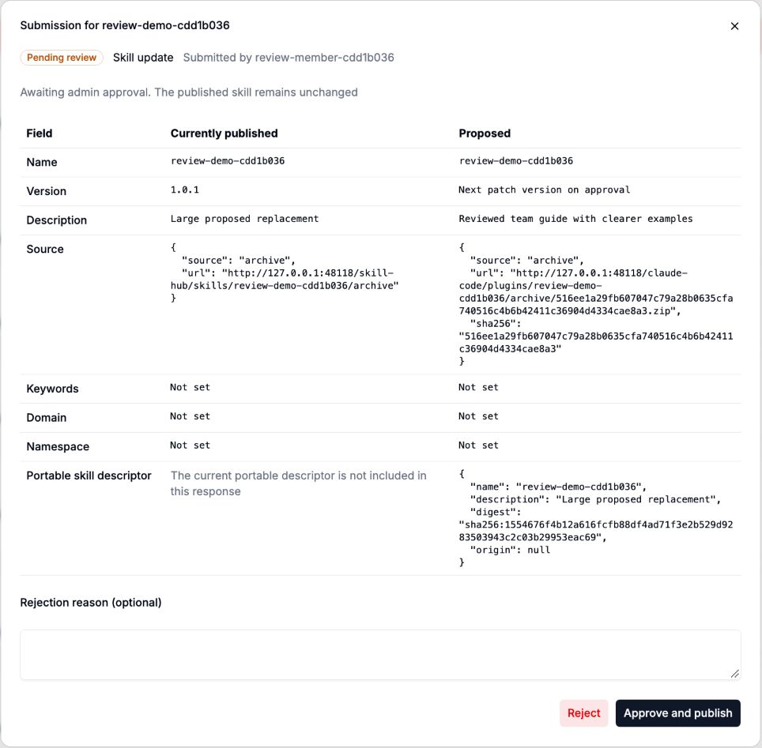
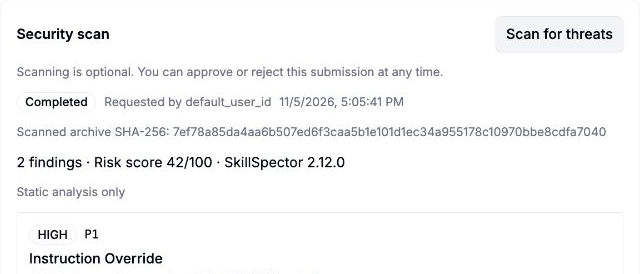
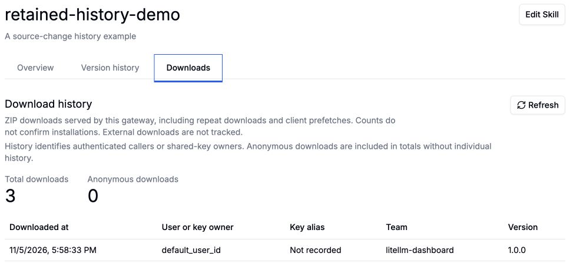

Give your team one place to find and share useful agent skills. With **LiteLLM Skills Gateway**, teammates can reuse a skill's instructions and supporting files in their own AI agents.

To help you manage those skills, we've added:

- ZIP uploads
- Admin review
- Version history
- Download tracking

{/* truncate */}

## Upload a complete skill

Select **Add Skill**, choose **Upload ZIP**, and select a ZIP with `SKILL.md` and its supporting files.

## Review skills before publication

Team members can submit new skills or propose updates. **Admins approve or reject submissions** before teammates can access the changes. Admins can publish their own uploads without review.

Open **Submissions** to compare a proposal with the published skill, then choose **Approve and publish** or **Reject**.

With a [scanner configured](/docs/skills_gateway#optional-security-scans), an admin can select **Scan for threats** and review the findings before approving a skill. The scan is optional and advisory; the admin decides whether to publish.

*Example scan of a test skill, with findings for the admin to review.*

## Keep earlier skill versions

Update a skill under the same name to publish a new version. You can inspect its version history and download a retained ZIP from an earlier version.

New skills start at `1.0.0`. Publish the next update as `1.0.1` with the default patch increment, or set a higher version number.

## See who downloads your skills

Admins can inspect each skill's **download count and authenticated download history**, including who downloaded it and when. Use those records to see which skills teammates pick up and who to ask for feedback.

*Example download history for a test skill.*

Anonymous and repeat downloads count toward totals. Shared keys identify the key's owner. Downloads do not confirm skill executions or completed installs.

Open **Skills Hub** in the LiteLLM dashboard to share a skill your team uses.

[Get started with Skills Gateway](/docs/skills_gateway).
