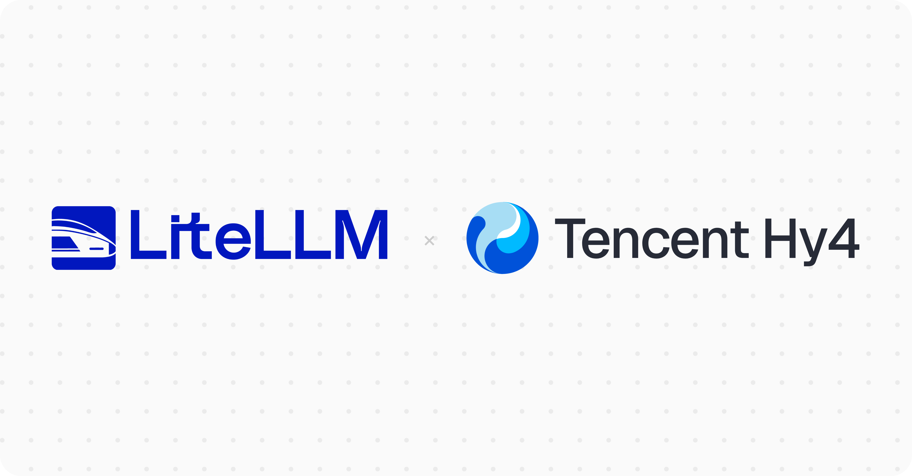

import Tabs from '@theme/Tabs';
import TabItem from '@theme/TabItem';



LiteLLM supports [Tencent Hy4](https://www.tencent.com/tencent-launches-hy4-joining-the-ranks-of-the-worlds-leading-open-source-ai-models/) through Tencent Cloud TokenHub. Use the same OpenAI-compatible request format as your other models, with spend tracking, rate limits and logs in the LiteLLM AI Gateway.

{/* truncate */}

## Tencent Hy4 pricing

TokenHub charges 50% of list prices through **December 31, 2026, at 23:59:59 Beijing time**. These USD rates apply per 1M tokens on [TokenHub's international pricing page](https://www.tencentcloud.com/document/product/1300/78937):

| Token type | List price | Promotional price, calculated at 50% of list |
|---|---:|---:|
| Input | $0.834 | $0.417 |
| Output | $2.501 | $1.2505 |
| Cached input | $0.042 | $0.021 |

List prices match Hy4 preview. After the promotion ends, TokenHub resumes billing at list prices.

:::note Cost tracking
LiteLLM's [default cost map](https://github.com/BerriAI/litellm/blob/main/model_prices_and_context_window.json) records **list prices** for `tencent/hy4`. Reloading the map does not apply the promotion. Use [custom pricing](/docs/proxy/custom_pricing) if your spend tracking needs to match the discounted invoice, and restore list rates when the offer ends.
:::

## What's new in Hy4

Hy4 adds image understanding to the preview model's reasoning, function calling and structured output. Tencent reports improvements on long-running agent tasks and introduces computer-use capabilities.

[TokenHub lists](https://www.tencentcloud.com/document/product/1300/78934) a 1M-token context window, with up to **960,000 input tokens** and **64,000 output tokens**. Use `hy4` for this release; `hy4-preview` remains a separate model ID.

## Use Tencent Hy4 with LiteLLM

Create a TokenHub API key using Tencent's [quickstart](https://www.tencentcloud.com/document/product/1300/78939), then export it in your terminal:

```bash
export TENCENT_API_KEY="YOUR_TENCENT_API_KEY"
```

<Tabs>
<TabItem value="proxy" label="LiteLLM Proxy">

**1. Save this as `config.yaml`**

```yaml
model_list:
  - model_name: hy4
    litellm_params:
      model: tencent/hy4
      api_key: os.environ/TENCENT_API_KEY

general_settings:
  master_key: os.environ/LITELLM_MASTER_KEY
```

**2. Start the proxy**

Generate a local proxy key and start the [v1.108.5 image](https://github.com/BerriAI/litellm/releases/tag/v1.108.5):

```bash
export LITELLM_MASTER_KEY="sk-$(openssl rand -hex 24)"

docker run -d --name litellm-hy4 \
  -p 127.0.0.1:4000:4000 \
  -e TENCENT_API_KEY \
  -e LITELLM_MASTER_KEY \
  -v "$(pwd)/config.yaml:/app/config.yaml:ro" \
  ghcr.io/berriai/litellm:v1.108.5 \
  --config /app/config.yaml
```

**3. Test it**

Once the proxy is ready, run this in the same terminal:

```bash
curl --fail-with-body http://localhost:4000/v1/chat/completions \
  -H "Content-Type: application/json" \
  -H "Authorization: Bearer $LITELLM_MASTER_KEY" \
  -d '{
    "model": "hy4",
    "messages": [{"role": "user", "content": "Write a Python function that checks whether a number is prime."}]
  }'
```

The response contains the generated answer in `choices[0].message.content`.

</TabItem>
<TabItem value="sdk" label="LiteLLM Python SDK">

Install LiteLLM, then run the Python example with `TENCENT_API_KEY` set:

```bash
pip install --upgrade litellm
```

```python
from litellm import completion

response = completion(
    model="tencent/hy4",
    messages=[
        {"role": "user", "content": "Write a Python function that checks whether a number is prime."}
    ],
)

print(response.choices[0].message.content)
```

</TabItem>
</Tabs>

For an existing proxy, add the model entry to your configuration and restart the proxy. To refresh its pricing, open **Models + Endpoints → Price Data → Reload Price Data**, or call `POST /reload/model_cost_map` as an admin. Keep the default remote cost map enabled: the pinned image's bundled map predates the Hy4 entry.

## FAQ

### Which provider prefix and API key do I use?

Use `tencent/hy4` with `TENCENT_API_KEY`. LiteLLM defaults to TokenHub's international endpoint. See the [Tencent provider guide](/docs/providers/tencent) for region overrides.

### Does Hy4 accept images?

Yes. Send text and `image_url` content parts in your messages. The final Hy4 release adds vision; Hy4 preview is text-only.

## Feedback

Questions about Hy4 on LiteLLM? Share your use case or report a problem in [GitHub Discussions](https://github.com/BerriAI/litellm/discussions).
