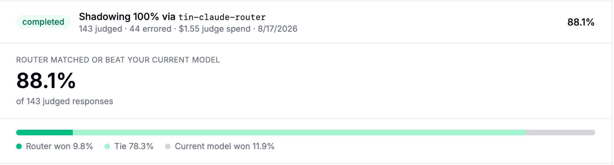
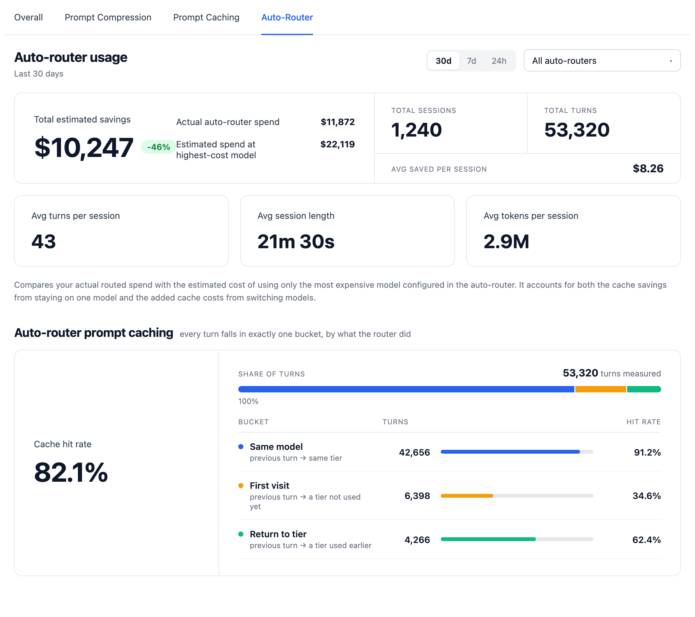

import NavigationCards from '@site/src/components/NavigationCards';

Public benchmarks measure someone else's prompts. Two features measure yours: a **shadow evaluation** before you switch, and **savings accounting** after.

## Shadow evaluations



- **Samples** a slice of one key's, team's, or user's live traffic.
- **Duplicates** each sampled request through the router. The shadow response never reaches the client.
- **Judges** blind: an LLM compares the router's answer with the one the current model served.
- **Runs** up to 30 days (default 7) or until each target's own shadow and judge spend reaches `max_budget` (default $10, max $10,000). `max_turns` is no longer accepted.
- **Compares** several router configs in one job on the same sampled traffic, so tier map and classifier choices are settled before anything changes.
- On our own traffic: **88.1%** matched or beat the current model, 143 judged turns, $1.55 judge spend.

<NavigationCards
columns={2}
items={[
  {
    title: "Shadow Evaluations: Test the Auto-Router on Your Own Production Traffic",
    description: "Setting up a job, defaults for turns and duration, choosing the judge, reading the results card.",
    to: "/blog/auto-router-shadow-evaluations",
  },
  {
    title: "Route on Context Size and Modality",
    description: "Multi-config shadow jobs and the key, team, and user targets.",
    to: "/blog/auto-router-more-routing-configurations",
  },
]}
/>

## Optional rubric grades

A preference says which response was better, even when both responses were poor. A rubric job also grades each response against your criteria on a fixed 1–5 scale. For example, a winner graded 2 against a loser graded 1 still indicates poor answers. A tie with grades `(5, 5)` indicates both responses met the criteria. Grades are estimates from the judge, not a guarantee of correctness.

:::note Availability

These endpoints require a proxy build that includes [rubric grading support](https://github.com/BerriAI/litellm/pull/52321). Check that your deployed build contains this change before using the examples. The feature is disabled by default.

:::

### Enable rubric jobs

Upgrade every API and sampling worker that shares the database before setting `LITELLM_SHADOW_EVAL_RUBRIC_ENABLED=true`. Apply the setting to each worker through your deployment environment, then restart or redeploy those workers.

```bash
export LITELLM_SHADOW_EVAL_RUBRIC_ENABLED=true
```

The normal proxy schema migration adds nullable fields for the job's rubric and rubric version, and for each evaluated pair's real and shadow grades. It does not rewrite existing rows or add grades to earlier attempts. Existing preference-only jobs and their result payloads remain unchanged. The migration alone does not enable rubric grading.

:::warning Upgrade every worker first

Older workers ignore the feature flag and treat a rubric job as a preference-only job. They can record successful judgments without grades. Do not enable rubric jobs while any older worker still shares the database.

:::

### Start a rubric job

Use a proxy administrator credential to create the job. The request accepts the same targets, router, sampling percentage, duration and budget settings as `POST /auto_router/shadow_eval/start`, plus a required `rubric`. Supply nonblank plain text of at most 4,000 characters. Each job stores its own rubric, which stays fixed for that job.

The example targets an existing team and an already configured auto-router. Set `LITELLM_ADMIN_KEY` to your administrator credential, `TEAM_ID` to that team's ID, and `ROUTER_NAME` to the auto-router's model name. It uses `curl` and `jq`.

```bash
export PROXY_BASE_URL=http://localhost:4000

JOB_ID=$(
  jq -n \
    --arg team_id "$TEAM_ID" \
    --arg router_name "$ROUTER_NAME" \
    '{team_ids: [$team_id], router_name: $router_name,
      shadow_percentage: 10, max_budget: 1, duration_days: 1,
      rubric: "Answer the question correctly and directly in at most three sentences."}' |
  curl --fail-with-body --silent --show-error \
    "$PROXY_BASE_URL/auto_router/shadow_eval/rubric/start" \
    -H "Authorization: Bearer $LITELLM_ADMIN_KEY" \
    -H 'Content-Type: application/json' \
    --data-binary @- |
  jq -er '.job_id'
)
```

A successful request returns HTTP 201 with the job ID, rubric and grading-contract version. Creation returns HTTP 400 when the feature flag is off, or HTTP 422 for a blank or oversized rubric. An older proxy without the rubric route returns HTTP 404. Sending a `rubric` field to the original start route does not create a rubric job.

Continue sending normal requests with the team's existing credentials. The default forward direction samples requests that did not use the evaluated router and duplicates them through it. The caller still receives only the real response. Rubric jobs use the existing default judge unless you set `judge_model`.

### Read and interpret grades

```bash
curl --fail-with-body --silent --show-error \
  "$PROXY_BASE_URL/auto_router/shadow_eval/$JOB_ID/rubric_results" \
  -H "Authorization: Bearer $LITELLM_ADMIN_KEY"
```

The grade endpoint allows proxy administrators and administrator viewers. It returns joint grade distributions overall and per router arm. This illustrative response has three graded comparisons, including one where both answers failed the rubric.

```json
{
  "job_id": "example-job-id",
  "rubric": "Answer the question correctly and directly in at most three sentences.",
  "rubric_version": 1,
  "overall": {
    "group": "all",
    "graded_count": 3,
    "ungraded_count": 0,
    "grade_distribution": [
      {"real_grade": 1, "shadow_grade": 1, "turn_count": 1},
      {"real_grade": 5, "shadow_grade": 5, "turn_count": 2}
    ]
  },
  "by_router": [
    {
      "group": "your-auto-router",
      "graded_count": 3,
      "ungraded_count": 0,
      "grade_distribution": [
        {"real_grade": 1, "shadow_grade": 1, "turn_count": 1},
        {"real_grade": 5, "shadow_grade": 5, "turn_count": 2}
      ]
    }
  ]
}
```

| Grade | Meaning against the job's rubric |
| --- | --- |
| 1 | Fails the criteria |
| 2 | Meets few of the criteria |
| 3 | Meets about half of the criteria |
| 4 | Meets most of the criteria |
| 5 | Fully meets the criteria |

`real_grade` always describes the response the caller received. `shadow_grade` describes the duplicated response, including in reverse-direction jobs. The judge sees randomized A/B labels, which are mapped back before grades are stored. Equal grades can still have a preferred response.

`graded_count` counts comparisons with both grades. `ungraded_count` counts successful preference judgments without both grades, such as results written by an older worker. Those rows are excluded from `grade_distribution`, never treated as zero or low grades. For a job with multiple routers, the overall count includes one comparison per request and router arm. Use `by_router` to compare arms.

Read preference, confidence summaries and evaluation errors through the existing `GET /auto_router/shadow_eval/{job_id}` endpoint. Invalid or missing grades invalidate the entire rubric verdict and produce a recorded evaluation error, not a successful preference-only verdict. Grades must be JSON integers from 1 through 5. Strings, booleans, floats and out-of-range values are rejected. Error attempts are excluded from the grade distribution. The grade endpoint returns HTTP 404 for a preference-only job.

### Stop jobs before rollback

Before starting any worker without rubric support, disable the feature on all upgraded workers, stop every running rubric job, and finish or drain their in-flight evaluations. Applying the flag requires a restart or redeployment. You can stop each job through the existing endpoint with an administrator credential.

```bash
curl --fail-with-body --silent --show-error -X POST \
  "$PROXY_BASE_URL/auto_router/shadow_eval/$JOB_ID/stop" \
  -H "Authorization: Bearer $LITELLM_ADMIN_KEY"
```

Drain or stop the upgraded workers before starting older ones. Waiting only for the roughly 10-second job cache expiry does not guarantee that in-flight evaluations have finished. The feature flag alone cannot protect a rollback because older workers ignore it. Rubric jobs cannot continue uninterrupted through a downgrade to a version without rubric support.

## Evaluate JEV on your own prompts

Start with [Test Routing](/docs/auto_router/setup#jev-classifier-typesafe-ai) to inspect tier choices, then use a shadow evaluation to compare actual answers. A classifier matching your tier labels does not establish that the selected model answers well. Freeze your rubric and labels before comparing JEV with another classifier, and report disagreement separately from correctness

The [JEV benchmark](/blog/jev-auto-router-benchmark) measured classifier latency and registry-priced classifier cost on authored synthetic cases. To evaluate a deployment, include classifier spend, downstream completions, embeddings where enabled, and shadow/judge requests. Record fallback rates and p95 latency as well as successful-call averages

JEV logs a separate `typesafe/<model>` classifier call attributed through the parent request's metadata. Its `classifier_cost` is also carried on a successful JEV routing decision and deducted in reported router savings. That metadata describes the classifier charge already logged separately: do not count it again when summing spend rows. Missing usage or a missing registry entry leaves classifier cost unknown, and cancellation does not prove the provider billed zero

## Savings after you switch



- **Per request:** what the router picked, why, and what the same request would have cost on the most expensive model in the hardest configured tier. The difference, net of any classifier call, is stamped on the request.
- **Rolled up:** into the daily spend tables, so it shows per key, team, tag, and organization.
- **Usage tab:** total estimated savings, sessions and turns, prompt-cache hit rate by turn type. A 30-day window over 400k sessions reads in 38 ms.
- **Classifier cost:** returned per request in the `x-litellm-classifier-cost` header when a classifier cost was recorded, including a successful JEV classification
- **Honest baseline:** priced with a warm cache on continuing turns; a fresh cache write after a switch counts against the saving, so a single request can read negative. Formula and every surface: [Reported savings](/docs/proxy/auto_routing#reported-savings).

<NavigationCards
columns={2}
items={[
  {
    title: "AutoRouter: Easy Visibility to Your Savings",
    description: "The usage tab, per-request classifier cost, and preset matching against your own deployments.",
    to: "/blog/auto-router-spend-visibility",
  },
  {
    title: "Decision log",
    description: "One greppable line per routing decision: cause, tier, score, signals, routed model.",
    to: "/docs/proxy/auto_routing#decision-log",
  },
]}
/>

## Reading a single decision

- Each routed request in the logs opens with a routing-decision card: tier, cause (including `jev_classifier`), and the model that served it
- Test Routing in the Add Model form shows the same card, so a surprising production decision can be replayed against the form with the same prompt.
