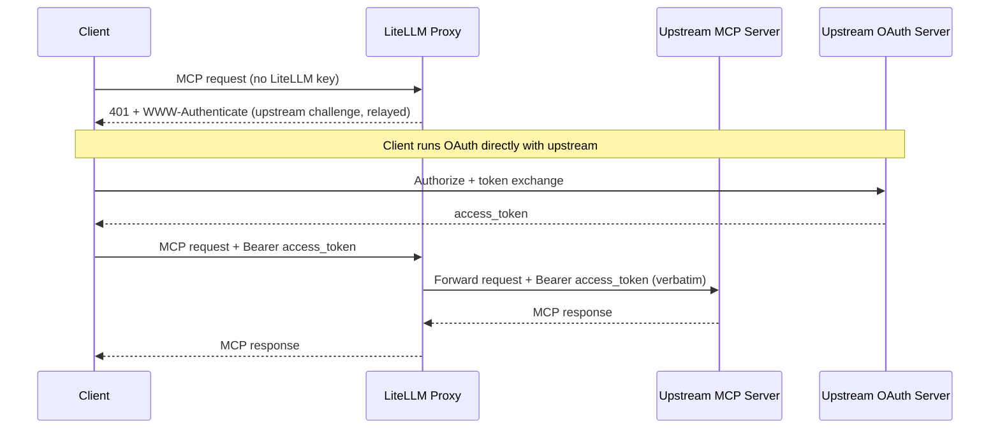
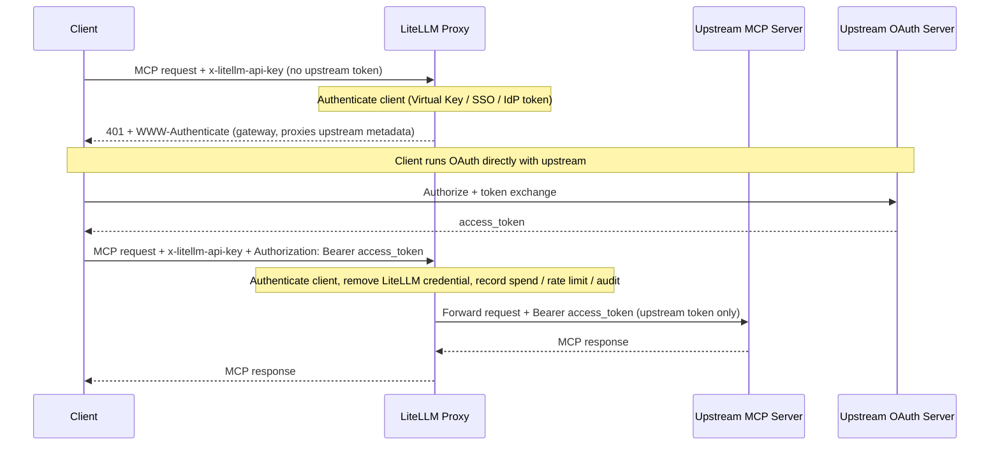
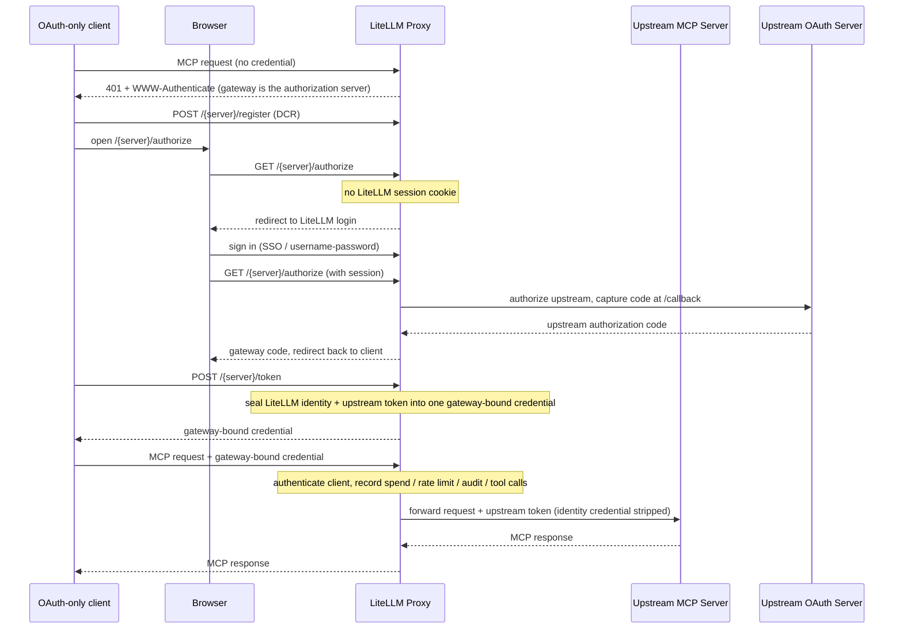
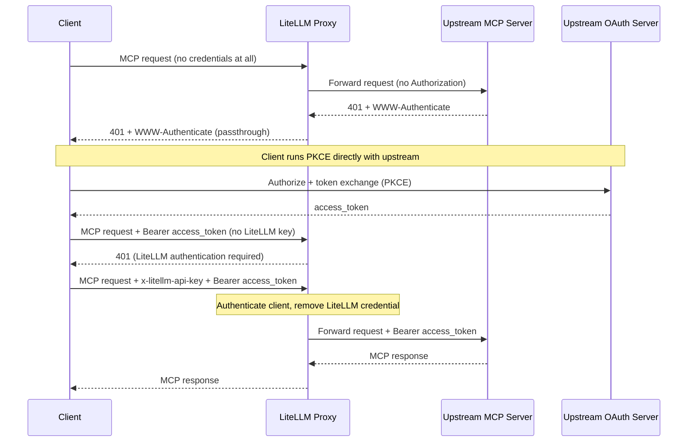

# OAuth token passthrough {#mcp-oauth-passthrough}

LiteLLM can forward a client's OAuth access token to an MCP server. The client obtains the token from the server's OAuth provider, and LiteLLM forwards it without issuing, storing, or refreshing it.

Choose whether the client must also authenticate to LiteLLM:

| Mode | Client authentication to LiteLLM | Credential forwarded to the MCP server | Spend / rate limits / audit | Use when |
|------|-------------------|-------------------------------|-----------------------------|----------|
| `true_passthrough` | None | The client's `Authorization`, unchanged | Not recorded | The MCP server handles all authentication |
| `oauth_delegate` | Required (Virtual Key, SSO, or IdP token) | A separate MCP server token supplied by the client | Recorded for the authenticated client | LiteLLM authenticates the client and tracks usage; the MCP server validates its own token |

Both modes return the upstream's protected-resource metadata verbatim during discovery, so the client always authorizes against the real upstream issuer.

Both forward the token exactly as the caller sent it. LiteLLM does not decode it, does not check its audience or scopes, and does not exchange it; the upstream MCP server is the only party that validates it. If the caller's token was minted for a different resource, neither mode can make it work, and you want [`oauth2_token_exchange`](#audience-locked-tokens-passthrough-or-token-exchange) instead.

Both modes support `dcr_bridge`, which lets LiteLLM host OAuth registration and sign-in for the client. Turn it on for clients that cannot register with the upstream IdP themselves or cannot send two separate credentials, such as OpenCode, Claude Code, Cursor, and Claude Desktop. See [Gateway-hosted sign-in (DCR bridge)](#gateway-hosted-sign-in-dcr-bridge).

## Audience-locked tokens: passthrough or token exchange {#audience-locked-tokens-passthrough-or-token-exchange}

An OAuth access token carries an audience (`aud`, or the resource it was requested for). A well-behaved upstream MCP server rejects any token whose audience names something else, for example a token an agent obtained for a SaaS API and then presented to the MCP server. Because `true_passthrough` and `oauth_delegate` forward the token verbatim, that rejection shows up as the upstream's own `401` relayed back to the client. This is the correct confused-deputy-safe outcome: the gateway did not launder a token minted for one resource into access to another, and it is not a LiteLLM bug to file.

Pick the mode from the token you actually hold:

| The caller's token was minted for | Use | What LiteLLM does with it |
|-----------------------------------|-----|---------------------------|
| The upstream MCP server itself (the client ran OAuth against that server's issuer) | `true_passthrough` or `oauth_delegate` | Forwards it verbatim; the upstream validates audience and scopes |
| A different resource (your IdP, an internal API, a SaaS API), and your IdP supports RFC 8693 or Entra On-Behalf-Of | `oauth2_token_exchange` | Sends it to the IdP as the `subject_token`, receives a token whose audience is the MCP server (`audience: ...` in the server config), caches it, and forwards only the exchanged token. See [Token exchange (OBO)](./mcp_obo_auth.md) |
| A LiteLLM Virtual Key, SSO session, or IdP JWT used only to authenticate to LiteLLM | Neither passthrough mode | Credentials used to authenticate to LiteLLM are never forwarded to the MCP server. Configure a server-side credential (`oauth2` client credentials, a static `authentication_token`, or token exchange) instead |

The practical test: if you would have to ask your IdP to widen a token's audience so the upstream accepts it, stop and use token exchange. Widening audiences turns one bearer into a key for several resources, and the passthrough modes exist precisely so that the gateway never does that on the caller's behalf.

## true_passthrough

LiteLLM forwards the client's `Authorization` unchanged, without authenticating the client or issuing or storing tokens. Use this mode when the MCP server handles all authentication.

### Setup

```yaml title="config.yaml" showLineNumbers
mcp_servers:
  notion_passthrough:
    url: "https://mcp.notion.com/mcp"
    auth_type: true_passthrough
```

That is the entire configuration. No client credentials or token endpoints, because LiteLLM never participates in the token exchange.

### How It Works

- The client sends its MCP request with no LiteLLM Virtual Key.
- With no upstream token yet, LiteLLM relays the upstream's own `401` and `WWW-Authenticate`.
- The client runs OAuth directly against the upstream issuer.
- The client retries with `Authorization: Bearer <upstream-token>`, and LiteLLM forwards it untouched.



### Fail-Closed Behavior

LiteLLM skips client authentication only when every target uses `true_passthrough`. It requires client authentication when:

- The server's `auth_type` is anything else.
- The request targets multiple servers (`x-mcp-servers: a,b`) and any one is not `true_passthrough`.
- The target server cannot be resolved from the URL path or the `x-mcp-servers` header.

### Security Trade-offs

- The MCP route becomes an unauthenticated ingress at the LiteLLM layer.
- Spend tracking, per-key rate limits, and any guardrail depending on `user_api_key_auth.user_id` do not run.
- LiteLLM cannot tell who the caller is, so per-user auditing must come from the upstream server's logs.
- `available_on_public_internet: false` adds no authentication here; it mainly controls IP-based discovery ([see guide](./mcp_public_internet.md)).
- Only enable it on servers whose upstream OAuth issuer you trust to enforce access control.

### Config Reference

| Field | Required | Description |
|-------|----------|-------------|
| `auth_type` | Yes | Must be `true_passthrough`. |
| `url` | Yes | The upstream MCP server URL. |
| `allowed_tools` | No | Server-level tool allowlist. With no caller identity there are no per-key or per-team tool permissions, so this list is the only tool restriction and it applies to every caller identically. |

```yaml title="config.yaml" showLineNumbers
mcp_servers:
  notion_passthrough:
    url: "https://mcp.notion.com/mcp"
    auth_type: true_passthrough
    allowed_tools:
      - search
      - fetch
```

## oauth_delegate

LiteLLM authenticates the client with a Virtual Key, SSO session, or IdP token, then forwards a separate MCP server token supplied by the client. LiteLLM does not issue tokens or forward its own authentication credential to the server. Use this mode to retain LiteLLM authentication, spend tracking, rate limits, and audit logs while the MCP server validates its own token and controls tool access.

### Setup

```yaml title="config.yaml" showLineNumbers
mcp_servers:
  notion_delegate:
    url: "https://mcp.notion.com/mcp"
    auth_type: oauth_delegate
```

No client credentials, for the same reason as `true_passthrough`. What changes is the request: the caller sends two credentials.

### How It Works

- The client authenticates to LiteLLM with a credential in `x-litellm-api-key`.
- The MCP server token is sent in `Authorization` (or `x-mcp-<alias>-authorization` for aggregate requests).
- LiteLLM authenticates the client, then forwards only the MCP server token.
- With no upstream token yet, LiteLLM returns a `401` pointing at the gateway's `oauth-protected-resource` well-known, which proxies the upstream metadata verbatim.



:::warning[Keep the two credentials in separate headers]

If a client sends a single credential in `Authorization` with no `x-litellm-api-key`, LiteLLM uses it to authenticate the client (Virtual Key, IdP JWT, or SSO session token) and never forwards it to the MCP server. This prevents credentials intended for LiteLLM from reaching a third-party server.

:::

### Security Trade-offs

- LiteLLM authenticates every request.
- Spend tracking, rate limits, and audit logs use the authenticated client's identity.
- LiteLLM forwards the upstream token without inspecting it, so the upstream still owns tool-level authorization and token validation.

### Config Reference

| Field | Required | Description |
|-------|----------|-------------|
| `auth_type` | Yes | Must be `oauth_delegate`. |
| `url` | Yes | The upstream MCP server URL. |

Send the LiteLLM credential in `x-litellm-api-key` and the MCP server token in `Authorization: Bearer <upstream-token>` (or `x-mcp-<alias>-authorization` for a specific server in an aggregate request).

LiteLLM also applies [per-key and per-team tool permissions](./mcp_control.md#per-entity-tool-level-permissions), the server's `allowed_tools` list, and per-key rate limits. It logs the spend for each tool call under the authenticated client's identity.

## Multi-server aggregate requests {#multi-server-aggregate-requests}

A request to the aggregate `/mcp` endpoint (or one carrying `x-mcp-servers: a,b`) fans out to several upstreams, but the request can only carry one `Authorization` header. If two of those upstreams both forward the caller's token, sending that one header to both would replay a single bearer across unrelated resources (the cross-resource replay RFC 9700 warns about). LiteLLM therefore applies two rules to `true_passthrough` and `oauth_delegate` servers inside an aggregate scope.

Bind one upstream token to one server with `x-mcp-{alias}-authorization`. The alias is lowercased and any character outside `a-z0-9_` becomes `_`, so a server aliased `Jira Cloud` is addressed as `x-mcp-jira_cloud-authorization`. The value is forwarded verbatim, so include the scheme (`Bearer <token>`). Per-server headers are never withheld, on any operation, because each one names exactly one recipient.

The request-wide `Authorization` is withheld from a client-forwarded server during a listing fan-out (`tools/list`, and the prompt and resource listings) whenever another server in the same scope would also consume it. That server is then listed with no upstream credential, so a server that requires one returns its `401` and the aggregate absorbs it (see below). Explicitly addressed operations such as `tools/call` on a named tool, a single-server route like `/{server_name}/mcp`, or an aggregate scope where only one server forwards the caller's token are unaffected: the client named the one recipient, so the request-wide header is forwarded to it.

In practice this is why a single bearer that is valid for several upstreams can execute tools through the aggregate endpoint yet not appear in the aggregate `tools/list`: the tool call names one server, the listing does not. The fix is to send the token per server rather than request-wide.

```bash title="Aggregate tools/list with per-server tokens" showLineNumbers
curl -X POST "https://litellm.example.com/mcp" \
  -H "Content-Type: application/json" \
  -H "x-litellm-api-key: Bearer $LITELLM_API_KEY" \
  -H "x-mcp-servers: jira,confluence" \
  -H "x-mcp-jira-authorization: Bearer <token-for-jira>" \
  -H "x-mcp-confluence-authorization: Bearer <token-for-confluence>" \
  -d '{"jsonrpc":"2.0","id":1,"method":"tools/list","params":{}}'
```

Sending the same token value on two per-server headers is your decision, made explicitly per server, and LiteLLM honors it. What it refuses to do is make that decision for you by fanning out an unaddressed `Authorization`.

LiteLLM skips client authentication only when every server in the request uses `true_passthrough`. If a request includes a server with any other authentication mode, the client must authenticate to LiteLLM.

## Previewing tools in the Admin UI {#previewing-tools-in-the-admin-ui}

LiteLLM holds no upstream token for these servers, so the create and edit forms cannot list tools on their own. Both forms show an "Authorize & Fetch Tools (browser-only)" button for `true_passthrough` and `oauth_delegate`. It runs the upstream OAuth flow in the admin's browser and keeps the resulting token in that browser session only, forwarding it per server for the tool preview and for configuring `allowed_tools`. The token is not written to the server row, to the per-user credential store, or to any cache; closing the tab discards it.

The optional OAuth Client ID and Client Secret next to that button are different: they are saved with the server as declared configuration. Set them when the upstream issuer does not support dynamic client registration and every admin should authorize through one pre-registered app.

## Intentional limits {#intentional-limits}

The following are consequences of forwarding a token verbatim without inspecting it, and they are by design rather than defects.

On the multi-server aggregate there is no per-server "needs re-authentication" signal. A single-server route relays the upstream's `401` and `WWW-Authenticate` truthfully, but the aggregate absorbs one server's auth failure into an empty listing for that server so the remaining servers still list. Use the single-server route, or the per-server header, when you need to see which upstream rejected the token.

Sender-constrained tokens (DPoP, RFC 9449, or mTLS-bound tokens, RFC 8705) cannot be relayed. The binding proves the request came from the TLS client or the key holder that obtained the token, and a layer-7 proxy is neither. The upstream will reject them; obtain a plain bearer for the MCP server or use token exchange.

Revoked tokens are not detected at connect time. LiteLLM keeps no state about a forwarded token and does not introspect it, so a token revoked at the issuer is forwarded and rejected by the upstream on the request that uses it. The client sees the upstream's `401` at that point, exactly as it would talking to the upstream directly.

## Gateway-hosted sign-in (DCR bridge) {#gateway-hosted-sign-in-dcr-bridge}

OAuth-only MCP clients (OpenCode, Claude Code, Cursor, Claude Desktop) connect by running a single Dynamic Client Registration (RFC 7591) plus PKCE flow against whatever authorization server the discovery metadata advertises. They:

- Hold no client credential pre-provisioned with the upstream IdP.
- Cannot send a separate LiteLLM credential alongside an upstream token.

So neither the plain `true_passthrough` request nor the two-header `oauth_delegate` request fits them. The `dcr_bridge` flag closes that gap:

- **On:** LiteLLM advertises itself as the authorization server during discovery and hosts `/{server_name}/register`, `/{server_name}/authorize`, and `/{server_name}/token`. The client registers and signs in through the gateway while LiteLLM runs the upstream OAuth behind those endpoints.
- **Off:** LiteLLM relays the upstream server's own OAuth metadata verbatim. Suits clients already registered with the upstream IdP, or able to run DCR directly against it.

Where to set it:

- Valid only on `true_passthrough` and `oauth_delegate`; rejected on any other `auth_type` at create, update, and config load.
- In the Admin UI it is the "Gateway-hosted sign-in (DCR bridge)" switch on the MCP server form, defaulted on for those two modes.
- In config it is a boolean field.

### true_passthrough with the bridge

```yaml title="config.yaml" showLineNumbers
mcp_servers:
  miro:
    url: "https://mcp.miro.com/"
    transport: http
    auth_type: true_passthrough
    dcr_bridge: true
```

The transparent option for OAuth-only clients:

- The client discovers the gateway as its authorization server and registers through `POST /{server_name}/register`.
- It runs PKCE against `GET /{server_name}/authorize` and `POST /{server_name}/token`.
- Where the upstream supports DCR, LiteLLM relays the client's registration to it.
- Where the server has no stored `client_id`, LiteLLM mints an ephemeral client for the flow and persists nothing.
- No LiteLLM sign-in is involved, and no caller identity or spend is recorded.

### oauth_delegate with the bridge

```yaml title="config.yaml" showLineNumbers
mcp_servers:
  miro:
    url: "https://mcp.miro.com/"
    transport: http
    auth_type: oauth_delegate
    dcr_bridge: true
```

This combination keeps LiteLLM in the observability path for OAuth-only clients, so spend, rate limits, audit, and per-tool-call attribution all resolve. Reach for it when you want to see in LiteLLM which server a caller used and which tools it invoked.

An OAuth-only client cannot present a LiteLLM key inline, so identity comes from a LiteLLM browser session instead:

- At the authorize step LiteLLM looks for a LiteLLM UI session cookie.
- With no cookie, it redirects to LiteLLM login (`/sso/key/generate`) first.
- After sign-in the user re-initiates the connection.
- LiteLLM seals that identity plus the upstream token into a gateway-bound credential.
- The client stores that credential and sends it on later requests. LiteLLM uses it to authenticate the client and record spend and audit logs.

:::warning[Two prerequisites]

- **The gateway needs a working browser sign-in** (SSO or username/password). Without one there is no identity to bind and the authorize step cannot proceed. A missing gateway sign-in is the usual reason an `oauth_delegate` bridge connection stalls at the login page.
- **The client's OAuth flow must run in an interactive browser session.** OpenCode, Claude Code, Cursor, and Claude Desktop all do.

For fully scripted, non-interactive delegation, leave `dcr_bridge` off and use the two-header `oauth_delegate` request instead.

:::



### Choosing the flag

| Situation | `dcr_bridge` |
|-----------|--------------|
| An OAuth-only client (OpenCode, Claude Code, Cursor, Claude Desktop, ChatGPT) that holds no upstream `client_id` and cannot send two credentials | `true` |
| A client already registered with the upstream IdP, or one that runs DCR directly against the upstream | `false` |
| A scripted, non-interactive caller that can send `x-litellm-api-key` plus an upstream `Authorization` bearer | `false`, with `auth_type: oauth_delegate` (two-header form) |

### Connecting a client

- Point the client at `https://<gateway-host>/<server_name>/mcp` and let it discover OAuth from there.
- Do not configure a `client_id` or secret on the client; the gateway handles registration and the token exchange.
- On a `true_passthrough` bridge server the browser flow authorizes only with the upstream.
- On an `oauth_delegate` bridge server it signs in to LiteLLM first, then authorizes with the upstream.

Follow each client's own MCP documentation for exact field names, which change over time.

Claude Code registers and runs the browser flow on first use:

```bash
claude mcp add --transport http miro https://<gateway-host>/miro/mcp
```

Cursor reads remote MCP servers from `~/.cursor/mcp.json`:

```json
{
  "mcpServers": {
    "miro": {
      "url": "https://<gateway-host>/miro/mcp"
    }
  }
}
```

OpenCode reads them from `opencode.json`:

```json
{
  "mcp": {
    "miro": {
      "type": "remote",
      "url": "https://<gateway-host>/miro/mcp",
      "enabled": true
    }
  }
}
```

### Config Reference

| Field | Required | Description |
|-------|----------|-------------|
| `auth_type` | Yes | Must be `true_passthrough` or `oauth_delegate`; `dcr_bridge` is rejected on any other value. |
| `url` | Yes | The upstream MCP server URL. |
| `dcr_bridge` | Yes | `true` so the gateway hosts sign-in for OAuth-only clients. Off relays the upstream's own OAuth metadata instead. |

## Delegate Auth to Upstream (PKCE Passthrough) {#delegate-auth-to-upstream-pkce-passthrough}

:::warning[Deprecated]

`delegate_auth_to_upstream` is the original flag for forwarding client OAuth tokens and is deprecated. It no longer bypasses LiteLLM authentication: LiteLLM requires a Virtual Key, SSO session, or IdP token on every request that carries a bearer token. The proxy logs a deprecation warning when a server is loaded with `auth_type: oauth2` and `delegate_auth_to_upstream: true`. Use `auth_type: oauth_delegate` to require LiteLLM authentication and forward a separate MCP server token, or `auth_type: true_passthrough` to let the MCP server handle all authentication. Migrate existing configurations to one of those modes. The section below describes the legacy flag.

:::

For OAuth2 MCP servers where the client authenticates directly against the upstream server's own OAuth issuer, the legacy flag lets a credential-free client reach the upstream's OAuth challenge through LiteLLM so it can start PKCE. Once the client holds an upstream token it must also present a LiteLLM credential, exactly as with `oauth_delegate`.

### Setup

```yaml title="config.yaml" showLineNumbers
mcp_servers:
  notion_mcp:
    url: "https://mcp.notion.com/mcp"
    auth_type: oauth2
    oauth2_flow: authorization_code
    delegate_auth_to_upstream: true
```

Delegated servers are interactive, so they take `oauth2_flow: authorization_code`. The flag is honored **only** when `auth_type: oauth2`; setting it on any other auth type is silently ignored.

:::warning[Internal-only (`available_on_public_internet: false`) and the anonymous discovery step]

`available_on_public_internet: false` does not require authentication for the initial OAuth discovery request. An anonymous client with no `Authorization` header can still reach the upstream OAuth2 `/authorize` challenge for a matching `auth_type: oauth2` server with `delegate_auth_to_upstream: true` (not `oauth2_flow: client_credentials`). The internal-only flag mainly controls IP-based discovery and related behavior ([see guide](./mcp_public_internet.md)). Tool calls are not affected: LiteLLM authenticates any request carrying a bearer token.

:::

### How It Works

1. The client sends an MCP request to LiteLLM with no `Authorization` header and no `x-litellm-api-key`.
2. When every target server is `auth_type: oauth2` with `delegate_auth_to_upstream: true`, LiteLLM allows this request without authentication and returns the upstream's `401` + `WWW-Authenticate` to the client.
3. The client completes PKCE directly with the upstream OAuth issuer.
4. The client retries with `Authorization: Bearer <upstream-token>`. LiteLLM requires authentication on this request. With no LiteLLM credential, the request fails with `401`. The client must send a Virtual Key in `x-litellm-api-key` alongside the MCP server token, as with `oauth_delegate`.
5. After authenticating the client, LiteLLM forwards the MCP server token unchanged and never forwards the LiteLLM credential.



### Fail-Closed Behavior

The anonymous cold start fires only when the request carries no bearer and **every** target opts in. It runs normal LiteLLM auth when:

- The request carries an `Authorization` header (any bearer, including an upstream token).
- The server's `auth_type` is anything other than `oauth2`.
- `delegate_auth_to_upstream` is not explicitly `true`.
- The server's effective `oauth2_flow` is `client_credentials`.
- The request targets multiple servers (`x-mcp-servers: a,b`) and any one is not delegated.
- The target server cannot be resolved from the URL path or `x-mcp-servers` header.

### Security Trade-offs

- Only the credential-free discovery step is anonymous. Tool calls run under a LiteLLM identity, so spend tracking, per-key rate limits, and guardrails apply as they do for `oauth_delegate`.
- LiteLLM forwards the upstream token without inspecting it, so the upstream still owns tool-level authorization and token validation.
- Because the flag is deprecated and behaves like `oauth_delegate` once a bearer is present, migrate to `auth_type: oauth_delegate` rather than relying on it.

### Config Reference

| Field | Required | Description |
|-------|----------|-------------|
| `auth_type` | Yes | Must be `oauth2`. The flag is ignored otherwise. |
| `oauth2_flow` | Yes | Set to `authorization_code`; delegation lets the client's interactive PKCE flow start against the upstream server. |
| `delegate_auth_to_upstream` | Yes | Set to `true` to opt this server into the legacy delegate behavior. Deprecated in favor of `auth_type: oauth_delegate`. |
