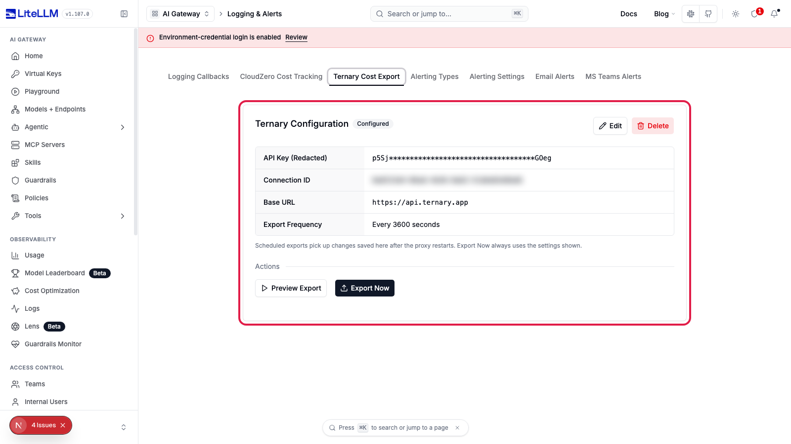

# Ternary

LiteLLM can export proxy spend data to [Ternary](https://ternary.app) as [FOCUS 1.2](https://focus.finops.org/) formatted cost reports. This lets you allocate and analyse LLM spend alongside your cloud costs in Ternary's FinOps platform, for example by splitting a shared AI invoice across teams, projects, and API keys.

## Overview

| Property | Details |
|----------|---------|
| Destination | Export LiteLLM usage data to a Ternary AI Gateway cost connection |
| Data format | FOCUS CSV (automatically transformed from LiteLLM spend data) |
| Supported operations | Automatic scheduled export (daily; interval for setup validation), plus a preview and an on-demand export |
| Setup | Admin UI (Logging & Alerts > Ternary Cost Export) or `config.yaml` |
| Authentication | Ternary API key + connection ID (per-connection bearer token) |
| Privacy | Cost and usage metadata only. No prompt or completion content leaves the gateway |

## Prerequisites

You need three values from Ternary:

1. **Connection ID** (`TERNARY_CONNECTION_ID`): identifies the cost connection the data lands in. It appears in the export URL path.
2. **API Key** (`TERNARY_API_KEY`): a per-connection bearer token that authenticates the push.
3. **API host** (`TERNARY_BASE_URL`): your Ternary API host, which differs by region (US vs EU).

The Connection ID and API Key are minted when you add an **AI Gateway** integration in Ternary (**Admin > Integrations > New Integration > AI Gateway**). The API host is the base URL of the Ternary instance you sign in to. The US and EU regions have different hosts.

## Setup

Set Ternary up either in the Admin UI or in `config.yaml`. The Admin UI stores the settings in the proxy database with the API key encrypted, so no environment variables or config changes are needed. If `config.yaml` sets the `ternary` callback, the config file takes precedence and the Admin UI shows the integration as read-only.

### Admin UI

1. Open **Logging & Alerts** in the Admin UI and select the **Ternary Cost Export** tab.
2. Click **Add Ternary Integration**.
3. Enter the **API Key** and **Connection ID** from Ternary. Keep the default **Base URL** (`https://api.ternary.app`) unless your Ternary instance uses a different API host.
4. Choose an **Export Frequency**. Use **Daily** for normal use; **Fixed interval** is meant for short setup checks.
5. Click **Create**. The tab shows the saved settings with the API key masked.



Restart the proxy after saving, editing, or deleting the integration so the scheduled export picks up the change. **Preview Export** and **Export Now** always use the settings shown and work without a restart. Changing the base URL requires entering the API key again, so a stored key cannot be sent to a different host.

### Config file

#### Environment variables

| Variable | Required | Description |
|----------|----------|-------------|
| `TERNARY_API_KEY` | Yes | Per-connection bearer token from the Ternary AI Gateway integration |
| `TERNARY_CONNECTION_ID` | Yes | Cost connection identifier (used in the export URL path) |
| `TERNARY_BASE_URL` | Yes | Your Ternary API host (region-specific, US vs EU). No default is assumed. |
| `TERNARY_EXPORT_FREQUENCY` | No | `daily` (default), or `interval` for short setup-validation loops. LiteLLM spend is a daily aggregate, so there is no sub-daily cadence. |
| `TERNARY_EXPORT_INTERVAL_SECONDS` | No | Seconds between exports when frequency is `interval` (intended for short setup-validation / test loops) |

#### Proxy config

```yaml
model_list:
  - model_name: gpt-4o
    litellm_params:
      model: openai/gpt-4o
      api_key: sk-your-key

litellm_settings:
  callbacks: ["ternary"]
```

```bash
export TERNARY_API_KEY="<your-connection-api-key>"
export TERNARY_CONNECTION_ID="<your-connection-id>"
export TERNARY_BASE_URL="<your-ternary-api-host>"   # region-specific (US vs EU)
litellm --config /path/to/config.yaml
```

The proxy registers a background job that exports FOCUS-formatted spend data on the configured schedule.

## Testing your setup

### Preview export

The preview returns the FOCUS rows Ternary would receive for your most recent usage, including the token counts in `Tags`. It sends nothing to Ternary and works before the integration is configured. In the Admin UI, click **Preview Export**.

```bash
curl -X POST "http://localhost:4000/ternary/dry-run" \
  -H "Content-Type: application/json" \
  -H "Authorization: Bearer $LITELLM_MASTER_KEY" \
  -d '{"limit": 500}' | jq '{message, summary}'
```

```json
{
  "message": "Preview only. Nothing was sent to Ternary",
  "summary": {
    "total_records": 43,
    "estimated_spend": 1189.47,
    "total_tokens": 2521173308,
    "unique_teams": 0,
    "unique_models": 6,
    "days": ["2026-10-17", "2026-10-19"]
  }
}
```

`estimated_spend` is LiteLLM's estimate, not your provider's invoice.

### Export now

Export now uploads the same window as the next scheduled export, today and the two days before (UTC), and lists the days it uploaded. In the Admin UI, click **Export Now**. To export a specific window, pass `start_time_utc` and `end_time_utc` together.

```bash
curl -X POST "http://localhost:4000/ternary/export" \
  -H "Content-Type: application/json" \
  -H "Authorization: Bearer $LITELLM_MASTER_KEY" \
  -d '{}'
```

```json
{
  "message": "Ternary export uploaded 2 day(s)",
  "status": "success",
  "start_time_utc": "2026-10-17T00:00:00Z",
  "end_time_utc": "2026-10-19T18:37:23Z",
  "days_uploaded": ["2026-10-17", "2026-10-19"]
}
```

If a window has no usage, `days_uploaded` is empty and nothing is sent. If a day fails to upload, the endpoint returns a 502 naming the failed days.

## Admin API

The Admin UI uses these proxy endpoints. They require a Proxy Admin key; Admin Viewers can read the settings.

| Endpoint | Description |
|----------|-------------|
| `GET /ternary/settings` | Current settings with the API key masked. `status` is `configured`, `config_file` when `config.yaml` sets the callback, or `null` when nothing is set up |
| `POST /ternary/init` | Save settings: `api_key`, `connection_id`, `ternary_base_url`, `frequency`, `interval_seconds` |
| `PUT /ternary/settings` | Update some fields. Omitted fields keep their stored value; changing `ternary_base_url` requires `api_key` |
| `DELETE /ternary/delete` | Delete the stored settings |
| `POST /ternary/dry-run` | Preview the export without sending anything |
| `POST /ternary/export` | Export now |

When `config.yaml` sets the `ternary` callback, `init`, `PUT /ternary/settings` and `delete` return 409.

## How it works

On each scheduled run LiteLLM transforms recent spend into FOCUS 1.2 CSV and uploads **one file per UTC day** in the export window:

1. **Request an upload URL.** For each day with data, LiteLLM calls `POST {TERNARY_BASE_URL}/external-cost-sources/v1/{TERNARY_CONNECTION_ID}/upload-url` with `Authorization: Bearer {TERNARY_API_KEY}` and the body `{"day": "YYYY-MM-DD"}`. Ternary returns a short-lived signed Google Cloud Storage URL for exactly that day's file, plus the headers the upload must carry.
2. **Upload the day.** LiteLLM `PUT`s that day's CSV straight to the signed URL with the returned headers. The CSV never passes through Ternary's API.

Each day maps to one file, so re-sending a day replaces it rather than double-counting. If one day's upload fails, the remaining days still upload; the next scheduled run re-sends the window, so a missed day catches up on its own.

## Privacy

Only cost and usage **metadata** is exported: spend, token counts, model, provider, and team/key identifiers. Prompt and completion **content never leaves the gateway**.

## Cost provenance (estimate vs. billed)

Gateway-reported spend is a rate-card **estimate**, not a billed invoice. Ternary tags every row landed through this connection with its provenance (a cost source of `"LiteLLM estimate"`), derived server-side from the connection, so estimated gateway spend is never mistaken for, or reallocated as, billed cloud cost. Keep the gateway's spend scoped as the estimate it is to avoid double-counting against a separate provider invoice.

## FOCUS field mapping

LiteLLM spend data is transformed into the FOCUS 1.2 schema (the same shared transformer used by the other FOCUS destinations):

| LiteLLM field | FOCUS column | Description |
|---------------|--------------|-------------|
| `spend` | BilledCost, EffectiveCost, ListCost, ContractedCost | Cost of the usage (gateway estimate) |
| `model` | ChargeDescription, ResourceId | Model identifier |
| `model_group` | ServiceName | Model group / deployment |
| `custom_llm_provider` | ProviderName, PublisherName | Provider (openai, anthropic, …) |
| `api_key` | BillingAccountId | Hashed API key |
| `api_key_alias` | BillingAccountName | Human-readable key alias |
| `team_id` | SubAccountId | Team identifier |
| `team_alias` | SubAccountName | Team name |
| `organization_id` / `organization_alias` | Tags | Organization identifier / display name |

### Token breakdown

Per-request token counts (`prompt_tokens`, `completion_tokens`, `cache_read_input_tokens`, `cache_creation_input_tokens`), which the shared FOCUS transformer does not surface as top-level columns, are carried in the standard FOCUS **`Tags`** column as JSON. Ternary reads them from `Tags` on ingest to enable token-weighted cost allocation. Other metadata (`user_id`, `user_email`, `model`, …) also rides in `Tags`.

## Related Links

- [Ternary](https://ternary.app)
- [FOCUS Specification](https://focus.finops.org/)
- [Focus Export (S3 / GCS / Parquet)](./focus.md)
