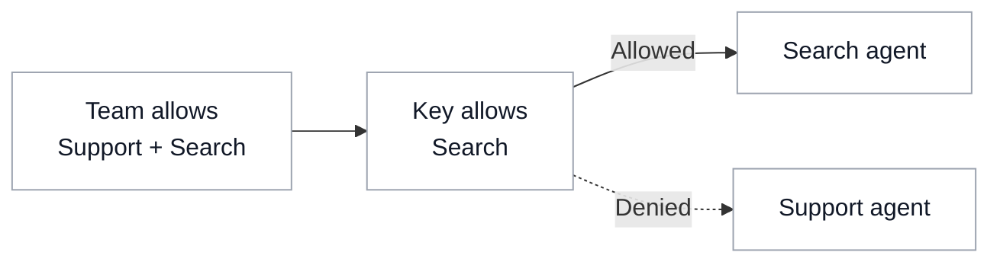

# Agent Access

{/* keep-version-note */}

Sign in as a [proxy admin](../access_control.md#global-proxy-roles) and [register your agent](../../a2a.md#adding-your-agent).

## Give a team access

Open **Teams → Create Team**. Expand **Agent Settings**, select the **Allowed Agents**, and create the team.

To reuse an agent list across teams, assign an [access group](../access_groups.md#5-attach-the-access-group-to-a-team).

## Give an application access

Open **Virtual Keys → Create New Key**. Name the key and select its team. Under **Agent Settings**, choose the agents the application needs and click **Create Key**. For production applications, use a [service account key](../service_accounts.md#usage).

A key with no agent selection inherits its team's access. When both have restrictions, the agent must be allowed by both, including any access group grants.

To require explicit agent permissions for non-admin keys, set `general_settings.agent_access_default_deny: true` in the proxy configuration. <SinceVersion v="1.108.0" />

## Manage access through your IdP

[Sync users and teams](../identity_provisioning.md), then assign agent permissions to those teams. Applications can authenticate with IdP tokens through [JWT key mapping](../jwt_key_mapping.md).

## Test access

Call `GET /v1/agents` with the application's static API credential or mapped JWT to list its allowed agents. Call an allowed agent, then a registered agent outside its permissions. A blocked call to `POST /a2a/{agent_id}` returns `403 Forbidden`.

[Agent permissions API examples](../../a2a_agent_permissions.md)

## Change or remove access

Open the key or team, select **Settings → Edit Settings**, update **Agents / Access Groups**, then click **Save Changes**. Remove any access group grants that also allow the agent.

Clearing the selection can restore inherited access. To stop all requests from an application, open the key's actions menu and choose **Block Key** or **Delete Key**.
