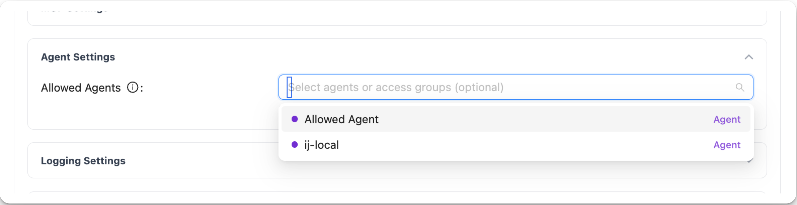
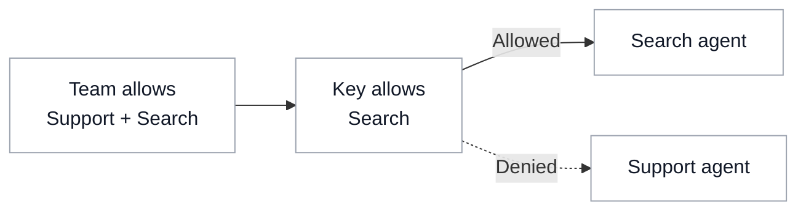

# Agent Access

{/* keep-version-note */}

Sign in as a [proxy admin](../access_control.md#global-proxy-roles) and [register your agent](../../a2a.md#adding-your-agent).

## Give a team access

Open **Teams → Create Team**. Expand **Agent Settings**, select the **Allowed Agents**, and create the team.

To reuse an agent list across teams, assign an [access group](../access_groups.md#5-attach-the-access-group-to-a-team).

## Give an application access

Open **Virtual Keys → Create New Key**. Name the key and select its team. Under **Agent Settings**, choose the agents the application needs and click **Create Key**. For production applications, use a [service account key](../service_accounts.md#usage).

[](../../../img/agent_key.png "Open full-size screenshot")

A key with no agent selection inherits its team's access. When both have restrictions, the agent must be allowed by both, including any access group grants.



To require explicit agent permissions for non-admin keys, set `general_settings.agent_access_default_deny: true` in the proxy configuration. <SinceVersion v="1.108.0" />

## Let an agent act for the caller {#act-for-the-caller}

Permission to invoke an agent is separate from permission for that agent to call models, MCP servers, or other agents. Give the agent its own Virtual Key, then forward the caller's context on its downstream requests.

Create the key with the registered agent's `agent_id`. Replace the example IDs with your agent and its team; choose a model that team permits:

```bash
curl "$LITELLM_BASE_URL/key/generate" \
  -H "Authorization: Bearer $LITELLM_ADMIN_KEY" \
  -H "Content-Type: application/json" \
  -d '{
    "key_alias": "support-agent",
    "agent_id": "registered-agent-id",
    "team_id": "agent-team-id",
    "models": ["gpt-4o"]
  }'
```

Store the returned key as `AGENT_API_KEY`. Configure its [MCP](./mcp.md) and downstream agent grants as needed. A key without `agent_id` does not apply the caller restrictions described here.

The caller invokes `POST /a2a/{agent_id}` with their own credential. LiteLLM forwards the resolved identity to the agent backend as `X-LiteLLM-User-Id` and `X-LiteLLM-Team-Id`, when present. Accept this context only from authenticated gateway requests.

In your agent's request handler, forward those headers with the agent's own key. For example, using FastAPI and the OpenAI Python SDK:

```python
import os

from fastapi import Request
from openai import AsyncOpenAI

client = AsyncOpenAI(
    api_key=os.environ["AGENT_API_KEY"],
    base_url=f"{os.environ['LITELLM_BASE_URL'].rstrip('/')}/v1",
)

async def call_model(request: Request):
    caller_headers = {
        name: request.headers[name]
        for name in ("X-LiteLLM-User-Id", "X-LiteLLM-Team-Id")
        if request.headers.get(name)
    }
    return await client.chat.completions.create(
        model="gpt-4o",
        messages=[{"role": "user", "content": "Summarize this support request."}],
        extra_headers=caller_headers,
    )
```

Forward the same headers on MCP and agent-to-agent requests. LiteLLM further restricts the agent's own permissions:

- **Models:** the caller team's model access and per-member restrictions apply; without a caller team, the caller user's model list applies.
- **MCP:** caller team and user permissions can narrow servers and tools.
- **Other agents:** the caller team's agent grants apply.

These headers cannot expand the agent's grants. They do not carry the caller's Virtual Key restrictions or select the caller's upstream OAuth credentials. Missing headers leave the agent's own permissions in effect. The model request's `user` field is separate attribution and customer-budget context.

Test with a resource the agent can access but the caller cannot; the downstream request should be denied. See [access inheritance](./inheritance.md) and the [shared-agent walkthrough](/blog/ai-gateway-identity-and-finops) for the broader setup.

## Manage access through your IdP

[Sync users and teams](../identity_provisioning.md), then assign agent permissions to those teams. Applications can authenticate with IdP tokens through [JWT key mapping](../jwt_key_mapping.md).

## Test access

Call `GET /v1/agents` with the application's static API credential or mapped JWT to list its allowed agents. Call an allowed agent, then a registered agent outside its permissions. A blocked call to `POST /a2a/{agent_id}` returns `403 Forbidden`.

[Agent permissions API examples](../../a2a_agent_permissions.md)

## Change or remove access

Open the key or team, select **Settings → Edit Settings**, update **Agents / Access Groups**, then click **Save Changes**. Remove any access group grants that also allow the agent.

Clearing the selection can restore inherited access. To stop all requests from an application, open the key's actions menu and choose **Block Key** or **Delete Key**.
