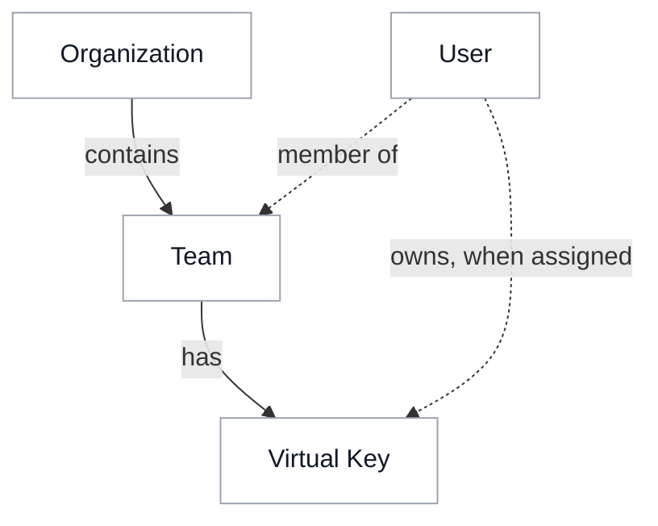

# Access inheritance

{/* keep-version-note */}

Permissions can be assigned to organizations, teams, users, and Virtual Keys. LiteLLM checks these permissions to decide which models, MCP servers, and agents a request can access. This page explains how permissions are inherited and checked.

A Virtual Key can be assigned to a team and a user. The table below shows how team, user, and organization permissions affect what the key can access.

## Keys assigned to a team

A user can belong to several teams, but a Virtual Key uses the permissions of the team assigned to it. [Agents acting for a caller](./agents.md#act-for-the-caller) can also forward that caller's user and team IDs.

| Resource | Key and team | User and organization |
| --- | --- | --- |
| **Models** | Both the key and team must allow the model. Access Groups can allow additional models, as described below. | Model restrictions for a team member can further limit access. The user's model list applies to keys without a team. LiteLLM checks organization model lists when teams are created or updated, with no separate organization model check on each request. |
| **MCP servers and tools** | The key and team must both allow the server. A key with no MCP servers configured inherits its team's servers by default. Tool permissions are also checked. | User and organization permissions can further restrict servers and tools. |
| **Agents** | The key and team must both allow the agent. A key with no agent restriction inherits its team's access. | Team keys have no additional user or organization agent restrictions. |

For example, if a team allows **Search** and **Support**, and its key allows only **Search**, that key can call only the Search agent.

### Access Groups can expand access {#access-groups-add-grants}

Authorized [Access Groups](../access_groups.md) assigned to a key can allow models and MCP servers that its team does not allow. For agents, the team must also allow the agent. When you remove access, check Access Group permissions as well as the key's own permissions.

MCP servers marked [available to all keys](../../mcp_control.md#public-mcp-servers-allow_all_keys) can also allow access. Set `general_settings.mcp_allow_all_keys_respects_mcp_scope: true` to apply a Virtual Key's MCP restrictions to these servers.

## Keys without a team

A personal key can call a model only if both the key and its user allow it. If the user has `no-default-models`, their personal keys cannot call models.

By default, a personal key does not inherit permissions from its user's teams. With `litellm_settings.personal_key_model_access_from_teams: true`, at least one of the user's teams must also allow the model. This setting also enables inheritance from the user's teams for MCP servers and agents. The MCP and agent permission checks described above still apply. This setting is off by default.

A [service account key](../service_accounts.md) belongs to a team and has no user owner. A key's owner is the user assigned to it, which can differ from the administrator who created it.

## Empty selections can restore access

Clearing a selection can remove a restriction or restore inherited access.

| Selection | Meaning |
| --- | --- |
| Empty key model list | The key adds no model restriction. Team and user restrictions still apply as described above. **All Team Models** uses the assigned team's model list. |
| No MCP selection on a key | The key inherits its team's MCP servers by default. [Require explicit MCP permissions on each key](../../mcp_control.md#require-keys-to-define-their-own-mcp-access) to turn this off. **No MCP Servers** blocks all MCP access for that key. |
| No agent restrictions on key or team | Agent access is open by default. Set `general_settings.agent_access_default_deny: true` to require explicit agent permissions for non-admin keys. |

To stop an application's requests entirely, block or delete its Virtual Key.

## Roles and limits

[Roles](../access_control.md) control administrative actions, such as creating keys or editing teams. Model, MCP, and agent permissions control what the key can call. [Budgets and rate limits](../users.md) limit usage. A key's own limit does not override other limits that apply to the request.

For setup, see [LLM Access](./llm.md), [MCP Access](./mcp.md), and [Agent Access](./agents.md).
