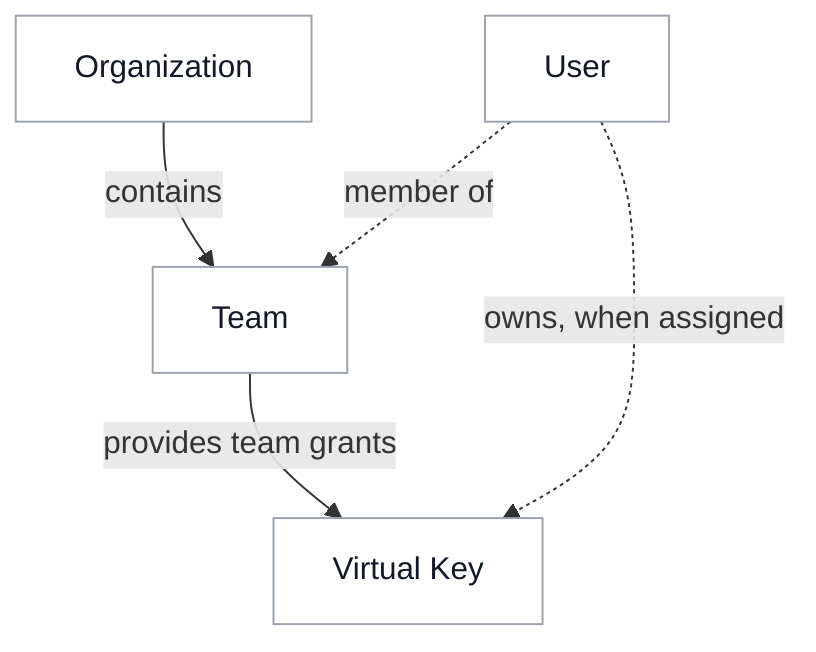

# Access inheritance

{/* keep-version-note */}

Permissions can be assigned to organizations, teams, users, and Virtual Keys. When a request reaches LiteLLM, the gateway combines the applicable permissions to decide what it can access. This page explains how those rules work for models, MCP servers, and agents.

Ownership and membership identify which rules apply. The way those rules combine depends on the resource.

## Keys assigned to a team

These rules describe ordinary application keys. A user can belong to several teams, but a team key uses the team selected on that key. [Agents acting for a caller](./agents.md#act-for-the-caller) also carry the caller's context into downstream requests.

| Resource | Key and team | User and organization |
| --- | --- | --- |
| **Models** | Both the key and team must allow the model. Access Groups can add grants, as described below. | A per-member model restriction can narrow access within the team. The user's personal model list applies to keys without a team. Organization model lists are checked on team creation and updates, with no separate organization model check on each request. |
| **MCP servers and tools** | Direct key and team selections must both allow the server. A key with no selection inherits its team's servers by default. Tool restrictions also combine. | Configured user and organization permissions can further narrow the available servers and tools. |
| **Agents** | The key and team must both allow the agent. A key with no agent restriction inherits its team's access. | Ordinary team keys have no additional user or organization agent allowlist. |

For example, if a team allows **Search** and **Support**, and its key allows only **Search**, that key can call only the Search agent.

### Access Groups add grants

Authorized [Access Groups](../access_groups.md) attached to a key can grant models and MCP servers beyond its team's selection. For agents, group grants still have to fit the team's agent access. Review group membership as well as direct selections when removing access.

MCP servers marked [available to all keys](../../mcp_control.md#public-mcp-servers-allow_all_keys) provide another grant. Set `general_settings.mcp_allow_all_keys_respects_mcp_scope: true` when these servers must respect a Virtual Key's configured MCP scope.

## Keys without a team

A personal key assigned to a user must pass its own model list and its owner's personal model list. The owner's `no-default-models` setting blocks this personal model-access path.

By default, belonging to a team does not make a personal key inherit that team's grants. With `litellm_settings.personal_key_model_access_from_teams: true`, model requests must also be allowed through at least one of the owner's teams. The same setting makes eligible team grants available to personal keys for MCP servers and agents; their resource-specific restrictions still apply. This setting is off by default.

A [service account key](../service_accounts.md) belongs to a team and has no user owner. Creating a key as an administrator does not make the administrator its owner; ownership comes from the key's assigned user.

## Empty selections can restore access

Clearing a selection can remove a restriction or restore inherited access.

| Selection | Meaning |
| --- | --- |
| Empty key model list | No extra model restriction at the key level; other applicable checks remain. **All Team Models** follows the selected team's models. |
| No MCP selection on a key | Inherit the team by default. [Require explicit key grants](../../mcp_control.md#require-keys-to-define-their-own-mcp-access) to disable this fallback. **No MCP Servers** blocks all MCP access for that key. |
| No agent restrictions on key or team | Agent access is open by default. Set `general_settings.agent_access_default_deny: true` to require a grant for non-admin keys. |

To stop an application's requests entirely, block or delete its Virtual Key.

## Roles and limits

[Roles](../access_control.md) control administrative actions, such as creating keys or editing teams. Resource permissions decide what the key can call. [Budgets and rate limits](../users.md) separately cap usage; a key's own limit does not replace applicable shared limits.

For setup, see [LLM Access](./llm.md), [MCP Access](./mcp.md), and [Agent Access](./agents.md).
