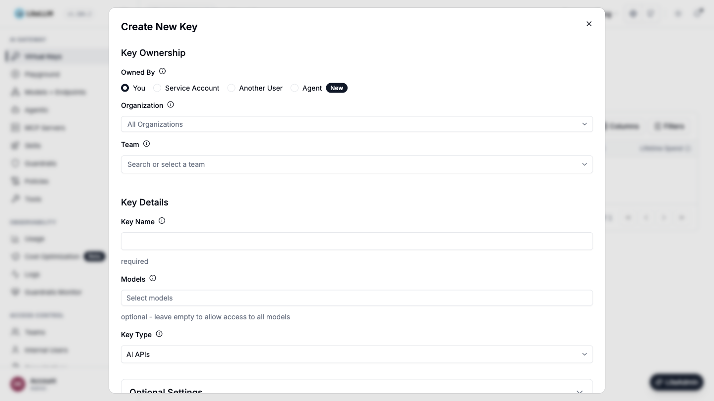

# LLM Access

{/* keep-version-note */}

Sign in as a [proxy admin](../access_control.md#global-proxy-roles) and [add your models](../docker_quick_start.md#3-add-your-first-model).

## Give a team access

Open **Teams** and create a team, or select an existing team and open **Settings → Edit Settings**. Under **Models**, select the models the team needs and save.

Use the model names configured in LiteLLM, which can differ from the provider's model names.

## Give an application access

Open **Virtual Keys → Create New Key**. Name the key, select the **Team**, and choose **AI APIs** as the key type.

Under **Models**, select the models the application needs, or choose **All Team Models**. Click **Create Key**. For production applications, use a [service account key](../service_accounts.md#usage).

When models are selected directly, both the key and team must allow the model. [Model access groups](../model_access_groups.md#managing-access-groups-via-ui) can grant additional models.

## Manage access through your IdP

[Sync users and teams](../identity_provisioning.md), then assign model permissions to those teams. Applications can authenticate with IdP tokens through [JWT key mapping](../jwt_key_mapping.md).

## Test access

Use the [chat completion example](../docker_quick_start.md#6-call-the-gateway-from-your-app) with the application's static API credential or mapped JWT. An allowed model should succeed. A configured model outside its permissions should return a model access error.

## Change or remove access

Edit the team's or key's **Models** selection and save. Remove any access group or wildcard grants that also allow the model.

Leaving a key's **Models** empty adds no restriction at the key level. To stop all requests from an application, open the key's actions menu and choose **Block Key** or **Delete Key**.

[Model access API examples](../model_access.md) · [Key permission rules](../key_auth_arch.md)
