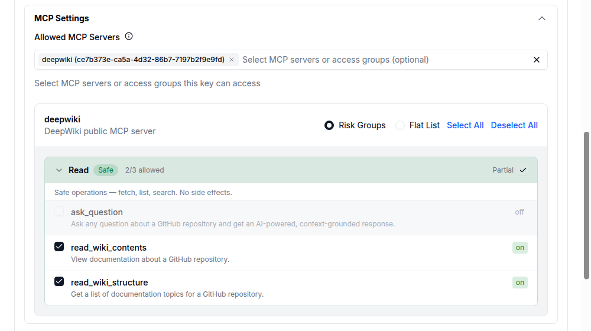

# MCP Access

{/* keep-version-note */}

Sign in as a [proxy admin](../access_control.md#global-proxy-roles) and [register your MCP server](../../mcp#adding-your-mcp).

## Give a team access

Open **Teams**, select the team, then open **Settings → Edit Settings**. Under **MCP Servers / Access Groups**, select the servers the team needs. Turn off any tools the team must not use, then click **Save Changes**.

For a new team, use **Create Team → MCP Settings → Allowed MCP Servers**.

## Give an application access

Open **Virtual Keys → + Create New Key**. Choose the team and give the key a name. Expand **MCP Settings**, then select the application's servers under **Allowed MCP Servers**. Turn off unneeded tools and click **Create Key**. For production applications, use a [service account key](../service_accounts.md#usage).

[](../../../img/mcp_grant_key_tools.png "Open full-size screenshot")

When servers are selected directly, both the key and team must allow the server. [Access groups](../access_groups.md#4-attach-the-access-group-to-a-key) can grant additional servers.

By default, a key with no MCP selection inherits its team's access. You can [require each key to define its own MCP access](../../mcp_control#require-keys-to-define-their-own-mcp-access).

## Manage access through your IdP

[Sync teams with SCIM and assign MCP permissions](../../mcp_grant_access.md#grant-mcp-access-through-scim-provisioned-teams). Applications can authenticate with IdP tokens through [JWT key mapping](../jwt_key_mapping.md).

## Test access

Set `LITELLM_PROXY_URL` to your gateway URL and `LITELLM_API_KEY` to the application's static API credential or mapped JWT. List its allowed tools:

```bash
curl "$LITELLM_PROXY_URL/mcp-rest/tools/list" \
  -H "Authorization: Bearer $LITELLM_API_KEY"
```

Check the returned tools, then [connect your MCP client](../../mcp_usage).

## Change or remove access

Open the key's **Settings → Edit Settings**, update **MCP Servers / Access Groups** and its tool selection, then save. To block all MCP access for the key, choose **No MCP Servers**. Clearing the selection can restore inherited access.

To restrict which applications can connect, configure the [MCP client allowlist](../../mcp_client_allowlist.md). To hide internal servers from external callers, configure [public internet access](../../mcp_public_internet.md).

For detailed configuration, see [API examples](../../mcp_grant_access), [MCP permission rules](../../mcp_control), and [Tool Policies](../tool_policies.md).

Configure the credentials LiteLLM sends to each server in [Upstream Authentication](../../mcp_upstream_auth.md).
