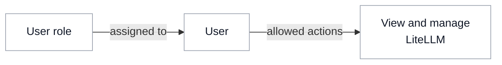

# Access Management

{/* keep-version-note */}

Control access to models, MCP servers, and agents in LiteLLM.

- [LLM Access](./llm.md)
- [MCP Access](./mcp.md)

## Users, teams, and virtual keys

Create users and teams in LiteLLM or [sync them from your identity provider (IdP)](../identity_provisioning.md).

A [virtual key](../virtual_keys.md) is a sub-identity under a user or team, with its own permissions, budgets, and rate limits. Authenticate with its static API credential or [map JWT claims to the virtual key](../jwt_key_mapping.md).

A [service account key](../service_accounts.md) is a team-owned virtual key for application access.

## Access groups

[Access groups](../access_groups.md) define which models, MCP servers, and agents a team or virtual key can use. Assign the same group to multiple teams or keys.

To manage membership in your IdP, [sync users and groups with SCIM](../../tutorials/scim_litellm.md), then assign access groups to the resulting LiteLLM teams.

## Roles

[Roles and team member permissions](../access_control.md) define what a user can view and manage in LiteLLM, such as viewing usage, creating keys, or editing team settings. [Audit logs](../audit_logs.md) record administrative changes.

