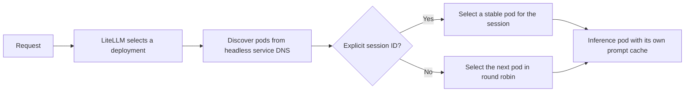

import Image from '@theme/IdealImage';

# Cache-Aware Routing

Route requests from the same session to the same inference pod so the server can reuse its prompt cache. This is useful for multi-turn conversations and agent workloads served by self-hosted models on Kubernetes.

LiteLLM discovers pod IPs behind a Kubernetes headless service and uses the request's session ID to select a pod. Requests without an explicit session ID are distributed across the pods using round robin.

The inference server must support and enable prompt or prefix caching for cache reuse. LiteLLM provides session affinity; it does not inspect the contents of each pod's cache or guarantee a cache hit.

## How it works



Pod selection happens after LiteLLM selects a deployment. Enable it with `kubernetes_pod_discovery` in the deployment's `litellm_params`; keep your existing [routing strategy](../routing.md). There is no additional `routing_strategy` value to set. Pass-through routes do not use pod discovery.

## Setup

### 1. Expose inference pods through a headless service

Run LiteLLM in the same Kubernetes cluster as your inference pods. It must be able to resolve the service hostname and connect directly to each pod's serving port.

For an existing inference deployment in the `gpu` namespace, create a headless service. Match `selector` to your pods' labels and use the port on which the inference server listens:

```yaml
apiVersion: v1
kind: Service
metadata:
  name: my-vllm-headless
  namespace: gpu
spec:
  clusterIP: None
  selector:
    app: vllm
  ports:
    - name: http
      port: 8000
      targetPort: 8000
```

The headless service's DNS answer provides the ready pod IPs. Use the pod's serving port in `api_base`: LiteLLM replaces the hostname with a pod IP and preserves the URL's port and path.

### 2. Enable pod discovery in LiteLLM

Add the model to your proxy configuration. Replace `your-served-model` with the model name exposed by your inference server and set `VLLM_API_KEY` in the proxy environment.

```yaml
model_list:
  - model_name: gpu-llama
    litellm_params:
      model: openai/your-served-model
      api_base: http://my-vllm-headless.gpu.svc.cluster.local:8000/v1
      api_key: os.environ/VLLM_API_KEY
      kubernetes_pod_discovery: true
```

You can also enable **Kubernetes pod discovery** in **Add Model > Advanced Settings** in the Admin UI.

### 3. Send a stable session ID

Send the same `litellm_session_id` on every request in a conversation. Use a different ID for each independent session.

```bash
curl http://localhost:4000/v1/chat/completions \
  -H "Authorization: Bearer $LITELLM_API_KEY" \
  -H "Content-Type: application/json" \
  -d '{
    "model": "gpu-llama",
    "litellm_session_id": "conversation-123",
    "messages": [
      {"role": "system", "content": "You are a helpful assistant."},
      {"role": "user", "content": "Help me plan a trip to Tokyo."}
    ]
  }'
```

Continue the conversation with the same session ID and include the conversation history in `messages`. Affinity does not store conversation history for you. With the same selected deployment and pod set, subsequent requests select the same pod.

You can also pass the ID as `metadata.session_id`:

```json
{
  "model": "gpu-llama",
  "metadata": {"session_id": "conversation-123"},
  "messages": [{"role": "user", "content": "Help me plan a trip to Tokyo."}]
}
```

When both fields are present, the top-level `litellm_session_id` takes precedence. You can also send the session ID through the `x-litellm-session-id` request header. If you also send `x-litellm-trace-id`, the caller's session ID still controls pod affinity.

Missing or empty session IDs use round robin, as do session IDs generated by the proxy through `missing_session_id: generate`. Stable IDs generated by your application work normally.

## Session affinity and retries

LiteLLM uses rendezvous hashing to rank pods for a session. Proxy workers that see the same pod IPs select the same pod for the same session, without a shared session-to-pod mapping. When pods are added or removed, some sessions move to a different pod and need to warm its cache again.

When LiteLLM retries a request, it selects the next pod in that session's stable ranking. After all pods have been tried, the ranking wraps around. A retry does not permanently move the session to the replacement pod. Configure retries through the existing [retry settings](./reliability.md#fallbacks--retries--timeouts--cooldowns).

Affinity applies within the selected deployment. If a model group contains multiple deployments, the routing strategy still chooses between those deployments first. Cooldowns and rate limits remain associated with the configured deployment, rather than individual discovered pods.

## Discovery settings

Set these environment variables on the LiteLLM proxy to control the DNS discovery cache:

| Environment variable | Default | Behavior |
| --- | --- | --- |
| `KUBERNETES_POD_DISCOVERY_REFRESH_INTERVAL_SECONDS` | `5` | Refresh the cached pod IPs when a request arrives after this interval. |
| `KUBERNETES_POD_DISCOVERY_IDLE_EVICTION_SECONDS` | `300` | Remove a service's cached pod set after it goes unused for this duration. |

These settings control LiteLLM's pod discovery cache. The inference server controls its own prompt cache lifetime.

A transient DNS failure preserves previously discovered pod IPs. An authoritative empty DNS answer clears the pod set. If no pod IP is available, LiteLLM keeps the configured service hostname for the request.

## Inspect pods and verify routing

### Model page

In the Admin UI, open **Models + Endpoints**, select the model, and open **Overview**. With pod discovery enabled, proxy admins and admin viewers see a **Kubernetes pods** card with the service host, port, ready pod count, and pod IPs. It refreshes every 10 seconds and includes a **Refresh** button.

The card performs a fresh DNS lookup, so its result can briefly differ from the router's cached pod set. Opening or refreshing the card does not change routing state.

Admins can retrieve the same information through the API. Use the configured model's ID in the path:

```bash
curl "http://localhost:4000/model/$MODEL_ID/kubernetes_pods" \
  -H "Authorization: Bearer $LITELLM_ADMIN_KEY"
```

The response includes `model_id`, `service_host`, `port`, `pod_ips`, `pod_count`, and `error`. Other roles cannot access this endpoint or see the card.

### Request logs

Open **Logs** in the Admin UI and select a request. The **Pod** row shows the selected pod IP, discovered pod count, and selection method: **Round robin**, **Session affinity**, or **Session affinity (retry)**. **API Base** also shows the pod IP used for that request. Compare requests with the same session ID to verify affinity; use requests without a session ID to check round-robin distribution.

<Image img={require('../../img/kubernetes_pod_discovery_logs.png')} alt="Request log showing the selected Kubernetes pod IP in API Base" style={{ width: '100%', maxWidth: '1200px' }} />

## Troubleshooting

| Symptom | What to check |
| --- | --- |
| Requests keep using the service hostname | Set `kubernetes_pod_discovery: true` and use an `http://` hostname. HTTPS URLs and IP literals are left unchanged. |
| No ready pods appear | Check the headless service's selector, pod readiness, and DNS resolution from the proxy. |
| Requests cannot connect to a pod | Check network policies and the port in `api_base`. Direct pod requests use the pod's serving port. |
| Routing changes between requests in a conversation | Reuse the same explicit session ID. Check whether the selected deployment or discovered pod set changed, or whether the request was retried. |
| `NO_PROXY` warning | If `HTTP_PROXY` or `ALL_PROXY` is set, ensure the proxy bypass covers the pod IPs as well as the service hostname. A CIDR entry alone does not cover pod IPs for these HTTP clients. LiteLLM keeps the service hostname if only that hostname is exempt. |
| The Kubernetes pods card reports an invalid `api_base` | Use an `http://` service hostname. HTTPS is not rewritten because replacing the hostname with a pod IP breaks TLS hostname verification. |

For provider-managed prompt caches across deployments, see [Prompt Caching Aware Routing](../tutorials/claude_code_prompt_cache_routing.md).
