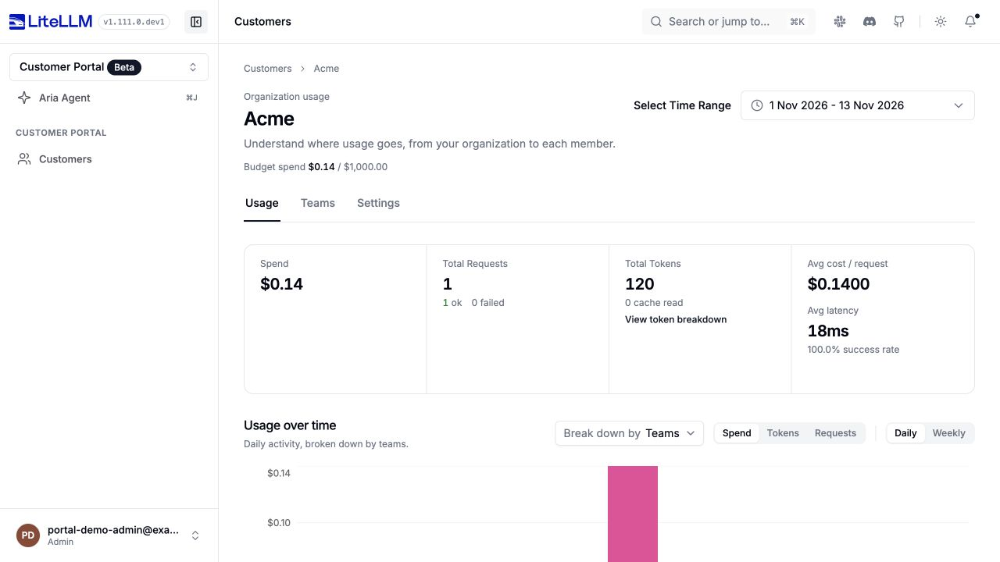
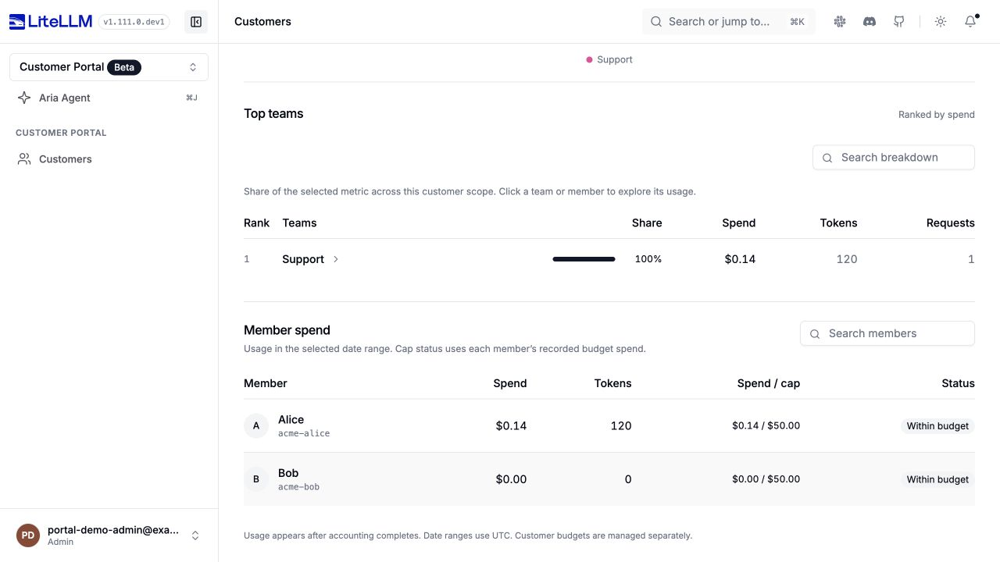
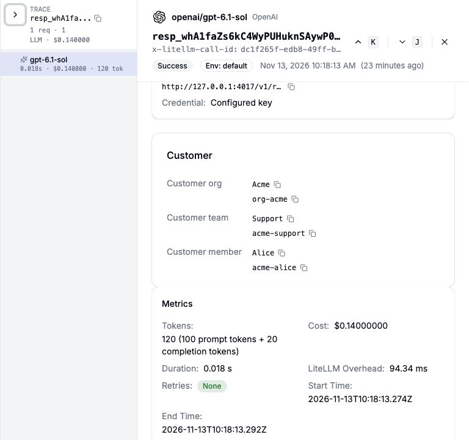

# Set customer budgets and read usage

:::info

Without a LiteLLM Enterprise license, Customer Management is free for up to 5 customer organizations, 5 customer teams per organization, and 5 customer members per team. The auto-created `default` team counts toward the team limit. [LiteLLM Enterprise](https://www.litellm.ai/enterprise) removes these limits.

:::

Use one application API key for your customers. Pass the customer's organization alias and member ID with each request. LiteLLM resolves the member's team and organization, checks their budgets, and records spend, tokens, and requests at all three levels.

<SinceVersion v="1.111.0" />

Start with [Customer Management](../customers.md) to track your first request. Use this guide to create a customer with budgets before sending traffic, add teams and members, and read usage from your backend. Webhook notifications are optional.



*Local Customer Management after one controlled-provider request, with usage read from the accounting ledger.*


## Free tier limits

Management creates that would exceed a free-tier limit return `403`. A member counts toward the limit of every team in its `parent_team_ids`.

Requests with a valid virtual key keep working, subject to the usual authentication, model access, budget, and rate-limit checks. If a limit prevents auto-registration, new organization aliases or member IDs are not auto-registered or tracked at that customer level. The proxy logs a `CUSTOMER TRACKING OFF` warning. Existing customer levels on the request remain tracked.

The Customers dashboard shows a banner when any free-tier limit is reached. If an Enterprise license lapses, existing rows keep being tracked, even when their counts exceed the free-tier limits. The limits restrict new creates, not existing tracking. Proxy admins can check current capacity with [the limits API](./api_reference.md#customer-management-limits).

## Before you start

You need a running [LiteLLM Gateway](../docker_quick_start.md), a connected PostgreSQL database with the customer migrations, your existing application API key, and a proxy admin key for management and usage reads.

Make these values available in your application's environment and the terminal where you run curl:

| Variable | Value |
| --- | --- |
| `LITELLM_BASE_URL` | Gateway URL without `/v1`, for example `http://localhost:4000`. |
| `LITELLM_MODEL` | An existing gateway model alias your application key can use. |
| `LITELLM_API_KEY` | Your existing application API key. The same key serves every customer. |
| `LITELLM_ADMIN_KEY` | Proxy admin key for Customer Management, usage, and log reads. |
| `START_DATE`, `END_DATE` | Inclusive UTC dates in `YYYY-MM-DD` format. Use the current UTC date for both on your first run. |

Keep keys on your server. Your backend authenticates the customer and selects the identity headers from that customer's session before it calls LiteLLM. It also authorizes customer access before it returns usage to your product.

## 1. Import a customer {#2-import-a-customer}

Create the organization first, then its team and members. Use IDs from your application, or save the IDs LiteLLM returns when you omit them.

### Create the organization and default member budget

Acme has a $1,000 budget. Its default member template gives each member a $50 budget, a $40 soft threshold, and rate limits.

```bash title="POST /management/v1/customer_organizations"
curl --request POST "$LITELLM_BASE_URL/management/v1/customer_organizations" \
  --header "Authorization: Bearer $LITELLM_ADMIN_KEY" \
  --header "Content-Type: application/json" \
  --data '{
    "customer_org_id": "org-acme",
    "alias": "Acme",
    "budget": {
      "max_budget": 1000,
      "budget_duration": "30d"
    },
    "default_budgets": [
      {
        "name": "standard",
        "max_budget": 50,
        "soft_budget": 40,
        "budget_duration": "30d",
        "rpm_limit": 60,
        "tpm_limit": 100000
      }
    ],
    "default_budget_template": "standard"
  }'
```

Expect `201 Created`. A soft budget is a notification threshold and does not block requests. [Webhook delivery](#1-set-up-budget-webhooks) requires the customer budget callback.

### Create the team

```bash title="POST /management/v1/customer_teams"
curl --request POST "$LITELLM_BASE_URL/management/v1/customer_teams" \
  --header "Authorization: Bearer $LITELLM_ADMIN_KEY" \
  --header "Content-Type: application/json" \
  --data '{
    "customer_team_id": "acme-support",
    "parent_org_id": "org-acme",
    "alias": "Support",
    "budget": {
      "max_budget": 250,
      "budget_duration": "30d"
    }
  }'
```

Expect `201` with `parent_org_id: "org-acme"`.

### Create Alice and Bob

Create each member with the Support team's ID in `parent_team_ids`. Omitting `budget_id` selects Acme's default member template.

```bash title="Create Alice"
curl --request POST "$LITELLM_BASE_URL/management/v1/customer_members" \
  --header "Authorization: Bearer $LITELLM_ADMIN_KEY" \
  --header "Content-Type: application/json" \
  --data '{
    "customer_member_id": "acme-alice",
    "parent_team_ids": ["acme-support"],
    "alias": "Alice"
  }'
```

```bash title="Create Bob"
curl --request POST "$LITELLM_BASE_URL/management/v1/customer_members" \
  --header "Authorization: Bearer $LITELLM_ADMIN_KEY" \
  --header "Content-Type: application/json" \
  --data '{
    "customer_member_id": "acme-bob",
    "parent_team_ids": ["acme-support"],
    "alias": "Bob"
  }'
```

Expect `201` for each member. Read `effective_budget` in the response to verify the inherited $50 cap. Use `budget_id` to select another template or `budget_override` to customize a member. The current API rejects the old `budget_template_id` field.

### Use an email as a member ID {#add-an-email-preview}

You can use an email string as `customer_member_id` if it is a stable, gateway-wide unique ID in your application. LiteLLM treats it as an ID; v1.111 has no separate member `email` field or `x-litellm-customer-member-email` lookup. Use an application-owned ID if the email can change.

### Repeat an import

A repeated create returns `409` for an existing ID. Retrieve that ID, confirm its parent, then patch the fields you need to change. This gives your backend an upsert flow with the existing APIs.

```bash title="Retrieve the existing member"
curl "$LITELLM_BASE_URL/management/v1/customer_members/acme-alice" \
  --header "Authorization: Bearer $LITELLM_ADMIN_KEY"
```

After confirming `parent_team_ids` contains `acme-support`, update Alice:

```bash title="Update the existing member"
curl --request PATCH "$LITELLM_BASE_URL/management/v1/customer_members/acme-alice" \
  --header "Authorization: Bearer $LITELLM_ADMIN_KEY" \
  --header "Content-Type: application/json" \
  --data '{
    "alias": "Alice"
  }'
```

Use the same create, retrieve, and update flow for organizations and teams. For repeatable organization and member imports, use the [upsert endpoints](./api_reference.md#retry-a-customer-import).

## 2. Send a request for Alice {#3-send-a-request-for-alice}

Use your existing application key and pass Alice's identity in request headers:

```http
x-litellm-customer-org-alias: Acme
x-litellm-customer-member-id: acme-alice
```

LiteLLM resolves `acme-alice` to `acme-support`, then `org-acme`. The same identity headers work with Responses, Chat Completions, and Anthropic Messages.

### OpenAI Responses SDK

Run `pip install openai` in your application project. The raw response exposes `x-litellm-call-id`, which you use to find this request in spend logs.

```python
import os

from openai import OpenAI

client = OpenAI(
    api_key=os.environ["LITELLM_API_KEY"],
    base_url=f"{os.environ['LITELLM_BASE_URL'].rstrip('/')}/v1",
)
raw_response = client.responses.with_raw_response.create(
    model=os.environ["LITELLM_MODEL"],
    input="Write a short welcome message.",
    extra_headers={
        "x-litellm-customer-org-alias": "Acme",
        "x-litellm-customer-member-id": "acme-alice",
    },
)
response = raw_response.parse()
print(response.output_text)
print("LiteLLM call ID:", raw_response.headers.get("x-litellm-call-id"))
```

Expect a successful Responses result. LiteLLM checks the organization, team, and member budgets, model access, and rate limits, then attributes usage to all three records.

### LangChain Deep Agents

Run `pip install deepagents langchain-openai`. Use a model alias that supports tool calling. Configure the model for the authenticated customer's request:

```python
import os

from deepagents import create_deep_agent
from langchain_openai import ChatOpenAI

model = ChatOpenAI(
    model=os.environ["LITELLM_MODEL"],
    base_url=f"{os.environ['LITELLM_BASE_URL'].rstrip('/')}/v1",
    api_key=os.environ["LITELLM_API_KEY"],
    use_responses_api=True,
    default_headers={
        "x-litellm-customer-org-alias": "Acme",
        "x-litellm-customer-member-id": "acme-alice",
    },
)
agent = create_deep_agent(model=model)
result = agent.invoke({"messages": [{"role": "user", "content": "Say hello to Alice."}]})
print(result["messages"][-1].text)
```

Select the customer's headers for each authenticated request. Do not change a shared model instance's headers while it serves other customers.

An existing member ID can resolve its parents without the organization header. With an existing organization alias and a new member ID, LiteLLM registers the member under `org-acme:default` and assigns the organization's default member template. An alias alone attributes usage to the organization.

For first-request registration and team selection, see [inference identity headers](./api_reference.md#attribute-inference-requests).

To send customer identity in a JWT instead of headers, see [customer identity from JWT claims](./jwt-customer-identity.md). If the JWT identifies your app but your customer identity comes from headers, see [how to send both in one request](./jwt-customer-identity.md#app-jwt-customer-headers).

## 3. Fetch usage for your product {#5-fetch-usage-for-your-product}

The organization aggregated endpoint returns complete spend, token, and request totals for the date range, without pagination. It accepts up to 100 customer organization IDs.

```bash title="Complete Acme usage"
curl --get "$LITELLM_BASE_URL/management/v1/customer_organizations/daily/activity/aggregated" \
  --header "Authorization: Bearer $LITELLM_ADMIN_KEY" \
  --data-urlencode "customer_org_ids=org-acme" \
  --data-urlencode "start_date=$START_DATE" \
  --data-urlencode "end_date=$END_DATE"
```

Read the response's top-level metadata:

```json title="Usage response excerpt from the local example"
{
  "metadata": {
    "total_spend": 0.14,
    "total_tokens": 120,
    "total_api_requests": 1
  }
}
```

Dates are inclusive UTC days, with at most a 400-day difference between start and end. `total_spend` is cost in USD. You can use it in your product's pricing or chargeback calculation; this API does not create invoices or collect payment. The key breakdown shows the top key, while totals include every key.

### Team and member usage

```bash title="Support team usage, first page"
curl --get "$LITELLM_BASE_URL/management/v1/customer_teams/daily/activity" \
  --header "Authorization: Bearer $LITELLM_ADMIN_KEY" \
  --data-urlencode "customer_team_ids=acme-support" \
  --data-urlencode "start_date=$START_DATE" \
  --data-urlencode "end_date=$END_DATE" \
  --data-urlencode "page=1" \
  --data-urlencode "page_size=100"
```

```bash title="Alice's usage, first page"
curl --get "$LITELLM_BASE_URL/management/v1/customer_members/daily/activity" \
  --header "Authorization: Bearer $LITELLM_ADMIN_KEY" \
  --data-urlencode "customer_member_ids=acme-alice" \
  --data-urlencode "start_date=$START_DATE" \
  --data-urlencode "end_date=$END_DATE" \
  --data-urlencode "page=1" \
  --data-urlencode "page_size=100"
```

These endpoints paginate stored rows. Follow `metadata.has_more` and increment `page` until it is `false`. Sum each page's totals once; the same date can occur on several pages. See the [pagination contract](./api_reference.md#usage-pagination). Do not add organization, team, and member totals together: they include the same requests.

Accounting runs in the background. If usage has not appeared after a successful request, check accounting completion, the UTC dates, and the identity headers. Zero-cost models can report requests and tokens with $0 spend.

## 4. Fetch budgets and caps {#6-fetch-budgets-and-caps}

Retrieve Acme's running budget spend and organization cap:

```bash title="Organization budget"
curl "$LITELLM_BASE_URL/management/v1/customer_organizations/org-acme" \
  --header "Authorization: Bearer $LITELLM_ADMIN_KEY"
```

Retrieve the Support team's running spend and cap:

```bash title="Team budget"
curl "$LITELLM_BASE_URL/management/v1/customer_teams/acme-support" \
  --header "Authorization: Bearer $LITELLM_ADMIN_KEY"
```

Retrieve Alice's inherited budget and active overrides:

```bash title="Member budget"
curl "$LITELLM_BASE_URL/management/v1/customer_members/acme-alice" \
  --header "Authorization: Bearer $LITELLM_ADMIN_KEY"
```

Read `budget.max_budget` for an organization and `effective_budget.max_budget` for a team or member. The same objects contain `rpm_limit`, `tpm_limit`, model limits, and allowed models. A team or member's effective budget combines its template with active overrides; an expired override no longer applies.

`spend` is the current budget counter, `budget_usage` lists the current counter and `reset_at` of each budget window, and `budget_reset_at` records the next reset. Usage reads report historical spend by UTC day for the dates you select. A reset sets the counters back without erasing that history. Budgets reset on the separately configured [budget reset timezone](../budget_reset_and_tz.md), so a window boundary need not line up with a UTC day. To resolve a member's parents in your product, read its `parent_org_id` and `parent_team_ids`. The first team is its default team.

Open **Customer Management → Customers**, select **Acme**, and choose **Select Time Range** to include your requests. The usage page shows spend, requests, tokens, and the member caps. Choose **Teams** in **Break down by** to inspect Support.



*Actual customer records and accounting data in the local Customer Management. Alice's controlled-provider request records $0.14 and 120 tokens.*

## Set up budget webhooks (optional) {#1-set-up-budget-webhooks}

Skip this section if you do not need budget notifications. Prepare a POST endpoint in your product that accepts JSON and returns a successful `2xx` response within 10 seconds. The gateway must be able to reach it.

Replace the example endpoint below with your receiver URL. Add this configuration before testing webhook delivery, then restart the gateway:

```yaml title="config.yaml, additions to your existing configuration"
general_settings:
  use_spend_logs_ledger: true

litellm_settings:
  callbacks: [customer_budget_webhook]

callback_settings:
  customer_budget_webhook:
    endpoint: https://billing.example.com/litellm/customer-budget
    headers:
      X-Source: litellm
```

Merge these entries with your existing configuration. If you already have callbacks, add `customer_budget_webhook` to that list. For values supplied through your secret store, use `CUSTOMER_BUDGET_WEBHOOK_URL` and `CUSTOMER_BUDGET_WEBHOOK_HEADERS`; see [configuration precedence](./api_reference.md#customer-budget-events).

After a positive spend update commits, LiteLLM checks the affected organization, team, and member. Spend at or above `soft_budget` produces `soft_budget_crossed`; spend at or above `max_budget` produces `budget_crossed`. One update can produce both events at several levels. Free requests and requests rejected before inference do not produce a customer budget spend event.

```json title="Example event for Alice's $40 soft threshold"
{
  "event": "soft_budget_crossed",
  "scope": "customer_member",
  "entity_id": "acme-alice",
  "customer_org_id": "org-acme",
  "customer_org_alias": "Acme",
  "customer_team_id": null,
  "customer_team_alias": null,
  "customer_member_id": "acme-alice",
  "customer_member_alias": "Alice",
  "spend": 41.25,
  "budget": 40,
  "period": "2026-12-13T12:00:00+00:00",
  "timestamp": "2026-11-13T12:00:00Z"
}
```

`budget` is the triggering threshold. `period` is the recorded next reset timestamp, or `"lifetime"` if no reset is recorded. Route the event with `customer_org_id` to update the customer's balance in your product. A member budget covers that member across teams, so member events contain the organization and member IDs; the team fields are `null`.

Return a successful `2xx` response within 10 seconds. Delivery is best effort: a cache claim suppresses the same event, scope, entity, and period until the budget reset, including after failure. Lifetime budgets use a cache claim with a 100-year TTL. Cross-worker deduplication needs shared Redis; a local fallback can produce duplicates. The HTTP client retries a connection error once, but there is no durable retry queue or schedule for timeouts or unsuccessful HTTP responses. Reconcile through the usage APIs to recover missed events.

Verify delivery with the [webhook test](#verify-webhook-delivery), after the customer and SDK examples are ready.

## Check budgets and webhook delivery {#4-check-budgets-and-webhook-delivery}

Create a separate customer with a zero budget to check rejection without changing Acme's settings:

```bash title="Create a zero-cap test customer"
curl --request POST "$LITELLM_BASE_URL/management/v1/customer_organizations" \
  --header "Authorization: Bearer $LITELLM_ADMIN_KEY" \
  --header "Content-Type: application/json" \
  --data '{
    "customer_org_id": "org-budget-check",
    "alias": "Budget check",
    "budget": {
      "max_budget": 0
    }
  }'
```

Use the `client` from [Send a request for Alice](#3-send-a-request-for-alice) with the same application key and model, and this customer's alias:

```python
from openai import APIStatusError

try:
    response = client.responses.create(
        model=os.environ["LITELLM_MODEL"],
        input="Budget check",
        extra_headers={"x-litellm-customer-org-alias": "Budget check"},
    )
    print("Request succeeded:", response.id)
except APIStatusError as error:
    print(error.status_code)
```

Expect `422` and a budget error naming `customer_org=org-budget-check`, before a provider request. A deployment can change this status to `429`; see [Handle a budget refusal in your client](#handle-a-budget-refusal-in-your-client).

### Verify webhook delivery

Skip this test if you did not configure [budget webhooks](#1-set-up-budget-webhooks). Use a positive-cost model to test the webhook. Set the test cap to $1 and the soft threshold to $0, then rerun the same SDK call. The request succeeds and incurs the model's normal cost. Zero-cost requests do not produce a spend event.

```bash title="Allow the test request and trigger a soft-budget alert"
curl --request PATCH "$LITELLM_BASE_URL/management/v1/customer_organizations/org-budget-check" \
  --header "Authorization: Bearer $LITELLM_ADMIN_KEY" \
  --header "Content-Type: application/json" \
  --data '{
    "budget": {
      "max_budget": 1,
      "soft_budget": 0
    }
  }'
```

After accounting commits the request's cost, check your webhook receiver for `soft_budget_crossed`, with `scope: "customer_org"` and `entity_id: "org-budget-check"`. The event's `budget` is `0` and its `spend` is greater than `0`. The earlier rejected request does not generate this event.

```json title="Expected webhook excerpt, using the local demo cost"
{
  "event": "soft_budget_crossed",
  "scope": "customer_org",
  "entity_id": "org-budget-check",
  "customer_org_id": "org-budget-check",
  "spend": 0.14,
  "budget": 0
}
```

If the event does not arrive, confirm that the callback is enabled, the gateway can reach your endpoint, and accounting has recorded positive spend. Check gateway logs for delivery errors. Use a fresh test organization ID and alias when repeating this test: duplicate events remain suppressed for the budget period, including after a failed delivery.

Restore the test customer's zero cap and remove its soft threshold:

```bash title="Restore the test cap after the check"
curl --request PATCH "$LITELLM_BASE_URL/management/v1/customer_organizations/org-budget-check" \
  --header "Authorization: Bearer $LITELLM_ADMIN_KEY" \
  --header "Content-Type: application/json" \
  --data '{
    "budget": {
      "max_budget": 0,
      "soft_budget": null
    }
  }'
```

The first exhausted scope rejects a request: organization, then team, then member. Allow for requests already in flight and background accounting when you show balances.

### Handle a budget refusal in your client

A budget refusal returns `422` by default. A deployment that sets `budget_exceeded_status_code: 429` under `litellm_settings` returns `429`, so identify the refusal from the parsed error body and not from the status or the message text.

```yaml title="config.yaml, optional: return 429 for budget refusals"
litellm_settings:
  budget_exceeded_status_code: 429
```

OpenAI-compatible routes such as `/v1/chat/completions` set `error.type` to `budget_exceeded`:

```json title="Chat Completions, default 422"
{
  "error": {
    "message": "ExceededBudget: customer_org=org-budget-check over budget. Spend=0.0, Budget=0.0. Spend resumes when the budget window resets.",
    "type": "budget_exceeded",
    "param": null,
    "code": "422"
  }
}
```

`/v1/messages` keeps an Anthropic error type and adds `error.litellm_error_type`:

```json title="Anthropic Messages, default 422"
{
  "type": "error",
  "error": {
    "type": "invalid_request_error",
    "message": "ExceededBudget: customer_org=org-budget-check over budget. Spend=0.0, Budget=0.0. Spend resumes when the budget window resets.",
    "litellm_error_type": "budget_exceeded"
  }
}
```

| Route | Status | `error.type` | `error.litellm_error_type` |
| --- | --- | --- | --- |
| `/v1/chat/completions` | `422`, default | `budget_exceeded` | Absent |
| `/v1/messages` | `422`, default | `invalid_request_error` | `budget_exceeded` |
| `/v1/chat/completions` | `429`, configured | `budget_exceeded` | Absent |
| `/v1/messages` | `429`, configured | `rate_limit_error` | `budget_exceeded` |

An ordinary rate limit, such as a scope's `rpm_limit`, is also a `429` but has a different body: `error.type` is `throttling_error` on OpenAI-compatible routes, and on `/v1/messages` it is `rate_limit_error` with no `litellm_error_type`.

The OpenAI SDK exposes the inner `error` object as `error.body`:

```python title="Detect a budget refusal with the OpenAI SDK"
import os

from openai import APIStatusError, OpenAI

client = OpenAI(
    api_key=os.environ["LITELLM_API_KEY"],
    base_url=f"{os.environ['LITELLM_BASE_URL'].rstrip('/')}/v1",
)


def is_budget_refusal(error: APIStatusError) -> bool:
    body = error.body
    return isinstance(body, dict) and body.get("type") == "budget_exceeded"


try:
    client.chat.completions.create(
        model=os.environ["LITELLM_MODEL"],
        messages=[{"role": "user", "content": "Budget check"}],
        extra_headers={"x-litellm-customer-org-alias": "Budget check"},
    )
except APIStatusError as error:
    if is_budget_refusal(error):
        print("Budget exhausted, do not retry:", error.status_code)
    else:
        raise
```

The Anthropic SDK exposes the whole response body, so read the nested `error` object. Run `pip install anthropic` first. Anthropic requires `max_tokens`; set `LITELLM_MODEL_MAX_OUTPUT_TOKENS` to the native output limit documented for your configured model.

```python title="Detect a budget refusal with the Anthropic SDK"
import os

from anthropic import Anthropic, APIStatusError

client = Anthropic(
    api_key=os.environ["LITELLM_API_KEY"],
    base_url=os.environ["LITELLM_BASE_URL"].rstrip("/"),
)


def is_budget_refusal(error: APIStatusError) -> bool:
    body = error.body
    detail = body.get("error") if isinstance(body, dict) else None
    return isinstance(detail, dict) and detail.get("litellm_error_type") == "budget_exceeded"


try:
    client.messages.create(
        model=os.environ["LITELLM_MODEL"],
        max_tokens=int(os.environ["LITELLM_MODEL_MAX_OUTPUT_TOKENS"]),
        messages=[{"role": "user", "content": "Budget check"}],
        extra_headers={"x-litellm-customer-org-alias": "Budget check"},
    )
except APIStatusError as error:
    if is_budget_refusal(error):
        print("Budget exhausted, do not retry:", error.status_code)
    else:
        raise
```

Retrying straight away does not help: the request is refused before it reaches a provider, and the response carries no `Retry-After` header. The same request can succeed after the exhausted budget or window resets, after an approved [budget increase request](./api_reference.md#budget-increase-requests), or after an administrator raises the limit. A budget without `budget_duration` or a window has no automatic reset, whatever the message text says, so read `budget_reset_at` and `budget_limits[].reset_at` from the management API before you tell a customer when to try again.

Both SDKs retry `429` twice by default, with backoff, before your code sees the exception. With the default `422` the refusal reaches your `except` block after one request. With a configured `429` the check above still identifies the refusal, but only after the SDK has sent the request three times. To avoid those extra requests, keep the default `422`, or pass `max_retries=0` to the client, or use `client.with_options(max_retries=0)` for one call, and retry in your own code only when the error is not a budget refusal.

## Debug a request in spend logs {#7-debug-a-request-in-spend-logs}

Use the `x-litellm-call-id` printed by the Responses SDK. Make that value available as `LITELLM_CALL_ID` in the environment where you run curl.

```bash title="Find a request by its LiteLLM call ID"
curl --get "$LITELLM_BASE_URL/spend/logs/v2" \
  --header "Authorization: Bearer $LITELLM_ADMIN_KEY" \
  --data-urlencode "request_id=$LITELLM_CALL_ID" \
  --data-urlencode "start_date=$START_DATE 00:00:00" \
  --data-urlencode "end_date=$END_DATE 23:59:59"
```

This API requires a date range even with a request ID. Check the saved metadata to verify Alice → Support → Acme:

```json title="Saved customer identity excerpt"
{
  "metadata": {
    "user_api_key_customer_member_id": "acme-alice",
    "user_api_key_customer_member_alias": "Alice",
    "user_api_key_customer_team_id": "acme-support",
    "user_api_key_customer_team_alias": "Support",
    "user_api_key_customer_org_id": "org-acme",
    "user_api_key_customer_org_alias": "Acme"
  }
}
```

Compare `spend` and `total_tokens` with usage. A `metadata.status` of `"failure"` identifies a failed request; an absent or null status follows the default success behavior.

Open `/ui/logs/?log_id=<x-litellm-call-id>`. In the request details, check **Customer** for the resolved hierarchy and **Metrics** for cost and tokens:



*Actual saved request in the local gateway, using a controlled provider and the accounting ledger.*

The log API has no customer organization, team, or member filter. `user_id`, `team_id`, and `end_user` refer to separate LiteLLM entities. Find an individual request by its call ID and use the customer usage APIs for customer totals.

## Shared team budget or per-member allowance

A team budget is one counter for the whole team: every member's spend draws down the same amount. A member template is a set of limits that each assigned member inherits with its own counter, so three members on a $10 template can spend $10 each. Use a team budget to cap a group's total and a template to give each person an allowance. You can combine both.

The examples below continue from [Import a customer](#2-import-a-customer) and use `org-acme`. They need `jq` to read an ID from a response. The `effective_budget` responses come from a local gateway; the spend figures in the prose are illustrations.

### One shared team budget

Create a Research team with a $100 budget and add three members. They inherit Acme's `standard` template, so each also has a $50 member cap.

```bash title="Create a team with a $100 shared budget"
curl --request POST "$LITELLM_BASE_URL/management/v1/customer_teams" \
  --header "Authorization: Bearer $LITELLM_ADMIN_KEY" \
  --header "Content-Type: application/json" \
  --data '{
    "customer_team_id": "acme-research",
    "parent_org_id": "org-acme",
    "alias": "Research",
    "budget": {
      "max_budget": 100,
      "budget_duration": "30d"
    }
  }'
```

```bash title="Add three members to the team"
for member in acme-carol acme-dan acme-erin; do
  curl --request POST "$LITELLM_BASE_URL/management/v1/customer_members" \
    --header "Authorization: Bearer $LITELLM_ADMIN_KEY" \
    --header "Content-Type: application/json" \
    --data "{
      \"customer_member_id\": \"$member\",
      \"parent_team_ids\": [\"acme-research\"]
    }"
done
```

The team's `spend` is the sum of its members' requests. If Carol spends $45, Dan $40, and Erin $15, the team counter reaches $100 and LiteLLM refuses the next request from any of the three, even though each is under the $50 member cap.

### A separate allowance for each member

Add a template with a $10 monthly window and a $100 annual window. The response is the organization, so read the new template's ID from its `default_budgets` array by name.

```bash title="Add a template with monthly and annual windows"
export TEMPLATE_ID="$(curl --silent --request POST \
  "$LITELLM_BASE_URL/management/v1/customer_organizations/org-acme/default_budgets" \
  --header "Authorization: Bearer $LITELLM_ADMIN_KEY" \
  --header "Content-Type: application/json" \
  --data '{
    "name": "monthly-allowance",
    "budget_limits": [
      {"budget_duration": "1mo", "max_budget": 10},
      {"budget_duration": "12mo", "max_budget": 100}
    ]
  }' | jq -r '.default_budgets[] | select(.name == "monthly-allowance") | .budget_id')"
echo "$TEMPLATE_ID"
```

Create a Sales team without a team budget and assign the template to three members through `budget_id`.

```bash title="Create a team and assign the template to three members"
curl --request POST "$LITELLM_BASE_URL/management/v1/customer_teams" \
  --header "Authorization: Bearer $LITELLM_ADMIN_KEY" \
  --header "Content-Type: application/json" \
  --data '{
    "customer_team_id": "acme-sales",
    "parent_org_id": "org-acme",
    "alias": "Sales"
  }'

for member in acme-frank acme-grace acme-heidi; do
  curl --request POST "$LITELLM_BASE_URL/management/v1/customer_members" \
    --header "Authorization: Bearer $LITELLM_ADMIN_KEY" \
    --header "Content-Type: application/json" \
    --data "{
      \"customer_member_id\": \"$member\",
      \"parent_team_ids\": [\"acme-sales\"],
      \"budget_id\": \"$TEMPLATE_ID\"
    }"
done
```

Each response has the same inherited limits:

```json title="effective_budget excerpt for each member"
{
  "budget_limits": [
    {"budget_duration": "1mo", "max_budget": 10, "reset_at": "2026-12-01T00:00:00Z"},
    {"budget_duration": "12mo", "max_budget": 100, "reset_at": "2027-01-01T00:00:00Z"}
  ]
}
```

All three inherit the same limits from the template, but each has a separate spend counter. If Frank spends $10 this month, LiteLLM refuses Frank's next request until the monthly window resets, while Grace and Heidi can still spend $10 each. Sales has no team budget, so the three can spend $30 in a month between them.

### Change the allowance for every assigned member

Patch the template to raise the monthly window to $20. A `budget_limits` patch replaces the whole array, so send the annual window again to keep it.

```bash title="Raise the monthly allowance to $20"
curl --request PATCH \
  "$LITELLM_BASE_URL/management/v1/customer_organizations/org-acme/default_budgets/$TEMPLATE_ID" \
  --header "Authorization: Bearer $LITELLM_ADMIN_KEY" \
  --header "Content-Type: application/json" \
  --data '{
    "budget_limits": [
      {"budget_duration": "1mo", "max_budget": 20},
      {"budget_duration": "12mo", "max_budget": 100}
    ]
  }'
```

Retrieve two of the members:

```bash title="Read the effective limits for Frank and Grace"
for member in acme-frank acme-grace; do
  curl --silent "$LITELLM_BASE_URL/management/v1/customer_members/$member" \
    --header "Authorization: Bearer $LITELLM_ADMIN_KEY" \
    | jq '{customer_member_id, spend, limits: .effective_budget.budget_limits}'
done
```

Both now report the $20 monthly window, and each keeps its own `spend`:

```text title="Output after the template edit"
{
  "customer_member_id": "acme-frank",
  "spend": 0,
  "limits": [
    {"budget_duration": "1mo", "max_budget": 20, "reset_at": "2026-12-01T00:00:00Z"},
    {"budget_duration": "12mo", "max_budget": 100, "reset_at": "2027-01-01T00:00:00Z"}
  ]
}
{
  "customer_member_id": "acme-grace",
  "spend": 0,
  "limits": [
    {"budget_duration": "1mo", "max_budget": 20, "reset_at": "2026-12-01T00:00:00Z"},
    {"budget_duration": "12mo", "max_budget": 100, "reset_at": "2027-01-01T00:00:00Z"}
  ]
}
```

A template edit reaches every member still assigned to it. Changing the organization's `default_budget_template_id` is different: it selects the template for members created afterward and does not reassign existing members. Carol, Dan, and Erin stay on `standard` if `monthly-allowance` becomes the default.

### Override one member

Give Frank a $50 monthly window until the end of the year. Use a future timestamp with a timezone.

```bash title="Override Frank's monthly window"
curl --request PATCH "$LITELLM_BASE_URL/management/v1/customer_members/acme-frank" \
  --header "Authorization: Bearer $LITELLM_ADMIN_KEY" \
  --header "Content-Type: application/json" \
  --data '{
    "budget_override": {
      "budget_limits": [
        {"budget_duration": "1mo", "max_budget": 50}
      ]
    },
    "budget_override_expires_at": "2027-01-01T00:00:00Z"
  }'
```

Frank's `effective_budget` now has a $50 monthly window and the template's $100 annual window. An override window replaces the template window with the same `budget_duration`, and the other template windows still apply. Other non-null override fields replace the matching template fields. Two cases differ: an override that sets its own `max_budget` drops every template window and keeps only the windows in the override, and a non-empty `allowed_models` override replaces the inherited list.

After `budget_override_expires_at` passes, Frank's `effective_budget` returns to the template's $20 and $100 windows. The response still includes the stored `budget_override`, so read `effective_budget` for the limits that apply now.

### Monthly and annual windows

Each `budget_limits` entry accepts `"1mo"` for a monthly window or `"12mo"` for an annual window, at most one of each. Other values, including `"1y"`, return `422` with `Input should be '1mo' or '12mo'`. This rule covers window entries only. The scalar `budget_duration` field beside `max_budget` has its own format, such as `"30d"`.

### How the limits combine

A request must pass every limit that applies to it: the organization's budget, the budget of the team the request resolves to, and the member's effective budget, including each of its windows. Each limit is compared with its own counter, so the smallest number does not decide the outcome alone. Erin can be refused at $15 of personal spend because Research has reached $100, and Frank can be refused at his $20 monthly window while Acme and Sales have room. LiteLLM checks the organization first, then the team, then the member, and the error names the first exhausted scope.

## Unresolved customer identities {#fail-open-handling-pending}

If LiteLLM cannot register an unknown organization or member, it logs a warning and continues without tracking that customer level. It still tracks any resolved levels and enforces the request's other authentication, model, budget, and rate limits. A conflicting organization, member, or team identity returns `403`. Verify usage after setup rather than treating a successful model response as proof of attribution. See [identity handling](./api_reference.md#attribute-inference-requests).

## Troubleshooting

| Result | Check |
| --- | --- |
| `409` during import | Retrieve the existing ID, verify its parent, then patch mutable fields. |
| `422` during member creation | Use `parent_team_ids` and `budget_id`. Supply a template or override if the organization has no default template. |
| `401` on inference | Check the application key and gateway authentication. |
| `403` on inference | Confirm that the organization alias matches the member's organization. |
| Budget `422`, or `429` when configured | Confirm it is a [budget refusal](#handle-a-budget-refusal-in-your-client), then read organization, team, and member spend and caps to find the first exhausted scope. |
| `429` without a budget error type | Check the scope's RPM, TPM, and model limits. |
| Missing customer usage or IDs in logs | Check the identity headers, registration warnings, free-tier capacity, and accounting completion. |
