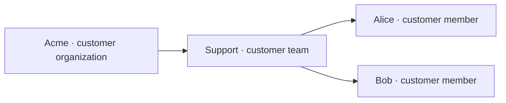

# Customer Portal API reference guide

Import your customers into LiteLLM, send requests with a customer member ID, and show each customer's spend, tokens, requests, and configured caps in your product.

In this guide, you create Acme, its Support team, and two members. LiteLLM resolves each member's team and organization when you send a request. You then fetch usage at each level through the API.


*Customer Portal usage preview with seeded sample API responses. Your totals depend on the requests you send.*

{/* keep-version-note: This walkthrough covers several APIs on main; no published release containing both changes has been verified. */}

:::info[Preview availability]

This guide covers the customer hierarchy and usage APIs on `main`, including [customer hierarchy #51459](https://github.com/BerriAI/litellm/pull/51459) and [customer usage #51495](https://github.com/BerriAI/litellm/pull/51495). Confirm that your deployment includes both changes and their database migrations. Check your gateway's `/openapi.json` for `/management/v1/customer_members` and `/management/v1/customer_members/daily/activity` before you start. These endpoints are absent from older releases.

:::



## Before you start

You need a running [LiteLLM Gateway](../docker_quick_start.md), a connected PostgreSQL database with the customer migrations applied, and a proxy admin key. The hierarchy and usage endpoints require the `proxy_admin` role, including read requests.

Use Bash or Zsh with `curl` and `jq`. Set these variables in the terminal where you run the examples:

```bash
set -o pipefail
export LITELLM_BASE_URL="http://localhost:4000"
export LITELLM_ADMIN_KEY="<your-proxy-admin-key>"
export LITELLM_MODEL="portal-chat"
```

Use your gateway's base URL without `/v1` or `/ui`. Replace `portal-chat` with a model alias from your gateway's `/models` response. Use your existing master key or a key with the `proxy_admin` role for `LITELLM_ADMIN_KEY`.

Keep the admin key on your server. Your browser or mobile app should call your backend, which authenticates the customer and fetches only that customer's data.

Customer attribution requires the spend accounting ledger. Keep it enabled in your gateway configuration:

```yaml title="config.yaml (addition to your existing configuration)"
general_settings:
  use_spend_logs_ledger: true
```

## 1. Import your customers

Create parents before their children. Use IDs from your application, with a customer prefix to keep them unique across your gateway. Save the returned IDs if you let LiteLLM generate them.

### Create a customer organization

Create Acme with an overall configured budget of $1,000 and a default member budget template of $50. Each member who inherits `standard` receives their own budget settings.

```bash title="POST /management/v1/customer_organizations"
curl --fail-with-body --silent --show-error \
  "$LITELLM_BASE_URL/management/v1/customer_organizations" \
  -H "Authorization: Bearer $LITELLM_ADMIN_KEY" \
  -H "Content-Type: application/json" \
  --data '{
    "customer_org_id": "acme",
    "alias": "Acme",
    "budget": {
      "max_budget": 1000,
      "budget_duration": "30d"
    },
    "default_budgets": [{
      "name": "standard",
      "is_default": true,
      "max_budget": 50,
      "budget_duration": "30d",
      "rpm_limit": 60,
      "tpm_limit": 100000
    }]
  }' | jq
```

Expect `201 Created`. The response includes `customer_org_id`, the organization's `budget`, and `default_budgets` with their generated `budget_id` values. Mark exactly one template as `is_default` when you supply templates.

### Create a customer team

Set `parent_org_id` to the organization you created. The team has its own configured budget.

```bash title="POST /management/v1/customer_teams"
curl --fail-with-body --silent --show-error \
  "$LITELLM_BASE_URL/management/v1/customer_teams" \
  -H "Authorization: Bearer $LITELLM_ADMIN_KEY" \
  -H "Content-Type: application/json" \
  --data '{
    "customer_team_id": "acme-support",
    "parent_org_id": "acme",
    "alias": "Support",
    "budget": {
      "max_budget": 250,
      "budget_duration": "30d"
    }
  }' | jq
```

Expect `201 Created` with `customer_team_id: "acme-support"` and `parent_org_id: "acme"`.

### Create customer members

Create one member per request. Alice and Bob inherit Acme's default member template because you omit `budget_template_id` and `budget_override`.

```bash title="POST /management/v1/customer_members (one request per member)"
for member in alice bob; do
  jq -n --arg id "acme-$member" --arg alias "$member" '{
    customer_member_id: $id,
    parent_team_id: "acme-support",
    alias: $alias
  }' | curl --fail-with-body --silent --show-error \
    "$LITELLM_BASE_URL/management/v1/customer_members" \
    -H "Authorization: Bearer $LITELLM_ADMIN_KEY" \
    -H "Content-Type: application/json" \
    --data-binary @- | jq
done
```

Expect `201 Created` for each member. The response includes the inherited settings in `effective_budget`. Example excerpt:

```json title="Alice (response excerpt)"
{
  "customer_member_id": "acme-alice",
  "parent_team_id": "acme-support",
  "effective_budget": {
    "max_budget": 50,
    "budget_duration": "30d",
    "rpm_limit": 60,
    "tpm_limit": 100000
  },
  "spend": 0
}
```

To assign a different template, pass its `budget_id` as `budget_template_id`. To customize a member, pass `budget_override`, for example `{"max_budget": 100}`. LiteLLM merges non-null budget and rate overrides with the template; use a non-empty `allowed_models` list to override inherited models. If the organization has no default template, supply a template or an override when you create the member.

Create each record once. A duplicate ID returns `409`; fetch the existing record or use `PATCH` to update it.

## 2. Send identifying information with requests

### Create a key bound to the customer

Create a virtual key with `metadata.customer_org_id`. LiteLLM requires this admin-assigned organization binding on non-admin keys that track customer usage.

```bash title="POST /key/generate"
CUSTOMER_KEY="$(
  jq -n --arg model "$LITELLM_MODEL" '{
    key_alias: "acme-application",
    models: [$model],
    metadata: {customer_org_id: "acme"}
  }' | curl --fail-with-body --silent --show-error \
    "$LITELLM_BASE_URL/key/generate" \
    -H "Authorization: Bearer $LITELLM_ADMIN_KEY" \
    -H "Content-Type: application/json" \
    --data-binary @- | jq -er '.key'
)"
```

Store `CUSTOMER_KEY` in your server's secret store. The command captures the key without printing it.

### Send a request for Alice

Set `metadata.customer_member_id` from your authenticated application user. You can send the member ID without repeating the team and organization IDs in the request body.

```bash title="POST /v1/chat/completions"
jq -n --arg model "$LITELLM_MODEL" '{
  model: $model,
  messages: [{role: "user", content: "Write a short welcome message."}],
  metadata: {customer_member_id: "acme-alice"}
}' | curl --fail-with-body --silent --show-error \
  "$LITELLM_BASE_URL/v1/chat/completions" \
  -H "Authorization: Bearer $CUSTOMER_KEY" \
  -H "Content-Type: application/json" \
  --data-binary @- | jq
```

LiteLLM looks up `acme-alice`, follows `parent_team_id` to `acme-support`, then follows `parent_org_id` to `acme`. It attributes the request to all three records and checks that Acme matches the key's organization binding. Conflicting IDs or a member from another organization cause an error before the provider call.

Use `metadata.customer_member_id` for this hierarchy. The OpenAI `user` field and the `x-litellm-customer-id` header identify the separate [customer/end-user tracker](../customers.md).

### Resolve the hierarchy from a member ID

Your backend can follow the same relationships through the read APIs:

```bash title="Resolve Alice → Support → Acme"
MEMBER="$(curl --fail-with-body --silent --show-error \
  "$LITELLM_BASE_URL/management/v1/customer_members/acme-alice" \
  -H "Authorization: Bearer $LITELLM_ADMIN_KEY")"
TEAM_ID="$(printf '%s' "$MEMBER" | jq -er '.parent_team_id')"

TEAM="$(curl --fail-with-body --silent --show-error \
  "$LITELLM_BASE_URL/management/v1/customer_teams/$TEAM_ID" \
  -H "Authorization: Bearer $LITELLM_ADMIN_KEY")"
ORG_ID="$(printf '%s' "$TEAM" | jq -er '.parent_org_id')"

curl --fail-with-body --silent --show-error \
  "$LITELLM_BASE_URL/management/v1/customer_organizations/$ORG_ID" \
  -H "Authorization: Bearer $LITELLM_ADMIN_KEY" | jq
```

For these sample IDs, `TEAM_ID` is `acme-support` and `ORG_ID` is `acme`. URL-encode IDs that contain reserved characters when constructing paths in your application.

## 3. Fetch usage for your product

Fetch spend in USD, token counts, and request counts for an inclusive UTC date range. The APIs return daily metrics and breakdowns by model, provider, API key, and the customer entity you queried.

Choose dates that include your requests. These example dates cover November 2026:

```bash
export START_DATE="2026-11-01"
export END_DATE="2026-11-30"
```

| Scope | Endpoint | ID filter |
| --- | --- | --- |
| Customer organization | `GET /management/v1/customer_organizations/daily/activity` | `customer_org_ids` |
| Customer team | `GET /management/v1/customer_teams/daily/activity` | `customer_team_ids` |
| Customer member | `GET /management/v1/customer_members/daily/activity` | `customer_member_ids` |

```bash title="Fetch organization, team, and member usage"
curl --fail-with-body --silent --show-error --get \
  "$LITELLM_BASE_URL/management/v1/customer_organizations/daily/activity" \
  -H "Authorization: Bearer $LITELLM_ADMIN_KEY" \
  --data-urlencode "customer_org_ids=acme" \
  --data-urlencode "start_date=$START_DATE" \
  --data-urlencode "end_date=$END_DATE" \
  --data-urlencode "page=1" --data-urlencode "page_size=100" | jq

curl --fail-with-body --silent --show-error --get \
  "$LITELLM_BASE_URL/management/v1/customer_teams/daily/activity" \
  -H "Authorization: Bearer $LITELLM_ADMIN_KEY" \
  --data-urlencode "customer_team_ids=acme-support" \
  --data-urlencode "start_date=$START_DATE" \
  --data-urlencode "end_date=$END_DATE" \
  --data-urlencode "page=1" --data-urlencode "page_size=100" | jq

curl --fail-with-body --silent --show-error --get \
  "$LITELLM_BASE_URL/management/v1/customer_members/daily/activity" \
  -H "Authorization: Bearer $LITELLM_ADMIN_KEY" \
  --data-urlencode "customer_member_ids=acme-alice" \
  --data-urlencode "start_date=$START_DATE" \
  --data-urlencode "end_date=$END_DATE" \
  --data-urlencode "page=1" --data-urlencode "page_size=100" | jq
```

Each ID filter accepts a comma-separated list. You can also filter by `model` or `api_key`, or omit the ID filter to fetch activity across customers as a proxy admin. Your backend should choose the IDs that the signed-in customer can access.

Example member response excerpt with sample data:

```json title="Usage response excerpt (sample data)"
{
  "results": [{
    "date": "2026-11-12",
    "metrics": {
      "spend": 0.14,
      "prompt_tokens": 100,
      "completion_tokens": 20,
      "total_tokens": 120,
      "api_requests": 1
    }
  }],
  "metadata": {
    "total_spend": 0.14,
    "total_tokens": 120,
    "total_api_requests": 1,
    "page": 1,
    "total_pages": 1,
    "has_more": false
  }
}
```

The same request contributes to its member, team, and organization totals. Display each scope as a view of that usage; adding the three totals would count the request three times.

### Read every page

Continue until `metadata.has_more` is `false`. The `metadata.total_*` fields cover the current page. Sum each page once for a range total. A date can appear on multiple pages because LiteLLM paginates stored usage rows before grouping them by day; merge matching dates when you build a chart.

For example, your backend can fetch an organization's range totals with Python and `httpx`. Run `uv add httpx` in your backend project, then save this as `customer_usage.py`:

```python title="customer_usage.py"
import json
import os
from decimal import Decimal

import httpx


def organization_usage(
    client: httpx.Client, organization_id: str, start_date: str, end_date: str
) -> dict[str, str | int]:
    spend = Decimal("0")
    tokens = 0
    requests = 0
    page = 1
    while True:
        response = client.get(
            "/management/v1/customer_organizations/daily/activity",
            params={
                "customer_org_ids": organization_id,
                "start_date": start_date,
                "end_date": end_date,
                "page": page,
                "page_size": 100,
            },
        )
        response.raise_for_status()
        metadata = response.json()["metadata"]
        spend += Decimal(str(metadata["total_spend"]))
        tokens += metadata["total_tokens"]
        requests += metadata["total_api_requests"]
        if not metadata["has_more"]:
            return {"spend_usd": str(spend), "tokens": tokens, "requests": requests}
        page += 1


if __name__ == "__main__":
    with httpx.Client(
        base_url=os.environ["LITELLM_BASE_URL"],
        headers={"Authorization": f"Bearer {os.environ['LITELLM_ADMIN_KEY']}"},
        timeout=30,
    ) as client:
        summary = organization_usage(
            client, "acme", os.environ["START_DATE"], os.environ["END_DATE"]
        )
        print(json.dumps(summary))
```

Run `uv run python customer_usage.py` from that project. In your product, derive `organization_id` from the authenticated customer's account and return the usage summary from your backend.

## 4. Fetch configured caps

Use the resource APIs to read budget settings alongside usage. Each response also includes recorded `spend` and `budget_reset_at`.

| Scope | Endpoint | Settings field |
| --- | --- | --- |
| Organization | `GET /management/v1/customer_organizations/{customer_org_id}` | `budget` |
| Team | `GET /management/v1/customer_teams/{customer_team_id}` | `budget` |
| Member | `GET /management/v1/customer_members/{customer_member_id}` | `effective_budget` |

```bash title="Read Alice's configured caps"
curl --fail-with-body --silent --show-error \
  "$LITELLM_BASE_URL/management/v1/customer_members/acme-alice" \
  -H "Authorization: Bearer $LITELLM_ADMIN_KEY" \
  | jq '{customer_member_id, parent_team_id, spend, budget_reset_at, effective_budget}'
```

Read `max_budget` for the USD cap, `rpm_limit` for requests per minute, `tpm_limit` for tokens per minute, `allowed_models` for the model list, and `budget_duration` for the configured duration. A null field has no value at that level. Use the member's `effective_budget` to include inherited template values and active overrides.

:::note[Configured caps and enforcement]

The customer hierarchy APIs store and return these settings. This preview does not enforce the customer hierarchy's spending or rate caps on inference requests. Use [virtual-key budgets](../virtual_keys.md) and [team budgets](../team_budgets.md) for request enforcement. Return the recorded `spend` and `budget_reset_at` as supplied; use the daily activity APIs for usage in a selected date range.

:::

### List customers and their caps

Use the collection endpoints to populate customer, team, and member tables in your product:

```bash title="List Acme's teams and Support's members"
curl --fail-with-body --silent --show-error --get \
  "$LITELLM_BASE_URL/management/v1/customer_teams" \
  -H "Authorization: Bearer $LITELLM_ADMIN_KEY" \
  --data-urlencode "parent_org_id=acme" \
  --data-urlencode "page=1" --data-urlencode "page_size=100" | jq

curl --fail-with-body --silent --show-error --get \
  "$LITELLM_BASE_URL/management/v1/customer_members" \
  -H "Authorization: Bearer $LITELLM_ADMIN_KEY" \
  --data-urlencode "parent_team_id=acme-support" \
  --data-urlencode "page=1" --data-urlencode "page_size=100" | jq
```

Call `GET /management/v1/customer_organizations` to list customer organizations. Collection responses use `data`, `meta`, and `links`, with `meta.total_pages` and a maximum `page_size` of 100. Usage responses use `results` and `metadata`; keep the pagination logic for each response format separate.

## 5. Check the result in Customer Portal

Open `/ui/customers/usage/?org=acme` on your gateway and choose a date range that includes your requests. Review spend, requests, and tokens, then choose **Teams** in **Break down by**. Select **Support**, then a member, to inspect that member's usage and configured caps.

Add `&team=acme-support&member=acme-alice` to the URL to open Alice's view. Link to this route from your admin tools after you create the organization.


*Member spend and configured caps in the usage components, with seeded sample API responses.*

LiteLLM writes accounting data in the background. If you see no usage after a successful request, allow the accounting writes to finish, check the date filter, and confirm that the request included the member metadata and used the customer-bound key. A zero-cost or mocked model can report tokens and requests with $0 spend.

## Troubleshooting

| Response | Action |
| --- | --- |
| `404` for the route | Check that your gateway includes the preview hierarchy and usage APIs. |
| `403` on a management or usage API | Use a `proxy_admin` credential. A customer-bound inference key cannot read these endpoints. |
| `409` when importing | Fetch the existing ID. Use `PATCH` to change the record. |
| `422` when creating a member | Supply an organization default template, a valid `budget_template_id`, or `budget_override`. |
| `400` or `403` on an attributed request | Check the member's parent team and organization, then compare them with the key's `metadata.customer_org_id`. |
| `503` on an attributed request | Check the database connection and `general_settings.use_spend_logs_ledger`. |

After importing Acme, repeat the parent-first creation sequence for your other customers. Bind each customer's inference key to its organization and serve usage and cap data through your backend.
