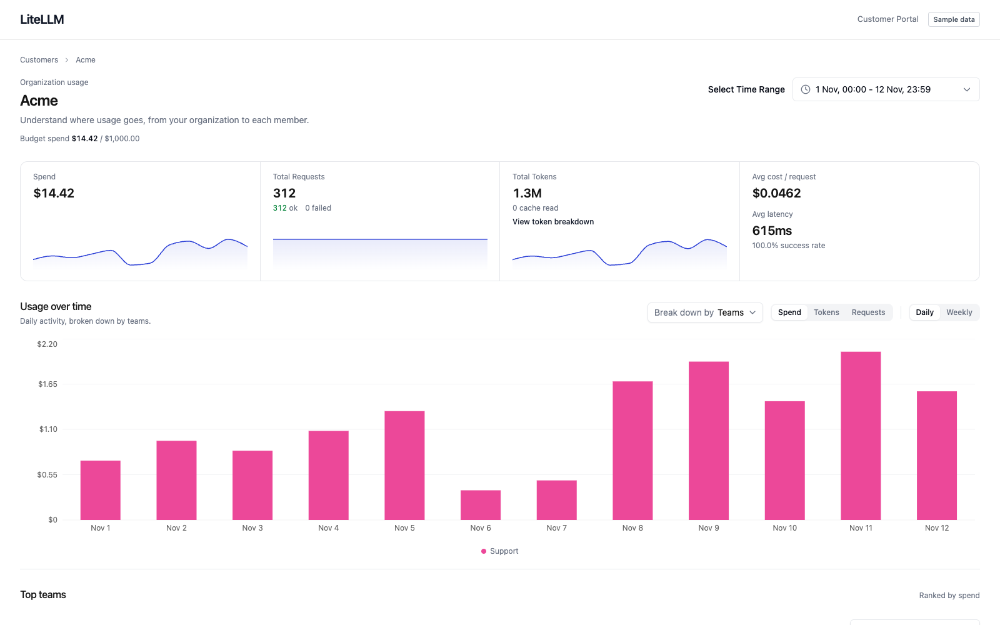
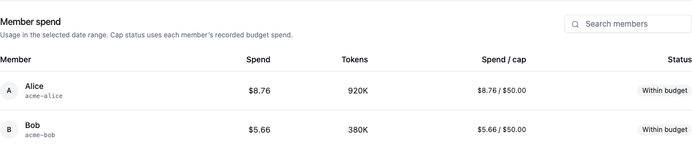

import Tabs from '@theme/Tabs';
import TabItem from '@theme/TabItem';

# Budget and charge back customers

Create a customer organization, add its teams and members, then pass customer identity with each LLM request. LiteLLM checks the customer's budgets and attributes spend, tokens, and requests to the member, team, and organization. Use the usage APIs to show those costs in your product or calculate chargebacks.

The same two headers work with Responses, Chat Completions, and Anthropic Messages:

```http
x-litellm-customer-org-alias: Acme
x-litellm-customer-member-id: acme-alice
```

In this guide, Alice belongs to Acme's Support team. LiteLLM resolves her member ID to the team and organization you create below.



*Customer Portal preview with seeded sample API responses. Your totals depend on the requests you send.*

{/* keep-version-note: This guide distinguishes the verified main-branch API from pending changes. A published release containing the complete integration has not been verified. */}

Use a build containing the customer hierarchy APIs, identity headers, usage routes, and database migrations on `main`. Check `/openapi.json` for `/management/v1/customer_members` before you start. Email, fresh spend counters, request-log identity fields, and webhooks have preview requirements beside their steps. See the [availability reference](./api_reference.md#availability) for the exact changes; a published release containing the complete integration has not been verified.

## Before you start

You need a running [LiteLLM Gateway](../docker_quick_start.md), a connected PostgreSQL database with the customer migrations, and a proxy admin key. Customer management and usage reads require `proxy_admin`.

Use Bash or Zsh with `curl` and `jq`. Set the base URL and a model alias from your gateway's `/models` response:

```bash
set -o pipefail
export LITELLM_BASE_URL="http://localhost:4000"
export LITELLM_MODEL="portal-chat"
export END_DATE="$(date -u +%Y-%m-%d)"
export START_DATE="$END_DATE"
```

The usage examples query today in UTC. Set `START_DATE` to an earlier `YYYY-MM-DD` value when you need a longer range.

Set `LITELLM_ADMIN_KEY` through your secret store or existing terminal environment. Keep it on your server. Your application should call your backend, which authenticates the customer and returns only that customer's data.

Keep the spend accounting ledger enabled in your gateway configuration:

```yaml title="config.yaml, addition to your existing configuration"
general_settings:
  use_spend_logs_ledger: true
```

## 1. Import the customer and its members

Create Acme with ID `org-acme`, its Support team, then Alice and Bob. Use IDs from your application and save the returned IDs when you let LiteLLM generate them.

### Create the organization and default member budget

Acme has a $1,000 organization budget. Each member who inherits the `standard` template has a $50 budget and the template's rate limits.

```bash title="POST /management/v1/customer_organizations"
curl --fail-with-body --silent --show-error \
  "$LITELLM_BASE_URL/management/v1/customer_organizations" \
  -H "Authorization: Bearer $LITELLM_ADMIN_KEY" \
  -H "Content-Type: application/json" \
  --data '{
    "customer_org_id": "org-acme",
    "alias": "Acme",
    "budget": {"max_budget": 1000, "budget_duration": "30d"},
    "default_budgets": [{
      "name": "standard",
      "is_default": true,
      "max_budget": 50,
      "soft_budget": 40,
      "budget_duration": "30d",
      "rpm_limit": 60,
      "tpm_limit": 100000
    }]
  }' | jq
```

Expect `201 Created`. Save `customer_org_id` and `default_budget_id`. A soft budget records a notification threshold; it does not block requests. [Configure a webhook](#7-receive-budget-events-preview) to receive events on a build with customer budget callback support.

### Create the team

```bash title="POST /management/v1/customer_teams"
curl --fail-with-body --silent --show-error \
  "$LITELLM_BASE_URL/management/v1/customer_teams" \
  -H "Authorization: Bearer $LITELLM_ADMIN_KEY" \
  -H "Content-Type: application/json" \
  --data '{
    "customer_team_id": "acme-support",
    "parent_org_id": "org-acme",
    "alias": "Support",
    "budget": {"max_budget": 250, "budget_duration": "30d"}
  }' | jq
```

Expect `201` with `parent_org_id: "org-acme"`.

### Create the members

Create one member per request. Omitting `budget_id` assigns Acme's default member template.

```bash title="POST /management/v1/customer_members"
for member in alice bob; do
  jq -n --arg id "acme-$member" --arg alias "$member" '{
    customer_member_id: $id,
    parent_team_id: "acme-support",
    alias: $alias
  }' | curl --fail-with-body --silent --show-error \
    "$LITELLM_BASE_URL/management/v1/customer_members" \
    -H "Authorization: Bearer $LITELLM_ADMIN_KEY" \
    -H "Content-Type: application/json" \
    --data-binary @- | jq
done
```

Expect `201` for each member. Read `effective_budget` to verify the inherited $50 budget. To choose another template, pass its `budget_id`. To customize a member, pass `budget_override`, for example `{"max_budget": 100}`. The current API rejects the old `budget_template_id` field.

If your build includes [#51617](https://github.com/BerriAI/litellm/pull/51617), you can add Alice's email. Older builds reject this field:

```bash title="Optional, requires member email support"
curl --fail-with-body --silent --show-error --request PATCH \
  "$LITELLM_BASE_URL/management/v1/customer_members/acme-alice" \
  -H "Authorization: Bearer $LITELLM_ADMIN_KEY" \
  -H "Content-Type: application/json" \
  --data '{"email":"alice@acme.example"}' | jq
```

### Repeat an import without duplicate customers

A repeated `POST` returns `409` for an existing ID. Your backend can implement an upsert with the existing APIs: on `409` or an uncertain create response, retrieve that ID, verify its parent, then patch the mutable fields. Do not generate another ID to retry the same customer.

```bash title="Retrieve and update the existing member"
curl --fail-with-body --silent --show-error \
  "$LITELLM_BASE_URL/management/v1/customer_members/acme-alice" \
  -H "Authorization: Bearer $LITELLM_ADMIN_KEY" \
  | jq '{customer_member_id, parent_team_id, effective_budget}'

# Continue after confirming parent_team_id is acme-support.
curl --fail-with-body --silent --show-error --request PATCH \
  "$LITELLM_BASE_URL/management/v1/customer_members/acme-alice" \
  -H "Authorization: Bearer $LITELLM_ADMIN_KEY" \
  -H "Content-Type: application/json" \
  --data '{"alias":"Alice"}' | jq
```

Use the same create, retrieve, and patch pattern for organizations and teams. Update named templates through their [template routes](./api_reference.md#member-budget-templates). Native upsert and automatic organization creation remain under review in #51607.

## 2. Bind a key and send a Responses request

Bind your application's inference key to Acme. This prevents the key from acting for another customer organization.

```bash title="Create and capture a customer-bound key"
LITELLM_CUSTOMER_KEY="$(
  jq -n --arg model "$LITELLM_MODEL" '{
    key_alias: "acme-application",
    models: [$model],
    metadata: {customer_org_id: "org-acme"}
  }' | curl --fail-with-body --silent --show-error \
    "$LITELLM_BASE_URL/key/generate" \
    -H "Authorization: Bearer $LITELLM_ADMIN_KEY" \
    -H "Content-Type: application/json" \
    --data-binary @- | jq -er '.key'
)"
export LITELLM_CUSTOMER_KEY
```

Store the generated key in your server's secret store. The command captures it without printing it.

Send the current member's ID from your authenticated application session. Save the response headers so you can trace the request in step 6.

```bash title="POST /v1/responses"
LITELLM_RESPONSE_HEADERS="$(mktemp)"
export LITELLM_RESPONSE_HEADERS

jq -n --arg model "$LITELLM_MODEL" '{
  model: $model,
  input: "Write a short welcome message."
}' | curl --fail-with-body --silent --show-error \
  "$LITELLM_BASE_URL/v1/responses" \
  -H "Authorization: Bearer $LITELLM_CUSTOMER_KEY" \
  -H "Content-Type: application/json" \
  -H "x-litellm-customer-org-alias: Acme" \
  -H "x-litellm-customer-member-id: acme-alice" \
  --dump-header "$LITELLM_RESPONSE_HEADERS" \
  --data-binary @- | jq
```

Expect a successful Responses result. LiteLLM resolves `acme-alice` to `acme-support`, then `org-acme`. It checks the applicable budgets, model access, and rate limits, and attributes the request to those three records.

You can use an existing member ID without the organization header. With an organization alias and a new member ID, LiteLLM registers the member under `org-acme:default` and assigns the organization's default member template. The organization must already exist and have a default template. An alias alone charges only the organization.

:::info Member email

With #51617, replace `x-litellm-customer-member-id` with `x-litellm-customer-member-email: alice@acme.example` and keep the organization alias header. An email in the member-ID header is an ID string, not an email lookup. Check the [email availability note](./api_reference.md#customer-members) before using this path.

:::

### Use the same identity in your SDK

<Tabs>
<TabItem value="python" label="OpenAI Python" default>

Run `uv add openai` in your application project. Save this as `customer_request.py`, then run `uv run python customer_request.py` from the terminal where you exported the variables above.

```python title="customer_request.py"
import os

from openai import OpenAI

client = OpenAI(
    api_key=os.environ["LITELLM_CUSTOMER_KEY"],
    base_url=f"{os.environ['LITELLM_BASE_URL'].rstrip('/')}/v1",
)
response = client.responses.create(
    model=os.environ["LITELLM_MODEL"],
    input="Write a short welcome message.",
    extra_headers={
        "x-litellm-customer-org-alias": "Acme",
        "x-litellm-customer-member-id": "acme-alice",
    },
)
print(response.output_text)
```

</TabItem>
<TabItem value="javascript" label="OpenAI JavaScript">

Run `npm install openai` in your application project. Save this as `customer-request.mjs`, then run `node customer-request.mjs` in the same terminal environment.

```javascript title="customer-request.mjs"
import OpenAI from "openai";

const client = new OpenAI({
  apiKey: process.env.LITELLM_CUSTOMER_KEY,
  baseURL: `${process.env.LITELLM_BASE_URL.replace(/\/$/, "")}/v1`,
});
const response = await client.responses.create(
  {
    model: process.env.LITELLM_MODEL,
    input: "Write a short welcome message.",
  },
  {
    headers: {
      "x-litellm-customer-org-alias": "Acme",
      "x-litellm-customer-member-id": "acme-alice",
    },
  },
);
console.log(response.output_text);
```

</TabItem>
</Tabs>

### Chat Completions and Anthropic Messages

Keep the same headers and use the endpoint's normal body. `metadata.customer_member_id` and `litellm_metadata.customer_member_id` support a separate attribution path; sending those fields alone does not enter the header-based hierarchy budget checks.

<Tabs>
<TabItem value="chat" label="Chat Completions" default>

```bash
jq -n --arg model "$LITELLM_MODEL" '{
  model: $model,
  messages: [{role: "user", content: "Write a short welcome message."}]
}' | curl --fail-with-body --silent --show-error \
  "$LITELLM_BASE_URL/v1/chat/completions" \
  -H "Authorization: Bearer $LITELLM_CUSTOMER_KEY" \
  -H "Content-Type: application/json" \
  -H "x-litellm-customer-org-alias: Acme" \
  -H "x-litellm-customer-member-id: acme-alice" \
  --data-binary @- | jq
```

</TabItem>
<TabItem value="messages" label="Anthropic Messages">

Use a model alias that supports the Anthropic Messages endpoint.

```bash
jq -n --arg model "$LITELLM_MODEL" '{
  model: $model,
  max_tokens: 128,
  messages: [{role: "user", content: "Write a short welcome message."}]
}' | curl --fail-with-body --silent --show-error \
  "$LITELLM_BASE_URL/v1/messages" \
  -H "Authorization: Bearer $LITELLM_CUSTOMER_KEY" \
  -H "Content-Type: application/json" \
  -H "anthropic-version: 2023-06-01" \
  -H "x-litellm-customer-org-alias: Acme" \
  -H "x-litellm-customer-member-id: acme-alice" \
  --data-binary @- | jq
```

</TabItem>
</Tabs>

## 3. Verify the budget check

Use a separate test customer so you can check rejection without changing Acme's budget or model configuration. The admin key below stays on your server and can address this test customer without the Acme application's key binding.

```bash title="Create a zero-cap test customer"
curl --fail-with-body --silent --show-error \
  "$LITELLM_BASE_URL/management/v1/customer_organizations" \
  -H "Authorization: Bearer $LITELLM_ADMIN_KEY" \
  -H "Content-Type: application/json" \
  --data '{
    "customer_org_id":"org-budget-check",
    "alias":"Budget check",
    "budget":{"max_budget":0}
  }' | jq
```

Send a request with the test customer's alias. The model must be an alias your key can use, so a model-access failure cannot mask the budget result.

```bash title="Expect HTTP 422 before a provider request"
jq -n --arg model "$LITELLM_MODEL" '{model:$model,input:"Budget check"}' \
  | curl --silent --show-error \
    "$LITELLM_BASE_URL/v1/responses" \
    -H "Authorization: Bearer $LITELLM_ADMIN_KEY" \
    -H "Content-Type: application/json" \
    -H "x-litellm-customer-org-alias: Budget check" \
    --write-out '\nHTTP %{http_code}\n' \
    --data-binary @-
```

Expect HTTP `422` and a budget error naming `customer_org=org-budget-check`. A deployment can customize the budget error status. This request should not reach the provider.

To test admission after the budget changes, set the test cap to a positive value, rerun the request, then restore `0`. A successful request can incur provider cost.

```bash title="Change the test cap; restore it after the check"
curl --fail-with-body --silent --show-error --request PATCH \
  "$LITELLM_BASE_URL/management/v1/customer_organizations/org-budget-check" \
  -H "Authorization: Bearer $LITELLM_ADMIN_KEY" \
  -H "Content-Type: application/json" \
  --data '{"budget":{"max_budget":1}}' | jq

# Rerun the Responses request above, then restore the test cap.
curl --fail-with-body --silent --show-error --request PATCH \
  "$LITELLM_BASE_URL/management/v1/customer_organizations/org-budget-check" \
  -H "Authorization: Bearer $LITELLM_ADMIN_KEY" \
  -H "Content-Type: application/json" \
  --data '{"budget":{"max_budget":0}}' | jq
```

Organization, team, and member caps apply to their own recorded spend. The first exhausted scope rejects the request. Main can read stale cached spend until refresh; #51568 adds shared spend counters and reseeding. Verify that change in your deployment before relying on prompt cross-worker rejection after a paid request.

## 4. Fetch costs and usage for chargebacks

Use the organization aggregated endpoint for complete totals over a date range. It returns spend, tokens, and requests for up to 100 customer organization IDs in one response, with no raw-row pagination.

```bash title="GET complete organization usage"
curl --fail-with-body --silent --show-error --get \
  "$LITELLM_BASE_URL/management/v1/customer_organizations/daily/activity/aggregated" \
  -H "Authorization: Bearer $LITELLM_ADMIN_KEY" \
  --data-urlencode "customer_org_ids=org-acme" \
  --data-urlencode "start_date=$START_DATE" \
  --data-urlencode "end_date=$END_DATE" | jq
```

Dates are inclusive UTC days. The maximum difference between start and end is 400 days. Read the top-level totals for your product:

```json title="Illustrative response excerpt"
{
  "metadata": {
    "total_spend": 0.14,
    "total_tokens": 3000,
    "total_api_requests": 3
  }
}
```

`total_spend` is recorded cost in USD. Use it as input to your own pricing and chargeback calculation. LiteLLM does not create invoices, collect payment, or apply your product's markup through this API. The aggregated endpoint's key breakdown shows the top key; the totals include all keys.

### Fetch team and member usage

```bash title="Support team usage"
curl --fail-with-body --silent --show-error --get \
  "$LITELLM_BASE_URL/management/v1/customer_teams/daily/activity" \
  -H "Authorization: Bearer $LITELLM_ADMIN_KEY" \
  --data-urlencode "customer_team_ids=acme-support" \
  --data-urlencode "start_date=$START_DATE" \
  --data-urlencode "end_date=$END_DATE" \
  --data-urlencode "page_size=100" | jq
```

```bash title="Alice's usage"
curl --fail-with-body --silent --show-error --get \
  "$LITELLM_BASE_URL/management/v1/customer_members/daily/activity" \
  -H "Authorization: Bearer $LITELLM_ADMIN_KEY" \
  --data-urlencode "customer_member_ids=acme-alice" \
  --data-urlencode "start_date=$START_DATE" \
  --data-urlencode "end_date=$END_DATE" \
  --data-urlencode "page_size=100" | jq
```

These two APIs paginate stored usage rows. Follow `metadata.has_more`, increment `page`, sum each page's totals once, and merge dates that occur on several pages. A single page is not a complete billing-period total. Organization, team, and member totals overlap, so do not add them together.

### Fetch every usage page

Use this helper on your backend to retrieve complete team or member totals. It follows every page and parses cost as `Decimal` before summing. For daily charts, merge each page's `results` by date as well; the totals below do not build a daily breakdown.

```bash
python -m pip install httpx pydantic
```

```python title="Complete team and member usage totals"
import json
import os
from decimal import Decimal
from typing import Literal

import httpx
from pydantic import BaseModel, ConfigDict


class UsageTotals(BaseModel):
    model_config = ConfigDict(frozen=True)
    total_spend: Decimal
    total_tokens: int
    total_api_requests: int


class PageMetadata(UsageTotals):
    page: int
    has_more: bool


class UsagePage(BaseModel):
    metadata: PageMetadata


def fetch_usage_totals(
    client: httpx.Client,
    resource: Literal["customer_teams", "customer_members"],
    customer_id: str,
) -> UsageTotals:
    id_filter = "customer_team_ids" if resource == "customer_teams" else "customer_member_ids"
    totals = UsageTotals(total_spend=Decimal("0"), total_tokens=0, total_api_requests=0)
    page = 1
    while True:
        response = client.get(
            f"/management/v1/{resource}/daily/activity",
            params={
                id_filter: customer_id,
                "start_date": os.environ["START_DATE"],
                "end_date": os.environ["END_DATE"],
                "page": page,
                "page_size": 100,
            },
        )
        response.raise_for_status()
        payload: object = json.loads(response.text, parse_float=Decimal)
        metadata = UsagePage.model_validate(payload).metadata
        if metadata.page != page:
            raise ValueError("The usage response did not match the requested page")
        totals = UsageTotals(
            total_spend=totals.total_spend + metadata.total_spend,
            total_tokens=totals.total_tokens + metadata.total_tokens,
            total_api_requests=totals.total_api_requests + metadata.total_api_requests,
        )
        if not metadata.has_more:
            return totals
        page += 1


with httpx.Client(
    base_url=os.environ["LITELLM_BASE_URL"],
    headers={"Authorization": f"Bearer {os.environ['LITELLM_ADMIN_KEY']}"},
    timeout=30,
) as client:
    team = fetch_usage_totals(client, "customer_teams", "acme-support")
    member = fetch_usage_totals(client, "customer_members", "acme-alice")
    print("Support:", team.model_dump_json())
    print("Alice:", member.model_dump_json())
```

Accounting runs in the background. After a successful request, allow time for it to finish and check the UTC date range. Zero-cost models can produce request and token counts with $0 spend.

## 5. Show budgets alongside usage

Fetch the resource's running budget counter and configured cap separately from date-range usage:

| Scope | Resource read | Budget field |
| --- | --- | --- |
| Acme | `GET /management/v1/customer_organizations/org-acme` | `budget` |
| Support | `GET /management/v1/customer_teams/acme-support` | `budget` |
| Alice | `GET /management/v1/customer_members/acme-alice` | `effective_budget` |

```bash title="Alice's current budget settings"
curl --fail-with-body --silent --show-error \
  "$LITELLM_BASE_URL/management/v1/customer_members/acme-alice" \
  -H "Authorization: Bearer $LITELLM_ADMIN_KEY" \
  | jq '{customer_member_id, parent_team_id, spend, budget_reset_at, effective_budget}'
```

Read `effective_budget.max_budget`, `rpm_limit`, and `tpm_limit` for Alice's current settings. LiteLLM combines her selected template with active overrides and drops an override's effect after `budget_override_expires_at`. Read `budget_reset_at` for the next recorded reset. Use date-range usage for historical cost; budget resets can make it differ from the running `spend` counter.

To resolve an existing member's organization, retrieve the member's `parent_team_id`, then retrieve that team and read `parent_org_id`. To list a customer's teams or members, use the [parent filters](./api_reference.md#list-pagination).

Open **Customer Portal → Customers**, select **Acme**, and use **Select Time Range** to include your requests. Check **Spend**, **Total Requests**, and **Total Tokens**. Choose **Teams** in **Break down by** to inspect Support. You can also open `/ui/customers/usage/?org=org-acme`; add `&team=acme-support&member=acme-alice` for Alice's view.



*Seeded UI preview. The table compares selected-range usage with each member's recorded budget spend and cap.*

## 6. Debug a request in spend logs

Extract the LiteLLM call ID from the headers saved in step 2:

```bash
LITELLM_CALL_ID="$(
  awk 'tolower($1)=="x-litellm-call-id:" {gsub("\r", "", $2); print $2}' \
    "$LITELLM_RESPONSE_HEADERS"
)"
export LITELLM_CALL_ID
```

Fetch the request's cost, status, and saved customer hierarchy. The identity fields below require [#51596](https://github.com/BerriAI/litellm/pull/51596). The public log API requires a date range even when you pass a request ID:

```bash title="GET /spend/logs/v2"
curl --fail-with-body --silent --show-error --get \
  "$LITELLM_BASE_URL/spend/logs/v2" \
  -H "Authorization: Bearer $LITELLM_ADMIN_KEY" \
  --data-urlencode "request_id=$LITELLM_CALL_ID" \
  --data-urlencode "start_date=$START_DATE 00:00:00" \
  --data-urlencode "end_date=$END_DATE 23:59:59" \
  | jq '.data[]
    | {request_id, litellm_call_id, model, spend, total_tokens,
       status: .metadata.status,
       customer_identity: (.metadata | {
         user_api_key_customer_member_id,
         user_api_key_customer_member_alias,
         user_api_key_customer_team_id,
         user_api_key_customer_team_alias,
         user_api_key_customer_org_id,
         user_api_key_customer_org_alias
       })}'
```

Verify `user_api_key_customer_member_id: "acme-alice"`, `user_api_key_customer_team_id: "acme-support"`, and `user_api_key_customer_org_id: "org-acme"`. These saved fields show the hierarchy resolved for the request. Compare its cost and status with the usage date range.

The log API has no customer organization, team, or member filter. `user_id`, `team_id`, and `end_user` filters refer to separate LiteLLM entities. Use the saved call ID to locate this request; use the customer usage APIs for customer totals.

## 7. Receive budget events (preview)

This setup requires [#51579](https://github.com/BerriAI/litellm/pull/51579). The configuration and payload below were verified against commit `1d3b7154b9`; they are not available on main without that change.

Add the callback to your gateway configuration and restart the gateway:

```yaml title="config.yaml, additions to your existing configuration"
litellm_settings:
  callbacks: [customer_budget_webhook]

callback_settings:
  customer_budget_webhook:
    endpoint: https://billing.example.com/litellm/customer-budget
    headers:
      X-Source: litellm
```

Merge these entries with existing `litellm_settings` and `callback_settings`. For endpoint and authentication headers supplied through your secret store, use `CUSTOMER_BUDGET_WEBHOOK_URL` and `CUSTOMER_BUDGET_WEBHOOK_HEADERS` instead; the [API reference](./api_reference.md#customer-budget-events-preview) describes their precedence.

After a positive spend update commits, LiteLLM checks each affected organization, team, and member. A recorded spend at or above `soft_budget` produces `soft_budget_crossed`; a spend at or above `max_budget` produces `budget_crossed`. One update can produce both events at several levels. Free requests and requests rejected before inference do not produce a customer budget spend event.

For Alice's $40 soft threshold, your endpoint receives a JSON object like this:

```json title="POST to your customer budget webhook"
{
  "event": "soft_budget_crossed",
  "scope": "customer_member",
  "entity_id": "acme-alice",
  "customer_org_id": "org-acme",
  "customer_org_alias": "Acme",
  "customer_team_id": "acme-support",
  "customer_team_alias": "Support",
  "customer_member_id": "acme-alice",
  "customer_member_alias": "Alice",
  "spend": 41.25,
  "budget": 40,
  "period": "2026-12-01T00:00:00+00:00",
  "timestamp": "2026-11-13T12:00:00Z"
}
```

`budget` is the threshold that triggered this event. `period` is the recorded next reset timestamp, or `"lifetime"` when none is recorded. Your receiver can route the event using `customer_org_id`, then update the balance shown in your product.

Return a successful `2xx` response within the 10-second timeout. Delivery is best effort: a cache claim suppresses the same event, scope, entity, and period for 24 hours, including after a failed delivery. Cross-worker deduplication needs shared Redis; a local fallback can produce duplicates. The HTTP client retries a connection error once, but there is no durable queue or retry schedule for timeouts or unsuccessful HTTP responses. This preview also reads customer spend through the configured database reader, so replica lag can miss a threshold event. Reconcile through the usage APIs so your product can recover missed events.

## Fail-open handling (pending)

Fail-open identity handling remains under review in [#51604](https://github.com/BerriAI/litellm/pull/51604). Main rejects identities it cannot resolve or register, and identities that conflict. A validated configuration that preserves asserted customer IDs in logs is required before this guide can provide a copyable setup.

## Troubleshooting

| Result | Check |
| --- | --- |
| `409` during import | Retrieve the existing ID, verify its parent, then patch mutable fields. |
| `422` during member creation | Use `budget_id`, not `budget_template_id`. Supply a template or an override if the organization has no default template. |
| `401` on inference | Check the organization alias and member ID. An unknown member needs an organization alias and default member template for registration. |
| `403` on inference | Compare the member's organization with the alias and the key's `metadata.customer_org_id`. |
| Budget `422` | Read organization, team, and member spend and caps. Check the first exhausted scope. |
| `429` | Read the scope's RPM and TPM limits, including model-specific limits. |
| No usage yet | Check accounting completion, UTC dates, customer headers, and the selected IDs. |
| Missing customer IDs in logs | Check whether your build includes #51596. |

Use the [API reference](./api_reference.md) to add more customers, change member templates, or fetch usage and caps for your own product.
