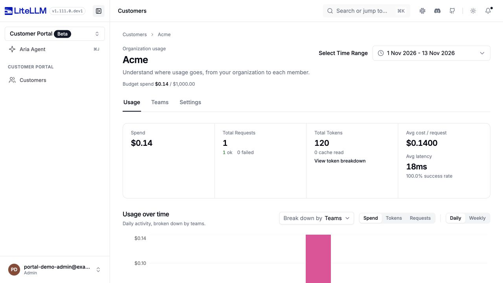
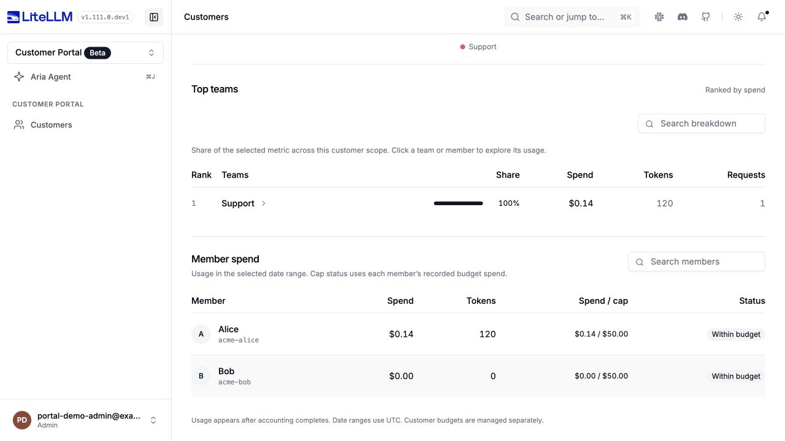
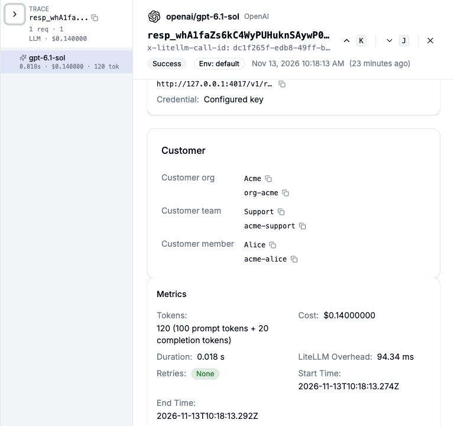

# Track customer spend

:::info

Without a LiteLLM Enterprise license, the customer portal is free for up to 5 customer organizations, 5 customer teams per organization, and 5 customer members per team. The auto-created `default` team counts toward the team limit. [LiteLLM Enterprise](https://www.litellm.ai/enterprise) removes these limits.

:::

Use one application API key for your customers. Pass the customer's organization alias and member ID with each request. LiteLLM resolves the member's team and organization, checks their budgets, and records spend, tokens, and requests at all three levels.

Set up budget notifications, then import Acme, its Support team, and two members. Send a request for Alice and fetch usage and budgets to display in your product.



*Local Customer Portal after one controlled-provider request, with usage read from the accounting ledger.*

{/* keep-version-note: This guide distinguishes the verified main-branch API from pending changes. A published release containing the complete integration has not been verified. */}

Use a build containing the customer hierarchy APIs, identity headers, usage routes, and database migrations on `main`. Check `/openapi.json` for `/management/v1/customer_members`. Preview requirements appear beside the steps that need them; see the [availability reference](./api_reference.md#availability) for the required changes.

## Free tier limits

Management creates that would exceed a free-tier limit return `403`. A member counts toward the limit of every team in its `parent_team_ids`.

Requests with a valid virtual key keep working, subject to the usual authentication, model access, budget, and rate-limit checks. If a limit prevents auto-registration, new organization aliases or member IDs are not auto-registered or tracked at that customer level. The proxy logs a `CUSTOMER TRACKING OFF` warning. Existing customer levels on the request remain tracked.

The Customers dashboard shows a banner when any free-tier limit is reached. If an Enterprise license lapses, existing rows keep being tracked, even when their counts exceed the free-tier limits. The limits restrict new creates, not existing tracking. Proxy admins can check current capacity with [the limits API](./api_reference.md#customer-portal-limits).

## Before you start

You need a running [LiteLLM Gateway](../docker_quick_start.md), a connected PostgreSQL database with the customer migrations, your existing application API key, and a proxy admin key for management and usage reads.

Make these values available in your application's environment and the terminal where you run curl:

| Variable | Value |
| --- | --- |
| `LITELLM_BASE_URL` | Gateway URL without `/v1`, for example `http://localhost:4000`. |
| `LITELLM_MODEL` | An existing gateway model alias your application key can use. |
| `LITELLM_API_KEY` | Your existing application API key. The same key serves every customer. |
| `LITELLM_ADMIN_KEY` | Proxy admin key for customer management, usage, and log reads. |
| `START_DATE`, `END_DATE` | Inclusive UTC dates in `YYYY-MM-DD` format. Use the current UTC date for both on your first run. |

Keep keys on your server. Your backend authenticates the customer and selects the identity headers from that customer's session before it calls LiteLLM. It also authorizes customer access before it returns usage to your product.

## 1. Set up budget webhooks

Use a build containing [customer budget webhook support](https://github.com/BerriAI/litellm/pull/51579) and the [customer budget alert fix](https://github.com/BerriAI/litellm/pull/51645). The alert fix is pending; the recurring-budget and member events below require it. Prepare a POST endpoint in your product that accepts JSON and returns a successful `2xx` response within 10 seconds. The gateway must be able to reach it.

Replace the example endpoint below with your receiver URL. Add this configuration before importing customers or sending requests, then restart the gateway:

```yaml title="config.yaml, additions to your existing configuration"
general_settings:
  use_spend_logs_ledger: true

litellm_settings:
  callbacks: [customer_budget_webhook]

callback_settings:
  customer_budget_webhook:
    endpoint: https://billing.example.com/litellm/customer-budget
    headers:
      X-Source: litellm
```

Merge these entries with your existing configuration. If you already have callbacks, add `customer_budget_webhook` to that list. For values supplied through your secret store, use `CUSTOMER_BUDGET_WEBHOOK_URL` and `CUSTOMER_BUDGET_WEBHOOK_HEADERS`; see [configuration precedence](./api_reference.md#customer-budget-events).

After a positive spend update commits, LiteLLM checks the affected organization, team, and member. Spend at or above `soft_budget` produces `soft_budget_crossed`; spend at or above `max_budget` produces `budget_crossed`. One update can produce both events at several levels. Free requests and requests rejected before inference do not produce a customer budget spend event.

```json title="Example event for Alice's $40 soft threshold"
{
  "event": "soft_budget_crossed",
  "scope": "customer_member",
  "entity_id": "acme-alice",
  "customer_org_id": "org-acme",
  "customer_org_alias": "Acme",
  "customer_team_id": null,
  "customer_team_alias": null,
  "customer_member_id": "acme-alice",
  "customer_member_alias": "Alice",
  "spend": 41.25,
  "budget": 40,
  "period": "2026-12-13T12:00:00+00:00",
  "timestamp": "2026-11-13T12:00:00Z"
}
```

`budget` is the triggering threshold. `period` is the recorded next reset timestamp, or `"lifetime"` if no reset is recorded. Route the event with `customer_org_id` to update the customer's balance in your product. A member budget covers that member across teams, so member events contain the organization and member IDs; the team fields are `null`.

Return a successful `2xx` response within 10 seconds. Delivery is best effort: a cache claim suppresses the same event, scope, entity, and period until the budget reset, including after failure. Lifetime budgets use a long-lived claim. Cross-worker deduplication needs shared Redis; a local fallback can produce duplicates. The HTTP client retries a connection error once, but there is no durable retry queue or schedule for timeouts or unsuccessful HTTP responses. Reconcile through the usage APIs to recover missed events.

Verify delivery in [step 4](#4-check-budgets-and-webhook-delivery), after the customer and SDK examples are ready.

## 2. Import a customer

Create the organization first, then its team and members. Use IDs from your application, or save the IDs LiteLLM returns when you omit them.

### Create the organization and default member budget

Acme has a $1,000 budget. Its default member template gives each member a $50 budget, a $40 soft threshold, and rate limits.

```bash title="POST /management/v1/customer_organizations"
curl --request POST "$LITELLM_BASE_URL/management/v1/customer_organizations" \
  --header "Authorization: Bearer $LITELLM_ADMIN_KEY" \
  --header "Content-Type: application/json" \
  --data '{
    "customer_org_id": "org-acme",
    "alias": "Acme",
    "budget": {
      "max_budget": 1000,
      "budget_duration": "30d"
    },
    "default_budgets": [
      {
        "name": "standard",
        "is_default": true,
        "max_budget": 50,
        "soft_budget": 40,
        "budget_duration": "30d",
        "rpm_limit": 60,
        "tpm_limit": 100000
      }
    ]
  }'
```

Expect `201 Created`. A soft budget is a notification threshold and does not block requests. [Webhook delivery](#1-set-up-budget-webhooks) requires the customer budget callback.

### Create the team

```bash title="POST /management/v1/customer_teams"
curl --request POST "$LITELLM_BASE_URL/management/v1/customer_teams" \
  --header "Authorization: Bearer $LITELLM_ADMIN_KEY" \
  --header "Content-Type: application/json" \
  --data '{
    "customer_team_id": "acme-support",
    "parent_org_id": "org-acme",
    "alias": "Support",
    "budget": {
      "max_budget": 250,
      "budget_duration": "30d"
    }
  }'
```

Expect `201` with `parent_org_id: "org-acme"`.

### Create Alice and Bob

Create each member with the Support team's ID in `parent_team_ids`. Omitting `budget_id` selects Acme's default member template.

```bash title="Create Alice"
curl --request POST "$LITELLM_BASE_URL/management/v1/customer_members" \
  --header "Authorization: Bearer $LITELLM_ADMIN_KEY" \
  --header "Content-Type: application/json" \
  --data '{
    "customer_member_id": "acme-alice",
    "parent_team_ids": ["acme-support"],
    "alias": "Alice"
  }'
```

```bash title="Create Bob"
curl --request POST "$LITELLM_BASE_URL/management/v1/customer_members" \
  --header "Authorization: Bearer $LITELLM_ADMIN_KEY" \
  --header "Content-Type: application/json" \
  --data '{
    "customer_member_id": "acme-bob",
    "parent_team_ids": ["acme-support"],
    "alias": "Bob"
  }'
```

Expect `201` for each member. Read `effective_budget` in the response to verify the inherited $50 cap. Use `budget_id` to select another template or `budget_override` to customize a member. The current API rejects the old `budget_template_id` field.

### Add an email (preview)

The `email` field requires [#51617](https://github.com/BerriAI/litellm/pull/51617). On a build containing that change, add Alice's email:

```bash title="PATCH /management/v1/customer_members/acme-alice"
curl --request PATCH "$LITELLM_BASE_URL/management/v1/customer_members/acme-alice" \
  --header "Authorization: Bearer $LITELLM_ADMIN_KEY" \
  --header "Content-Type: application/json" \
  --data '{
    "email": "alice@acme.example"
  }'
```

### Repeat an import

A repeated create returns `409` for an existing ID. Retrieve that ID, confirm its parent, then patch the fields you need to change. This gives your backend an upsert flow with the existing APIs.

```bash title="Retrieve the existing member"
curl "$LITELLM_BASE_URL/management/v1/customer_members/acme-alice" \
  --header "Authorization: Bearer $LITELLM_ADMIN_KEY"
```

After confirming `parent_team_ids` contains `acme-support`, update Alice:

```bash title="Update the existing member"
curl --request PATCH "$LITELLM_BASE_URL/management/v1/customer_members/acme-alice" \
  --header "Authorization: Bearer $LITELLM_ADMIN_KEY" \
  --header "Content-Type: application/json" \
  --data '{
    "alias": "Alice"
  }'
```

Use the same create, retrieve, and update flow for organizations and teams. Native upserts and automatic organization creation remain under review in [#51607](https://github.com/BerriAI/litellm/pull/51607).

## 3. Send a request for Alice

Use your existing application key and pass Alice's identity in request headers:

```http
x-litellm-customer-org-alias: Acme
x-litellm-customer-member-id: acme-alice
```

LiteLLM resolves `acme-alice` to `acme-support`, then `org-acme`. The same identity headers work with Responses, Chat Completions, and Anthropic Messages.

### OpenAI Responses SDK

Run `pip install openai` in your application project. The raw response exposes `x-litellm-call-id`, which you use to find this request in spend logs.

```python
import os

from openai import OpenAI

client = OpenAI(
    api_key=os.environ["LITELLM_API_KEY"],
    base_url=f"{os.environ['LITELLM_BASE_URL'].rstrip('/')}/v1",
)
raw_response = client.responses.with_raw_response.create(
    model=os.environ["LITELLM_MODEL"],
    input="Write a short welcome message.",
    max_output_tokens=128,
    extra_headers={
        "x-litellm-customer-org-alias": "Acme",
        "x-litellm-customer-member-id": "acme-alice",
    },
)
response = raw_response.parse()
print(response.output_text)
print("LiteLLM call ID:", raw_response.headers.get("x-litellm-call-id"))
```

Expect a successful Responses result. LiteLLM checks the organization, team, and member budgets, model access, and rate limits, then attributes usage to all three records.

### LangChain Deep Agents

Run `pip install deepagents langchain-openai`. Use a model alias that supports tool calling. Configure the model for the authenticated customer's request:

```python
import os

from deepagents import create_deep_agent
from langchain_openai import ChatOpenAI

model = ChatOpenAI(
    model=os.environ["LITELLM_MODEL"],
    base_url=f"{os.environ['LITELLM_BASE_URL'].rstrip('/')}/v1",
    api_key=os.environ["LITELLM_API_KEY"],
    use_responses_api=True,
    default_headers={
        "x-litellm-customer-org-alias": "Acme",
        "x-litellm-customer-member-id": "acme-alice",
    },
)
agent = create_deep_agent(model=model)
result = agent.invoke({"messages": [{"role": "user", "content": "Say hello to Alice."}]})
print(result["messages"][-1].text)
```

Select the customer's headers for each authenticated request. Do not change a shared model instance's headers while it serves other customers.

An existing member ID can resolve its parents without the organization header. With an existing organization alias and a new member ID, LiteLLM registers the member under `org-acme:default` and assigns the organization's default member template. An alias alone attributes usage to the organization.

With [#51617](https://github.com/BerriAI/litellm/pull/51617), replace the member-ID header with `x-litellm-customer-member-email: alice@acme.example`; keep the organization alias header. An email string in the member-ID header is an ID, not an email lookup.

## 4. Check budgets and webhook delivery

Create a separate customer with a zero budget to check rejection without changing Acme's settings:

```bash title="Create a zero-cap test customer"
curl --request POST "$LITELLM_BASE_URL/management/v1/customer_organizations" \
  --header "Authorization: Bearer $LITELLM_ADMIN_KEY" \
  --header "Content-Type: application/json" \
  --data '{
    "customer_org_id": "org-budget-check",
    "alias": "Budget check",
    "budget": {
      "max_budget": 0
    }
  }'
```

Use the `client` from step 3 with the same application key and model, and this customer's alias:

```python
from openai import APIStatusError

try:
    response = client.responses.create(
        model=os.environ["LITELLM_MODEL"],
        input="Budget check",
        max_output_tokens=128,
        extra_headers={"x-litellm-customer-org-alias": "Budget check"},
    )
    print("Request succeeded:", response.id)
except APIStatusError as error:
    print(error.status_code)
```

Expect `422` and a budget error naming `customer_org=org-budget-check`, before a provider request. A deployment can customize the budget error status.

Use a positive-cost model to test the webhook. Set the test cap to $1 and the soft threshold to $0, then rerun the same SDK call. The request succeeds and incurs the model's normal cost. Zero-cost requests do not produce a spend event.

```bash title="Allow the test request and trigger a soft-budget alert"
curl --request PATCH "$LITELLM_BASE_URL/management/v1/customer_organizations/org-budget-check" \
  --header "Authorization: Bearer $LITELLM_ADMIN_KEY" \
  --header "Content-Type: application/json" \
  --data '{
    "budget": {
      "max_budget": 1,
      "soft_budget": 0
    }
  }'
```

After accounting commits the request's cost, check your webhook receiver for `soft_budget_crossed`, with `scope: "customer_org"` and `entity_id: "org-budget-check"`. The event's `budget` is `0` and its `spend` is greater than `0`. The earlier rejected request does not generate this event.

```json title="Expected webhook excerpt, using the local demo cost"
{
  "event": "soft_budget_crossed",
  "scope": "customer_org",
  "entity_id": "org-budget-check",
  "customer_org_id": "org-budget-check",
  "spend": 0.14,
  "budget": 0
}
```

If the event does not arrive, confirm that the callback is enabled, the gateway can reach your endpoint, and accounting has recorded positive spend. Check gateway logs for delivery errors. Use a fresh test organization ID and alias when repeating this test: duplicate events remain suppressed for the budget period, including after a failed delivery.

Restore the test customer's zero cap and remove its soft threshold:

```bash title="Restore the test cap after the check"
curl --request PATCH "$LITELLM_BASE_URL/management/v1/customer_organizations/org-budget-check" \
  --header "Authorization: Bearer $LITELLM_ADMIN_KEY" \
  --header "Content-Type: application/json" \
  --data '{
    "budget": {
      "max_budget": 0,
      "soft_budget": null
    }
  }'
```

The first exhausted scope rejects a request: organization, then team, then member. Fresh customer spend counters across workers require [#51568](https://github.com/BerriAI/litellm/pull/51568). Without that change, admission can use cached spend until refresh. Allow for requests already in flight and background accounting when you show balances.

## 5. Fetch usage for your product

The organization aggregated endpoint returns complete spend, token, and request totals for the date range, without pagination. It accepts up to 100 customer organization IDs.

```bash title="Complete Acme usage"
curl --get "$LITELLM_BASE_URL/management/v1/customer_organizations/daily/activity/aggregated" \
  --header "Authorization: Bearer $LITELLM_ADMIN_KEY" \
  --data-urlencode "customer_org_ids=org-acme" \
  --data-urlencode "start_date=$START_DATE" \
  --data-urlencode "end_date=$END_DATE"
```

Read the response's top-level metadata:

```json title="Usage response excerpt from the local example"
{
  "metadata": {
    "total_spend": 0.14,
    "total_tokens": 120,
    "total_api_requests": 1
  }
}
```

Dates are inclusive UTC days, with at most a 400-day difference between start and end. `total_spend` is cost in USD. You can use it in your product's pricing or chargeback calculation; this API does not create invoices or collect payment. The key breakdown shows the top key, while totals include every key.

### Team and member usage

```bash title="Support team usage, first page"
curl --get "$LITELLM_BASE_URL/management/v1/customer_teams/daily/activity" \
  --header "Authorization: Bearer $LITELLM_ADMIN_KEY" \
  --data-urlencode "customer_team_ids=acme-support" \
  --data-urlencode "start_date=$START_DATE" \
  --data-urlencode "end_date=$END_DATE" \
  --data-urlencode "page=1" \
  --data-urlencode "page_size=100"
```

```bash title="Alice's usage, first page"
curl --get "$LITELLM_BASE_URL/management/v1/customer_members/daily/activity" \
  --header "Authorization: Bearer $LITELLM_ADMIN_KEY" \
  --data-urlencode "customer_member_ids=acme-alice" \
  --data-urlencode "start_date=$START_DATE" \
  --data-urlencode "end_date=$END_DATE" \
  --data-urlencode "page=1" \
  --data-urlencode "page_size=100"
```

These endpoints paginate stored rows. Follow `metadata.has_more` and increment `page` until it is `false`. Sum each page's totals once; the same date can occur on several pages. See the [pagination contract](./api_reference.md#usage-pagination). Do not add organization, team, and member totals together: they include the same requests.

Accounting runs in the background. If usage has not appeared after a successful request, check accounting completion, the UTC dates, and the identity headers. Zero-cost models can report requests and tokens with $0 spend.

## 6. Fetch budgets and caps

Retrieve Acme's running budget spend and organization cap:

```bash title="Organization budget"
curl "$LITELLM_BASE_URL/management/v1/customer_organizations/org-acme" \
  --header "Authorization: Bearer $LITELLM_ADMIN_KEY"
```

Retrieve the Support team's running spend and cap:

```bash title="Team budget"
curl "$LITELLM_BASE_URL/management/v1/customer_teams/acme-support" \
  --header "Authorization: Bearer $LITELLM_ADMIN_KEY"
```

Retrieve Alice's inherited budget and active overrides:

```bash title="Member budget"
curl "$LITELLM_BASE_URL/management/v1/customer_members/acme-alice" \
  --header "Authorization: Bearer $LITELLM_ADMIN_KEY"
```

Read `budget.max_budget` for an organization and `effective_budget.max_budget` for a team or member. The same objects contain `rpm_limit`, `tpm_limit`, model limits, and allowed models. A team or member's effective budget combines its template with active overrides; an expired override no longer applies.

`spend` is the running budget counter. `budget_reset_at` records the next reset. Use date-range usage for historical costs because a reset changes the counter without erasing historical usage. To resolve a member's parents in your product, read its `parent_org_id` and `parent_team_ids`. The first team is its default team.

Open **Customer Portal → Customers**, select **Acme**, and choose **Select Time Range** to include your requests. The usage page shows spend, requests, tokens, and the member caps. Choose **Teams** in **Break down by** to inspect Support.



*Actual customer records and accounting data in the local Customer Portal. Alice's controlled-provider request records $0.14 and 120 tokens.*

## 7. Debug a request in spend logs

Use the `x-litellm-call-id` printed by the Responses SDK. Make that value available as `LITELLM_CALL_ID` in the environment where you run curl.

```bash title="Find a request by its LiteLLM call ID"
curl --get "$LITELLM_BASE_URL/spend/logs/v2" \
  --header "Authorization: Bearer $LITELLM_ADMIN_KEY" \
  --data-urlencode "request_id=$LITELLM_CALL_ID" \
  --data-urlencode "start_date=$START_DATE 00:00:00" \
  --data-urlencode "end_date=$END_DATE 23:59:59"
```

This API requires a date range even with a request ID. Customer identity fields require [#51596](https://github.com/BerriAI/litellm/pull/51596). Check the saved metadata to verify Alice → Support → Acme:

```json title="Saved customer identity excerpt"
{
  "metadata": {
    "user_api_key_customer_member_id": "acme-alice",
    "user_api_key_customer_member_alias": "Alice",
    "user_api_key_customer_team_id": "acme-support",
    "user_api_key_customer_team_alias": "Support",
    "user_api_key_customer_org_id": "org-acme",
    "user_api_key_customer_org_alias": "Acme"
  }
}
```

Compare `spend` and `total_tokens` with usage. A `metadata.status` of `"failure"` identifies a failed request; an absent or null status follows the default success behavior.

Open `/ui/logs/?log_id=<x-litellm-call-id>`. In the request details, check **Customer** for the resolved hierarchy and **Metrics** for cost and tokens:



*Actual saved request in the local gateway, using a controlled provider and the accounting ledger. The Customer section requires #51596.*

The log API has no customer organization, team, or member filter. `user_id`, `team_id`, and `end_user` refer to separate LiteLLM entities. Find an individual request by its call ID and use the customer usage APIs for customer totals.

## Fail-open handling (pending)

Fail-open identity handling remains under review in [#51604](https://github.com/BerriAI/litellm/pull/51604). Main rejects identities it cannot resolve or register, and identities that conflict. A validated configuration that preserves asserted customer IDs in logs is required before this guide can provide a setup.

## Troubleshooting

| Result | Check |
| --- | --- |
| `409` during import | Retrieve the existing ID, verify its parent, then patch mutable fields. |
| `422` during member creation | Use `parent_team_ids` and `budget_id`. Supply a template or override if the organization has no default template. |
| `401` on inference | Check the organization alias and member ID. A new member needs an existing organization alias and default template for registration. |
| `403` on inference | Confirm that the organization alias matches the member's organization. |
| Budget `422` | Read organization, team, and member spend and caps to find the first exhausted scope. |
| `429` | Check the scope's RPM, TPM, and model limits. |
| Missing customer IDs in logs | Check whether your build includes #51596. |
