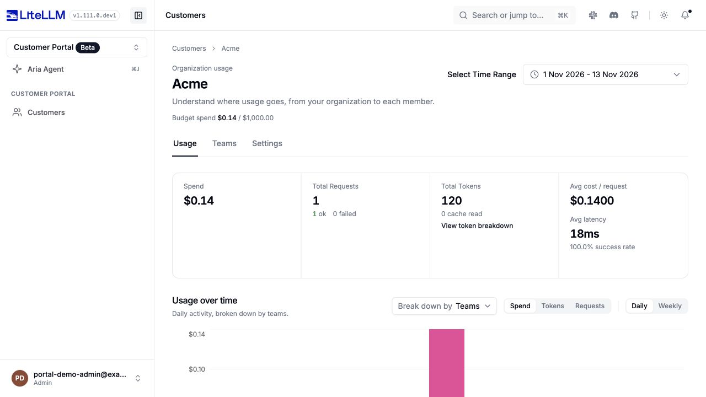

# Customer Management

<SinceVersion v="1.111.0" />

Track LLM spend for your application's customers and end users. Use Customer Management for new integrations to view usage and set budgets by customer organization, team, and member.

Send your customer's identity with each request using your existing application key. You can start tracking without creating a key for each customer or setting up webhooks.

| Customer level | Use it for |
| --- | --- |
| Organization | A customer account, such as Acme, and its total budget. |
| Team | A group within that customer, such as Support, with a shared budget. |
| Member | An individual end user, such as Alice, with their own allowance. |

These customer records are separate from LiteLLM's internal organizations, teams, and users. If you use `user`, `x-litellm-customer-id`, `x-litellm-end-user-id`, or `/customer/*`, see [moving from legacy end-user tracking](#moving-from-legacy-end-user-tracking). Those APIs remain supported.

## Before you start

Use a [LiteLLM Gateway](./docker_quick_start.md) on v1.111 or later with PostgreSQL and its database migrations applied. You need an application key that can call your chosen model, and proxy admin access to view Customer Management or read its management APIs.

Set these environment variables through your existing environment or secret store:

| Variable | Value |
| --- | --- |
| `LITELLM_BASE_URL` | Your gateway root URL, without `/v1` or `/ui`, for example `http://localhost:4000`. |
| `LITELLM_API_KEY` | Your existing application key. |
| `LITELLM_MODEL` | A Chat Completions model alias configured on your gateway and allowed by that key. |

Keep keys on your server. Your backend authenticates the customer and chooses the organization alias and member ID from their session. Use stable member IDs, unique across your gateway, such as `acme-alice`.

Without Enterprise, you can create up to **5 customer organizations, 5 teams per organization, and 5 members per team**. The `default` team counts toward that limit. See [capacity and tracking at the limit](./customer_management/track-customer-spend.md#free-tier-limits).

## 1. Send a request {#track-customer-spend}

Pass the organization alias and member ID in headers:

```bash title="Track a request for Alice at Acme"
curl --fail-with-body "$LITELLM_BASE_URL/v1/chat/completions" \
  --header "Authorization: Bearer $LITELLM_API_KEY" \
  --header "Content-Type: application/json" \
  --header "x-litellm-customer-org-alias: Acme" \
  --header "x-litellm-customer-member-id: acme-alice" \
  --data "{
    \"model\": \"$LITELLM_MODEL\",
    \"messages\": [{\"role\": \"user\", \"content\": \"Say hello.\"}]
  }"
```

Expect a model response. On the first request, LiteLLM registers an unknown organization alias and adds a new member to its `default` team, subject to capacity limits. Existing members keep their assigned teams. The same headers work with Responses and Anthropic Messages; see the [SDK examples](./customer_management/track-customer-spend.md#3-send-a-request-for-alice).

A new member inherits the organization's default member budget if you configured one. Without a default, the member starts without its own cap. To enforce customer limits from the first request, [create the organization and budgets first](./customer_management/track-customer-spend.md#2-import-a-customer).

## 2. View customer usage {#view-usage}

Open **Customer Management → Customers** in the Admin UI, select **Acme**, and choose **Select Time Range** to include your request. Check spend, requests, and tokens. Use **Break down by** to inspect teams and members.



*Example from a local gateway with a controlled provider. Your cost and token count depend on the model and request.*

Accounting runs in the background. If usage has not appeared, confirm the date range and headers, then check accounting completion and gateway warnings. A successful model response alone does not confirm customer tracking. At a free-tier limit, a request can succeed without registering or tracking the new customer level. Existing levels remain tracked. Zero-cost requests can show tokens and requests with $0 spend.

To read usage from your backend, use the [customer usage APIs](./customer_management/track-customer-spend.md#5-fetch-usage-for-your-product) with a proxy admin key. Authorize the customer's access before returning that data to your product. Organization, team, and member totals describe the same requests; do not add the levels together.

## 3. Set budgets and add your customer structure {#customer-budgets}

Open the customer's **Settings** and use **Set budget** or **Edit budget** to choose a **Spend limit (USD)** and **Reset period**. Use a member's **Budget template** for their default allowance.

A team budget caps the group's combined spend. A member template gives each assigned member their own allowance. You can use both. Follow [Set budgets and read usage](./customer_management/track-customer-spend.md) for a complete API setup, shared-budget examples, rate limits, model access, budget refusals, and optional webhook notifications.

| Next task | Guide |
| --- | --- |
| Create teams and members with budgets before their first request | [Import a customer](./customer_management/track-customer-spend.md#2-import-a-customer) |
| Compare a shared team budget with a per-member allowance | [Budget examples](./customer_management/track-customer-spend.md#shared-team-budget-or-per-member-allowance) |
| Show spend and remaining limits in your product | [Read usage](./customer_management/track-customer-spend.md#5-fetch-usage-for-your-product) and [read budgets](./customer_management/track-customer-spend.md#6-fetch-budgets-and-caps) |
| Notify your backend when a customer reaches a threshold | [Budget webhooks](./customer_management/track-customer-spend.md#1-set-up-budget-webhooks) |
| Find a request's customer and cost | [Spend logs](./customer_management/track-customer-spend.md#7-debug-a-request-in-spend-logs) |
| Look up fields, endpoints, or errors | [Customer Management API reference](./customer_management/api_reference.md) |

<span id="tracking-customer-spend--permissions" />
<span id="1-make-llm-api-call-w-customer-id" />
<span id="2-get-customer-spend" />
<span id="restricting-which-ids-become-customers" />
<span id="keeping-a-default-budget-for-unregistered-customers" />
<span id="bucketing-internal-traffic-under-one-customer" />
<span id="restricting-which-models-a-customer-can-use" />
<span id="setting-customer-object-permissions" />
<span id="what-are-object-permissions" />
<span id="creating-a-customer-with-object-permissions" />
<span id="updating-customer-object-permissions" />
<span id="viewing-customer-object-permissions" />
<span id="use-cases" />
<span id="setting-customer-budgets" />
<span id="default-budget-for-all-customers" />
<span id="quick-start" />
<span id="assign-pricing-tiers" />
<span id="1-create-a-budget" />
<span id="2-assign-budget-to-customer" />
<span id="3-test-it" />

## Moving from legacy end-user tracking

Customer Management is the recommended setup from v1.111. Existing end-user tracking keeps working. The two systems have separate records and usage APIs; sending a legacy identity field does not create a Customer Management member.

| Existing integration | Customer Management |
| --- | --- |
| Flat end-user ID in `user`, `x-litellm-customer-id`, or `x-litellm-end-user-id` | Organization alias and member ID in `x-litellm-customer-org-alias` and `x-litellm-customer-member-id`. |
| `/customer/new`, `/customer/update`, `/customer/info` | `/management/v1/customer_organizations`, `/management/v1/customer_teams`, and `/management/v1/customer_members`. |
| Default end-user budget or an assigned legacy budget | Organization and team caps, plus member budget templates and overrides. |
| **Usage → Customer Usage** and the **End User** log filter | **Customer Management → Customers**, customer usage APIs, and the request's **Customer** details. |

Choose the organization and team for each existing end user. You can reuse a stable end-user ID as a member ID after checking that it is unique across your gateway. Create the customer records and equivalent budgets, switch your application's identity headers, then verify a request and its usage in Customer Management.

Keep legacy records for historical reporting. This setup does not copy old spend or budget counters into the new records. Plan the budget cutover so a customer does not receive a fresh allowance mid-period by mistake. During an overlap, do not add legacy and new totals for the same requests.

Retain the legacy integration for features that depend on its identity path, including JWT end-user mapping and customer object permissions for MCP servers, vector stores, and agents. The new customer headers do not replace those controls. See the [legacy reference](./legacy_end_users.md) and [legacy usage dashboard](./customer_usage.md).
