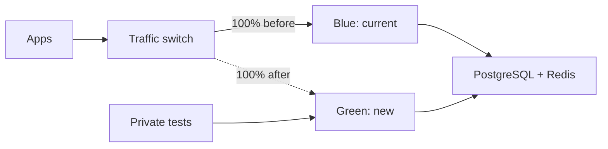

# Blue/Green Deployment

{/* keep-version-note */}

Blue/green keeps two complete sets of LiteLLM instances available during an upgrade. Blue serves the current version. Green runs the new version and receives test traffic. After green passes your checks, switch new requests to it and drain blue.



The solid and dashed ingress paths show different stages of the rollout. Blue keeps its existing requests after the switch. Their responses do not move to green.

## Prepare the replacement

Deploy green with a pinned image. Use the same database, encryption salt, authentication settings, and regional Redis as blue. Use separate service names or backend pools so ingress can select each version. Both sets use production state. Tests that create keys or change configuration affect that shared state.

Plan capacity for both sets and their database connections. Run `/health/readiness`, an authenticated model request, and a streaming request through green's private test route. Check model permissions, provider credentials, spend records, and required callbacks before promotion.

## Switch ingress traffic

This [Gateway API HTTPRoute](https://gateway-api.sigs.k8s.io/guides/user-guides/traffic-splitting/) example assumes an existing HTTPS `Gateway` named `litellm-ingress`, plus `litellm-blue` and `litellm-green` Services in the same namespace. Each Service exposes port 4000 and selects only its own version. Configure TLS on the Gateway and readiness on the pods first.

```yaml title="litellm-route.yaml"
apiVersion: gateway.networking.k8s.io/v1
kind: HTTPRoute
metadata:
  name: litellm
spec:
  parentRefs:
    - name: litellm-ingress
  hostnames:
    - llm.example.com
  rules:
    - backendRefs:
        - name: litellm-blue
          port: 4000
          weight: 100
        - name: litellm-green
          port: 4000
          weight: 0
```

For the cutover, change blue's weight to `0` and green's weight to `100` in your deployment source. Apply the route through your normal release process. Confirm that the controller accepts the route and new requests reach green. Keep blue ready until the routing change takes effect and its requests finish. Outside Gateway API, use load balancer backend weights or a service selector for the same pattern.

## Drain existing requests

Traffic weights control new requests. They do not move an open stream. Before you remove blue, wait until its active requests reach zero or your drain deadline expires. Check how your ingress controller handles persistent connections and backend removal.

For example, a gateway that permits 600-second requests also needs shutdown time for routing changes and process cleanup. Merge this fragment into each Deployment's pod specification. Test these example values with your workload. They do not guarantee that every stream completes:

```yaml title="Deployment pod template fragment"
spec:
  template:
    spec:
      terminationGracePeriodSeconds: 650
      containers:
        - name: litellm
          env:
            - name: GRACEFUL_SHUTDOWN_TIMEOUT
              value: "610"
          readinessProbe:
            httpGet:
              path: /health/readiness
              port: 4000
          lifecycle:
            preStop:
              exec:
                command: ["sh", "-c", "sleep 10"]
```

Kubernetes includes the `preStop` hook in the pod's termination grace period. The sleep gives endpoint changes time to take effect. It does not drain requests. Match the application server and ingress timeouts to this shutdown budget. Test with a stream near the maximum duration. See [pod termination](https://kubernetes.io/docs/concepts/workloads/pods/pod-lifecycle/#pod-termination) and [Server Tuning](../../server_tuning.md#keep-restarts-hitless).

LiteLLM also has an opt-in [drain endpoint](../../health.md#other-health-endpoints). If you enable it, set `DRAIN_ENDPOINT_TOKEN` to require the `X-Drain-Token` header. Restrict access to internal callers.

## Keep migrations compatible

Run one migration job for the shared database, and set `DISABLE_SCHEMA_UPDATE=true` on both sets of serving instances. Coordinate Helm releases so they do not each launch competing migrations. See [migrations](../../prod.md#run-migrations-from-the-helm-presync-hook).

Confirm that blue can still read and write after green's migration. A release can remove columns, change stored values, or require incompatible configuration. A blue/green traffic switch does not make those changes safe. Follow the release's migration procedure. Test rollback against a database copy before production.

## Roll back

If green fails after cutover, route new requests back to blue. Blue must still be available and compatible with the current schema. Drain green before removal. Restoring an old database backup can discard new keys, configuration, and spend records. Do not use it for a routine traffic rollback. To shift traffic gradually, use [Canary](./canary.md).
