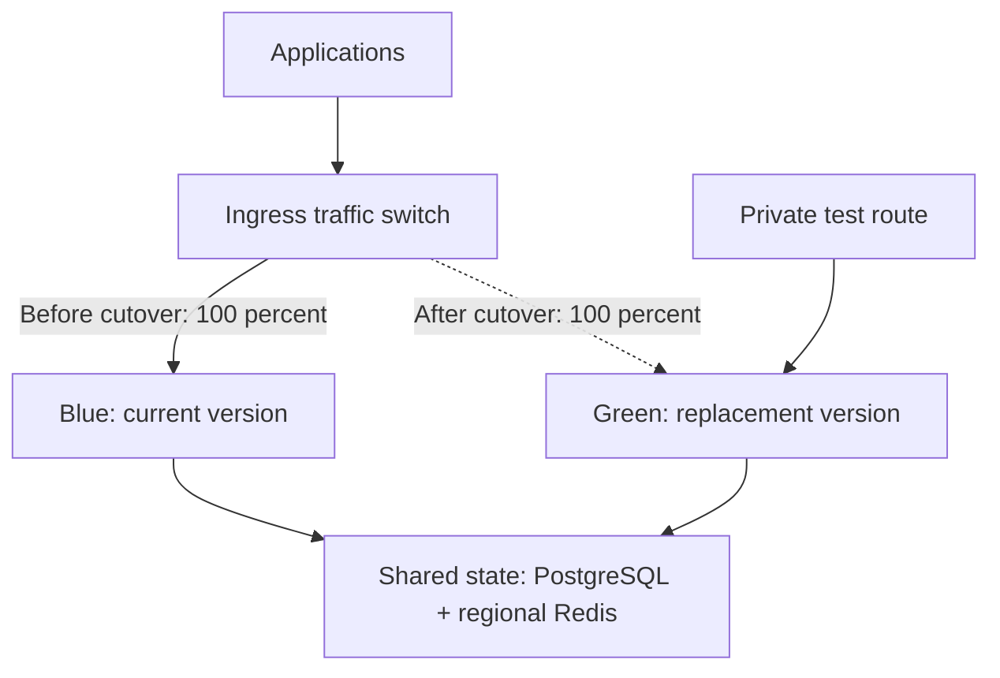

# Blue/Green Deployment

{/* keep-version-note */}

Blue/green keeps two complete sets of LiteLLM instances available during an upgrade. Blue serves the current version. Green runs the replacement version and receives test traffic. Once green passes validation, switch new requests to it and drain blue.



The solid and dashed ingress paths show different stages of the rollout. Blue keeps its existing requests after the switch; their responses do not move to green.

## Prepare the replacement

Deploy green with a pinned image and the same database, encryption salt, authentication settings, and regional Redis as blue. Use separate service names or backend pools so ingress can select each version. Both sets run against production state, so a test that creates a key or changes configuration affects that shared state.

Budget capacity for both sets and their database connections. Run `/health/readiness`, an authenticated model request, and a streaming request through green's private test route. Check model permissions, provider credentials, spend recording, and required callbacks before promotion.

## Switch ingress traffic

This [Gateway API HTTPRoute](https://gateway-api.sigs.k8s.io/guides/user-guides/traffic-splitting/) example assumes an existing HTTPS `Gateway` named `litellm-ingress`, plus `litellm-blue` and `litellm-green` Services in the same namespace. Each Service exposes port 4000 and selects only its own version. Configure TLS on the Gateway and readiness on the pods first.

```yaml title="litellm-route.yaml"
apiVersion: gateway.networking.k8s.io/v1
kind: HTTPRoute
metadata:
  name: litellm
spec:
  parentRefs:
    - name: litellm-ingress
  hostnames:
    - llm.example.com
  rules:
    - backendRefs:
        - name: litellm-blue
          port: 4000
          weight: 100
        - name: litellm-green
          port: 4000
          weight: 0
```

For the cutover, change blue's weight to `0` and green's weight to `100` in your deployment source, then apply the route through your normal release process. Confirm that the controller accepts the route and that new requests reach green. Keep blue ready until the change has propagated and its requests have drained. A load balancer's backend weights or service selector can implement the same pattern outside Gateway API.

## Drain existing requests

Changing traffic weights controls future routing; it does not migrate an open stream. Wait for blue's active requests to reach zero before removing it, or use a bounded drain window that matches your request policy. Check connection persistence and deregistration behavior on your ingress controller.

For example, a gateway that permits 600-second requests needs a shutdown budget that also covers routing propagation and process cleanup. Merge this fragment into each Deployment's pod specification; the values are an example, not a promise that every stream completes:

```yaml title="Deployment pod template fragment"
spec:
  template:
    spec:
      terminationGracePeriodSeconds: 650
      containers:
        - name: litellm
          env:
            - name: GRACEFUL_SHUTDOWN_TIMEOUT
              value: "610"
          readinessProbe:
            httpGet:
              path: /health/readiness
              port: 4000
          lifecycle:
            preStop:
              exec:
                command: ["sh", "-c", "sleep 10"]
```

Kubernetes counts the `preStop` hook inside the pod's termination grace period. The sleep gives endpoint changes time to propagate; it does not itself drain work. Match the application server's graceful shutdown timeout and ingress timeouts to this budget, then test with a stream near the maximum duration. See [pod termination](https://kubernetes.io/docs/concepts/workloads/pods/pod-lifecycle/#pod-termination) and [Server Tuning](../../server_tuning.md#keep-restarts-hitless). LiteLLM also has an opt-in [drain endpoint](../../health.md#other-health-endpoints). If you enable it, set `DRAIN_ENDPOINT_TOKEN` so callers must provide `X-Drain-Token`, and restrict it to internal callers.

## Keep migrations compatible

Run one migration job for the shared database, and set `DISABLE_SCHEMA_UPDATE=true` on both sets of serving instances. Coordinate Helm releases so they do not each launch competing migrations. See [migrations](../../prod.md#run-migrations-from-the-helm-presync-hook).

Confirm that blue can still read and write after green's migration. If a release removes a column, changes stored values, or requires incompatible configuration, a blue/green traffic switch alone is not a safe upgrade plan. Use the release's migration procedure and test the rollback path against a database copy before production.

## Roll back

If green fails validation after cutover, route new requests back to blue while blue is still available and compatible with the current schema. Drain green before removal. Do not restore an old database backup as a routine traffic rollback: that can discard new keys, configuration, and spend records. For gradual exposure instead of a full switch, use [Canary](./canary.md).
