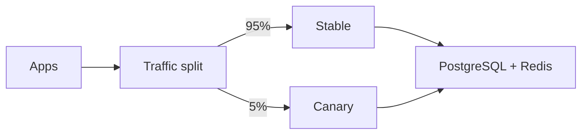

# Canary Deployment

{/* keep-version-note */}

A canary release sends a small share of new requests to a new LiteLLM version. The stable version serves the rest. Compare their behavior under real traffic. Then increase the canary's share or return it to zero.



The diagram shows an example starting split. Choose a share that tests your normal traffic mix without exceeding the canary's capacity. A 5 percent request share can use more or less than 5 percent of tokens, concurrent streams, or provider cost.

## Prepare a comparable release

Deploy stable and canary behind separate Services or backend pools. Use the same model aliases, authentication policy, database, encryption salt, and regional Redis. Change these only when the test requires it. Pin both images. Label logs, metrics, and traces by release so you can compare results.

Run private smoke tests before enabling production traffic. Include a virtual-key request, a stream, a rejected request, and the callbacks that your applications need. Provider latency varies. Compare the same model and request type when testing a gateway change.

## Set the traffic split

This example uses [Gateway API weighted backends](https://gateway-api.sigs.k8s.io/guides/user-guides/traffic-splitting/). It assumes an existing HTTPS `Gateway` named `litellm-ingress` and separate `litellm-stable` and `litellm-canary` Services in the same namespace. Configure pod readiness and the Gateway's TLS listener before attaching the route.

```yaml title="litellm-canary-route.yaml"
apiVersion: gateway.networking.k8s.io/v1
kind: HTTPRoute
metadata:
  name: litellm
spec:
  parentRefs:
    - name: litellm-ingress
  hostnames:
    - llm.example.com
  rules:
    - backendRefs:
        - name: litellm-stable
          port: 4000
          weight: 95
        - name: litellm-canary
          port: 4000
          weight: 5
```

Weights are relative. With these two backends, `95` and `5` target a 95/5 split over many routing decisions. Actual traffic depends on sample size, connection reuse, and affinity. Check the actual split before comparing canary metrics. To route a specific team's traffic, use a trusted ingress rule. Do not authorize access through a public header that clients can set.

## Promote with explicit gates

Record the stable version's error rates and latency before the rollout. Set acceptable limits for the canary. Monitor authentication failures, gateway errors, time to first token, completed streams, queue depth, and database connections. Check spend records and callback delivery. See [Prometheus Metrics](../../prometheus.md).

An example sequence is `5% → 25% → 50% → 100%`. At each step, wait for enough requests and long streams to complete. Use your normal traffic mix. Stop or reverse the rollout when the canary exceeds your thresholds. Give autoscaling time to add capacity before the next traffic increase.

Mirroring production LLM requests can call the provider twice, double the cost, and repeat side effects. Use controlled test requests or a replay process that accounts for these effects.

## Protect shared state and streams

Both releases write to the same database. Run migrations once and keep `DISABLE_SCHEMA_UPDATE=true` on serving instances. Verify that both versions support the migrated schema. A small canary traffic share does not limit the impact of a destructive migration or a shared configuration change. See [migration compatibility](./blue_green.md#keep-migrations-compatible).

Keep each active stream on the version that accepted it. When you promote or roll back, change weights for new requests. Then drain the version you plan to remove. Keep its replicas running until those requests finish or reach your documented deadline. Set timeouts to cover that period. Follow the [drain example](./blue_green.md#drain-existing-requests).

## Roll back

Set the canary's weight to `0` and restore stable to `100`. Confirm that new requests reach stable. Save canary logs and metrics. Drain its existing requests before removing it. The stable release must still support the shared database schema. Routing does not reverse migrations. Use [Blue/Green](./blue_green.md) to test a complete replacement before a single traffic switch.
