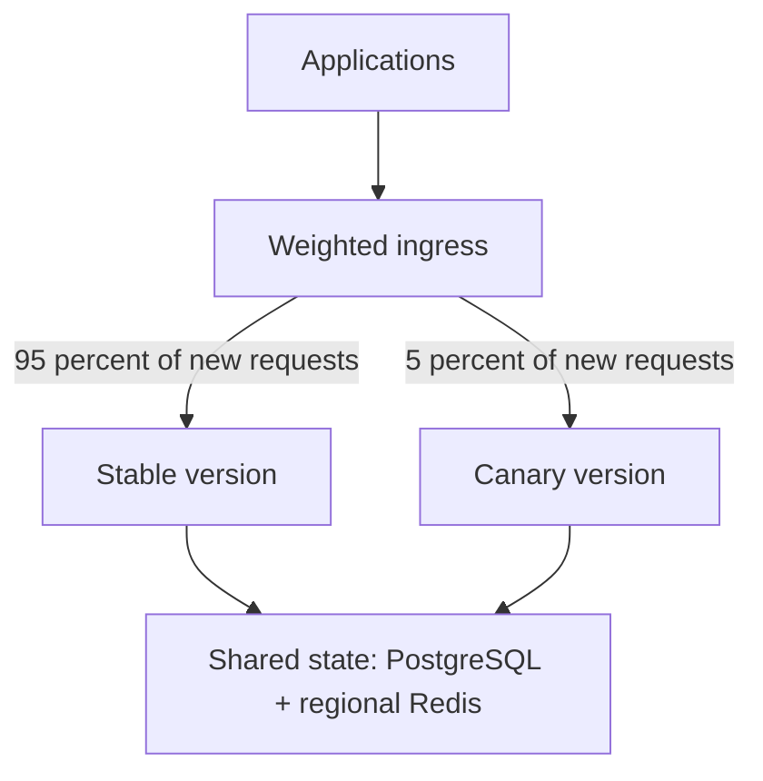

# Canary Deployment

{/* keep-version-note */}

A canary release sends a small share of new requests to a new LiteLLM version while the stable version serves the rest. Compare their behavior under real traffic, then increase the canary's share or return it to zero.



This is an example starting split. Choose a share that gives the canary enough representative traffic without exceeding its capacity. A 5 percent request share is not necessarily 5 percent of tokens, concurrent streams, or provider cost.

## Prepare a comparable release

Deploy stable and canary behind separate Services or backend pools. Keep the same model aliases, authentication policy, shared database, encryption salt, and regional Redis unless the change under test requires a difference. Pin both images and label telemetry by release so you can compare results.

Run private smoke tests before enabling production traffic. Include a virtual-key request, a stream, a rejected request, and the callbacks that your applications depend on. Model-provider latency varies; compare the same model and request class when evaluating a gateway change.

## Set the traffic split

This example uses [Gateway API weighted backends](https://gateway-api.sigs.k8s.io/guides/user-guides/traffic-splitting/). It assumes an existing HTTPS `Gateway` named `litellm-ingress` and separate `litellm-stable` and `litellm-canary` Services in the same namespace. Configure pod readiness and the Gateway's TLS listener before attaching the route.

```yaml title="litellm-canary-route.yaml"
apiVersion: gateway.networking.k8s.io/v1
kind: HTTPRoute
metadata:
  name: litellm
spec:
  parentRefs:
    - name: litellm-ingress
  hostnames:
    - llm.example.com
  rules:
    - backendRefs:
        - name: litellm-stable
          port: 4000
          weight: 95
        - name: litellm-canary
          port: 4000
          weight: 5
```

Weights are relative. With these two backends, `95` and `5` target a 95/5 split over many routing decisions. Actual traffic depends on sample size, connection reuse, and affinity. Verify the observed split before interpreting canary metrics. For team-specific exposure, use a trusted routing rule at ingress; do not rely on a public client-supplied header as an authorization boundary.

## Promote with explicit gates

Record the stable baseline and an acceptable error and latency budget before the rollout. Observe authentication failures, gateway errors, time to first token, completed streams, queue depth, database connections, and spend/callback delivery. See [Prometheus Metrics](../../prometheus.md).

An example sequence is `5% → 25% → 50% → 100%`. Advance only after enough representative requests and long-running streams complete at the current step. Stop or reverse the rollout when the canary exceeds your thresholds. Autoscaling must have time to supply capacity before the next traffic increase.

Do not mirror production LLM requests merely to compare versions: a mirrored call can invoke the provider twice, incur cost twice, and repeat side effects. Use controlled test requests or an explicitly designed replay process.

## Protect shared state and streams

Both releases write to the same database. Run migrations once, keep `DISABLE_SCHEMA_UPDATE=true` on serving instances, and verify that both versions support the migrated schema. Canary traffic percentages do not limit the impact of a destructive migration or a shared configuration change. See [migration compatibility](./blue_green.md#keep-migrations-compatible).

Keep an in-flight stream on the version that accepted it. When you promote or roll back, change weights for new requests, then drain the version you plan to remove. Keep its replicas and timeouts available until those requests finish or reach your documented deadline. Follow the [drain example](./blue_green.md#drain-existing-requests).

## Roll back

Set the canary's weight to `0` and restore stable to `100`, then confirm new requests reach stable. Preserve canary logs and metrics and drain its existing requests before teardown. The stable release must still be compatible with the shared database; routing does not reverse migrations. Use [Blue/Green](./blue_green.md) when you prefer to validate a complete replacement before a single cutover.
