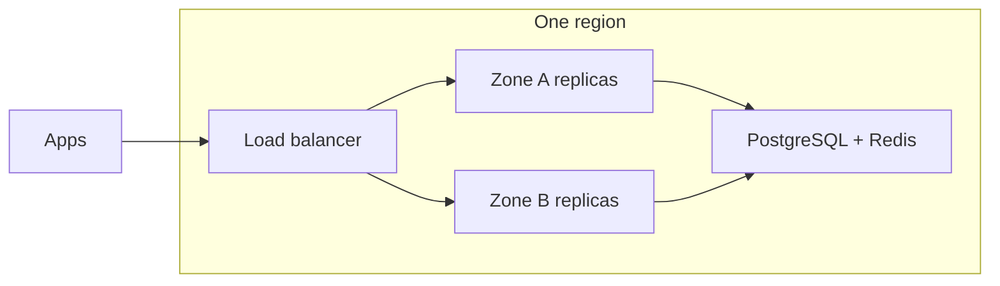

# High Availability

{/* keep-version-note */}

High availability keeps the gateway serving requests when an instance fails or you deploy a new version. Start with multiple replicas across availability zones in one region. Add another region to meet recovery or latency requirements.

| Topic | Use it for |
| --- | --- |
| [Blue/Green](./blue_green.md) | Test a complete replacement deployment, then switch traffic. |
| [Canary](./canary.md) | Send a small share of requests to a new version before you promote it. |
| [Multi-Region](../../multi_region.md) | Run regional gateways with a shared database and regional Redis. |
| [Routing](../multi_region/routing.md) | Choose which region receives a request. |
| [Failover](../multi_region/failover.md) | Decide when to remove a region and how to recover. |

## Make one region resilient

Run at least two serving replicas on separate nodes and spread them across zones. Leave enough spare capacity for the remaining replicas to carry traffic after a failure. Two replicas in the same zone do not protect against a zone outage. See [Sizing & Scaling](../sizing.md) and the cloud-specific [Reference Architectures](../architecture.md).

On Kubernetes, use [topology spread constraints](https://kubernetes.io/docs/concepts/scheduling-eviction/topology-spread-constraints/) to place replicas. A [PodDisruptionBudget](https://kubernetes.io/docs/tasks/run-application/configure-pdb/) limits voluntary evictions, such as a node drain. It does not prevent node or zone failures. Set the Deployment rollout strategy to keep enough replicas available during upgrades.

## Protect the data services

All replicas in a deployment use the same logical PostgreSQL database. Use database replication and automated failover across zones. Test connection recovery after a writer change. Backups and restore tests help you recover lost data. They do not replace an available writer. Size the connection pool for the maximum replica count, including extra pods during a rollout. See [Database Sizing](../../db_sizing.md).

Use shared Redis for replicas that need common rate-limit counters, router state, and caches. Configure Redis replication and failover. Test how your features behave when Redis is unavailable. Adding gateway replicas does not make PostgreSQL or Redis redundant. See [What Needs Redis](../../redis_requirements.md) and [Redis Sizing](../../redis_sizing.md).

Keep provider access redundant too. If every gateway calls the same unavailable model endpoint, healthy gateway replicas cannot complete those calls. Configure and test [model fallbacks](../../reliability.md) separately from gateway failover.

## Use the right health signal

Use `/health/liveliness` for process liveness and `/health/readiness` to decide whether an instance can receive traffic. Neither makes an LLM request. Add a separate, controlled synthetic request to check authentication, model access, and provider connectivity. See [Health Checks](../../health.md).

By default, readiness returns 503 when the configured database is unreachable. If you enable `allow_requests_on_db_unavailable`, readiness can remain 200 during a database outage. This setting changes authentication and enforcement during the outage. A 200 response does not prove that all features work. Read [graceful DB unavailability](../../prod.md#gracefully-handle-db-unavailability) before enabling it. Use the [multi-region health policy](../multi_region/failover.md#choose-a-health-policy) when several regions share the database.

## Verify recovery

In a test environment, remove one replica, drain a node, trigger database failover, and interrupt Redis access. Confirm that the remaining capacity meets your latency and error targets. Check that streams finish during planned drains and spend queues recover. Record the time to detect a failure and restore service. If your recovery plan covers a whole-region outage, continue with [Multi-Region](../../multi_region.md).
