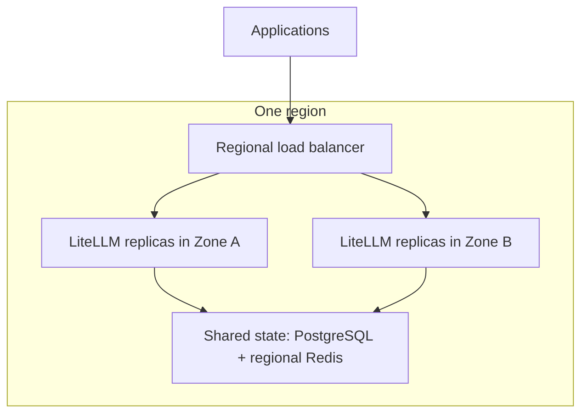

# High Availability

{/* keep-version-note */}

High availability means the gateway can keep serving requests when an instance fails or you deploy a new version. Start with multiple replicas across availability zones in one region. Add another region when your recovery or latency requirements need it.

| Topic | Use it for |
| --- | --- |
| [Blue/Green](./blue_green.md) | Test a complete replacement deployment, then switch traffic. |
| [Canary](./canary.md) | Send a small share of requests to a new version before you promote it. |
| [Multi-Region](../../multi_region.md) | Run regional gateways with a shared database and regional Redis. |
| [Routing](../multi_region/routing.md) | Choose which region receives a request. |
| [Failover](../multi_region/failover.md) | Decide when to remove a region and how to recover. |

## Make one region resilient

Run at least two serving replicas on separate nodes and distribute them across zones. Leave enough spare capacity for the remaining replicas to carry traffic after a failure. A second replica in the same failure domain does not protect against a zone outage. See [Sizing & Scaling](../sizing.md) and the cloud-specific [Reference Architectures](../architecture.md).

On Kubernetes, use [topology spread constraints](https://kubernetes.io/docs/concepts/scheduling-eviction/topology-spread-constraints/) for placement. A [PodDisruptionBudget](https://kubernetes.io/docs/tasks/run-application/configure-pdb/) limits voluntary evictions, such as a node drain; it does not prevent a node or zone from failing. Keep enough replicas available during upgrades with the Deployment rollout strategy as well.

## Protect the data services

All replicas in a deployment use the same logical PostgreSQL database. Use database replication and automated failover across zones, and test connection recovery after a writer change. Backups and restore tests cover data loss; they do not replace an available writer. Size the connection pool for the maximum replica count, including extra pods during a rollout. See [Database Sizing](../../db_sizing.md).

Use shared Redis for the replicas that need common rate-limit counters, router state, and caches. Configure its own replication and failover, and test the behavior of the features you use when Redis is unavailable. Adding gateway replicas does not make either data service redundant. See [What Needs Redis](../../redis_requirements.md) and [Redis Sizing](../../redis_sizing.md).

Keep provider access redundant too. If every gateway calls the same unavailable model endpoint, healthy gateway replicas cannot complete those calls. Configure and test [model fallbacks](../../reliability.md) separately from gateway failover.

## Use the right health signal

Use `/health/liveliness` for process liveness and `/health/readiness` to decide whether an instance can receive traffic. Neither makes an LLM request. Add a separate, controlled synthetic request to check authentication, model access, and provider connectivity. See [Health Checks](../../health.md).

By default, a configured database that is unreachable makes readiness return 503. If you deliberately enable `allow_requests_on_db_unavailable`, readiness can remain 200 during a database outage. That is a degraded service policy with authentication and enforcement implications, not proof that all features work. Read [graceful DB unavailability](../../prod.md#gracefully-handle-db-unavailability) before enabling it, and use the [multi-region health policy](../multi_region/failover.md#choose-a-health-policy) when several regions share the database.

## Verify recovery

In a test environment, remove one replica, drain a node, trigger the managed database's failover procedure, and interrupt Redis access. Confirm that the remaining capacity meets your latency and error targets, that streams finish during planned drains, and that spend queues recover. Record the time to detect a failure and restore service. If a whole-region outage is in scope, continue with [Multi-Region](../../multi_region.md).
