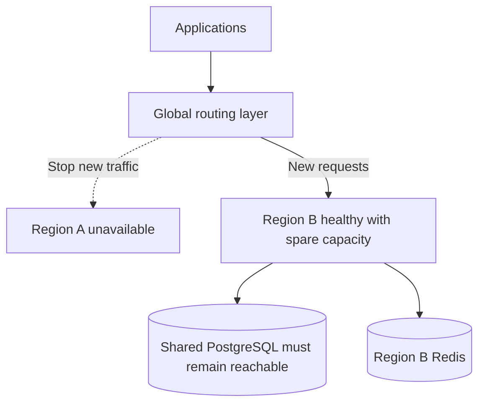

# Multi-Region Failover

{/* keep-version-note */}

Failover sends new requests to a usable region after another region fails. It needs a health policy, spare capacity, and a tested recovery procedure. It does not move an open stream or repair the [shared database](../../multi_region.md).



## Choose a health policy

Use `/health/liveliness` to detect a running process, and `/health/readiness` to decide whether a gateway is ready for traffic. Both return 503 during graceful shutdown. Neither is a complete end-to-end model test. See [Health Checks](../../health.md) and the [readiness implementation](https://github.com/BerriAI/litellm/blob/fdafffb84285892c1e97bf8b31d5eba0cbd7420a/litellm/proxy/health_endpoints/_health_endpoints.py).

| Policy | Probe behavior | Operational consequence |
| --- | --- | --- |
| Normal database-backed service | Readiness returns 503 when its configured database is unreachable. | Remove gateways that cannot meet normal service requirements. A shared database outage can make every region unready. |
| Explicit degraded service | With `allow_requests_on_db_unavailable: true`, readiness can remain 200 despite database loss. | Route only if the degraded authentication and enforcement policy is acceptable. Monitor database status and failed operations separately. |
| Process-only liveness | Liveliness can return 200 while dependencies are unavailable. | Useful for process monitoring; insufficient by itself to prove a region can serve normal traffic. |

Do not replace readiness with liveness simply to keep all regions in rotation during a database outage. Decide what service is permitted first. `allow_requests_on_db_unavailable` can allow requests without normal database verification of virtual keys; it is not just a cache optimization. Follow the private-network restriction and error behavior in [graceful DB unavailability](../../prod.md#gracefully-handle-db-unavailability), then test uncached keys, cache expiry, budgets, and model credentials for your deployed version.

Add a low-volume synthetic check for authenticated model access and a separate monitor for database/Redis health. Avoid removing every region because one shared provider model fails if other configured models remain usable. Set failure and recovery thresholds to avoid rapid movement between regions during a brief incident.

## Example: active-passive with HAProxy

This backend fragment assumes an existing, redundant HAProxy frontend that terminates client TLS and sends gateway traffic to `litellm_regions`. Replace the example private ingress addresses and CA path. Both regional ingress endpoints must serve `llm.example.com` with a certificate valid for that hostname.

```text title="haproxy.cfg backend fragment"
backend litellm_regions
    mode http
    retries 0
    option httpchk
    http-check send meth GET uri /health/readiness ver HTTP/1.1 hdr Host llm.example.com
    http-check expect status 200
    timeout connect 5s
    timeout server 650s
    default-server check inter 3s fall 3 rise 3
    server region_a 10.10.0.10:443 ssl verify required ca-file /etc/haproxy/ca.pem verifyhost llm.example.com sni str(llm.example.com) check-sni llm.example.com
    server region_b 10.20.0.10:443 ssl verify required ca-file /etc/haproxy/ca.pem verifyhost llm.example.com sni str(llm.example.com) check-sni llm.example.com backup
```

The backup receives new traffic when no regular server is available. Three consecutive failed probes remove Region A; three successful probes make it eligible again. Probe timeouts and connection failures affect the actual detection time, so this is not a fixed nine-second recovery guarantee. `retries 0` disables backend retries in this example; clients decide whether to retry a failed operation. Align frontend timeouts and stream handling with the backend. See [HAProxy health checks](https://www.haproxy.com/documentation/haproxy-configuration-tutorials/reliability/health-checks/) and [server options](https://docs.haproxy.org/3.2/configuration.html#5.2).

This simple configuration automatically makes Region A active again when it recovers. If you require manual failback, hold it out of routing until validation finishes, then restore it through your ingress control process. Configure the equivalent health, priority, and recovery settings for the [managed routing service](./routing.md#implementation-examples) you choose.

## Separate regional and shared failures

| Failure | What changes | What failover can do |
| --- | --- | --- |
| One gateway or zone | Some regional capacity is lost. | Regional ingress uses surviving ready replicas; global failover is needed only if the region cannot serve its load. |
| One region's ingress or network | That regional endpoint becomes unusable. | Send new requests to another region that can reach the database and model providers. |
| Regional Redis | Local counters, caches, or router state are affected. | Another region has separate Redis, but its counters do not include the failed region's usage. Test the policy before automatic movement. |
| Shared PostgreSQL writer | Every region loses the same dependency. | Gateway routing alone cannot restore normal database-backed service. Recover the database or use a previously approved degraded policy. |
| Shared provider endpoint | The same model can fail from every region. | Use tested model fallbacks or provider recovery; moving the gateway may not help. |

Check what your routing product does when every endpoint is unhealthy. For example, [AWS Global Accelerator can send traffic to unhealthy endpoints when none are healthy](https://docs.aws.amazon.com/global-accelerator/latest/dg/about-endpoints.html). Do not assume an empty healthy set always stops requests.

## Recover the shared database

Define a recovery time objective for service restoration and a recovery point objective for acceptable data loss. Zone-level database HA and cross-region disaster recovery solve different failures. An asynchronous regional replica can lag, so promotion can lose recent writes; backup recovery takes additional time.

Use your database service's documented failover procedure. Establish one writable primary and prevent the old writer from accepting conflicting writes. Update or restore the writer endpoint used by every region, verify TLS/DNS and connectivity, then confirm key lookup, a management write, spend updates, and queued work before restoring full traffic. Do not promote separate writable databases independently in each gateway region.

`DATABASE_URL_READ_REPLICA` routes reads; it does not promote a reader or change `DATABASE_URL`. See [Database Read Replica](../../db_read_replica.md). If you need each region to survive an unrelated database failure independently, use [independent deployments](../../global_control_plane.md), with separate keys and budgets, instead of assuming the shared-database design provides that isolation.

## Test failover and failback

Exercise a planned regional drain first: stop new routing, allow existing streams to finish, and confirm the surviving region handles the load. Then test an abrupt regional failure, which can interrupt streams and leave request outcomes uncertain. Clients need bounded retries appropriate to the operation; do not automatically replay every request after a connection loss.

Measure detection time, routing propagation or DNS caching, new-connection success, stream failures, and database recovery separately. During failback, validate the recovered region's release, secrets, provider quota, and dependencies before adding traffic gradually. Keep the healthy region available until the recovered region remains stable under load.
