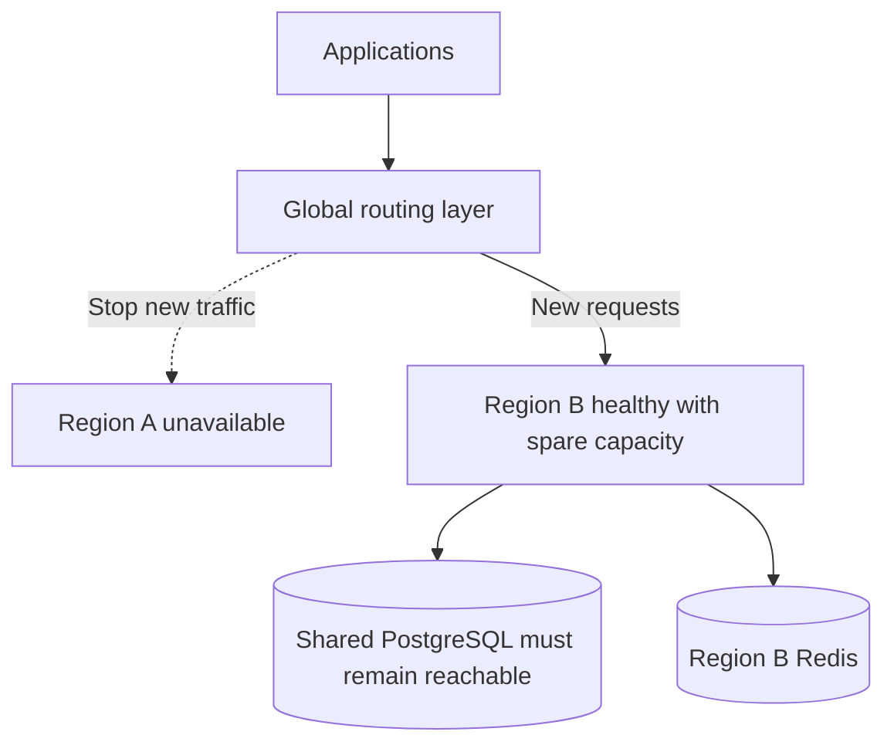

# Multi-Region Failover

{/* keep-version-note */}

Failover sends new requests to a healthy region after another region fails. It needs a health policy, spare capacity, and a tested recovery procedure. It does not move an open stream or repair the [shared database](../../multi_region.md).



## Choose a health policy

Use `/health/liveliness` to detect a running process. Use `/health/readiness` to decide whether a gateway is ready for traffic. Both return 503 during graceful shutdown. Neither tests a model request from end to end. See [Health Checks](../../health.md) and the [readiness implementation](https://github.com/BerriAI/litellm/blob/fdafffb84285892c1e97bf8b31d5eba0cbd7420a/litellm/proxy/health_endpoints/_health_endpoints.py).

| Policy | Probe behavior | Operational consequence |
| --- | --- | --- |
| Normal database-backed service | Readiness returns 503 when its configured database is unreachable. | Remove gateways that cannot meet normal service requirements. A shared database outage can make every region unready. |
| Explicit degraded service | With `allow_requests_on_db_unavailable: true`, readiness can remain 200 despite database loss. | Route only if the degraded authentication and enforcement policy is acceptable. Monitor database status and failed operations separately. |
| Process-only liveness | Liveliness can return 200 while dependencies are unavailable. | Use it to monitor the process. It does not prove that a region can serve normal traffic. |

Decide which operations you permit during a database outage before choosing a health policy. Do not replace readiness with liveness just to keep traffic flowing. `allow_requests_on_db_unavailable` can allow requests without normal database checks of virtual keys. Follow the private-network restriction in [graceful DB unavailability](../../prod.md#gracefully-handle-db-unavailability) and review its error behavior. Test uncached keys, cache expiry, budgets, and model credentials with your deployed version.

Add a low-volume test request for authenticated model access. Monitor PostgreSQL and Redis health separately. If one shared provider model fails, keep regions available for other working models. Set failure and recovery thresholds to prevent rapid traffic shifts during a brief incident.

## Example: active-passive with HAProxy

This backend fragment needs an existing, redundant HAProxy frontend. The frontend terminates client TLS and sends gateway traffic to `litellm_regions`. Replace the example private ingress addresses and CA path. Both regional ingress endpoints must serve `llm.example.com` with a certificate valid for that hostname.

```text title="haproxy.cfg backend fragment"
backend litellm_regions
    mode http
    retries 0
    option httpchk
    http-check send meth GET uri /health/readiness ver HTTP/1.1 hdr Host llm.example.com
    http-check expect status 200
    timeout connect 5s
    timeout server 650s
    default-server check inter 3s fall 3 rise 3
    server region_a 10.10.0.10:443 ssl verify required ca-file /etc/haproxy/ca.pem verifyhost llm.example.com sni str(llm.example.com) check-sni llm.example.com
    server region_b 10.20.0.10:443 ssl verify required ca-file /etc/haproxy/ca.pem verifyhost llm.example.com sni str(llm.example.com) check-sni llm.example.com backup
```

The backup receives new traffic when no regular server is available. Three consecutive failed probes remove Region A. Three successful probes make it eligible again. Probe timeouts and connection failures affect detection time. These settings do not guarantee recovery in nine seconds. `retries 0` disables backend retries. Clients decide whether to retry a failed operation. Match frontend timeouts and stream handling to the backend. See [HAProxy health checks](https://www.haproxy.com/documentation/haproxy-configuration-tutorials/reliability/health-checks/) and [server options](https://docs.haproxy.org/3.2/configuration.html#5.2).

This configuration makes Region A active again when it recovers. For manual failback, keep it out of routing until it passes your checks. Then restore it through your ingress control process. Configure equivalent health, priority, and recovery settings for your [managed routing service](./routing.md#implementation-examples).

## Separate regional and shared failures

| Failure | What changes | What failover can do |
| --- | --- | --- |
| One gateway or zone | The region loses some capacity. | Regional ingress uses surviving ready replicas. Use global failover only if the region cannot serve its load. |
| One region's ingress or network | That regional endpoint becomes unusable. | Send new requests to another region that can reach the database and model providers. |
| Regional Redis | Local counters, caches, or router state can fail. | Another region has separate Redis, but its counters do not include the failed region's usage. Test the policy before enabling automatic failover. |
| Shared PostgreSQL writer | Every region loses the same dependency. | Gateway routing alone cannot restore normal database-backed service. Recover the database or use a previously approved degraded policy. |
| Shared provider endpoint | The same model can fail from every region. | Use tested model fallbacks or wait for provider recovery. Moving the gateway might not help. |

Check what your routing product does when every endpoint is unhealthy. For example, [AWS Global Accelerator can send traffic to unhealthy endpoints when none are healthy](https://docs.aws.amazon.com/global-accelerator/latest/dg/about-endpoints.html). An unhealthy status does not always stop requests.

## Recover the shared database

Define a recovery time objective for how quickly you must restore service. Define a recovery point objective for how much data you can lose. Database HA across zones and disaster recovery across regions address different failures. An asynchronous regional replica can lag, so promotion can lose recent writes. Backup recovery takes additional time.

Use your database service's documented failover procedure. Establish one writable primary and prevent the old writer from accepting conflicting writes. Update or restore the writer endpoint for every region. Verify TLS, DNS, and connectivity. Before restoring full traffic, test key lookup, a management write, spend updates, and queued work. Do not promote a separate writable database in each gateway region.

`DATABASE_URL_READ_REPLICA` routes reads. It does not promote a reader or change `DATABASE_URL`. See [Database Read Replica](../../db_read_replica.md). To isolate database failures between regions, use [independent deployments](../../global_control_plane.md) with separate keys and budgets. A shared database cannot provide that isolation.

## Test failover and failback

Test a planned regional drain first. Stop new routing, allow existing streams to finish, and confirm that the surviving region handles the load. Then test an abrupt regional failure. It can interrupt streams and leave request outcomes uncertain. Set client retry limits for each operation. Do not automatically replay every request after a connection loss.

Measure failure detection, routing changes, DNS caching, new-connection success, stream failures, and database recovery separately. Before failback, check the recovered region's release, secrets, provider quota, and dependencies. Add traffic gradually. Keep the healthy region available until the recovered region remains stable under load.
