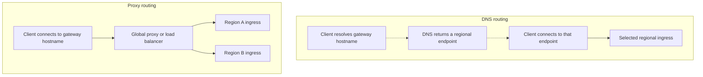

# Multi-Region Routing

{/* keep-version-note */}

Routing chooses which region receives a new request. Use a single gateway hostname and keep regional endpoints available for health probes and controlled tests. The [multi-region overview](../../multi_region.md) describes the shared database and regional Redis; [Failover](./failover.md) covers unhealthy regions and recovery.

## Choose the routing layer

DNS returns an address; it does not proxy the model request. Recursive resolvers and clients cache the answer, and an existing connection can outlive the DNS TTL. DNS weights therefore control answers over time, not an exact percentage of individual requests.

A global proxy stays in the request path and chooses an origin according to its routing policy. It provides a place to manage HTTP behavior, but its capacity, availability, TLS, and streaming timeouts become part of the gateway's design. Deploy a self-managed proxy tier redundantly rather than adding one global point of failure.

## Choose a policy

| Policy | Useful when | Check before enabling it |
| --- | --- | --- |
| Latency or proximity | Users are spread across regions. | Measure the full request path, including shared database and model-provider latency. The closest gateway is not always the fastest complete request. |
| Weighted | You want a controlled distribution or a gradual regional rollout. | Verify actual traffic and capacity. Connection reuse and DNS caching can skew the observed split. |
| Priority | One region serves traffic and another is a standby. | Keep the standby healthy, configured, and large enough to take over. |
| Region-restricted | Requests must stay in an approved set of locations. | Apply the restriction to failover targets, providers, logs, and data storage as well as ingress. |

Location-based routing alone does not enforce data residency: this topology still sends database operations to a shared writer. Decide where prompts, responses, logs, and metadata can travel before choosing regions.

## Implementation examples

These services implement routing policies; they do not create or synchronize LiteLLM's regional deployments.

| Implementation | Routing layer | How it fits |
| --- | --- | --- |
| [AWS Route 53](https://docs.aws.amazon.com/Route53/latest/DeveloperGuide/routing-policy.html) | DNS | Latency, weighted, geolocation, and failover records select regional endpoints. |
| [AWS Global Accelerator](https://docs.aws.amazon.com/global-accelerator/latest/dg/about-endpoints.html) | Global network frontend | Static addresses route connections to supported regional endpoints such as ALBs and NLBs. |
| [Google Cloud global external Application Load Balancer](https://docs.cloud.google.com/load-balancing/docs/https) | HTTP proxy | One frontend reaches supported backends in multiple regions. Backend type determines available routing and health controls. |
| [Azure Traffic Manager](https://learn.microsoft.com/en-us/azure/traffic-manager/traffic-manager-routing-methods) | DNS | Performance, weighted, geographic, or priority policies choose endpoints. |
| [Azure Front Door](https://learn.microsoft.com/en-us/azure/frontdoor/routing-methods) | HTTP proxy | Health, priority, latency, and weights select a regional origin. Weights apply among origins eligible under the other settings. |
| [HAProxy](https://www.haproxy.com/documentation/haproxy-configuration-tutorials/reliability/health-checks/) | Self-managed proxy | Backends represent regional ingress endpoints. Use health checks and weighted or backup servers; see the [failover example](./failover.md#example-active-passive-with-haproxy). |

For Cloud Run, serverless NEGs do not support ordinary load-balancer health checks. Use the [supported serverless health and outlier-detection mechanisms](https://docs.cloud.google.com/load-balancing/docs/negs/serverless-neg-concepts), and test their behavior during regional and dependency failures. Outlier detection is unavailable on backend services with IAP enabled; account for that restriction when combining identity-aware access and regional failover.

## Preserve request behavior

Forward the client's authorization and request body through the routing layer. Configure TLS for client-to-ingress and cross-region proxy-to-origin connections. Ensure each regional endpoint recognizes the public hostname and required paths, including model APIs and any management routes you expose.

Keep response streaming enabled and avoid buffering the whole response. Align idle and request timeouts at every hop with the API behavior you support. A streaming response stays on its original connection; changing routing does not transfer it to another region.

Be deliberate about retries. A network error after dispatch does not prove the provider did no work. Replaying a completion can produce duplicate output or charges, and retrying a management request can repeat a mutation. Let the application decide whether a failed operation can be retried; do not enable broad proxy retries for every POST.

## Verify the route

Send controlled requests through the public hostname and correlate them with regional ingress logs or traces. Check both regional endpoints directly, then compare the observed regional distribution with your policy. Test a long stream, a new connection after a DNS change, and a request whose preferred region is unavailable. Continue with [Failover](./failover.md) for the health policy and recovery procedure.
