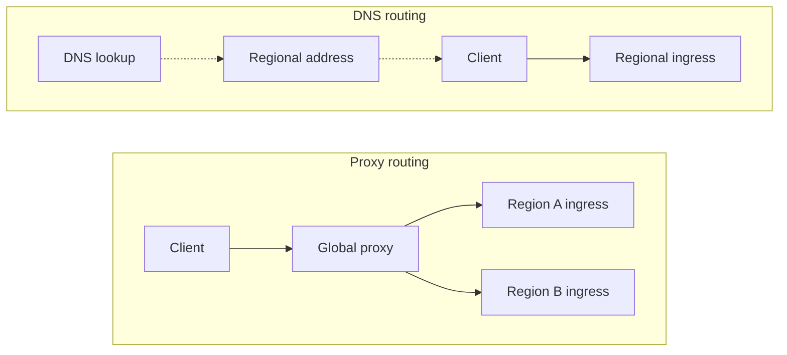

# Multi-Region Routing

{/* keep-version-note */}

Use a single gateway hostname. Keep regional endpoints available for health probes and controlled tests. See the [multi-region overview](../../multi_region.md) for shared data and [Failover](./failover.md) for health policies and recovery.

## Choose the routing layer

Recursive resolvers and clients cache DNS answers. An existing connection can outlive the DNS TTL. DNS weights control how often DNS returns each address, not the exact share of requests each region receives.

A global proxy stays in the request path and chooses an origin through its routing policy. Plan for its capacity, TLS, and streaming timeouts. Deploy redundant instances if you manage it yourself.

## Choose a policy

| Policy | Useful when | Check before enabling it |
| --- | --- | --- |
| Latency or proximity | Users work in several regions. | Measure the full request path, including shared database and model-provider latency. The closest gateway does not always complete requests fastest. |
| Weighted | You want a controlled distribution or a gradual regional rollout. | Verify actual traffic and capacity. Connection reuse and DNS caching can skew the observed split. |
| Priority | One region serves traffic and another is a standby. | Keep the standby healthy, configured, and large enough to take over. |
| Region-restricted | Requests must stay in an approved set of locations. | Apply the restriction to failover targets, providers, logs, and data storage as well as ingress. |

Location-based routing alone does not enforce data residency. This design still sends database operations to a shared writer. Decide where prompts, responses, logs, and metadata can travel before choosing regions.

## Implementation examples

| Implementation | Routing layer | How it fits |
| --- | --- | --- |
| [AWS Route 53](https://docs.aws.amazon.com/Route53/latest/DeveloperGuide/routing-policy.html) | DNS | Latency, weighted, geolocation, and failover records select regional endpoints. |
| [AWS Global Accelerator](https://docs.aws.amazon.com/global-accelerator/latest/dg/about-endpoints.html) | Global network frontend | Static addresses route connections to supported regional endpoints such as ALBs and NLBs. |
| [Google Cloud global external Application Load Balancer](https://docs.cloud.google.com/load-balancing/docs/https) | HTTP proxy | One frontend reaches supported backends in multiple regions. Backend type determines available routing and health controls. |
| [Azure Traffic Manager](https://learn.microsoft.com/en-us/azure/traffic-manager/traffic-manager-routing-methods) | DNS | Performance, weighted, geographic, or priority policies choose endpoints. |
| [Azure Front Door](https://learn.microsoft.com/en-us/azure/frontdoor/routing-methods) | HTTP proxy | Health, priority, latency, and weights select a regional origin. Weights apply among origins eligible under the other settings. |
| [HAProxy](https://www.haproxy.com/documentation/haproxy-configuration-tutorials/reliability/health-checks/) | Self-managed proxy | Backends represent regional ingress endpoints. Use health checks and weighted or backup servers. See the [failover example](./failover.md#example-active-passive-with-haproxy). |

For Cloud Run, serverless NEGs do not support ordinary load-balancer health checks. Use the [supported serverless health and outlier-detection mechanisms](https://docs.cloud.google.com/load-balancing/docs/negs/serverless-neg-concepts). Test them during regional and dependency failures. Backend services with IAP enabled cannot use outlier detection.

## Preserve request behavior

Forward the client's authorization and request body through the routing layer. Configure TLS from clients to ingress and from cross-region proxies to origins. Check that each regional endpoint accepts the shared hostname and required paths. Include model APIs and any management routes you expose.

Keep response streaming enabled and avoid buffering the whole response. Set idle and request timeouts at every hop to support your API behavior. A streaming response stays on its original connection. Routing changes do not transfer it to another region.

A network error can leave the request outcome unknown. Replaying a completion can produce duplicate output or charges. Retrying a management request can repeat a change. Let the application decide whether to retry a failed operation. Do not enable proxy retries for every POST.

## Verify the route

Send controlled requests through the gateway hostname and find them in regional ingress logs or traces. Check both regional endpoints directly, then compare actual traffic with your routing policy. Test a long stream, a new connection after a DNS change, and a request whose preferred region is unavailable. Continue with [Failover](./failover.md) for the health policy and recovery procedure.
