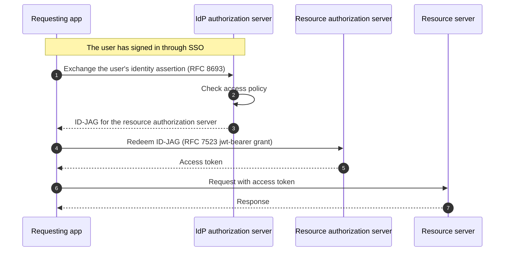

# ID-JAG

ID-JAG ([Identity Assertion JWT Authorization Grant](https://datatracker.ietf.org/doc/html/draft-ietf-oauth-identity-assertion-authz-grant)) lets an application access another service on a signed-in user's behalf. The identity provider (IdP) approves the exchange, and the target service's authorization server applies its own access policy before issuing an access token.

LiteLLM can act as both a resource and requesting app:

| Guide | Use case | What LiteLLM does |
|-------|----------|------------------|
| [LiteLLM as resource app](./resource_app.md) | An application needs to run inference or access MCP tools through LiteLLM. | Accepts an ID-JAG at `POST /token` and issues a LiteLLM credential for the user. |
| [LiteLLM as requesting app](./requesting_app.md) | An agent using LiteLLM needs access to an MCP server with a separate authorization server. | Exchanges the user's identity assertion for an ID-JAG, then redeems it for an MCP access token. |

:::info When to use ID-JAG

Use ID-JAG when an app needs to act on a signed-in user's behalf and you want your IdP to control which apps can request access. Both the IdP and the target service's authorization server must support ID-JAG.

For direct access to LiteLLM with an existing JWT, use [JWT authentication](../token_auth.md). For other token-exchange flows with an upstream MCP server, see [OBO token exchange](../../mcp_obo_auth.md).

:::

## How it works

The exchange involves four roles:

| Role | Responsibility |
|------|----------------|
| Requesting app (client) | Requests access on the user's behalf. |
| IdP authorization server | Validates the user's identity assertion and issues an ID-JAG according to its access policy. |
| Resource authorization server | Validates the ID-JAG, applies its access policy, and issues an access token. Its issuer identifier is the ID-JAG's `aud` claim. |
| Resource server | Accepts the access token to authorize API requests. |

When LiteLLM is the resource app, it issues access tokens and accepts them for inference and MCP requests. When LiteLLM is the requesting app, it exchanges the user's identity assertion for an ID-JAG at the IdP, then redeems the ID-JAG for an access token at the resource authorization server before calling the MCP server.

## Identity provider setup

### Okta

Okta implements ID-JAG as [Cross App Access (XAA)](https://developer.okta.com/docs/concepts/xaa/). Register the requesting app as an **AI agent** and enable Cross App Access on the resource app. An administrator connects them through a **resource connection** and selects the allowed scopes.

Select **Okta** under **Get started** in [LiteLLM as resource app](./resource_app.md#get-started) or [LiteLLM as requesting app](./requesting_app.md#get-started) for the full setup.
