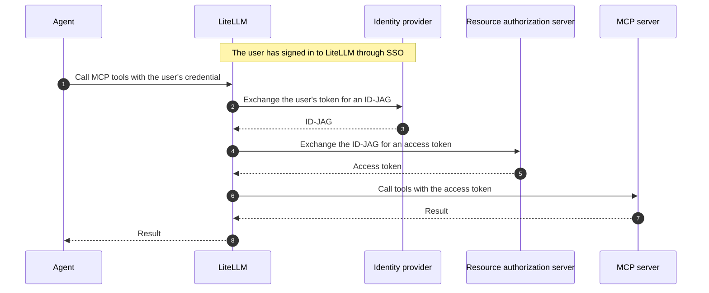

import Tabs from '@theme/Tabs';
import TabItem from '@theme/TabItem';
import IdJagScreenshot from '@site/src/components/IdJagScreenshot';

# LiteLLM as requesting app

Let LiteLLM call MCP tools on behalf of a signed-in user. LiteLLM exchanges the user's login token for an ID-JAG, then exchanges the ID-JAG for an access token at the MCP server's authorization server.

:::info
This feature requires an enterprise license, a database, and [LiteLLM SSO](../admin_ui_sso.md).
:::



## Get started

Select your identity provider.

<Tabs groupId="id-jag-idp" queryString="idp">
<TabItem value="okta" label="Okta" default>

This walkthrough uses your existing LiteLLM OIDC app in Okta.

### 1. Register LiteLLM as an AI agent {#okta}

Open LiteLLM in **Applications and Resources > Applications**.

1. Under **Grant type**, enable **Authorization Code** and **Refresh Token**.
2. In **Assignments**, assign the users who will test the flow.
3. Open **Machine Assignments > Resources** and select **Register AI agent**. Under **User access and authentication**, choose **Select an existing app**, select LiteLLM, and complete the registration.

<IdJagScreenshot
  src="/img/id-jag/okta-oidc-grant-types.jpg"
  alt="Okta grant types with Authorization Code and Refresh Token selected"
  caption="Enable Authorization Code and Refresh Token"
  width={690}
  height={126}
/>

<IdJagScreenshot
  src="/img/id-jag/okta-agent-link-litellm.jpg"
  alt="Okta AI agent registration with Select an existing app and LiteLLM Admin UI selected"
  caption="Link the agent to your existing LiteLLM app"
  width={880}
  height={510}
/>

In the agent's **Client registration**, select **Client secret** authentication. Use its client ID and secret as `GENERIC_CLIENT_ID` and `GENERIC_CLIENT_SECRET` in your LiteLLM SSO settings. Use `https://your-org.okta.com` as the SSO issuer.

<IdJagScreenshot
  src="/img/id-jag/okta-agent-client-credentials.jpg"
  alt="Okta client registration showing masked client secret and client ID fields"
  caption="Client secret and client ID"
  width={800}
  height={330}
/>

### 2. Set up the MCP resource app {#okta-connect-resource}

The MCP authorization server must accept ID-JAGs from your Okta org. If the resource is another LiteLLM proxy, follow its [resource-app setup](./resource_app.md#get-started).

1. At the MCP authorization server, register LiteLLM as a client. Save its client ID and secret, plus the server's issuer and token endpoint, for step 4.
2. In Okta's **Applications and Resources > Applications**, add or open the MCP resource app using the provider's SSO settings. Assign the users from the LiteLLM app.
3. Open **Machine Assignments > Callers > Cross App Access > Edit** and enable XAA. Set **Issuer URL** to the MCP authorization server's issuer and add its supported scopes.

<IdJagScreenshot
  src="/img/id-jag/okta-mcp-xaa-issuer-scopes.jpg"
  alt="Okta XAA settings with the as.mcp.example.com issuer and mcp.tools.read scope"
  caption="Example XAA settings for the MCP resource"
  width={400}
  height={532}
/>

### 3. Connect LiteLLM to the resource {#okta-resource-connection}

Return to the LiteLLM AI agent's **Resource connections** tab and add the MCP resource app.

| Field | Value |
|-------|-------|
| AI agent's client ID registered in this app | The client ID from the MCP authorization server in step 2. |
| Resource identifier | The MCP service's resource URL. |
| Scopes | Select **Allow specific scopes** and choose the scopes LiteLLM may request. |

<IdJagScreenshot
  src="/img/id-jag/okta-mcp-resource-connection.jpg"
  alt="Okta resource connection with client ID litellm-client, resource https://mcp.example.com, and mcp.tools.read scope"
  caption="Connect LiteLLM to the MCP resource"
  width={510}
  height={608}
/>

Activate the agent if its status is **STAGED**.

### 4. Configure LiteLLM {#okta-configure-sso}

Use your Okta SSO credentials for the ID-JAG exchange. Set `RESOURCE_AS_CLIENT_SECRET` to LiteLLM's client secret at the MCP authorization server.

Add these settings to your existing deployment. Replace the example URLs, `<resource-client-id>`, and scopes with the values from steps 2 and 3.

<Tabs groupId="id-jag-deployment">
<TabItem value="helm" label="Helm" default>

```yaml title="values.yaml"
envVars:
  GENERIC_SCOPE: "openid profile email offline_access"
environmentSecrets: [litellm-id-jag]
proxy_config:
  mcp_servers:
    internal_tools:
      url: "https://mcp.example.com/mcp"
      transport: http
      auth_type: oauth2_id_jag
      token_exchange_endpoint: "https://your-org.okta.com/oauth2/v1/token"
      client_id: os.environ/GENERIC_CLIENT_ID
      client_secret: os.environ/GENERIC_CLIENT_SECRET
      id_jag_subject_source: refresh_token
      id_jag_resource_token_endpoint: "https://as.mcp.example.com/oauth2/token"
      id_jag_resource_client_id: "<resource-client-id>"
      id_jag_resource_client_secret: os.environ/RESOURCE_AS_CLIENT_SECRET
      audience: "https://as.mcp.example.com"
      id_jag_resource: "https://mcp.example.com"
      scopes: [mcp.tools.read]
```

</TabItem>
<TabItem value="terraform" label="Terraform">

Add these inputs to your existing [LiteLLM AWS or Google Cloud module](../deploy.md#use-the-modules-directly). Set `var.resource_client_secret_ref` to the resource client's secret ARN on AWS or Secret Manager resource ID on Google Cloud.

```hcl title="Existing LiteLLM module inputs"
gateway_extra_env = { GENERIC_SCOPE = "openid profile email offline_access" }
backend_extra_env = { GENERIC_SCOPE = "openid profile email offline_access" }
gateway_extra_secrets = { RESOURCE_AS_CLIENT_SECRET = var.resource_client_secret_ref }
backend_extra_secrets = { RESOURCE_AS_CLIENT_SECRET = var.resource_client_secret_ref }
proxy_config = {
  mcp_servers = {
    internal_tools = {
      url                                = "https://mcp.example.com/mcp"
      transport                          = "http"
      auth_type                          = "oauth2_id_jag"
      token_exchange_endpoint            = "https://your-org.okta.com/oauth2/v1/token"
      client_id                          = "os.environ/GENERIC_CLIENT_ID"
      client_secret                      = "os.environ/GENERIC_CLIENT_SECRET"
      id_jag_subject_source              = "refresh_token"
      id_jag_resource_token_endpoint     = "https://as.mcp.example.com/oauth2/token"
      id_jag_resource_client_id          = "<resource-client-id>"
      id_jag_resource_client_secret      = "os.environ/RESOURCE_AS_CLIENT_SECRET"
      audience                           = "https://as.mcp.example.com"
      id_jag_resource                    = "https://mcp.example.com"
      scopes                             = ["mcp.tools.read"]
    }
  }
}
```

Run `terraform plan`, then `terraform apply`.

</TabItem>
</Tabs>

### 5. Sign in and call the MCP server {#okta-test}

After deploying, sign in to `https://litellm.example.com/ui` through Okta. Use that user's credential with access to `internal_tools`:

```bash
curl -X POST "https://litellm.example.com/internal_tools/mcp" \
  -H "Content-Type: application/json" \
  -H "Accept: application/json, text/event-stream" \
  -H "x-litellm-api-key: Bearer <user-credential>" \
  -d '{"jsonrpc":"2.0","id":1,"method":"tools/list","params":{}}'
```

A successful response lists the server's tools.

</TabItem>
<TabItem value="other" label="Other IdP">

This walkthrough uses your existing OIDC SSO setup. Your IdP must support ID-JAG exchanges with OIDC ID tokens.

### 1. Enable ID-JAG for LiteLLM {#other-register-clients}

Enable ID-JAG exchange for LiteLLM's SSO client, or register a separate exchange client if your IdP requires one. Use client-secret authentication (`client_secret_post`) and allow it to exchange ID tokens issued to the SSO app.

Save the exchange client's ID, secret, and ID-JAG token endpoint. The example reads its secret from `IDP_EXCHANGE_CLIENT_SECRET`.

### 2. Set up the MCP resource app {#other-connect-resource}

At the MCP authorization server, register LiteLLM as a client allowed to redeem ID-JAGs. Configure trust for your IdP and map its users. Save LiteLLM's resource client ID and secret, the server's issuer and token endpoint, and its supported scopes.

If the resource is another LiteLLM proxy, follow its [resource-app setup](./resource_app.md#get-started).

### 3. Connect LiteLLM to the resource {#other-resource-connection}

In your IdP, register the MCP authorization server's issuer as the resource audience. Allow LiteLLM's exchange client from step 1 to request ID-JAGs for this resource and its scopes. Assign the users who will test the flow.

Use the resource client ID from step 2 in this connection.

### 4. Configure LiteLLM {#other-configure-sso}

Set `IDP_EXCHANGE_CLIENT_SECRET` to the exchange secret from step 1 and `RESOURCE_AS_CLIENT_SECRET` to the resource client secret from step 2.

Add these settings to your existing deployment. Replace the example URLs, client IDs, and scopes with your provider's values.

<Tabs groupId="id-jag-deployment">
<TabItem value="helm" label="Helm" default>

```yaml title="values.yaml"
environmentSecrets: [litellm-id-jag]
proxy_config:
  mcp_servers:
    internal_tools:
      url: "https://mcp.example.com/mcp"
      transport: http
      auth_type: oauth2_id_jag
      token_exchange_endpoint: "https://idp.example.com/oauth2/token"
      client_id: "<idp-exchange-client-id>"
      client_secret: os.environ/IDP_EXCHANGE_CLIENT_SECRET
      id_jag_resource_token_endpoint: "https://as.mcp.example.com/oauth2/token"
      id_jag_resource_client_id: "<resource-client-id>"
      id_jag_resource_client_secret: os.environ/RESOURCE_AS_CLIENT_SECRET
      audience: "https://as.mcp.example.com"
      scopes: [mcp.tools.read]
```

</TabItem>
<TabItem value="terraform" label="Terraform">

Add these inputs to your existing [LiteLLM AWS or Google Cloud module](../deploy.md#use-the-modules-directly). The secret references are ARNs on AWS or Secret Manager resource IDs on Google Cloud.

```hcl title="Existing LiteLLM module inputs"
gateway_extra_secrets = {
  IDP_EXCHANGE_CLIENT_SECRET = var.idp_exchange_client_secret_ref
  RESOURCE_AS_CLIENT_SECRET  = var.resource_client_secret_ref
}
backend_extra_secrets = {
  IDP_EXCHANGE_CLIENT_SECRET = var.idp_exchange_client_secret_ref
  RESOURCE_AS_CLIENT_SECRET  = var.resource_client_secret_ref
}
proxy_config = {
  mcp_servers = {
    internal_tools = {
      url                                = "https://mcp.example.com/mcp"
      transport                          = "http"
      auth_type                          = "oauth2_id_jag"
      token_exchange_endpoint            = "https://idp.example.com/oauth2/token"
      client_id                          = "<idp-exchange-client-id>"
      client_secret                      = "os.environ/IDP_EXCHANGE_CLIENT_SECRET"
      id_jag_resource_token_endpoint     = "https://as.mcp.example.com/oauth2/token"
      id_jag_resource_client_id          = "<resource-client-id>"
      id_jag_resource_client_secret      = "os.environ/RESOURCE_AS_CLIENT_SECRET"
      audience                           = "https://as.mcp.example.com"
      scopes                             = ["mcp.tools.read"]
    }
  }
}
```

Run `terraform plan`, then `terraform apply`.

</TabItem>
</Tabs>

If your IdP requires a resource identifier, add `id_jag_resource` with the MCP service's resource URL.

### 5. Sign in and call the MCP server {#other-test}

After deploying, sign in to `https://litellm.example.com/ui` through your IdP. Use that user's credential with access to `internal_tools`:

```bash
curl -X POST "https://litellm.example.com/internal_tools/mcp" \
  -H "Content-Type: application/json" \
  -H "Accept: application/json, text/event-stream" \
  -H "x-litellm-api-key: Bearer <user-credential>" \
  -d '{"jsonrpc":"2.0","id":1,"method":"tools/list","params":{}}'
```

A successful response lists the server's tools.

</TabItem>
</Tabs>

## Troubleshooting

<Tabs groupId="id-jag-idp" queryString="idp">
<TabItem value="okta" label="Okta" default>

| Response or log | Cause and fix |
|-----------------|---------------|
| `401 invalid_client` | Match the IdP client credentials to the AI agent's **Client registration**. |
| `invalid_target` | Match `audience` to the resource app's **Issuer URL**, and `id_jag_resource` to its resource identifier. |
| `unauthorized_client` | Allow the requested scopes on the agent's **Resource connection**. |
| `requested_token_type invalid or not supported` | Use `https://<your-org>.okta.com/oauth2/v1/token` for the ID-JAG exchange. |
| `invalid_grant` with a SAML subject | Set `id_jag_subject_source: refresh_token` and the SAML app's audience to the AI agent's client ID. Check assertion expiry. [Okta SAML setup](https://developer.okta.com/docs/guides/xaa-request-token-ex/saml2/main/). |
| `412`: missing or expired credentials | Sign in to LiteLLM again. For a missing refresh token, check login logs and enable **Refresh Token** on the Okta app. |
| Login logs report multiple refresh-token clients | Give all servers using `id_jag_subject_source: refresh_token` the same `client_id` and `token_exchange_endpoint`. |
| Resource authorization server rejects the ID-JAG | Check the resource client credentials and match `audience` and `id_jag_resource_token_endpoint` to the resource authorization server. |
| MCP server receives the user's credential | Send the credential in `x-litellm-api-key`. |
| `503` on connect | Check database connectivity. |
| No tools; `_meta` contains `http_status: 412` | Call `/internal_tools/mcp` to read the full error. |

</TabItem>
<TabItem value="other" label="Other IdP">

| Response or log | Cause and fix |
|-----------------|---------------|
| ID-JAG exchange rejects the subject | Confirm the IdP accepts the assertion's issuer and token type for ID-JAG exchange. |
| `412`: no assertion stored | Sign in through LiteLLM SSO after configuring the MCP server. |
| `412`: assertion expired | Sign in again. To renew OIDC assertions automatically, configure the SSO app to issue refresh tokens. |
| `412`: no refresh token stored | Check login logs and whether the IdP supports refresh-token exchange for this client, then sign in again. |
| `412`: refresh token expired | Sign in again. |
| Login logs report multiple refresh-token clients | Give all servers using `id_jag_subject_source: refresh_token` the same `client_id` and `token_exchange_endpoint`. |
| Resource authorization server rejects the ID-JAG | Check the resource client credentials and match `audience` and `id_jag_resource_token_endpoint` to the resource authorization server. |
| MCP server receives the user's credential | Send the credential in `x-litellm-api-key`. |
| `503` on connect | Check database connectivity. |
| No tools; `_meta` contains `http_status: 412` | Call `/internal_tools/mcp` to read the full error. |

</TabItem>
</Tabs>
