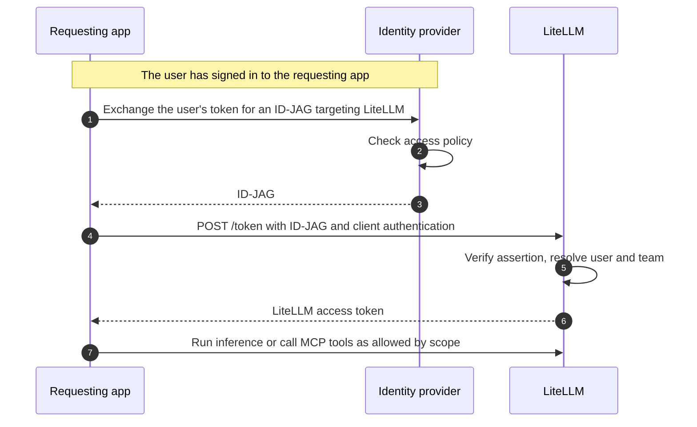

import Tabs from '@theme/Tabs';
import TabItem from '@theme/TabItem';
import IdJagScreenshot from '@site/src/components/IdJagScreenshot';

# LiteLLM as resource app

Let an application exchange an ID-JAG for a LiteLLM access token, then use it to run inference or call MCP tools on behalf of an existing LiteLLM user.

LiteLLM's `POST /token` endpoint issues the token. Inference endpoints such as `/v1/chat/completions` and the MCP gateway accept it.

:::info
This feature requires an enterprise license, a database, a shared Redis, and [JWT authentication](../token_auth.md). Configure Redis through `litellm_settings.cache` with Redis `cache_params` or through `general_settings.coordination_redis`, so each ID-JAG is redeemed once across all workers and replicas. Set `PROXY_BASE_URL` and allowlist at least one requesting app to enable the grant.
:::



## Get started

Select your identity provider for the full setup.

<Tabs groupId="id-jag-idp" queryString="idp">
<TabItem value="okta" label="Okta" default>

<span id="okta" />

This walkthrough assumes LiteLLM is already registered in Okta. It uses [Okta Cross App Access](https://developer.okta.com/docs/guides/xaa-agent-to-app/main/) and an OIDC requesting app. Replace `your-org.okta.com` and `litellm.example.com` with your domains.

### 1. Register the requesting app in Okta

In **Applications and Resources > Applications**, create or select an **OIDC Web Application** for the app that will call LiteLLM.

<IdJagScreenshot
  src="/img/id-jag/okta-oidc-web-app.jpg"
  alt="Okta application integration dialog with OIDC and Web Application selected"
  caption="Create an OIDC Web Application for the requesting app."
  width={800}
  height={724}
/>

Configure the requesting app so users can sign in with Okta:

1. Under **Grant type**, select **Authorization Code**.
2. In **Sign-in redirect URIs**, enter the callback URL from the requesting app's sign-in configuration. This is where Okta returns the user after sign-in.
3. Save the app. Open **Assignments** and assign the Okta user you'll use to test the flow.

<IdJagScreenshot
  src="/img/id-jag/okta-oidc-sign-in-callback.jpg"
  alt="Okta sign-in redirect URI set to https://agent.example.com/callback"
  caption="Set the requesting app's callback URL"
  width={690}
  height={184}
/>

From the app's **Machine Assignments > Resources** tab, select **Register AI agent** and complete the registration.

In the agent's **Client registration**, use client-secret authentication. Save its client ID and secret as `IDP_CLIENT_ID` and `IDP_CLIENT_SECRET` in the requesting app. These are also its OIDC sign-in credentials. Activate the agent if it is **STAGED**.

<IdJagScreenshot
  src="/img/id-jag/okta-agent-client-credentials.jpg"
  alt="Okta client registration showing masked client secret and client ID fields"
  caption="Client secret and client ID"
  width={800}
  height={330}
/>

### 2. Connect the requesting app to LiteLLM

In **Applications and Resources > Applications**, open your existing LiteLLM app. Under **Assignments**, make sure the user from step 1 is assigned to it.

Open **Machine Assignments > Callers > Cross App Access > Edit** and enable XAA. Set **Issuer URL** to your LiteLLM URL. Define `litellm:mcp` and `litellm:llm` as the supported scopes. Leave **Audience/tenant ID** empty for this single-tenant example.

| Value | URL |
|-------|-----|
| Issuer URL / ID-JAG audience | `https://litellm.example.com` |
| Token endpoint | `https://litellm.example.com/token` |
| Authorization server metadata | `https://litellm.example.com/.well-known/oauth-authorization-server` |
| Native client discovery | `https://litellm.example.com/.well-known/litellm-cli-auth` |

<IdJagScreenshot
  src="/img/id-jag/okta-xaa-issuer-scopes.jpg"
  alt="Okta Cross App Access settings with the bare-origin LiteLLM issuer and litellm:mcp and litellm:llm scopes"
  caption="Example XAA settings for LiteLLM"
  width={400}
  height={932}
/>

On the AI agent's **Resource connections** tab, select your LiteLLM app. Set the client ID registered in LiteLLM to `agent-client`, the **Resource identifier** to `https://litellm.example.com`, and select **Allow specific scopes**. Choose the scopes to allow:

<IdJagScreenshot
  src="/img/id-jag/okta-litellm-resource-connection.jpg"
  alt="Okta resource connection with client ID agent-client, resource https://litellm.example.com, and litellm:mcp and litellm:llm scopes"
  caption="Connect the requesting app to LiteLLM"
  width={510}
  height={670}
/>

| Granted scope | Access |
|---------------|--------|
| `litellm:mcp` | MCP gateway routes only. |
| `litellm:llm` | LLM API routes only. |
| `litellm:mcp litellm:llm` | Both MCP gateway and LLM API routes. |
| No scope | Full access within the user and team permissions, as with `lite login`. |

### 3. Configure LiteLLM

Configure LiteLLM with the requesting app's client ID and existing client secret. The example uses `agent-client` and reads its secret from `AGENT_CLIENT_SECRET`.

<Tabs groupId="id-jag-deployment">
<TabItem value="helm" label="Helm" default>

```yaml title="values.yaml"
envVars:
  PROXY_BASE_URL: "https://litellm.example.com"
environmentSecrets: [litellm-id-jag]
proxy_config:
  general_settings:
    enable_jwt_auth: true
    litellm_jwtauth:
      id_jag_requesting_apps:
        - client_id: agent-client
          client_secret: os.environ/AGENT_CLIENT_SECRET
```

</TabItem>
<TabItem value="terraform" label="Terraform">

Add these inputs to your existing [LiteLLM AWS or Google Cloud module](../deploy.md#use-the-modules-directly). Set `var.agent_client_secret_ref` to the secret ARN on AWS or Secret Manager resource ID on Google Cloud.

```hcl title="Existing LiteLLM module inputs"
gateway_extra_env = { PROXY_BASE_URL = "https://litellm.example.com" }
backend_extra_env = { PROXY_BASE_URL = "https://litellm.example.com" }
gateway_extra_secrets = { AGENT_CLIENT_SECRET = var.agent_client_secret_ref }
backend_extra_secrets = { AGENT_CLIENT_SECRET = var.agent_client_secret_ref }
proxy_config = {
  general_settings = {
    enable_jwt_auth = true
    litellm_jwtauth = {
      id_jag_requesting_apps = [{
        client_id     = "agent-client"
        client_secret = "os.environ/AGENT_CLIENT_SECRET"
      }]
    }
  }
}
```

Run `terraform plan`, then `terraform apply`.

</TabItem>
</Tabs>

Create or select a LiteLLM user whose email matches the IdP account. Give that user access to the models or MCP tools you want to call. After deploying, check that discovery lists `urn:ietf:params:oauth:grant-type:jwt-bearer`:

```bash
curl -s https://litellm.example.com/.well-known/oauth-authorization-server \
  | jq '.grant_types_supported'
```

In your existing JWT configuration, use Okta's org issuer (`https://your-org.okta.com`) and JWKS URL (`https://your-org.okta.com/oauth2/v1/keys`).

### 4. Sign in and request an ID-JAG

Configure the requesting app's OIDC login with issuer `https://your-org.okta.com` and scopes `openid profile email`. Sign in as the assigned test user and save the login response's `id_token` as `ID_TOKEN`. Set `REQUESTED_SCOPES="litellm:mcp litellm:llm"` to try both examples below, or request just one of the scopes allowed on the resource connection.

Use the agent's Okta credentials from step 1 to [exchange the ID token](https://developer.okta.com/docs/guides/xaa-request-token-ex/openidconnect/main/):

```bash title="Request an ID-JAG" showLineNumbers
curl -s -X POST https://your-org.okta.com/oauth2/v1/token \
  -d grant_type=urn:ietf:params:oauth:grant-type:token-exchange \
  -d requested_token_type=urn:ietf:params:oauth:token-type:id-jag \
  -d subject_token_type=urn:ietf:params:oauth:token-type:id_token \
  --data-urlencode "subject_token=$ID_TOKEN" \
  -d audience=https://litellm.example.com \
  -d resource=https://litellm.example.com \
  --data-urlencode "scope=$REQUESTED_SCOPES" \
  --data-urlencode "client_id=$IDP_CLIENT_ID" \
  --data-urlencode "client_secret=$IDP_CLIENT_SECRET"
```

Save the response's `access_token` as `ID_JAG`.

### 5. Get a LiteLLM access token

Send the ID-JAG as `assertion` with the `jwt-bearer` grant. Use the requesting app's client ID and secret **at LiteLLM**, as configured in `id_jag_requesting_apps`.

```bash title="Get a LiteLLM credential" showLineNumbers
curl -s -X POST https://litellm.example.com/token \
  -d grant_type=urn:ietf:params:oauth:grant-type:jwt-bearer \
  -d client_id=agent-client \
  --data-urlencode "client_secret=$AGENT_CLIENT_SECRET" \
  --data-urlencode "assertion=$ID_JAG"
```

Confidential clients can also use HTTP Basic authentication (`-u "agent-client:$AGENT_CLIENT_SECRET"`) instead of the client ID and secret form fields. Public clients send `client_id` without a secret.

```json
{
  "access_token": "LneZuxEFqvemEwK6lRzgg6BN...",
  "token_type": "Bearer",
  "expires_in": 86400,
  "scope": "litellm:mcp litellm:llm",
  "user_id": "user@example.com",
  "team_id": "125eca86-fbde-44de-8cb9-cf1432933fcd"
}
```

Save `access_token` as `LITELLM_ACCESS_TOKEN`. `scope` echoes the granted scope, which limits route access. No refresh token is issued. When the credential expires, request a fresh ID-JAG and redeem it again.

### 6. Call LiteLLM

Use the access token for calls allowed by its scope and the user's LiteLLM permissions. Spend is attributed to their `user_id` and `team_id`.

<Tabs>
<TabItem value="inference" label="Inference" default>

Replace `<your-model-name>` with a model configured on your proxy.

```bash title="Run inference" showLineNumbers
curl -s https://litellm.example.com/v1/chat/completions \
  -H "Authorization: Bearer $LITELLM_ACCESS_TOKEN" \
  -H "Content-Type: application/json" \
  -d '{"model":"<your-model-name>","messages":[{"role":"user","content":"Hello"}]}'
```

</TabItem>
<TabItem value="mcp" label="MCP tools">

```bash title="List MCP tools" showLineNumbers
curl -s -X POST https://litellm.example.com/mcp \
  -H "Authorization: Bearer $LITELLM_ACCESS_TOKEN" \
  -H "Content-Type: application/json" \
  -H "Accept: application/json, text/event-stream" \
  -d '{"jsonrpc":"2.0","id":1,"method":"tools/list","params":{}}'
```

</TabItem>
</Tabs>

</TabItem>
<TabItem value="other" label="Other IdP">

Your IdP must support ID-JAG issuance and accept an OIDC ID token as the subject. The example uses client-secret authentication; choose your provider's supported method.

### 1. Register the requesting app {#other-register-requesting-app}

Create an OIDC client in your IdP. Enable Authorization Code, register the requesting app's sign-in callback URL, and assign the users who may sign in. Configure the app's OIDC login with the provider's issuer and `openid profile email` scopes.

Enable ID-JAG token exchange for that client. Save its credentials as `IDP_CLIENT_ID` and `IDP_CLIENT_SECRET`, and note the issuer, JWKS URL, and ID-JAG token endpoint from your provider's metadata.

### 2. Register LiteLLM as a resource {#other-register-resource}

Register these values in your IdP:

| Setting | Value |
|---------|-------|
| Resource issuer / ID-JAG audience | `https://litellm.example.com` |
| Token endpoint | `https://litellm.example.com/token` |
| Authorization server metadata | `https://litellm.example.com/.well-known/oauth-authorization-server` |
| Native client discovery | `https://litellm.example.com/.well-known/litellm-cli-auth` |
| Resource identifier | `https://litellm.example.com` |
| Requesting app's client ID at LiteLLM | `agent-client` |

Allow the requesting app to access this resource for your test user. The IdP must put `agent-client` in the ID-JAG's `client_id` claim. Choose the allowed scopes:

| Granted scope | Access |
|---------------|--------|
| `litellm:mcp` | MCP gateway routes only. |
| `litellm:llm` | LLM API routes only. |
| `litellm:mcp litellm:llm` | Both MCP gateway and LLM API routes. |
| No scope | Full access within the user and team permissions, as with `lite login`. |

### 3. Configure LiteLLM {#other-configure-litellm}

Configure LiteLLM with the requesting app's client ID and existing client secret. The example uses `agent-client` and reads its secret from `AGENT_CLIENT_SECRET`.

<Tabs groupId="id-jag-deployment">
<TabItem value="helm" label="Helm" default>

```yaml title="values.yaml"
envVars:
  PROXY_BASE_URL: "https://litellm.example.com"
environmentSecrets: [litellm-id-jag]
proxy_config:
  general_settings:
    enable_jwt_auth: true
    litellm_jwtauth:
      id_jag_requesting_apps:
        - client_id: agent-client
          client_secret: os.environ/AGENT_CLIENT_SECRET
```

</TabItem>
<TabItem value="terraform" label="Terraform">

Add these inputs to your existing [LiteLLM AWS or Google Cloud module](../deploy.md#use-the-modules-directly). Set `var.agent_client_secret_ref` to the secret ARN on AWS or Secret Manager resource ID on Google Cloud.

```hcl title="Existing LiteLLM module inputs"
gateway_extra_env = { PROXY_BASE_URL = "https://litellm.example.com" }
backend_extra_env = { PROXY_BASE_URL = "https://litellm.example.com" }
gateway_extra_secrets = { AGENT_CLIENT_SECRET = var.agent_client_secret_ref }
backend_extra_secrets = { AGENT_CLIENT_SECRET = var.agent_client_secret_ref }
proxy_config = {
  general_settings = {
    enable_jwt_auth = true
    litellm_jwtauth = {
      id_jag_requesting_apps = [{
        client_id     = "agent-client"
        client_secret = "os.environ/AGENT_CLIENT_SECRET"
      }]
    }
  }
}
```

Run `terraform plan`, then `terraform apply`.

</TabItem>
</Tabs>

Create or select a LiteLLM user whose email matches the IdP account. Give that user access to the models or MCP tools you want to call. After deploying, check that discovery lists `urn:ietf:params:oauth:grant-type:jwt-bearer`:

```bash
curl -s https://litellm.example.com/.well-known/oauth-authorization-server \
  | jq '.grant_types_supported'
```

### 4. Sign in and request an ID-JAG {#other-request-id-jag}

Sign in to the requesting app as the assigned user. Save the login response's `id_token` as `ID_TOKEN`, and set `REQUESTED_SCOPES="litellm:mcp litellm:llm"` to try both examples below. Request just one scope to limit access, as allowed by your IdP policy.

Replace the token endpoint below with your provider's ID-JAG endpoint. Use the IdP client credentials from step 1:

```bash title="Request an ID-JAG" showLineNumbers
curl -s -X POST https://idp.example.com/oauth2/v1/token \
  -d grant_type=urn:ietf:params:oauth:grant-type:token-exchange \
  -d requested_token_type=urn:ietf:params:oauth:token-type:id-jag \
  -d subject_token_type=urn:ietf:params:oauth:token-type:id_token \
  --data-urlencode "subject_token=$ID_TOKEN" \
  -d audience=https://litellm.example.com \
  -d resource=https://litellm.example.com \
  --data-urlencode "scope=$REQUESTED_SCOPES" \
  --data-urlencode "client_id=$IDP_CLIENT_ID" \
  --data-urlencode "client_secret=$IDP_CLIENT_SECRET"
```

Save the response's `access_token` as `ID_JAG`.

### 5. Get a LiteLLM access token {#other-get-access-token}

Send the ID-JAG as `assertion` with the `jwt-bearer` grant. Use the requesting app's client ID and secret **at LiteLLM**, as configured in `id_jag_requesting_apps`.

```bash title="Get a LiteLLM credential" showLineNumbers
curl -s -X POST https://litellm.example.com/token \
  -d grant_type=urn:ietf:params:oauth:grant-type:jwt-bearer \
  -d client_id=agent-client \
  --data-urlencode "client_secret=$AGENT_CLIENT_SECRET" \
  --data-urlencode "assertion=$ID_JAG"
```

Confidential clients can also use HTTP Basic authentication (`-u "agent-client:$AGENT_CLIENT_SECRET"`) instead of the client ID and secret form fields. Public clients send `client_id` without a secret.

```json
{
  "access_token": "LneZuxEFqvemEwK6lRzgg6BN...",
  "token_type": "Bearer",
  "expires_in": 86400,
  "scope": "litellm:mcp litellm:llm",
  "user_id": "user@example.com",
  "team_id": "125eca86-fbde-44de-8cb9-cf1432933fcd"
}
```

Save `access_token` as `LITELLM_ACCESS_TOKEN`. `scope` echoes the granted scope, which limits route access. No refresh token is issued. When the credential expires, request a fresh ID-JAG and redeem it again.

### 6. Call LiteLLM {#other-call-litellm}

Use the access token for calls allowed by its scope and the user's LiteLLM permissions. Spend is attributed to their `user_id` and `team_id`.

<Tabs>
<TabItem value="inference" label="Inference" default>

Replace `<your-model-name>` with a model configured on your proxy.

```bash title="Run inference" showLineNumbers
curl -s https://litellm.example.com/v1/chat/completions \
  -H "Authorization: Bearer $LITELLM_ACCESS_TOKEN" \
  -H "Content-Type: application/json" \
  -d '{"model":"<your-model-name>","messages":[{"role":"user","content":"Hello"}]}'
```

</TabItem>
<TabItem value="mcp" label="MCP tools">

```bash title="List MCP tools" showLineNumbers
curl -s -X POST https://litellm.example.com/mcp \
  -H "Authorization: Bearer $LITELLM_ACCESS_TOKEN" \
  -H "Content-Type: application/json" \
  -H "Accept: application/json, text/event-stream" \
  -d '{"jsonrpc":"2.0","id":1,"method":"tools/list","params":{}}'
```

</TabItem>
</Tabs>

</TabItem>
</Tabs>

## Troubleshooting

<Tabs groupId="id-jag-idp" queryString="idp">
<TabItem value="okta" label="Okta" default>

| Response or log | Cause and fix |
|-----------------|---------------|
| `invalid_target` or `unauthorized_client` from Okta | Under **Directory > AI Agents > Resource connections**, check the LiteLLM issuer URL, allowed scopes, user assignments, and agent activation. |
| `400 unsupported_grant_type` | Check the enterprise license, database, shared Redis, JWT authentication, `PROXY_BASE_URL`, and nonempty requesting-app allowlist. Restart after configuration changes. Leave `virtual_key_claim_field` and `jwt_client_id_field` unset on this gateway. |
| `400 invalid_request`: missing `client_id` or `assertion` | Send `client_id` in the form or HTTP Basic authentication, and the ID-JAG in the `assertion` form field. |
| `401 invalid_client` | Match the allowlisted client ID and secret. Configure a secret only for a confidential client. |
| `400 invalid_grant`: wrong `typ` or malformed JWT | Send the ID-JAG returned by the IdP exchange, rather than the user's login token or an ordinary bearer token. |
| `400 invalid_grant`: assertion already redeemed | Request a new ID-JAG. Each assertion can be redeemed once. |
| `400 invalid_grant`; log reports an audience mismatch | Set **Machine Assignments > Callers > Issuer URL** to the bare origin, `<PROXY_BASE_URL>`. Check the scheme and trailing slashes. |
| `400 invalid_grant`; log reports an untrusted issuer or missing signing key | Use the Okta issuer `https://your-org.okta.com` and JWKS URL `https://your-org.okta.com/oauth2/v1/keys`. |
| `400 invalid_grant`; log reports a `client_id` mismatch | Set **AI agent's client ID registered in this app** to the ID the agent sends to LiteLLM. |
| `400 invalid_grant`; log reports that the user does not exist | Map the Okta `email` or `sub` to an existing LiteLLM user. |
| `400 invalid_request`: team selection or membership | Send `x-litellm-team-id` with the ID or alias of one of the user's teams. |
| `503 temporarily_unavailable`: user teams could not be read | Retry. The assertion has not been consumed. |
| `401` when using the ID-JAG on `/mcp` | Redeem it at `/token` and use the returned `access_token`. |

</TabItem>
<TabItem value="other" label="Other IdP">

| Response or log | Cause and fix |
|-----------------|---------------|
| `400 unsupported_grant_type` | Check the enterprise license, database, shared Redis, JWT authentication, `PROXY_BASE_URL`, and nonempty requesting-app allowlist. Restart after configuration changes. Leave `virtual_key_claim_field` and `jwt_client_id_field` unset on this gateway. |
| `400 invalid_request`: missing `client_id` or `assertion` | Send `client_id` in the form or HTTP Basic authentication, and the ID-JAG in the `assertion` form field. |
| `401 invalid_client` | Match the allowlisted client ID and secret. Configure a secret only for a confidential client. |
| `400 invalid_grant`: wrong `typ` or malformed JWT | Send the ID-JAG returned by the IdP exchange, rather than the user's login token or an ordinary bearer token. |
| `400 invalid_grant`: assertion already redeemed | Request a new ID-JAG. Each assertion can be redeemed once. |
| `400 invalid_grant`; log reports an audience mismatch | Match the IdP's resource audience to the bare origin, `<PROXY_BASE_URL>`. Check the scheme and trailing slashes. |
| `400 invalid_grant`; log reports an untrusted issuer or missing signing key | Match `issuers[].issuer` to the assertion's `iss` and configure that issuer's JWKS. |
| `400 invalid_grant`; log reports a `client_id` mismatch | Configure the IdP to put the app's LiteLLM client ID in the assertion. |
| `400 invalid_grant`; log reports that the user does not exist | Create the LiteLLM user or correct the user ID/email claim mapping. |
| `400 invalid_request`: team selection or membership | Send `x-litellm-team-id` with the ID or alias of one of the user's teams. |
| `503 temporarily_unavailable`: user teams could not be read | Retry. The assertion has not been consumed. |
| `401` when using the ID-JAG on `/mcp` | Redeem it at `/token` and use the returned `access_token`. |

</TabItem>
</Tabs>
