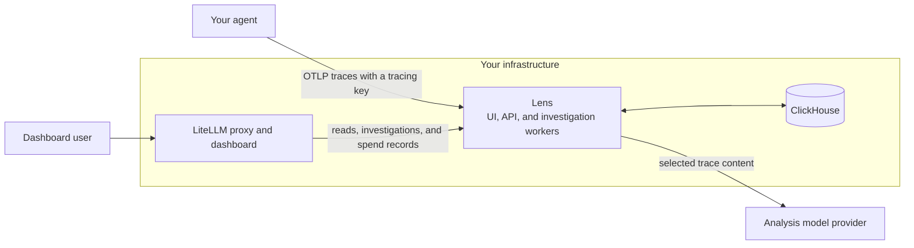

# Set up Lens

Lens lets you inspect agent traces, investigate failures, and save useful runs as datasets. You can open it inside your LiteLLM dashboard or use it as a separate application.

In both cases, Lens runs as its own service and stores its data in ClickHouse. Your agent can keep its existing model provider.

## How the pieces connect {#architecture}

Agents send traces directly to Lens with a tracing key. Investigations send selected trace content to your analysis model. The Compose file, the release bundle and the Helm chart each include both Lens and ClickHouse.

## Choose your starting point {#new-deployment}

| Your starting point | Follow this guide |
| --- | --- |
| Docker on one machine or server | [Download one Compose file and run it](./deployment/local.md) |
| Kubernetes | [Install the Helm chart](./deployment/kubernetes.md) |
| Add to an existing LiteLLM gateway | [Connect Lens to LiteLLM](./deployment/litellm.md) |

Already set up? [Send your first trace](./first-trace.md).

## Record coding agent sessions

After Lens starts, generate a tracing key and follow the exact [Claude Code](./coding-agents.md#claude-code) or [Codex](./coding-agents.md#codex) setup. Keep your existing model login. Open **Traces** in Lens to find your sessions; no Python example or LiteLLM gateway is required.

## Use Lens inside LiteLLM {#configure-an-existing-proxy}

A gateway administrator [connects Lens](./deployment/litellm.md) once. Users then open **Lens** in the sidebar with their existing session. If Lens already runs, keep its address, storage and credentials. You do not need a second copy.

## Use Lens on its own

Download the [Lens Compose file](https://github.com/BerriAI/lens/blob/main/deploy/lens/compose.yaml) and run `docker compose up --wait`. It starts Lens and ClickHouse from the published image. Sign in with the generated admin token. A LiteLLM gateway and PostgreSQL are not required.

Follow the [quickstart](./deployment/local.md). You can inspect traces without an analysis model. Add an [analysis model](https://github.com/BerriAI/lens/blob/main/docs/analysis.md) when you want to run investigations.

## Check your first result {#check-the-installation}

Open Lens, generate a tracing key, and follow [Send your first trace](./first-trace.md). Open the resulting run and inspect its content. A health check confirms that the service is ready; a stored trace confirms that your exporter can send data and you can read it.

For help from a coding agent, copy the **Set it up for me** prompt in the [Lens setup guide](https://github.com/BerriAI/lens/blob/main/docs/setup-with-agent.md). It covers standalone setup, an existing gateway, and connecting an agent.
