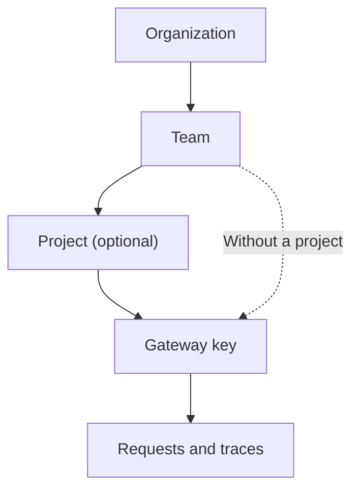

# Access control and workspace filters

{/* keep-version-note: This overview covers existing trace permissions and upcoming workspace controls, with no verified release that includes all controls. */}

:::info Upcoming workspace controls

These team/key tracing controls and Org, Team, Project and Key selectors are part of the upcoming Gateway and Lens updates. The screenshots show a preview build.

:::

Use Lens in the LiteLLM dashboard to share traces and inspect application traffic. Your Gateway account determines which traces you can read. Workspace filters narrow those results; selecting another organization, team, project or key does not grant access.

First [connect Lens to LiteLLM](./deployment/litellm.md). An administrator configures that connection once. Team members do not enter separate Lens integration credentials for each key.

Org and Project menus need configured entities and permission to list them. Organization management follows the Gateway's Enterprise licensing. Those management permissions do not grant trace access.

## Understand the hierarchy

Common traffic grouping:

A key can belong to a team without a project. A personal key can also have no team. For organization filters, an explicit organization on a key takes precedence; otherwise Lens uses the key's team's organization. These assignments group traffic, but do not define a separate permission grant.

## Who can read traces

Lens uses the Gateway's existing trace permissions:

| Reader | Visible traces |
| --- | --- |
| Proxy administrator or administrator viewer | All traces. |
| Team administrator | Their own user-owned traces, plus traces from teams they administer or have permission to view. |
| Other users, including team members | Their own user-owned traces, plus traces from teams that share logs with them. |
| Organization administrator or project owner | The same user/team rules. Organization or project ownership alone does not grant all related traces. |
| Non-admin key without a user identity | No trace reads; the request returns `403`. |

To share a team's traces, open **Teams**, select the team, then select **Member Permissions**. Grant the `/spend/logs` permission. A team administrator can read that team's traces without this member grant. See [Share a team's traces](./api.md#trace-access) for the API and default-team configuration.

Dedicated Lens tracing keys upload telemetry and check their own delivery receipts; they do not read traces. See [Upload traces](./api.md#upload).

## Enable Lens for a team and key

### Set the team default

Open **Teams**, select your team, and open its **Lens** tab. Set the switch to **On** to enable tracing for keys that inherit the team setting. **Default for team keys** identifies this control.

### Check the key

Open **Virtual Keys**, select the key, and open **Lens**. **On** enables tracing for that key. **Use team setting** removes a custom key override and restores inheritance.

A key's explicit On or Off setting takes precedence over its team. Without a key override, the team setting applies. If neither sets a value, tracing defaults to On when Lens is configured. This controls future collection: it does not grant read access or delete traces already stored. After enabling Lens, verify trace delivery.

## Segment traffic in Lens

Select **Open Lens** from the key's Lens tab. Lens opens with that key selected and its team when assigned. The left sidebar contains Lens pages; the hierarchy controls sit above the content.

| Select | Inspect |
| --- | --- |
| **Organization** | Traffic from keys assigned to that organization, including inherited team assignments. |
| **Team** | Traffic recorded for that team. |
| **Project** | Traffic from keys currently assigned to that project. |
| **Key** | Traffic recorded with that specific key. |

For example, select your organization, choose a team, then select a project to compare that application's traffic. Select a key to isolate one integration or service. Choosing **All keys** keeps the parent filters. Changing a parent clears its descendants and any open trace; selecting a key fills in its parents. **No project** means that key has no project assignment.

Selected filters combine with AND and remain within your authorized rows. A mismatched combination returns no results. Trace details, spans, conversation history, pagination, copied trace queries and shared links retain the selection. Trace SQL uses the same scope; see [Query traces with SQL](./api.md#query-traces).

These selectors filter trace views and trace SQL. They do not automatically filter Profiles, Datasets or Evals, or grant access to those objects.

Organization and project filters use current key assignments, not a historical snapshot. Scopes that match more than 2,048 keys require a narrower team, project or key selection. Organization filters also stop at 2,048 candidate teams. The Gateway returns an error instead of silently omitting matching keys.

If no traces appear, check the time range, tracing policy and connection, then follow [Send your first trace](./first-trace.md).
