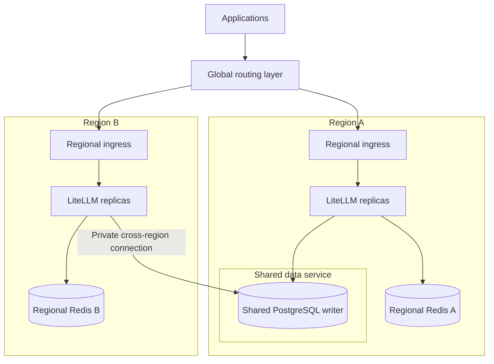

import Tabs from '@theme/Tabs';
import TabItem from '@theme/TabItem';

# Multi-Region Deployment

{/* keep-version-note */}

Run LiteLLM in more than one region when users need a nearby gateway or your recovery plan must cover a regional outage. The shared-database design on this page applies on AWS, Google Cloud, or Azure: regional gateways use one logical PostgreSQL database and a Redis instance per region.

Start with [High Availability](./deploy/ha/overview.md) for replicas and zone failures within one region. Use [Routing](./deploy/multi_region/routing.md) to choose a region for each request, and [Failover](./deploy/multi_region/failover.md) to define what happens when a region or a shared dependency fails.

## Architecture



Each region has its own ingress, gateway capacity, and Redis. This example places the shared PostgreSQL writer in Region A. PostgreSQL holds the shared keys, teams, users, configuration, and spend records. Use a highly available database service rather than a single database process. The regional gateways still depend on the same writable database; a second gateway region does not make that database independent.

| Mode | Normal request routing | Capacity requirement |
| --- | --- | --- |
| Active-active | Both regions serve requests, using a latency, location, or weighted policy. | The surviving region needs headroom for the traffic it takes over. |
| Active-passive | Region A serves requests; Region B is prepared as a standby. | Keep standby capacity and provider access ready for the required recovery time. |

Both modes need health monitoring and a recovery plan. Active-passive also needs regular tests of the standby; an idle deployment can have stale credentials, insufficient quota, or missing configuration.

A shared database provides one authoritative state store. It does not make every change immediately visible in every process: authentication caches, configuration reloads, read-replica lag, and batched spend writes can delay visibility. See [authentication caching](./caching_redis.md#virtual-key-authentication-cache-redis) and [Database Read Replica](./db_read_replica.md).

## Licensing across regions

A single LiteLLM Enterprise license covers a multi-region deployment when all regions share one database. Each instance receives and validates the same `LITELLM_LICENSE`; user and team limits are counted against that shared database.

| Topology | Databases | Enterprise licenses |
| --- | --- | --- |
| Shared-database multi-region deployment | One logical database | One for the deployment |
| Independent deployment per region | One per deployment | One per deployment |
| [Global Control Plane](./global_control_plane.md) | One per worker deployment | One per worker deployment |

The shared-database topology itself works with the open source proxy. Enterprise features require the license above. For independent deployments managed from one UI, use the [Global Control Plane](./global_control_plane.md). Each worker has its own keys, teams, budgets, database, Redis, and master key. The control plane does not make a key from one worker valid on another.

## Requirements

Keep these settings consistent across every region of the shared deployment:

| Setting | Requirement | Purpose |
| --- | --- | --- |
| `DATABASE_URL` | The same logical writable database | Shared keys, configuration, spend records, and license counts. |
| `LITELLM_MASTER_KEY` | The same secret | Consistent administrative authentication. |
| `LITELLM_SALT_KEY` | The same stable secret | Decrypt credentials stored in the shared database. Do not replace it during a rollout. |
| `LITELLM_LICENSE` | The same license, when using Enterprise features | Activate the shared deployment's Enterprise features. |
| `DISABLE_SCHEMA_UPDATE` | `true` on serving instances | A single coordinated migration job updates the shared schema. |

Use the same release and configuration source across regions, with explicit regional values for network endpoints and provider access. Store shared secrets in your secret manager and make them available to the deployment in each region.

Configure each region's Redis for its local replicas, including `router_settings` and any Redis-backed cache settings. See the [production Redis configuration](./prod.md#redis).

:::important Regional limits

Separate Redis instances do not share rate-limit counters. A Redis-backed allowance of 100 RPM in each of two regions can permit 200 RPM across them. Shared PostgreSQL does not turn those counters into a global rate limit. If you need a global quota, design and test a common enforcement mechanism; a shared Redis deployment adds cross-region latency and a shared dependency. Budget and spend visibility also depend on cache and flush intervals.

:::

Regional Redis also creates separate ownership locks for shared background jobs. Coordinate database-wide cleanup, budget resets, and exports across regions, and test ownership during failover. See [background job ownership](./prod.md#run-background-jobs-on-a-dedicated-worker).

## Setup

### 1. Provision the shared database

Provision PostgreSQL with zone redundancy, backups, and a tested writer failover procedure. Run schema migrations once per upgrade, through the [Helm migration job](./deploy/helm.md) or your coordinated deployment pipeline. Do not launch a migration independently from every region.

Decide separately whether your recovery plan needs a cross-region database replica. A replica can reduce recovery time, but promoting it and directing writers to it is a database recovery operation, not a gateway routing change. See [Failover](./deploy/multi_region/failover.md#recover-the-shared-database).

### 2. Connect the regions' networks

Provide private, routed access from every region to the shared database and allow only the required database connections. Depending on your cloud, use [AWS VPC peering](https://docs.aws.amazon.com/vpc/latest/peering/what-is-vpc-peering.html), a [Google Cloud VPC](https://docs.cloud.google.com/vpc/docs/vpc), or [Azure VNet peering](https://learn.microsoft.com/en-us/azure/virtual-network/virtual-network-peering-overview). Confirm managed database networking supports the chosen route and DNS configuration.

Use TLS and verify the database server certificate. Mount the required CA bundle in serving instances and migration jobs; see [database TLS](./prod.md#verify-the-database-server-certificate-custom-ca-eg-aws-rds). Cross-region database calls add network latency, so measure authentication, management operations, and connection recovery from each region.

### 3. Deploy proxy instances in each region

Deploy the regional load balancer and LiteLLM replicas with [Helm](./deploy/helm.md) or [Terraform](./deploy/terraform.md). Disable additional migration jobs in secondary releases; in the Helm chart, set `migrationJob.enabled: false`. Keep serving instances on `DISABLE_SCHEMA_UPDATE=true` everywhere.

The following environment values show the shared and regional settings. Inject real secrets through your deployment's secret manager and mount the CA at `/certs/db-ca.pem`.

<Tabs>
<TabItem value="primary" label="Region A">

```bash
DATABASE_URL="postgresql://litellm:<password>@db-writer.internal:5432/litellm?sslmode=verify-full&sslrootcert=/certs/db-ca.pem"
LITELLM_MASTER_KEY="sk-<shared-master-key>"
LITELLM_SALT_KEY="<shared-stable-encryption-key>"
LITELLM_LICENSE="<shared-enterprise-license>"
DISABLE_SCHEMA_UPDATE="true"
REDIS_HOST="redis.region-a.internal"
REDIS_PORT="6379"
REDIS_PASSWORD="<region-a-redis-secret>"
```

</TabItem>
<TabItem value="secondary" label="Region B">

```bash
# Same writable database and shared deployment secrets as Region A
DATABASE_URL="postgresql://litellm:<password>@db-writer.internal:5432/litellm?sslmode=verify-full&sslrootcert=/certs/db-ca.pem"
LITELLM_MASTER_KEY="sk-<shared-master-key>"
LITELLM_SALT_KEY="<shared-stable-encryption-key>"
LITELLM_LICENSE="<shared-enterprise-license>"
DISABLE_SCHEMA_UPDATE="true"
# Redis is regional
REDIS_HOST="redis.region-b.internal"
REDIS_PORT="6379"
REDIS_PASSWORD="<region-b-redis-secret>"
```

</TabItem>
</Tabs>

Omit `LITELLM_LICENSE` for an open source deployment. Apply the Redis settings to your proxy configuration and enable TLS for Redis where required by the service.

### 4. Optional: add regional read replicas

Set `DATABASE_URL_READ_REPLICA` to a regional reader endpoint if you need to reduce database read latency. Writes still go to `DATABASE_URL`. Configure TLS for the reader as well.

```bash
DATABASE_URL_READ_REPLICA="postgresql://litellm:<password>@db-reader.region-b.internal:5432/litellm?sslmode=verify-full&sslrootcert=/certs/db-ca.pem"
```

Read replicas can lag behind the writer, so test newly created keys, revocations, and budget changes before relying on them. The [read-replica guide](./db_read_replica.md) describes query routing and reader degradation. A read replica does not automatically become the writer when the primary fails.

### 5. Route clients {#5-route-clients-to-the-nearest-region}

Give clients one gateway hostname. Choose a DNS policy, a global HTTP load balancer, or a highly available proxy tier to select a regional endpoint. See [Routing](./deploy/multi_region/routing.md) for AWS Route 53 and Global Accelerator, Google Cloud global load balancing, Azure Traffic Manager and Front Door, and HAProxy examples.

Configure health checks according to the service you intend to offer during a failure. Do not use process liveness alone as proof that a region can authenticate and serve requests. Read [Failover](./deploy/multi_region/failover.md#choose-a-health-policy) before enabling automatic traffic changes.

### 6. Verify

Create a virtual key through one region, then use it for a model request through the other region's endpoint. Confirm the response and eventual spend record in the Admin UI. Allow for configured caches and any read-replica lag. The [Quickstart](./docker_quick_start.md#5-create-a-virtual-key) covers key creation.

Test routing with each region unavailable in turn. Test shared database loss separately: it can affect both regions at once. Record error rates, stream completion, recovery time, and the spare capacity needed in the surviving region.

## Optional: dedicated admin instance

You can keep management access on one private hostname while regional gateways serve model requests. This remains one deployment with a shared database, unlike the independent workers managed by the Global Control Plane.

<EnterpriseFeature>

`DISABLE_ADMIN_ENDPOINTS` and `DISABLE_LLM_API_ENDPOINTS` are Enterprise features.

</EnterpriseFeature>

Use the same shared database and secrets on all instances, then set these additional environment values:

<Tabs>
<TabItem value="admin" label="Admin instance">

```bash
DISABLE_LLM_API_ENDPOINTS="true"
```

</TabItem>
<TabItem value="worker" label="Regional serving instances">

```bash
DISABLE_ADMIN_UI="true"
DISABLE_ADMIN_ENDPOINTS="true"
```

</TabItem>
</Tabs>

`DISABLE_ADMIN_UI` disables `/ui`. `DISABLE_ADMIN_ENDPOINTS` disables management routes while model endpoints, health checks, and metrics remain available. `DISABLE_LLM_API_ENDPOINTS` disables model-serving routes while management remains available. The componentized [Helm deployment](./deploy/helm.md) also separates gateway, backend, and UI services.

## FAQ

**Do I need multi-region?** A regional deployment with replicas and redundant data services can cover instance and zone failures. Add regions for a defined latency or disaster-recovery requirement, then test the additional dependencies.

**What if the primary region's database fails?** Both regions can lose normal database-backed operations. Gateway failover alone does not fix this. Use the [shared-database recovery procedure](./deploy/multi_region/failover.md#recover-the-shared-database), and decide in advance whether a restricted degraded mode is acceptable.

**Can regions run different versions?** Only for a tested upgrade window in which both versions support the shared schema and configuration. Run migrations once and return regions to the same intended release. See [Blue/Green](./deploy/ha/blue_green.md) and [Canary](./deploy/ha/canary.md).
