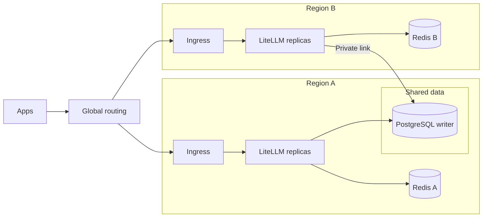

import Tabs from '@theme/Tabs';
import TabItem from '@theme/TabItem';

# Multi-Region Deployment

{/* keep-version-note */}

Run LiteLLM in more than one region when users need a nearby gateway or your recovery plan covers a regional outage. This design works on AWS, Google Cloud, and Azure. Regional gateways use one logical PostgreSQL database and a Redis instance per region.

Start with [High Availability](./deploy/ha/overview.md) for replicas and zone failures within one region. Use [Routing](./deploy/multi_region/routing.md) to choose a region for each request. Use [Failover](./deploy/multi_region/failover.md) to plan for regional and shared dependency failures.

## Architecture



Each region has its own ingress, gateway capacity, and Redis. This example places the shared PostgreSQL writer in Region A. PostgreSQL holds the shared keys, teams, users, configuration, and spend records. Use a highly available database service. All regional gateways depend on that writable database. Adding a gateway region does not give it an independent database.

| Mode | Normal request routing | Capacity requirement |
| --- | --- | --- |
| Active-active | Both regions serve requests through a latency, location, or weighted policy. | The surviving region needs spare capacity for the traffic it takes over. |
| Active-passive | Region A serves requests. Region B waits as a standby. | Keep standby capacity and provider access ready for the required recovery time. |

Both modes need health monitoring and a recovery plan. Test the standby regularly in an active-passive deployment. An idle deployment can have stale credentials, insufficient quota, or missing configuration.

A shared database holds the deployment's state. Processes do not see every change immediately. Authentication caches, configuration reloads, read-replica lag, and batched spend writes can delay updates. See [authentication caching](./caching_redis.md#virtual-key-authentication-cache-redis) and [Database Read Replica](./db_read_replica.md).

## Licensing across regions

A single LiteLLM Enterprise license covers a multi-region deployment when all regions share one database. Each instance receives and validates the same `LITELLM_LICENSE`. LiteLLM counts users and teams against the shared database's license limits.

| Topology | Databases | Enterprise licenses |
| --- | --- | --- |
| Shared-database multi-region deployment | One logical database | One for the deployment |
| Independent deployment per region | One per deployment | One per deployment |
| [Global Control Plane](./global_control_plane.md) | One per worker deployment | One per worker deployment |

This shared-database design works with the open source proxy. Enterprise features require the license above. Use the [Global Control Plane](./global_control_plane.md) to manage independent deployments from one UI. Each worker has its own keys, teams, budgets, database, Redis, and master key. The control plane does not make a key from one worker valid on another.

## Requirements

Keep these settings consistent across every region of the shared deployment:

| Setting | Requirement | Purpose |
| --- | --- | --- |
| `DATABASE_URL` | The same logical writable database | Shared keys, configuration, spend records, and license counts. |
| `LITELLM_MASTER_KEY` | The same secret | Consistent administrative authentication. |
| `LITELLM_SALT_KEY` | The same stable secret | Decrypt credentials stored in the shared database. Do not replace it during a rollout. |
| `LITELLM_LICENSE` | The same license, when using Enterprise features | Activate the shared deployment's Enterprise features. |
| `DISABLE_SCHEMA_UPDATE` | `true` on serving instances | A single coordinated migration job updates the shared schema. |

Use the same release and configuration source across regions. Set network endpoints and provider access for each region. Store shared secrets in your secret manager and provide them to each regional deployment.

Configure each region's Redis for its local replicas, including `router_settings` and any Redis-backed cache settings. See the [production Redis configuration](./prod.md#redis).

:::important Regional limits

Separate Redis instances do not share rate-limit counters. A Redis-backed allowance of 100 RPM in each of two regions can permit 200 RPM across them. Shared PostgreSQL does not combine those counters into a global rate limit. For a global quota, design and test enforcement across regions. A shared Redis deployment adds cross-region latency and a shared dependency. Cache and flush intervals also affect how quickly budgets and spend records update.

:::

Regional Redis also creates separate ownership locks for shared background jobs. Coordinate database-wide cleanup, budget resets, and exports across regions. Test which region owns each job during failover. See [background job ownership](./prod.md#run-background-jobs-on-a-dedicated-worker).

## Setup

### 1. Provision the shared database

Provision PostgreSQL with zone redundancy, backups, and a tested writer failover procedure. Run schema migrations once per upgrade through the [Helm migration job](./deploy/helm.md) or a shared deployment pipeline. Do not launch a separate migration from every region.

Decide whether your recovery plan needs a database replica in another region. A replica can reduce recovery time. Your database recovery procedure must promote it and direct writes to it. A gateway routing change does not perform those steps. See [Failover](./deploy/multi_region/failover.md#recover-the-shared-database).

### 2. Connect the regions' networks

Provide private network routes from every region to the shared database. Allow only the required database connections. Depending on your cloud, use [AWS VPC peering](https://docs.aws.amazon.com/vpc/latest/peering/what-is-vpc-peering.html), a [Google Cloud VPC](https://docs.cloud.google.com/vpc/docs/vpc), or [Azure VNet peering](https://learn.microsoft.com/en-us/azure/virtual-network/virtual-network-peering-overview). Check that the managed database supports your routes and DNS configuration.

Use TLS and verify the database server certificate. Mount the required CA bundle in serving instances and migration jobs. See [database TLS](./prod.md#verify-the-database-server-certificate-custom-ca-eg-aws-rds). Database calls across regions add network latency. Measure authentication, management operations, and connection recovery from each region.

### 3. Deploy proxy instances in each region

Deploy the regional load balancer and LiteLLM replicas with [Helm](./deploy/helm.md) or [Terraform](./deploy/terraform.md). Disable migration jobs in secondary releases. In the Helm chart, set `migrationJob.enabled: false`. Keep `DISABLE_SCHEMA_UPDATE=true` on all serving instances.

The following environment values show the shared and regional settings. Inject real secrets through your deployment's secret manager and mount the CA at `/certs/db-ca.pem`.

<Tabs>
<TabItem value="primary" label="Region A">

```bash
DATABASE_URL="postgresql://litellm:<password>@db-writer.internal:5432/litellm?sslmode=verify-full&sslrootcert=/certs/db-ca.pem"
LITELLM_MASTER_KEY="sk-<shared-master-key>"
LITELLM_SALT_KEY="<shared-stable-encryption-key>"
LITELLM_LICENSE="<shared-enterprise-license>"
DISABLE_SCHEMA_UPDATE="true"
REDIS_HOST="redis.region-a.internal"
REDIS_PORT="6379"
REDIS_PASSWORD="<region-a-redis-secret>"
```

</TabItem>
<TabItem value="secondary" label="Region B">

```bash
# Same writable database and shared deployment secrets as Region A
DATABASE_URL="postgresql://litellm:<password>@db-writer.internal:5432/litellm?sslmode=verify-full&sslrootcert=/certs/db-ca.pem"
LITELLM_MASTER_KEY="sk-<shared-master-key>"
LITELLM_SALT_KEY="<shared-stable-encryption-key>"
LITELLM_LICENSE="<shared-enterprise-license>"
DISABLE_SCHEMA_UPDATE="true"
# Redis is regional
REDIS_HOST="redis.region-b.internal"
REDIS_PORT="6379"
REDIS_PASSWORD="<region-b-redis-secret>"
```

</TabItem>
</Tabs>

Omit `LITELLM_LICENSE` for an open source deployment. Apply the Redis settings to your proxy configuration and enable TLS for Redis where required by the service.

### 4. Optional: add regional read replicas

Set `DATABASE_URL_READ_REPLICA` to a regional reader endpoint if you need to reduce database read latency. Writes still go to `DATABASE_URL`. Configure TLS for the reader as well.

```bash
DATABASE_URL_READ_REPLICA="postgresql://litellm:<password>@db-reader.region-b.internal:5432/litellm?sslmode=verify-full&sslrootcert=/certs/db-ca.pem"
```

Read replicas can lag behind the writer. Test newly created keys, revocations, and budget changes before relying on a replica. The [read-replica guide](./db_read_replica.md) describes query routing and behavior when the reader fails. A read replica does not automatically become the writer when the primary fails.

### 5. Route clients {#5-route-clients-to-the-nearest-region}

Give clients one gateway hostname. Use a DNS policy, global HTTP load balancer, or highly available proxy to select a regional endpoint. See [Routing](./deploy/multi_region/routing.md) for examples with AWS Route 53, Global Accelerator, Google Cloud load balancing, Azure Traffic Manager, Front Door, and HAProxy.

Set health checks to match the service you plan to offer during a failure. Process liveness alone does not prove that a region can authenticate and serve requests. Read [Failover](./deploy/multi_region/failover.md#choose-a-health-policy) before enabling automatic traffic changes.

### 6. Verify

Create a virtual key through one region. Use it for a model request through the other region's endpoint. Confirm the response, then check the spend record in the Admin UI. Allow time for configured caches, spend writes, and any read-replica lag. The [Quickstart](./docker_quick_start.md#5-create-a-virtual-key) covers key creation.

Test routing with each region unavailable in turn. Test shared database loss separately. It can affect both regions at once. Record error rates, stream completion, recovery time, and the spare capacity the surviving region needs.

## Optional: dedicated admin instance

You can keep management access on one private hostname while regional gateways serve model requests. These instances form one deployment with a shared database. Global Control Plane workers run independent deployments.

<EnterpriseFeature>

`DISABLE_ADMIN_ENDPOINTS` and `DISABLE_LLM_API_ENDPOINTS` are Enterprise features.

</EnterpriseFeature>

Use the same shared database and secrets on all instances. Then set these additional environment values:

<Tabs>
<TabItem value="admin" label="Admin instance">

```bash
DISABLE_LLM_API_ENDPOINTS="true"
```

</TabItem>
<TabItem value="worker" label="Regional serving instances">

```bash
DISABLE_ADMIN_UI="true"
DISABLE_ADMIN_ENDPOINTS="true"
```

</TabItem>
</Tabs>

`DISABLE_ADMIN_UI` disables `/ui`. `DISABLE_ADMIN_ENDPOINTS` disables management routes while model endpoints, health checks, and metrics remain available. `DISABLE_LLM_API_ENDPOINTS` disables model-serving routes while management remains available. The componentized [Helm deployment](./deploy/helm.md) also separates gateway, backend, and UI services.

## FAQ

**Do I need multi-region?** Replicas and redundant data services within one region can cover instance and zone failures. Add regions to meet a specific latency or disaster-recovery requirement. Test the additional dependencies.

**What if the primary region's database fails?** Both regions can lose normal database-backed operations. Gateway failover alone does not fix this. Use the [shared-database recovery procedure](./deploy/multi_region/failover.md#recover-the-shared-database). Decide in advance whether to allow restricted service during the outage.

**Can regions run different versions?** Only during a tested upgrade where both versions support the shared schema and configuration. Run migrations once. Return all regions to the same release after the upgrade. See [Blue/Green](./deploy/ha/blue_green.md) and [Canary](./deploy/ha/canary.md).
