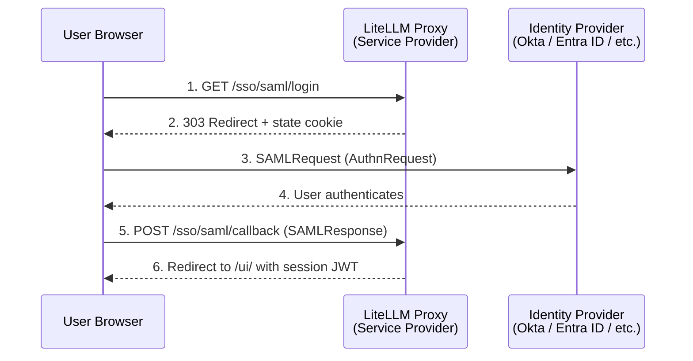

import Image from '@theme/IdealImage';

# Other OIDC and SAML providers

Use this page for an identity provider (IdP) that does not have its own guide, for example Keycloak, Auth0, Ping or OneLogin. LiteLLM can connect to any OIDC provider and any SAML 2.0 provider.

For Microsoft Entra ID, Okta and Google Workspace, use the [provider guides](./admin_ui_sso.md#set-up-your-provider).

<EnterpriseFeature feature="SSO">SSO is free for up to 5 users. Beyond that, an enterprise license is required.</EnterpriseFeature>

Wherever this page shows `https://litellm.example.com`, use your gateway's public URL.

## Generic OIDC

LiteLLM has a generic OAuth client. It works with most OIDC providers and needs no code.

### Required variables

Set these variables on the proxy, then restart it:

```bash
GENERIC_CLIENT_ID="<your-client-id>"
GENERIC_CLIENT_SECRET="<your-client-secret>"
GENERIC_AUTHORIZATION_ENDPOINT="https://idp.example.com/auth"
GENERIC_TOKEN_ENDPOINT="https://idp.example.com/token"
GENERIC_USERINFO_ENDPOINT="https://idp.example.com/me"
PROXY_BASE_URL="https://litellm.example.com"
```

In your IdP, set the redirect URI to `https://litellm.example.com/sso/callback`.

### Optional variables

LiteLLM reads user attributes from the IdP response. Use these variables to change the attribute names:

```bash
GENERIC_USER_ID_ATTRIBUTE="sub"
GENERIC_USER_EMAIL_ATTRIBUTE="email"
GENERIC_USER_DISPLAY_NAME_ATTRIBUTE="display_name"
GENERIC_USER_FIRST_NAME_ATTRIBUTE="first_name"
GENERIC_USER_LAST_NAME_ATTRIBUTE="last_name"
GENERIC_USER_ROLE_ATTRIBUTE="given_role"
GENERIC_USER_PROVIDER_ATTRIBUTE="provider"
GENERIC_USER_EXTRA_ATTRIBUTES="department,employee_id,manager" # more fields to read from the IdP response
GENERIC_CLIENT_STATE="some-state"  # if the IdP needs a state parameter
GENERIC_INCLUDE_CLIENT_ID="false"  # some IdPs do not accept the client_id in the body
GENERIC_SCOPE="openid profile email" # add profile to get first_name and last_name
```

If the UserInfo response does not have all user claims, set `GENERIC_INCLUDE_TOKEN_CLAIMS="true"`. LiteLLM then also reads claims from the ID token and the access token. If a claim is in both places, LiteLLM uses the UserInfo value.

If your IdP needs PKCE, set `GENERIC_CLIENT_USE_PKCE="true"`.

### Choose the user ID attribute

LiteLLM keeps the value of `GENERIC_USER_ID_ATTRIBUTE` as the identity of the user. At each sign-in, it finds the user by this value. Thus, the value must be unique and must not change for the life of the account.

Use `sub`, which is the standard OIDC claim for this. Do not use a claim that users can change in their profile, such as `preferred_username`, `email` or `name`. If the value changes, LiteLLM makes a new user at the next sign-in. That user has different keys, teams and spend.

If you do not set `GENERIC_USER_ID_ATTRIBUTE`, LiteLLM reads `preferred_username`. If users can change that value in your IdP, set the variable to `sub`.

### Set LiteLLM roles from the IdP

LiteLLM has four user roles:

| Role | Access |
|---|---|
| `proxy_admin` | Admin of the platform |
| `proxy_admin_viewer` | Can sign in, see all keys and see all spend. Cannot make changes. |
| `internal_user` | Can sign in, create and delete their own keys, and see their spend |
| `internal_user_viewer` | Can sign in, see their own keys and see their own spend |

You can set the role from the IdP in two ways:

- If your IdP can send one of these role names, use a role attribute.
- If your IdP sends its own group names, use role mappings. The group names do not have to match the LiteLLM role names.

#### Use a role attribute

Set `GENERIC_USER_ROLE_ATTRIBUTE` to the claim that holds the LiteLLM role. The value must be one of the four role names. You can use a nested path, for example `claims.role` or `attributes.litellm_role`.

#### Map IdP groups to LiteLLM roles

Role mappings tell LiteLLM which claim holds the groups of the user, and which groups give each role:

```bash
GENERIC_ROLE_MAPPINGS_GROUP_CLAIM="groups"
GENERIC_ROLE_MAPPINGS_ROLES='{"proxy_admin": ["llm-platform-admins"], "proxy_admin_viewer": ["llm-auditors"], "internal_user": ["llm-developers"], "internal_user_viewer": ["llm-readers"]}'
GENERIC_ROLE_MAPPINGS_DEFAULT_ROLE="internal_user_viewer"
```

- `GENERIC_ROLE_MAPPINGS_GROUP_CLAIM` is necessary when you set `GENERIC_ROLE_MAPPINGS_ROLES`. You can use a nested path, for example `realm_access.roles`. The claim can hold a list, a comma-separated string or one value.
- `GENERIC_ROLE_MAPPINGS_ROLES` is a JSON object. Each key is a LiteLLM role name. Each value is a list of IdP group names. Add only the roles that you use.
- If your IdP puts the groups only in the ID token or the access token, also set `GENERIC_INCLUDE_TOKEN_CLAIMS="true"`.

LiteLLM uses these rules:

- If the groups of a user match more than one role, LiteLLM gives the role with the most access. The order is the same as in the role table.
- If no group matches, LiteLLM gives `GENERIC_ROLE_MAPPINGS_DEFAULT_ROLE`. If you do not set a default role, LiteLLM reads `GENERIC_USER_ROLE_ATTRIBUTE`.
- LiteLLM updates the role of the user at each sign-in. If you move a user to a different group in the IdP, the LiteLLM role changes at the next sign-in.

You can also set role mappings in the Admin UI:

1. Open **Admin Settings > SSO Settings**.
2. Select **Generic SSO** or **Okta / Auth0 SSO** as the provider.
3. Turn on **Use Role Mappings**.
4. Enter the **Group Claim** and the **Default Role**.
5. Enter the IdP group names for each role in **Proxy Admin Teams**, **Admin Viewer Teams**, **Internal User Teams** and **Internal Viewer Teams**.

If you set the `GENERIC_ROLE_MAPPINGS_*` environment variables, LiteLLM uses them and not the mappings in the UI. You can also put these variables under `environment_variables` in `config.yaml`.

#### Add users to teams

To add users to teams from a groups claim, see [Auto-add SSO users to teams](./admin_ui_sso.md#auto-add-sso-users-to-teams-oidc).

### Read more fields from the IdP

Use `GENERIC_USER_EXTRA_ATTRIBUTES` to read more fields from the IdP response, for example department, employee ID or groups. Your [SSO event hook](./custom_sso.md) can then use these fields.

```bash
# Comma-separated list of field names
GENERIC_USER_EXTRA_ATTRIBUTES="department,employee_id,manager,groups"
```

You can use dot notation for nested fields:

```bash
GENERIC_USER_EXTRA_ATTRIBUTES="org_info.department,org_info.cost_center,metadata.employee_type"
```

The SSO event hook gets the fields in `extra_fields`:

```python
from litellm.proxy.management_endpoints.types import CustomOpenID

async def custom_sso_handler(userIDPInfo: CustomOpenID):
    # Read the extra fields
    extra_fields = getattr(userIDPInfo, 'extra_fields', None) or {}

    user_department = extra_fields.get("department")
    employee_id = extra_fields.get("employee_id")
    user_groups = extra_fields.get("groups", [])

    # Use these fields for your logic, for example team assignment or access control
    # ...
```

For CLI sign-in, you can put the same claims in user `metadata` with `CLI_SSO_CLAIM_MAP`. See [CLI authentication](./cli_sso.md#attribution-metadata-oidc-claims).

## SAML 2.0

LiteLLM can act as a SAML 2.0 service provider (SP) for the Admin UI. You can set SAML in the Admin UI or with environment variables. You do not change `config.yaml`.

If SAML is the only SSO provider, the **Login with SSO** button sends users to the SAML IdP. If you also set an OIDC provider, LiteLLM uses the OIDC provider.

### How it works



1. The user clicks the login button. LiteLLM sends the browser to the IdP with an AuthnRequest.
2. The user signs in at the IdP.
3. The browser sends the signed SAML assertion to the Assertion Consumer Service (ACS) endpoint of LiteLLM.
4. LiteLLM checks the signature, the audience and the timestamps of the assertion. It adds the user to the database if necessary.
5. LiteLLM gives the user a session JWT and opens the Admin UI.

LiteLLM supports SP-initiated and IdP-initiated sign-in with the HTTP-POST binding. An HttpOnly state cookie binds each SP-initiated sign-in to the browser that started it. Thus, an attacker cannot replay a captured assertion in a different browser. By default, LiteLLM rejects IdP-initiated (unsolicited) responses. To accept them, set `SAML_ALLOW_UNSOLICITED=true`.

### Configure SAML in the Admin UI

1. Open **Admin Settings > SSO Settings** and click **Configure SSO**.
2. Select **SAML SSO**.
3. Enter the IdP metadata as a URL or as XML.
4. Enter the **SP Entity ID** and the **Proxy Base URL**.
5. Save the settings.

<Image img={require('../../img/saml_ui_config_form.png')} alt="LiteLLM SSO Settings form with SAML SSO selected" style={{ width: '800px', height: 'auto' }} />

LiteLLM encrypts the settings and keeps them in the database. The settings stay after a restart. For headless or GitOps deployments, use environment variables. See [Configure SAML with environment variables](#configure-saml-with-environment-variables).

### Configure SAML with environment variables

#### 1. Install the SAML extra

SAML needs the `python3-saml` library. This library includes the native `xmlsec` and `libxml2` libraries. Install it with the `saml` extra:

```bash
pip install 'litellm[saml]'
```

The official Docker images include this extra. If you build your own image, add `litellm[saml]` to the install step.

#### 2. Set the environment variables

Set the IdP metadata as a URL or as XML. You can also set the SP entity ID.

```bash
# The IdP metadata (set one)
SAML_IDP_METADATA_URL="https://idp.example.com/app/abc123/sso/saml/metadata"
# or
SAML_IDP_METADATA_XML="<EntityDescriptor ...>...</EntityDescriptor>"

# Optional: the SP entity ID (the default is the metadata endpoint URL)
SAML_SP_ENTITY_ID="https://litellm.example.com/sso/saml/metadata"

# Necessary for all SSO
PROXY_BASE_URL="https://litellm.example.com"
LITELLM_MASTER_KEY="sk-..."
DATABASE_URL="postgresql://..."
```

#### 3. Register LiteLLM at your IdP

Enter these values in your IdP:

| Field | Value |
| --- | --- |
| ACS URL (Assertion Consumer Service) | `https://litellm.example.com/sso/saml/callback` |
| SP Entity ID or Audience | `https://litellm.example.com/sso/saml/metadata`, or the value of `SAML_SP_ENTITY_ID` |

The IdP must sign the assertions. The assertion must include the email of the user, as the NameID or as an attribute.

If your IdP can import SP metadata, download it from `GET /sso/saml/metadata`.

After you save the settings, the **SSO Settings** page shows the provider and the SP Entity ID:

<Image img={require('../../img/saml_ui_configured.png')} alt="LiteLLM SSO Settings page with the SAML provider and the SP Entity ID" style={{ width: '800px', height: 'auto' }} />

#### 4. Test sign-in

Restart the proxy. Open `https://litellm.example.com/ui` and click the SSO login button. The IdP sign-in page opens. After you sign in, the IdP sends you back to the Admin UI.

For step-by-step SAML setup in Okta and Entra ID, see [Okta](./okta_sso.md#admin-ui-sso-with-saml) and [Microsoft Entra ID](./entra_id_sso.md#admin-ui-sso-with-saml).

### Attribute mapping

LiteLLM finds common SAML attribute names (URN, OID and friendly names) for email, first name, last name, role and teams. If your IdP uses different names, set these variables:

| Environment variable | Default names | Attribute |
| --- | --- | --- |
| `SAML_ATTRIBUTE_EMAIL` | `urn:oid:0.9.2342.19200300.100.1.3`, `emailaddress` claim URI, `email`, `mail` | Email of the user |
| `SAML_ATTRIBUTE_USER_ID` | NameID | Stable user ID |
| `SAML_ATTRIBUTE_FIRST_NAME` | `urn:oid:2.5.4.42`, `givenname` claim URI, `givenName` | First name |
| `SAML_ATTRIBUTE_LAST_NAME` | `urn:oid:2.5.4.4`, `surname` claim URI, `sn` | Last name |
| `SAML_ATTRIBUTE_ROLE` | `role`, `roles`, `litellm_role` | LiteLLM user role |
| `SAML_ATTRIBUTE_TEAM_IDS` | `teams`, `team_ids`, `groups` | LiteLLM team IDs |

The role value must be `proxy_admin`, `proxy_admin_viewer`, `internal_user` or `internal_user_viewer`.

LiteLLM adds the user to each team with a `team_id` that matches a value in the team attribute. It does not create teams. Create the teams first.

### Configuration reference

SAML is on when `SAML_IDP_METADATA_URL` or `SAML_IDP_METADATA_XML` has a value.

| Variable | Default | Purpose |
| --- | --- | --- |
| `SAML_IDP_METADATA_URL` | unset | URL of the IdP metadata |
| `SAML_IDP_METADATA_XML` | unset | IdP metadata as XML, in place of the URL |
| `SAML_IDP_METADATA_VALIDATE_CERT` | `true` | Check the TLS certificate when LiteLLM gets the metadata over HTTPS |
| `SAML_SP_ENTITY_ID` | `<proxy_base_url>/sso/saml/metadata` | Service provider entity ID |
| `SAML_SP_NAME_ID_FORMAT` | `emailAddress` | NameID format that LiteLLM asks for |
| `SAML_STRICT` | `true` | Strict SAML checks (audience, timestamps, destination) |
| `SAML_WANT_ASSERTIONS_SIGNED` | `true` | Reject assertions that are not signed |
| `SAML_WANT_MESSAGES_SIGNED` | `false` | Reject SAML response messages that are not signed |
| `SAML_AUTHN_REQUESTS_SIGNED` | `false` | Sign the AuthnRequests that LiteLLM sends |
| `SAML_ALLOW_UNSOLICITED` | `false` | Accept IdP-initiated (unsolicited) responses |
| `SAML_ATTRIBUTE_EMAIL` | auto | Attribute name for the email |
| `SAML_ATTRIBUTE_USER_ID` | NameID | Attribute name for the user ID |
| `SAML_ATTRIBUTE_FIRST_NAME` | auto | Attribute name for the first name |
| `SAML_ATTRIBUTE_LAST_NAME` | auto | Attribute name for the last name |
| `SAML_ATTRIBUTE_ROLE` | `role` | Attribute name for the LiteLLM role |
| `SAML_ATTRIBUTE_TEAM_IDS` | `teams`/`groups` | Attribute name for the team IDs |

### SP endpoints

LiteLLM has three SAML endpoints:

| Method | Path | Purpose |
| --- | --- | --- |
| `GET` | `/sso/saml/login` | Starts SP-initiated sign-in. Sends the browser to the IdP. |
| `GET` | `/sso/saml/metadata` | SP metadata XML. Use it to register LiteLLM at the IdP. |
| `POST` | `/sso/saml/callback` | Assertion Consumer Service. Checks the signed response from the IdP. |

If SAML is the only SSO provider, `GET /sso/key/generate` (the login button in the Admin UI) sends the browser to the SAML IdP.

### Security

For SP-initiated sign-in, LiteLLM sets an HttpOnly state cookie (`litellm_saml_authn`). The cookie binds the SAML response to the browser that started the sign-in. This stops login CSRF attacks, where an attacker replays a captured response in a different browser.

Over HTTPS, the cookie is `Secure; SameSite=None`, so it stays during the cross-site POST from the IdP. Over HTTP, the cookie is `SameSite=Lax` for local development.

LiteLLM keeps the ID of each assertion that it accepts. It rejects an assertion that has the same ID in its validity window.

IdP-initiated (unsolicited) responses do not have a browser binding. For this reason, LiteLLM rejects them by default. Set `SAML_ALLOW_UNSOLICITED=true` only if you need IdP-initiated sign-in and you accept the risk.

### Troubleshooting

**"SAML SSO requires the optional 'python3-saml' dependency" (501).** Install the SAML extra with `pip install 'litellm[saml]'`. The official Docker images include it.

**"Could not parse an IdP entityID/SSO URL/certificate from the SAML metadata" (502).** LiteLLM did not find an IdP descriptor in the metadata. Make sure that the URL is correct and that the proxy can reach it. If you use `SAML_IDP_METADATA_XML`, make sure that the shell did not cut the XML.

**"SAML response references an unknown or already-used login request" (401).** The `InResponseTo` value in the assertion does not match a pending sign-in. The sign-in state expires after 10 minutes. This error also occurs if the user saved the IdP redirect as a bookmark, or if someone replayed the assertion. Start a new sign-in from `/sso/saml/login`.

**"Unsolicited (IdP-initiated) SAML responses are disabled" (401).** The response has no `InResponseTo` attribute, so the sign-in started at the IdP. To allow this flow, set `SAML_ALLOW_UNSOLICITED=true`.

**The assertion check fails after the IdP POST.** Set `PROXY_BASE_URL` to the public URL of the proxy, with `https://`. LiteLLM makes the ACS URL and the audience from this value. If they do not match the IdP settings, the check fails.

## Related

- [Single Sign-On](./admin_ui_sso.md): settings for all providers, such as email domains, the proxy admin and fallback login
- [Event hooks for SSO login](./custom_sso.md): run your own code when a user signs in
- [Identity overview](./identity_overview.md): compare SSO, SCIM, group-to-team mapping and JWT auth
