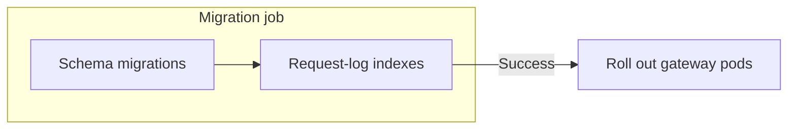

# Upgrade Guide

The Helm chart and official Terraform modules provide a **separate migration job** for schema changes and request-log indexing. Keep `DISABLE_SCHEMA_UPDATE=true` on the gateway pods and let the job finish before rolling out the new gateway version.



## Before you upgrade

Read the [release notes](/release_notes) for the versions you will cross. Check breaking changes and database changes, take a database snapshot, and test the upgrade against a restored copy of production to measure its duration. Rolling back an image does not undo database changes.

### Upgrading from a version before v1.104.0

:::danger Old pods can drop the upgraded schema

Before the migration job or the first new pod runs, set `DISABLE_SCHEMA_UPDATE=true` on **every old LiteLLM deployment that shares the database**. Finish rolling out that setting while the database still has the old schema, so a restarted pod cannot run schema setup with the old image. Include other deployments, restart policies, and automated image rollbacks in this check

The legacy migration resolver can diff the live database against the old image's `schema.prisma` and execute that diff. It drops tables and columns the old image does not know, including their data, but leaves their completed migrations in `_prisma_migrations`. An old pod restart during a rollout, an image rollback, or another deployment on the same database can trigger this

Before v1.84.0 the post-migration sanity check runs even when no migrations are pending. In v1.84.0 through v1.103.x it can still run after migrations or during `P3009` / `P3018` recovery. v1.104.0 makes the v2 resolver the default, which does not execute this schema diff. Explicitly selecting the legacy resolver with `USE_V2_MIGRATION_RESOLVER=false` or `--use_legacy_migration_resolver` keeps the risk on later versions too

Do not roll back only the image after the new version has touched the database. Stop the deployment and restore the pre-upgrade database snapshot together with the matching old image. Plan for writes since that snapshot to be lost or recovered separately

:::

Keep schema updates disabled on gateway pods and run the target version's migration job separately. This prevents the old resolver from changing the schema; it does not guarantee that old application code is compatible with every new schema. Test the mixed-version window against a restored database before production

#### Recovery when migration history is ahead of the schema

If an old pod already ran schema setup, stop **all LiteLLM instances and migration jobs** on that database and prevent automatic restarts. Back up the damaged database before recovery. The safest recovery is to restore the pre-upgrade snapshot and repeat the upgrade with schema updates disabled on the old deployments

A missing table such as `LiteLLM_DailyEndUserSpend` can cause `P3018` with PostgreSQL error `42P01` during migration, or runtime failures even when startup reports `No pending migrations to apply`. The migration ledger alone does not prove the tables still exist. Deleting only the failed migration entry does not recreate a missing table whose creation migration is still recorded as complete

If restoring a snapshot is not possible, have your database administrator test a schema repair on a copy of the damaged database first. Confirm that the live schema matches the exact old image's `schema.prisma`, then compare the ledger with the migration directories shipped in that old image. Remove only ledger rows for migrations absent from that image, and let the target image re-apply them. Do not clear the whole ledger or mark missing-table migrations as applied. If the schema is only partly reset or has other changes, do not use this procedure

<details>
<summary>Version-specific example for v1.80.0-stable.1 to v1.105.0</summary>

Use this SQL **only** when v1.80.0-stable.1's legacy resolver has reset the database to that image's schema during an upgrade to v1.105.0, with every LiteLLM process stopped and a backup taken. It removes the newer migration records so v1.105.0 can replay them. The three explicit names are backdated migrations that a timestamp cutoff alone misses. Other source or target versions need their own migration comparison

```sql
DELETE FROM "_prisma_migrations"
WHERE migration_name > '20251115120539_baseline_diff'
   OR migration_name IN (
     '20251113000000_add_project_table',
     '20251113000001_add_project_fields',
     '20251114180624_Add_org_usage_table'
   );
```

Run the v1.105.0 migration job with schema updates enabled, leaving every old deployment stopped. Require a successful exit, compare the repaired schema with the target image's `schema.prisma` using `prisma migrate diff`, and verify affected reads and writes before resuming traffic with gateway schema updates disabled

</details>

Replaying migrations recreates schema, **not data dropped by the old pod**. Recover that data from backups. Never run the old image with schema updates enabled against the repaired database

### Dry-run the migrations before the upgrade

From v1.109.0 the proxy applies the pending migrations at boot and lets PostgreSQL report the first one the database cannot take, the same way it reports any other failed migration (see [migration troubleshooting](../troubleshoot/prisma_migrations.md#6-database-migration-cannot-proceed-on-rows-the-schema-change-cannot-take)). To see that outcome before the upgrade window, run the dry run from any machine that can reach the database, with the **target** image:

```bash
docker run \
-e DATABASE_URL=postgresql://<user>:<password>@<host>:5432/<dbname> \
docker.litellm.ai/berriai/litellm:X.Y.Z --check_migrations_against_existing_data
```

It runs the real SQL of every pending migration, in order, each inside its own transaction that is rolled back before the next one starts, so `_prisma_migrations` and the schema are left exactly as they were and no lock outlives its migration, the same way the real upgrade commits one migration file at a time. A migration that depends on the one before it (an index on a column the previous migration adds) is replayed together with it. Exit code 0 lists each migration with the time it took, which is the time the real upgrade will hold that migration's locks:

```
LiteLLM Proxy: 2 pending migration(s) applied one at a time in a dry run, each rolled back before the next so its locks are released, nothing changed:
  20991231000000_require_team_alias: 0.0 s
  20991231000001_team_alias_index: 0.0 s
```

Exit code 2 prints PostgreSQL's own error for the first migration that fails. Nothing after it runs, and the migrations before it are listed with their times:

```
LiteLLM Proxy: Database migration cannot proceed. Migration 20991231000000_require_team_alias fails on this database after 0.0 s, nothing was applied.
column "team_alias" of relation "LiteLLM_TeamTable" contains null values
```

Because the statements really run, the dry run takes the same table locks the upgrade will, for as long as each statement takes, and a `CREATE INDEX` on a large `LiteLLM_SpendLogs` holds writes off that table for minutes. Run it off-peak or against a restored copy of production. An index a migration builds `CONCURRENTLY` is built the plain way inside the transaction, since PostgreSQL does not allow the concurrent form there. A database that has the tables but no `_prisma_migrations` history is not replayed: the dry run asks the same questions the boot asks before it baselines, that the migrations folder is the one this build ships (a custom `LITELLM_MIGRATION_DIR` is refused) and that the live schema matches this build's `schema.prisma`, and reports `nothing to dry-run` when both hold or the refusal (the `prisma migrate diff`, or the custom folder) when one does not. The request-log indexes the proxy builds in the background after it starts serving are not part of the dry run; on v1.108.0 only, the same flag ran read-only row counts instead and the proxy refused to boot on what they found.

## Upgrade with Helm or Terraform

| Deployment | Select the release | Run migrations before rollout |
|---|---|---|
| [Helm](./deploy/helm.md) | Pin the chart revision and shared image. The migration Job and application use the same image. | Keep `migrationJob.enabled: true` and enable the hook for your deployment controller. Wait for the job to complete. |
| [Terraform](./deploy/terraform.md) | Pin the module version or source revision. Set `image` to a compatible image tag or digest. | Run `terraform init -upgrade`. Review `terraform plan` before you apply it. The modules run an ECS migration task on AWS or a Cloud Run migration job on GCP before updating the services. |

<details>
<summary>Helm and Argo CD hook settings</summary>

For `helm upgrade`, these are the chart's defaults in both componentized and monolith modes:

```yaml title="values.yaml"
migrationJob:
  enabled: true
  hooks:
    helm:
      enabled: true
    argocd:
      enabled: false
```

For Argo CD, enable `argocd` and disable `helm`. See the [chart values](https://github.com/BerriAI/litellm/blob/main/litellm/deploy/helm/litellm/values.yaml).

</details>

Check the **migration job logs** for both schema and indexing completion. After the gateway rollout, verify [`/health/readiness`](./health.md#probe-endpoints) and send a test request through the gateway.

## Database migrations

### What takes time

The migration job runs schema migrations first, then builds any missing request-log indexes. **Both stages count toward the job's runtime.** Existing valid indexes are skipped.

| Work | What affects duration | Effect on the database |
|---|---|---|
| Schema changes, such as new tables or nullable columns | Usually short; lock waits can still delay them | Brief locks can delay other queries |
| Request-log indexes | `LiteLLM_SpendLogs` size, disk speed, memory, and database load | Concurrent index builds allow reads and writes, but consume database resources |
| A migration with a plain index build, table rewrite, or data backfill | Rows scanned or changed; inspect the release's migration SQL | Can block writes or other queries; test and plan a maintenance window if needed |

### Expected duration

Time the **complete migration job** against a production-sized database copy. A schema-only upgrade can be quick while a new index on a large spend-log table takes much longer. Table size alone is not enough to predict an upgrade window.

For Helm, set `migrationJob.activeDeadlineSeconds` (default **1800 seconds**) and the deployment controller's timeout to cover the complete job. With `helm upgrade`, also set `--timeout` accordingly. For Terraform, check the ECS task or Cloud Run job timeout and the deployment wait limit; Helm settings do not apply there.

Use [spend-log retention](./spend_logs_deletion.md) to limit the data future index builds must scan.

<details>
<summary>Check which schema migrations are already applied</summary>

```sql
SELECT migration_name, finished_at
FROM "_prisma_migrations"
WHERE finished_at IS NOT NULL
  AND rolled_back_at IS NULL
ORDER BY finished_at;
```

Compare the full result with the [migration files](https://github.com/BerriAI/litellm/tree/main/litellm/proxy-extras/litellm_proxy_extras/migrations) at your **target release tag**, rather than `main`. Inspect pending SQL for operations on large tables. Request-log indexing is a separate stage, so migration history alone does not confirm that the job is done.

</details>

## Rolling upgrades and spend log cleanup

[Spend log cleanup](./spend_logs_deletion.md#when-the-job-runs) runs from the `LiteLLM_ScheduledJobRun` table, created by migration `20261105000000_scheduled_job_runs`. Pods on an older version schedule the same cleanup from an in-process timer with a Redis lock, or with no lock at all when Redis is not configured, and the two never see each other. During a rolling upgrade both versions therefore run cleanup at the same time until the last old pod is gone. Each side deletes in small batches under its own statement timeout and both use the same retention cutoff, so the cost is duplicate work and extra delete load for the length of the rollout, not data loss. If the table is large and the rollout is slow, unset the retention settings before the upgrade and restore them after, or accept the extra load

The extra table does not prevent an old pod from booting when it uses the v2 resolver or has `DISABLE_SCHEMA_UPDATE=true`. This is not safe with schema updates enabled on the legacy resolver, which can drop the new table. Follow the [pre-v1.104.0 safeguards](#upgrading-from-a-version-before-v11040) before the target migration job runs, including for any later image that explicitly selects the legacy resolver. Keep gateway schema updates disabled throughout the rollout

## Custom deployments

If your deployment does not provide a migration job, run this in a separate container using the **target LiteLLM proxy image**, with `DATABASE_URL` and the required database credentials configured:

```bash
DISABLE_SCHEMA_UPDATE=false litellm --skip_server_startup
```

This LiteLLM command runs schema migrations **and request-log indexing**, waits for both to finish, and exits without starting the gateway. Require a successful exit before rolling out gateway containers with `DISABLE_SCHEMA_UPDATE=true`. A migration the rows cannot take fails inside this command with PostgreSQL's error and the command exits non-zero, see [the dry run](#dry-run-the-migrations-before-the-upgrade) to catch that earlier.

## When a migration is slow or stuck

Start with the **migration job's logs and status**. Check database lock waits in `pg_stat_activity` and index-build progress in `pg_stat_progress_create_index` before changing timeouts.

`LITELLM_PRISMA_MIGRATE_DEPLOY_TIMEOUT` controls the schema migration subprocess (default **600 seconds**). Set it on the **migration job** if that stage needs longer; it does not cover request-log indexing. The whole-job and deployment timeouts must allow enough time for both stages and retries.

See [migration troubleshooting](../troubleshoot/prisma_migrations.md) for failed migrations and PostgreSQL version-specific issues.
